# Lab 01: Independent Lab Exercises

## Exercise 1: The QA identity

I created a group usms-qa and a user usms-qa-01 inside it, tagged with Role=QA and Project=USMS. I attached the existing USMSDeveloperBase policy to the group, not the user. I saved the user's ARN into a variable the same way I did in Step 19.

```bash
aws iam create-group --group-name usms-qa

QA_ARN=$(aws iam create-user \
  --user-name usms-qa-01 \
  --tags Key=Role,Value=QA Key=Project,Value=USMS \
  --query 'User.Arn' \
  --output text)

aws iam add-user-to-group --group-name usms-qa --user-name usms-qa-01

aws iam attach-group-policy \
  --group-name usms-qa \
  --policy-arn "$USMS_POLICY_DEV_BASE"
```

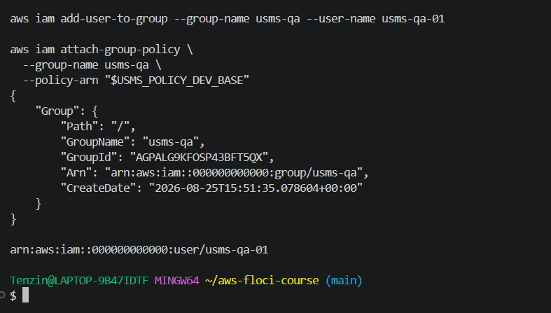

```bash
aws iam get-group --group-name usms-qa
aws iam list-attached-group-policies --group-name usms-qa
aws iam list-attached-user-policies --user-name usms-qa-01
```

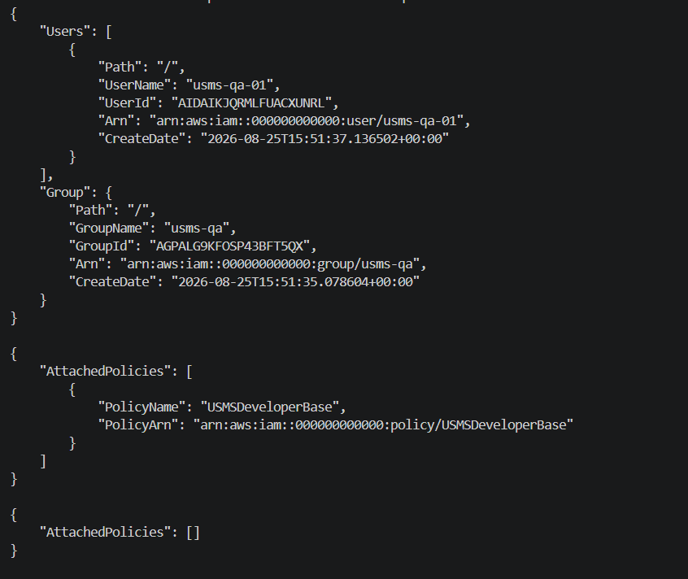

The results show three things:

- get-group shows usms-qa-01 inside the group.
- The group has USMSDeveloperBase attached.
- The user's own list of attached policies is empty.

So the permissions only reach the user through the group.

## Exercise 2: The read only reporting policy

I wrote a customer managed policy, USMSReportingReadOnly, with three statements:

- s3:ListBucket on the bucket itself
- s3:GetObject limited to arn:aws:s3:::usms-student-data/transcripts/*
- an explicit Deny on s3:Put* and s3:Delete*, covering both the bucket and the objects inside it

```bash
aws iam create-policy \
  --policy-name USMSReportingReadOnly \
  --description "Read-only access to transcripts prefix; explicit deny on writes and deletes" \
  --policy-document file://usms-reporting-readonly-policy.json \
  --query 'Policy.Arn' \
  --output text
```

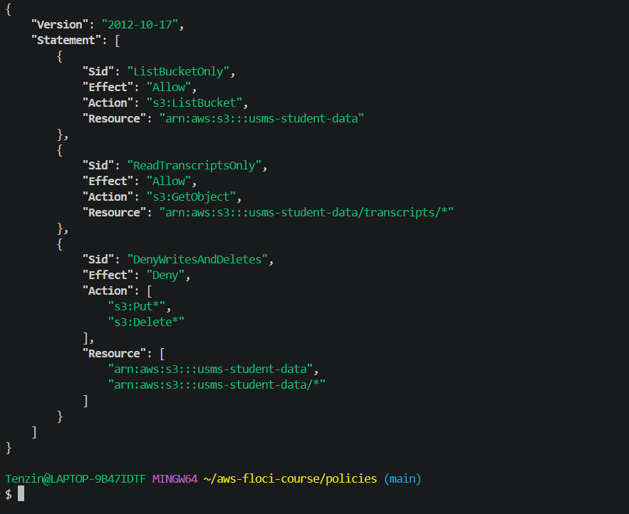

I validated the JSON with py -m json.tool. python3 is not available on my system, but py works.

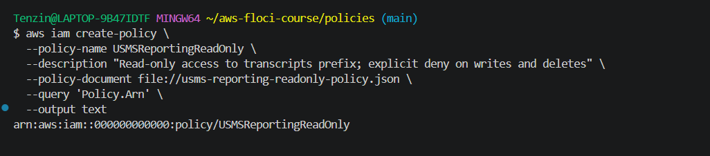

The policy was created with the ARN arn:aws:iam::000000000000:policy/USMSReportingReadOnly.

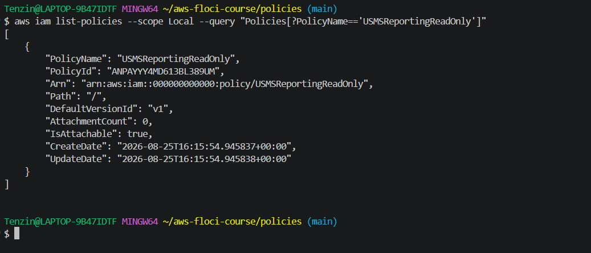

I checked it with the lab's expected outcome command. It confirms the policy exists with DefaultVersionId v1 and AttachmentCount 0. The count is 0 because this exercise only asked me to create the policy, not attach it anywhere.

## Exercise 3: Problem solving, the third party analytics role

I designed usms-analytics-partner-role for a partner university's analytics service. It has three limits:

- only usms-audit-01 can assume it
- a session can last at most 30 minutes
- it can only read objects under the reports/ prefix

As the exercise asked, I kept the trust policy and the permissions policy in two separate files:

- trust-analytics-partner.json names usms-audit-01 as the trusted principal.
- usms-analytics-partner-permissions.json allows s3:GetObject limited to arn:aws:s3:::usms-student-data/reports/*.

AWS does not let MaxSessionDuration go below 3600 seconds when creating a role. So I created the role with the lowest allowed ceiling. Then I asked for the actual 30 minute credential with --duration-seconds 1800 on the assume-role call itself.

```bash
aws iam create-role \
  --role-name usms-analytics-partner-role \
  --description "Read-only access to reports for partner analytics, assumed by usms-audit-01" \
  --assume-role-policy-document file://trust-analytics-partner.json \
  --max-session-duration 3600 \
  --tags Key=Project,Value=USMS Key=External,Value=true \
  --query 'Role.Arn' \
  --output text

aws iam create-policy \
  --policy-name USMSAnalyticsPartnerReports \
  --policy-document file://usms-analytics-partner-permissions.json \
  --query 'Policy.Arn' \
  --output text

aws iam attach-role-policy \
  --role-name usms-analytics-partner-role \
  --policy-arn "$ANALYTICS_POLICY_ARN"
```

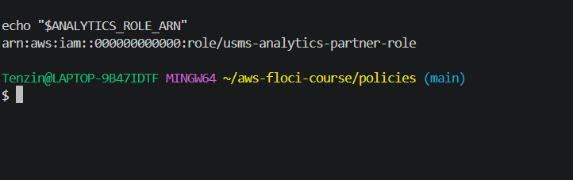

```bash
aws iam get-role --role-name usms-analytics-partner-role \
  --query 'Role.{MaxSession:MaxSessionDuration,Trust:AssumeRolePolicyDocument.Statement[0].Principal}' \
  --output json

aws iam list-attached-role-policies --role-name usms-analytics-partner-role
```

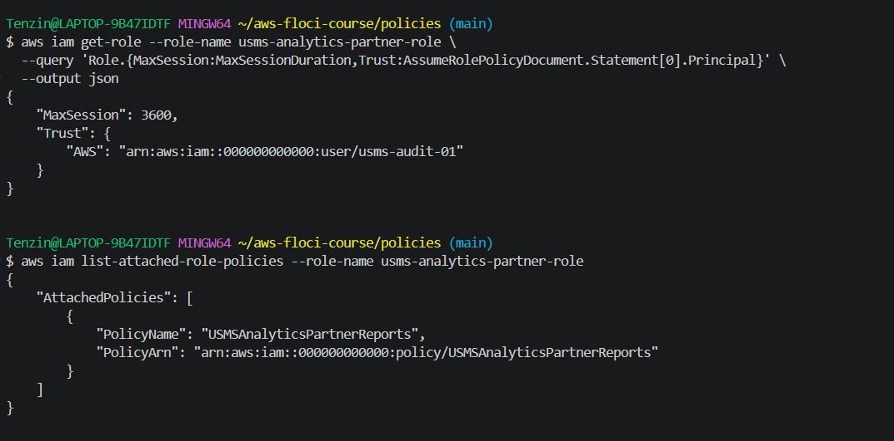

MaxSessionDuration is 3600, the trust policy names usms-audit-01, and USMSAnalyticsPartnerReports is attached.

```bash
ANALYTICS_ROLE_ARN=$(aws iam get-role --role-name usms-analytics-partner-role --query 'Role.Arn' --output text | tr -d '\r')
echo "Role ARN: $ANALYTICS_ROLE_ARN"
echo "Called at (UTC): $(date -u +%Y-%m-%dT%H:%M:%S)"
aws sts assume-role \
  --role-arn "$ANALYTICS_ROLE_ARN" \
  --role-session-name usms-audit-01-analytics \
  --duration-seconds 1800 \
  --profile floci \
  --query '{AssumedRoleArn:AssumedRoleUser.Arn,Expiration:Credentials.Expiration}' \
  --output table
```

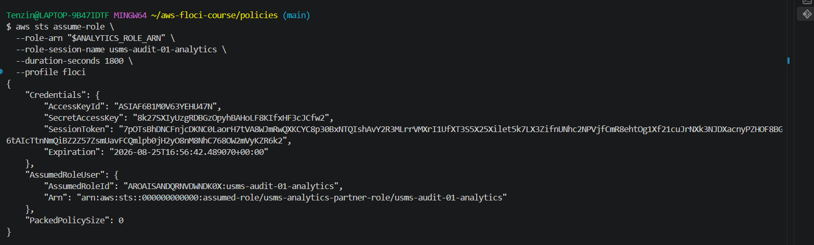

I ran the command again on 2026-10-08 with --query, so the screenshot no longer shows the secret key and session token. The call was made at 2026-10-08T09:47:20 UTC, and Expiration came back as 2026-10-08T10:17:21 UTC. That is still about 30 minutes after the call, so the duration worked as intended.

I called assume-role from my normal floci profile instead of actually being usms-audit-01. This is the same shortcut Lab 1 Step 30 used, because Floci does not enforce who is allowed to assume a role.

On sts:ExternalId, I would add one for a real external partner. Without it, anything that finds the role ARN and holds usms-audit-01's credentials could assume the role. An ExternalId is a shared secret that the partner must also supply. It protects against the confused deputy problem, where a third party is tricked into assuming a role on someone else's behalf.

## Exercise 4: Challenge, design a least privilege policy from a job description

I designed permissions for a nightly backup job. The job copies everything from the student data bucket into an archive bucket, checks what it copied, and writes a completion log to CloudWatch. It must never delete anything, never read IAM, and only ever run in us-east-1.

I chose a role, not a user or group, because this is an automated job, not a person. This is the same reasoning as usms-ec2-app-role. The full reasoning is in notes/lab-01-notes.md.

The policy has 4 statements, which is within the exercise's limit:

- **The first two** cover reading the source bucket and reading, writing and checking the archive bucket. Both are locked to us-east-1 with a Condition.
- **The third** covers logging, limited to one specific log group instead of all logs.
- **The fourth** is an explicit Deny on delete actions and all IAM actions. It uses Resource *, but the exercise only forbids wildcards on Allow statements.

```bash
aws iam create-role \
  --role-name usms-backup-operator-role \
  --description "Nightly backup job: copies student data to archive, verifies, logs completion" \
  --assume-role-policy-document file://trust-backup-operator.json \
  --tags Key=Project,Value=USMS \
  --query 'Role.Arn' \
  --output text

aws iam create-policy \
  --policy-name USMSBackupOperator \
  --policy-document file://usms-backup-operator-policy.json \
  --query 'Policy.Arn' \
  --output text

aws iam attach-role-policy \
  --role-name usms-backup-operator-role \
  --policy-arn "$BACKUP_POLICY_ARN"
```

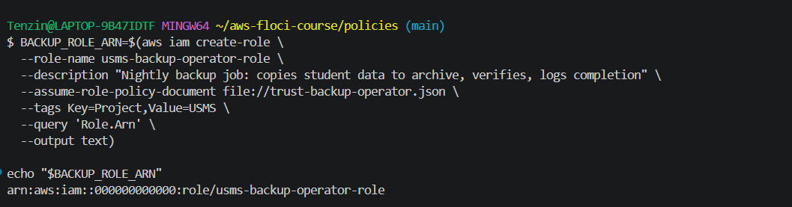

I created the role with a trust policy for ec2.amazonaws.com, the same pattern as Step 28.

```bash
aws iam get-role --role-name usms-backup-operator-role \
  --query 'Role.{Name:RoleName,Trust:AssumeRolePolicyDocument.Statement[0].Principal}' \
  --output json

aws iam list-attached-role-policies --role-name usms-backup-operator-role
```

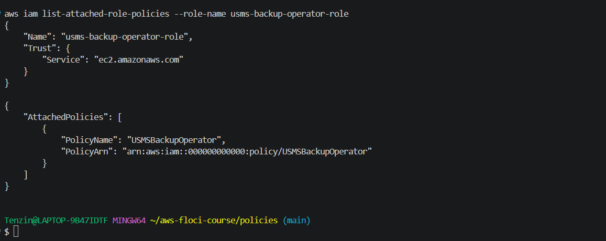

This confirms that the trust policy names ec2.amazonaws.com and that USMSBackupOperator is attached.

```bash
aws iam get-policy-version \
  --policy-arn "$BACKUP_POLICY_ARN" \
  --version-id "$VER" \
  --query 'PolicyVersion.Document.Statement[*].Condition'
```

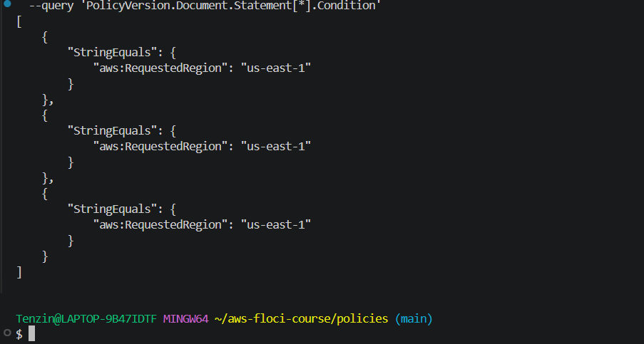

All three Allow statements have the aws:RequestedRegion condition that locks them to us-east-1.

I wrote up the three ways this policy could still be abused, and how I would close each gap, in notes/lab-01-notes.md.

## Exercise 5: Integration, prepare the identity Lab 2 will use

I checked whether usms-dev-01 already had every EC2 and VPC permission that Lab 2 needs. I added whatever was missing as a new version of USMSDeveloperBase.

I read the current v2 policy and compared its BuildNetworkingForLab02 statement against the 11 actions the exercise listed. Two were missing: ec2:CreateNatGateway and ec2:AllocateAddress.

```bash
aws iam get-policy-version \
  --policy-arn "$POLICY_ARN" \
  --version-id v2 \
  --query 'PolicyVersion.Document.Statement[?Sid==`BuildNetworkingForLab02`].Action' \
  --output json
```

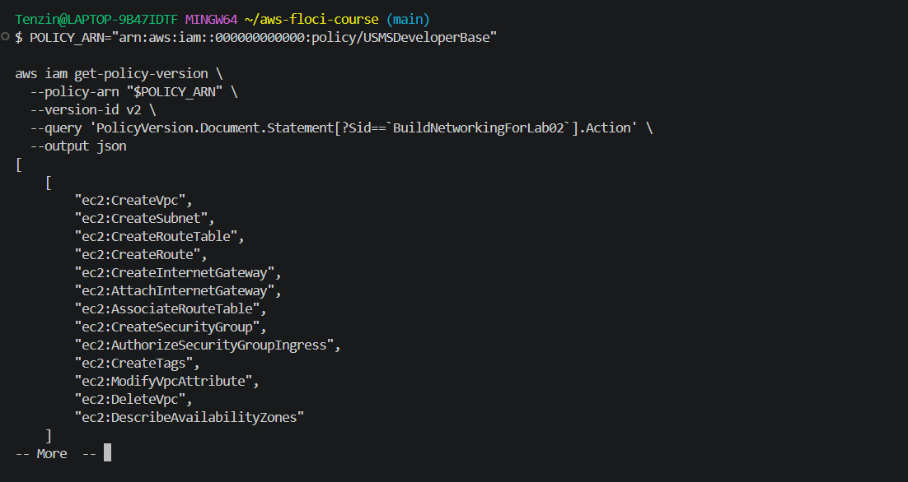

v2 already had CreateVpc, CreateSubnet, CreateRouteTable, CreateRoute, CreateInternetGateway, AttachInternetGateway, AssociateRouteTable, ModifyVpcAttribute, and DescribeAvailabilityZones, but not the two missing ones. Both are needed for the Lab 2 NAT gateway step, because a NAT gateway needs an Elastic IP allocated to it first.

I saved the v2 document to a new file, added the two missing actions to the same statement, and validated the JSON.

```bash
py -m json.tool usms-developer-base-policy-v3.json
```

Then I created it as version 3 with create-policy-version, not by deleting and creating the policy again.

```bash
aws iam create-policy-version \
  --policy-arn "$POLICY_ARN" \
  --policy-document file://usms-developer-base-policy-v3.json \
  --set-as-default
```

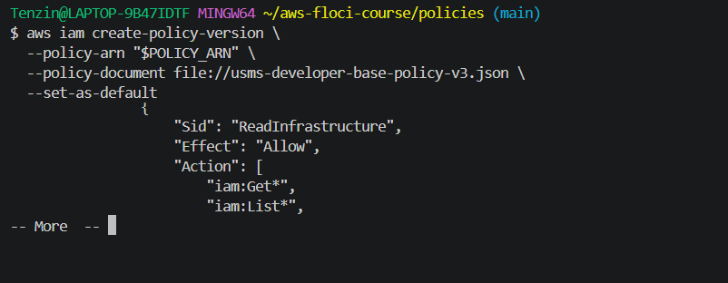

I checked that all three versions still exist and that v3 is now the default.

```bash
aws iam list-policy-versions \
  --policy-arn "$POLICY_ARN" \
  --query 'Versions[*].{Version:VersionId,Default:IsDefaultVersion,Created:CreateDate}' \
  --output table
```

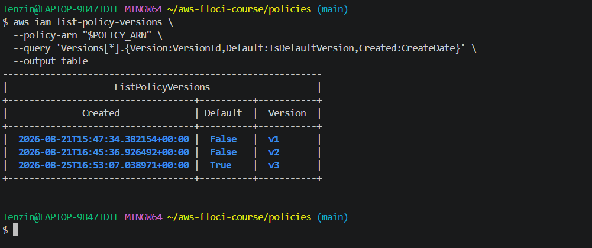

This matches the expected outcome: v1 and v2 both show False, and v3 shows True.

I added USMS_VPC_CIDR=10.0.0.0/16 to configs/lab-01.env, so Lab 2 can source it directly.

```bash
echo 'export USMS_VPC_CIDR=10.0.0.0/16' >> configs/lab-01.env
```

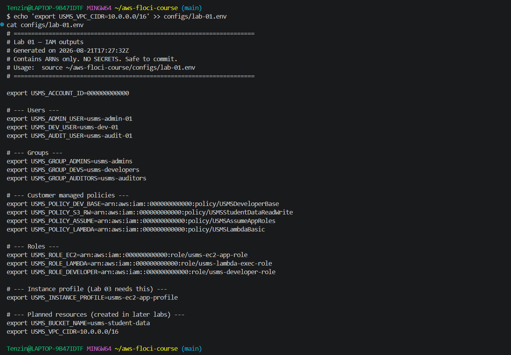

The exercise also pointed out that verify-lab-01.sh checks that the default version is v2, so it would fail after this change unless I updated it. I found that scripts/utilities/verify-lab-01.sh had never been filled in. It was an empty file. So I wrote the full script from Section 5 of the lab instructions and changed that one check from v2 to v3, as instructed. It now runs clean.

```bash
./scripts/utilities/verify-lab-01.sh
```

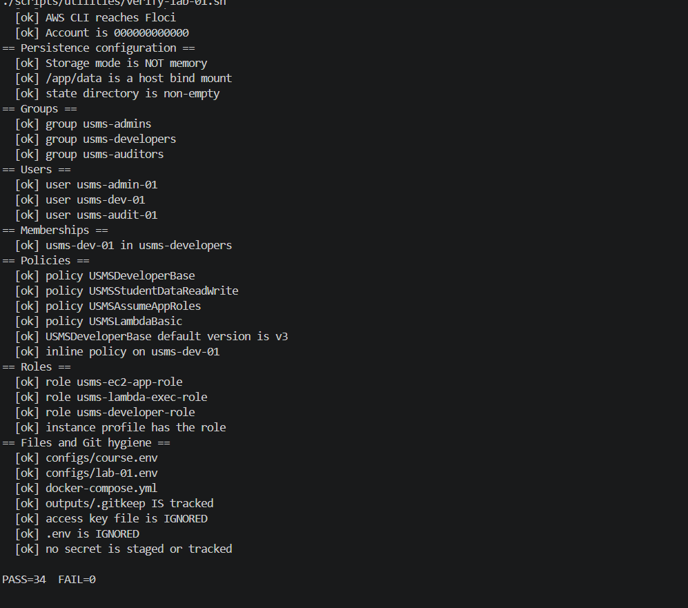
