# Lab 1: Identity and Access Management (IAM)

**Student Name:** Tenzin Namgay

**Student ID:** 02230307

**Module:** DSO303 : Cloud Native Infrastructure

**Practical:** Lab 1 : IAM

## 1. Aim / Objective

In this lab I set up a local AWS environment using Floci and installed and configured the AWS CLI. Then I built the complete IAM base (users, groups, policies, and roles) that the University Student Management System (USMS) project needs.

## 2. Introduction

AWS Identity and Access Management (IAM) is the service that controls who can access AWS resources and what actions they can perform. With IAM I can create users, put them in groups by role, and attach policies that define their permissions in a clear way that can be audited.

The main parts of IAM are:

- users, groups and roles
- policies (AWS managed, customer managed, and inline)
- trust policies for roles
- temporary credentials through STS

IAM is important because it enforces least privilege. This means every identity only gets the permissions it really needs, which lowers the risk of accidental or malicious damage. In real cloud environments, IAM is the first layer of security, set up before any other service is used.

## 3. Use Case

- Limiting a junior developer to only the resources they need for their project, not the whole AWS account
- Giving an EC2 instance temporary, auto rotating credentials through a role instead of storing permanent keys on the server
- Giving an auditor read only access across the account, so they can review resources without being able to change anything
- Letting a third party service assume a role for a limited time to access specific data

## 4. System Architecture / Design

For this lab I used Floci, a local AWS emulator that runs inside Docker and is managed with Docker Compose. My AWS CLI sends commands to Floci at `http://localhost:4566`. Floci saves all IAM data to `~/floci-data` on my computer using `FLOCI_STORAGE_MODE=hybrid`, so the data stays even after a restart.

I built:

- 3 groups
- 3 users
- 4 customer managed policies
- 1 inline policy
- 3 roles for different purposes, such as EC2, Lambda, and temporary developer access

## 5. Implementation Procedure

### Part A: Environment Setup

I created the full project folder structure first, before starting any service, so the configuration would be committed from the very first run. I wrote `.gitignore` and set up Git before creating any secret. Then I proved the ignore rules worked by creating a fake secret file and confirming that Git blocked it.

I learned that Floci uses `memory` storage mode by default, which means all data is lost on restart. So I configured `docker-compose.yml` and `configs/course.env` with `FLOCI_STORAGE_MODE=hybrid` and an absolute bind mount path. Then I wrote the `floci-up.sh` and `floci-down.sh` scripts to start and stop the environment safely.

I installed AWS CLI v2 and created a profile named `floci` that points at `http://localhost:4566`. I proved it was isolated from real AWS in three ways:

- I checked that the account number was `000000000000`.
- I looked at the actual request URL with `--debug`.
- I confirmed that stopping Floci broke the CLI.

Then I proved persistence. I created a test user, fully restarted the container, and confirmed the user still existed afterwards.

### Part B: Building the IAM Foundation

I created 3 IAM groups and 3 users and put each user in the correct group. I attached the AWS managed `ReadOnlyAccess` policy to the auditors group.

I wrote a customer managed policy called `USMSDeveloperBase` with three statements:

- one that allows broad read access
- one that allows specific EC2 networking actions, limited to `us-east-1`
- one explicit `Deny` that blocks dangerous identity changes, like creating users or attaching policies

I attached this policy to both the developers and admins groups.

I wrote a second customer managed policy, `USMSStudentDataReadWrite`. In it I kept the bucket level ARN (for `ListBucket`) separate from the object level ARN with a trailing `/*` (for `GetObject`/`PutObject`), because these are two different permission scopes in S3.

I added an inline policy to `usms-dev-01` that lets the user manage their own credentials. It uses the `${aws:username}` policy variable, so the same document works for any user without hardcoding a name.

I created three roles:

- `usms-ec2-app-role`, trusted by the EC2 service, for the application server
- `usms-lambda-exec-role`, trusted by Lambda, for notification functions
- `usms-developer-role`, trusted by `usms-dev-01` directly, for temporary higher access

For the EC2 role, I also created an instance profile and attached the role to it, because an EC2 instance cannot be given a role directly.

I showed the STS assume role workflow. I gave the developers group permission to call `sts:AssumeRole`. Then I assumed `usms-developer-role` to get temporary credentials. These can be recognised by the `ASIA` prefix instead of the permanent `AKIA` prefix. I used those credentials to confirm my identity had changed, and then went back to my normal identity.

Finally, I created a real access key for `usms-dev-01`. I sent the output straight into a file so the secret never appeared on screen, and confirmed that Git's ignore rules stopped that file from being committed.

## 6. Results and Evidence

### 6.1 CLI / SDK Evidence

**Screenshot 1: Environment running**

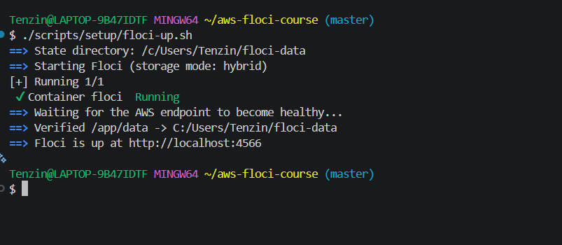

Floci container healthy, hybrid storage mode confirmed.
Image Source: N/A

**Screenshot 2: CLI connected to Floci**

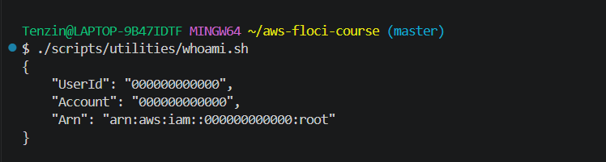

AWS CLI reaching Floci, showing account 000000000000.
Image Source: N/A

**Screenshot 3: Persistence proven**

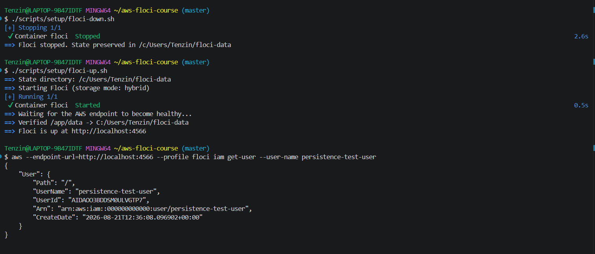

Test user survived a full container restart, which confirms hybrid storage works.
Image Source: N/A

**Screenshot 4: Groups created**

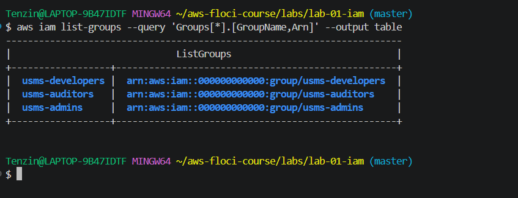

usms-admins, usms-developers and usms-auditors created and verified.
Image Source: N/A

**Screenshot 5: Users created**

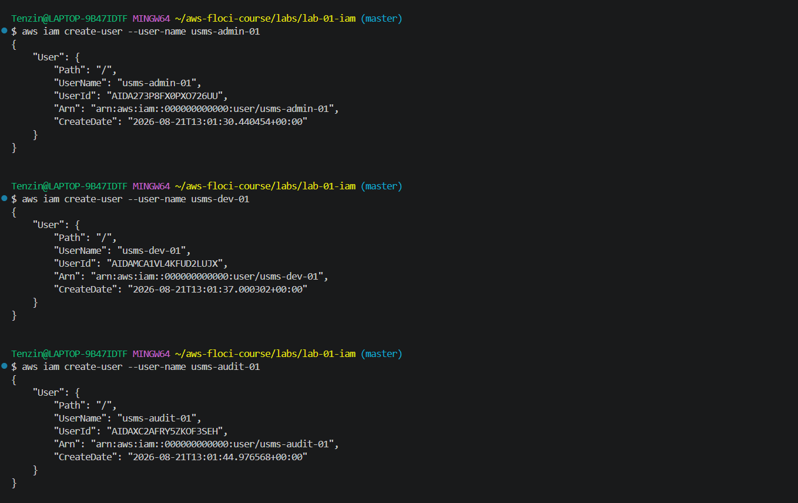

usms-admin-01, usms-dev-01 and usms-audit-01 created with correct ARNs.
Image Source: N/A

At first I created the three users without the --tags option. When I checked my work against the checklist, I added the same tags that Step 19 uses, Project=USMS and a Role for each user, with aws iam tag-user. I confirmed them with list-user-tags.

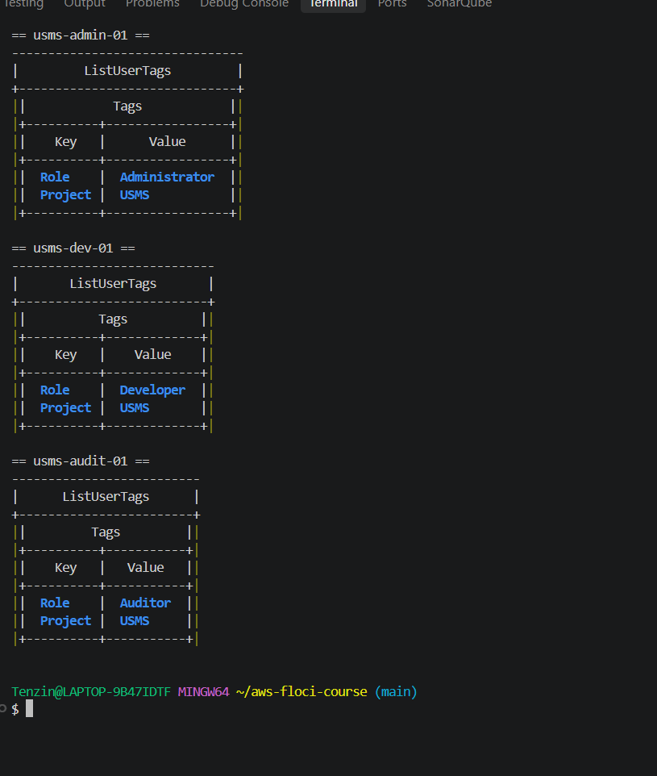

**Screenshot 6: Developer policy attached**

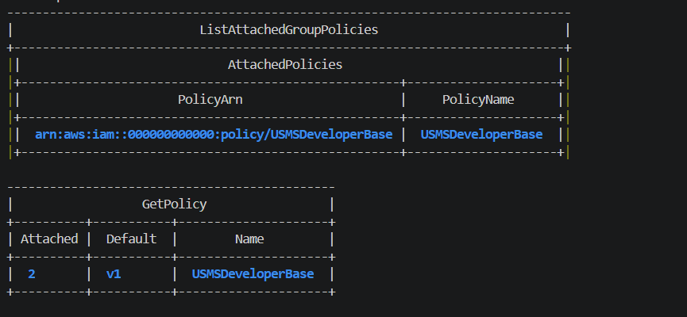

USMSDeveloperBase attached to both usms-developers and usms-admins.
Image Source: N/A

**Screenshot 7: S3 policy created**

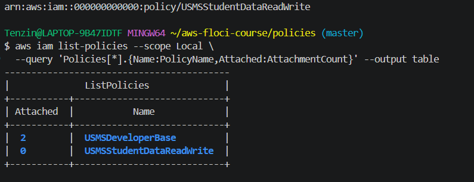

USMSStudentDataReadWrite created with correct bucket and object ARNs.
Image Source: N/A

**Screenshot 8: Inline vs attached policy**

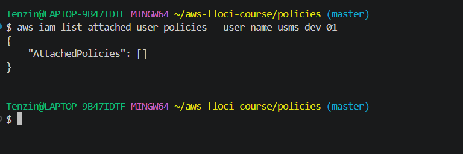

Shows the inline policy listed separately from the attached policies.
Image Source: N/A

**Screenshot 9: EC2 role verified**

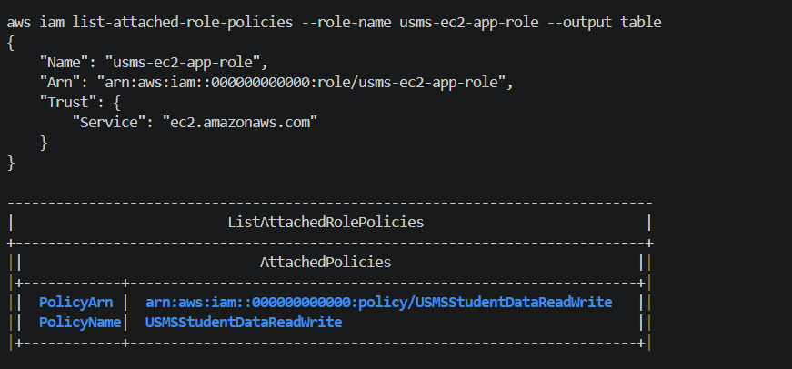

usms-ec2-app-role with the correct trust principal and attached policy.
Image Source: N/A

**Screenshot 10: Temporary credentials**

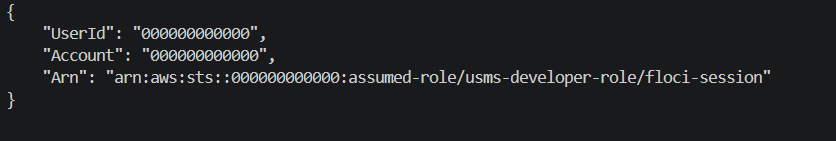

Identity changed to the assumed role ARN after sts assume-role.
Image Source: N/A

**Screenshot 11: Secret protected**

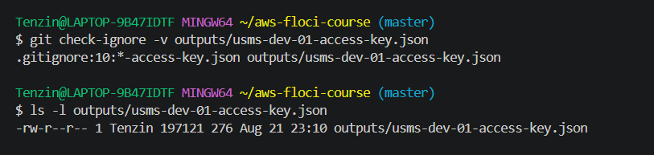

Git correctly ignoring the real access key file.
Image Source: N/A

### 6.2 AWS Management Console Verification

Floci does not have a graphical web console like real AWS. It only works through the command line, and the lab's own notes about Floci's limitations confirm this. So I could not take any AWS Console screenshots for this section.

Instead, I verified everything through the CLI output in Section 6.1. The final Git commit history below confirms that all the required resources were created.

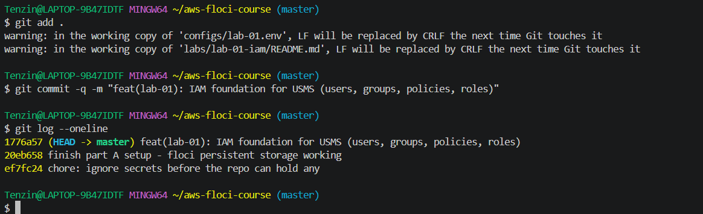

## 7. Analysis and Discussion

I achieved every objective in this lab. I built a fully working local AWS environment and a complete IAM identity structure. I got hands on practice with the same CLI commands and policy documents used in real AWS accounts.

**Problems I ran into:**

- My Floci CLI download kept getting corrupted on my normal network, with a different, invalid file size each time. Switching to a mobile hotspot fixed it.
- My AWS CLI could not reach Floci at first, because the endpoint_url setting was missing from my profile. I found this by checking the config file directly.
- PowerShell cannot run .sh scripts at all, so I did all script work in Git Bash instead.
- One step needed a Python script to edit a policy file, but Python was not properly installed. I got the same result by editing the JSON file by hand.
- chmod 600 has no real effect on Windows, because its filesystem does not use the same permission system as Linux.

**Floci does not fully enforce IAM policies:**

When I ran the policy simulator, it allowed a write action for a user that only had read only access. This should never happen on real AWS. It showed me that a command succeeding in Floci does not always mean the policy is correct. So I need to actually read and check the policy JSON instead of just trusting that it worked.

## 8. Reflection

**What did I learn about this AWS service?**

I learned that IAM works by keeping identities (users, groups, roles) separate from permissions (policies). Permissions should go on groups and roles, not directly on users. I also learned that a role needs two separate things to work: a trust policy (who can use it) and a permissions policy (what it can do).

**What challenges did I encounter?**

Most of my challenges were about the environment, not IAM itself. Getting Floci and the AWS CLI to talk to each other on Windows took a while. I also had download and installation problems along the way.

**How would I apply this service in a real world cloud environment?**

I would give permissions to groups instead of individual users. I would use roles instead of permanent access keys for servers. I would always add a Deny rule for anything that should never be allowed.

**What additional concepts would I like to explore?**

I would like to learn more about permission boundaries and CloudTrail. This lab only covered them as ideas, and I could not actually use them in Floci.

## 9. Conclusion

This lab helped me build the complete IAM setup for the USMS project. I created three groups, three users, four managed policies, one inline policy, and three roles with the correct trust relationships.

I also set up a local AWS environment that really keeps its data after a restart, which future labs will depend on.

Along the way I learned a lot about fixing real problems on Windows, like broken downloads, missing tools, and permission differences between operating systems.

## 10. Appendix (Optional)

- GitHub repository: https://github.com/Eyemusican/dso303-lab01-iam
- Policy files: `policies/` directory in the repository
- Scripts: `scripts/setup/`, `scripts/utilities/`, `scripts/cleanup/`
- Lab notes: `labs/lab-01-iam/lab-01-notes.md`
