# Lab 02: Independent Lab Exercises

## Exercise 1: Basic, a third public subnet

I created usms-public-subnet-c in us-east-1c with CIDR 10.0.5.0/24 and tagged it the same way as the other subnets. I turned on auto assign public IP and associated it with usms-public-rt. This is the same pattern as Steps 7, 8, and 11, just with a different AZ and CIDR.

```bash
PUBLIC_SUBNET_C_ID=$(aws ec2 create-subnet \
  --vpc-id "$VPC_ID" \
  --cidr-block 10.0.5.0/24 \
  --availability-zone "${AWS_REGION_COURSE}c" \
  --tag-specifications 'ResourceType=subnet,Tags=[{Key=Name,Value=usms-public-subnet-c},{Key=Project,Value=USMS},{Key=Tier,Value=public},{Key=AZ,Value=c}]' \
  --query 'Subnet.SubnetId' \
  --output text)

aws ec2 modify-subnet-attribute \
  --subnet-id "$PUBLIC_SUBNET_C_ID" \
  --map-public-ip-on-launch

aws ec2 associate-route-table \
  --route-table-id "$PUBLIC_RT_ID" \
  --subnet-id "$PUBLIC_SUBNET_C_ID"
```

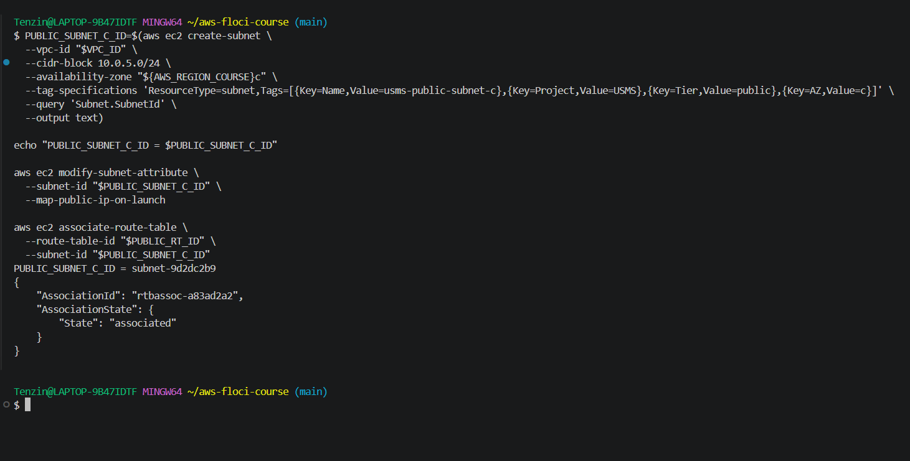

```bash
aws ec2 describe-subnets \
  --filters "Name=vpc-id,Values=$VPC_ID" \
  --query 'sort_by(Subnets, &CidrBlock)[].{Name:Tags[?Key==`Name`]|[0].Value,CIDR:CidrBlock,AZ:AvailabilityZone}' \
  --output table

aws ec2 describe-route-tables \
  --route-table-ids "$PUBLIC_RT_ID" \
  --query 'RouteTables[0].Associations[*].SubnetId' \
  --output table
```

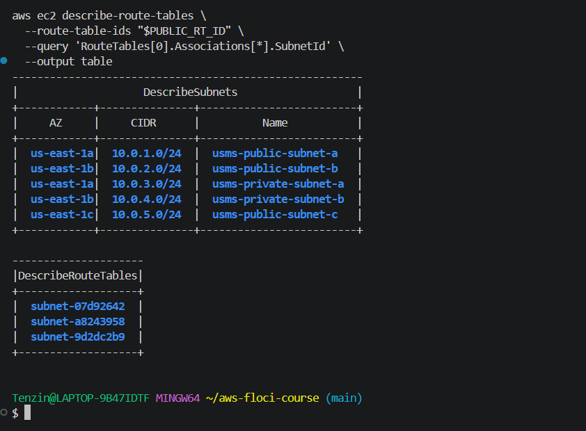

Five subnets now exist in the VPC, and usms-public-rt shows three associations instead of two. I did not add this subnet to configs/lab-02.env, because the exercise says it is practice only and Exercise 4 asks me to remove it later.

## Exercise 2: Intermediate, a bastion security group

I created usms-bastion-sg for a future jump host. It allows SSH only from 203.0.113.10/32, and the rule has a description. I used a documentation address because I did not want to expose my real IP.

```bash
BASTION_SG_ID=$(aws ec2 create-security-group \
  --group-name usms-bastion-sg \
  --description "USMS bastion host: SSH jump box for administrative access" \
  --vpc-id "$VPC_ID" \
  --tag-specifications 'ResourceType=security-group,Tags=[{Key=Name,Value=usms-bastion-sg},{Key=Project,Value=USMS},{Key=Tier,Value=bastion}]' \
  --query 'GroupId' \
  --output text)

aws ec2 authorize-security-group-ingress \
  --group-id "$BASTION_SG_ID" \
  --ip-permissions IpProtocol=tcp,FromPort=22,ToPort=22,IpRanges='[{CidrIp=203.0.113.10/32,Description="SSH from admin workstation"}]' \
  --query 'SecurityGroupRules[0].SecurityGroupRuleId' --output text
```

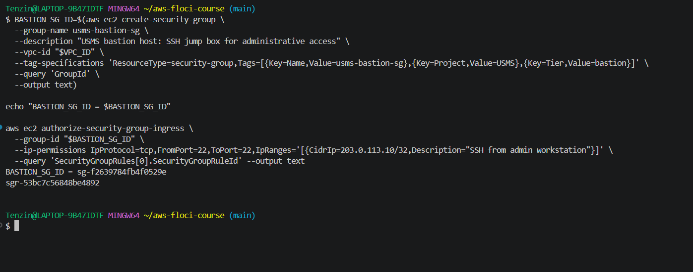

Before changing anything, I checked the existing SSH rule on usms-app-sg to get its exact rule ID.

```bash
aws ec2 describe-security-group-rules \
  --filters "Name=group-id,Values=$APP_SG_ID" \
  --query 'SecurityGroupRules[?FromPort==`22`]' \
  --output json
```

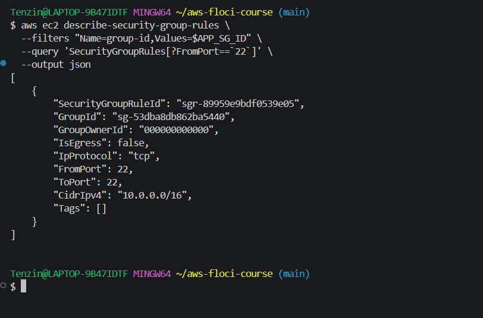

I added a new SSH rule on usms-app-sg with usms-bastion-sg as the source. Then I revoked the old 10.0.0.0/16 rule by its exact rule ID.

```bash
aws ec2 authorize-security-group-ingress \
  --group-id "$APP_SG_ID" \
  --ip-permissions IpProtocol=tcp,FromPort=22,ToPort=22,UserIdGroupPairs='[{GroupId='"$BASTION_SG_ID"',Description="SSH from bastion host only"}]' \
  --query 'SecurityGroupRules[0].SecurityGroupRuleId' --output text

aws ec2 revoke-security-group-ingress \
  --group-id "$APP_SG_ID" \
  --security-group-rule-ids sgr-89959e9bdf0539e05
```

When I checked the result, both commands had reported success, but neither one really worked.

```bash
aws ec2 describe-security-group-rules \
  --filters "Name=group-id,Values=$APP_SG_ID" \
  --query 'SecurityGroupRules[?FromPort==`22`]' \
  --output json
```

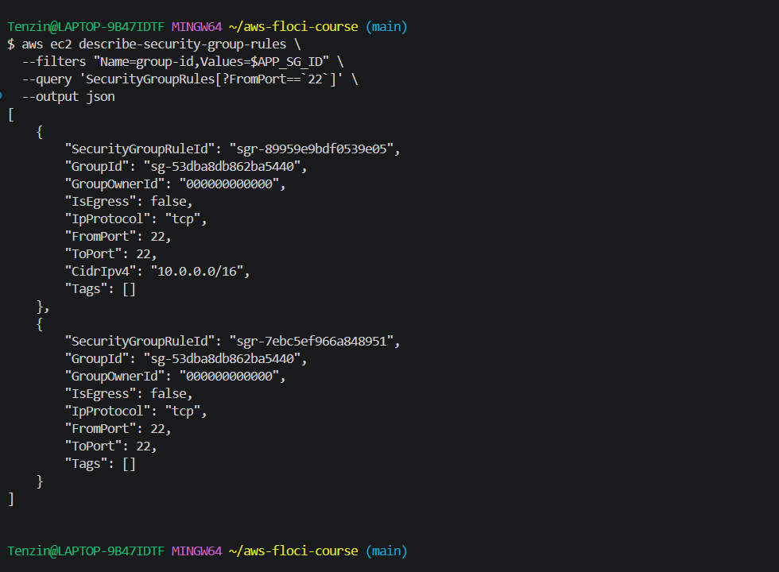

The old CIDR based rule (sgr-89959e9bdf0539e05) was still there, even though revoke-security-group-ingress reported Return: true. The new rule I added had no UserIdGroupPairs at all, so the source reference was not saved.

This is the same bug I hit in Step 15 with usms-db-sg. This time it happened on a different security group and a different rule. So it looks like a real limitation in this Floci build that I can repeat, not something tied to one rule.

I already proved in Step 15 that restarting Floci and creating the security group again from scratch does not fix this, so I did not repeat that here. The design itself is correct: the SSH rule on usms-app-sg is meant to come from usms-bastion-sg instead of the whole VPC range. The commands above capture that fully, even though Floci's storage cannot show it properly.

## Exercise 3: Problem solving, prove a claim about the network

I wrote scripts/utilities/lab-02-network-report.sh. It labels every subnet in usms-vpc as PUBLIC, PRIVATE, or ISOLATED, based only on its actual route table, never its name or tag.

It finds the VPC by tag and lists every subnet in it. For each subnet, it finds the associated route table and checks the target of its 0.0.0.0/0 route:

- an igw target means PUBLIC
- a nat target means PRIVATE
- no default route at all means ISOLATED

I used set -uo pipefail without -e, because the rule says the script must not fail if a subnet has no default route. With -e on, a query that comes back empty for an ISOLATED subnet could end the whole script early, instead of just printing that one line and moving on to the next subnet.

```bash
#!/usr/bin/env bash
set -uo pipefail

REPO_ROOT="$(cd "$(dirname "${BASH_SOURCE[0]}")/../.." && pwd)"
source "$REPO_ROOT/configs/course.env"

VPC_ID=$(aws ec2 describe-vpcs \
  --filters "Name=tag:Name,Values=usms-vpc" \
  --query 'Vpcs[0].VpcId' --output text)

SUBNET_IDS=$(aws ec2 describe-subnets \
  --filters "Name=vpc-id,Values=$VPC_ID" \
  --query 'Subnets[].SubnetId' --output text)

for s in $SUBNET_IDS; do
  name=$(aws ec2 describe-subnets --subnet-ids "$s" \
          --query 'Subnets[0].Tags[?Key==`Name`]|[0].Value' --output text)
  cidr=$(aws ec2 describe-subnets --subnet-ids "$s" \
          --query 'Subnets[0].CidrBlock' --output text)
  az=$(aws ec2 describe-subnets --subnet-ids "$s" \
          --query 'Subnets[0].AvailabilityZone' --output text)

  rt=$(aws ec2 describe-route-tables \
        --filters "Name=association.subnet-id,Values=$s" \
        --query 'RouteTables[0].RouteTableId' --output text)

  gateway=$(aws ec2 describe-route-tables --route-table-ids "$rt" \
        --query 'RouteTables[0].Routes[?DestinationCidrBlock==`0.0.0.0/0`].GatewayId | [0]' \
        --output text)
  nat=$(aws ec2 describe-route-tables --route-table-ids "$rt" \
        --query 'RouteTables[0].Routes[?DestinationCidrBlock==`0.0.0.0/0`].NatGatewayId | [0]' \
        --output text)

  if [[ "$gateway" == igw-* ]]; then
    printf '%-24s%-14s%-14s%-9s via %s\n' "$name" "$cidr" "$az" "PUBLIC" "$gateway"
  elif [[ "$nat" == nat-* ]]; then
    printf '%-24s%-14s%-14s%-9s via %s\n' "$name" "$cidr" "$az" "PRIVATE" "$nat"
  else
    printf '%-24s%-14s%-14s%-9s no default route\n' "$name" "$cidr" "$az" "ISOLATED"
  fi
done
```

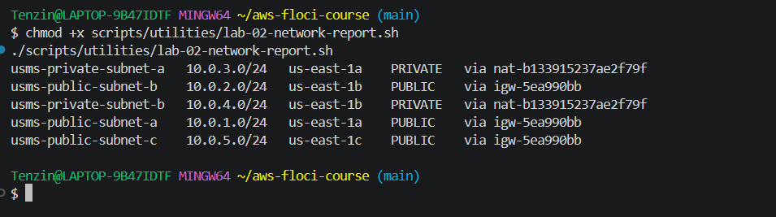

All five subnets are labelled correctly this way. None came back ISOLATED. This makes sense, because every subnet I have does have a default route: the public ones through the internet gateway and the private ones through the NAT gateway.

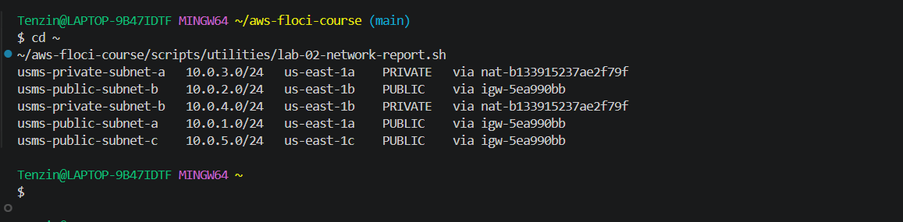

I ran it from my home directory and from inside the repo, and got the exact same five lines both times. So the script does not depend on where it is run from.

## Exercise 4: Challenge, design and defend

### The scenario

The project lead wants an exam results service with these needs:

- reachable only from campus (10.10.0.0/16, arriving over VPN)
- reads the transcripts database
- never reachable from the public internet
- still needs to download security patches

### Which subnet, and why

The service goes in usms-private-subnet-a. It reads the transcripts database and must never be reachable from the public internet. That is exactly what a private subnet is for, with no route to the internet gateway at all. There is no reason to build a new subnet, because the private tier already exists for this purpose.

### Security groups

I would create a new group, usms-exam-sg, and change usms-db-sg to add it as a source.

**usms-exam-sg inbound:**

- TCP 443 from 10.10.0.0/16, since staff reach the service over the campus VPN and nowhere else should be able to.

**usms-exam-sg outbound:**

- TCP 443 to 0.0.0.0/0, since the service needs to reach out to download security patches, and that traffic leaves through the NAT gateway, not directly to the internet.

**usms-db-sg addition:**

- TCP 5432 from usms-exam-sg, so the exam results service can read the transcripts database the same way usms-app-sg already can, using a group as the source instead of an address range for the same reason Step 15 explains.

### NACL

A NACL change is needed. I read the live entries of usms-private-nacl, and neither direction of the campus traffic is allowed today:

- **Inbound:** rule 100 only allows TCP 5432 from 10.0.0.0/16, and rule 110 only allows the ephemeral range 1024 to 65535. So HTTPS on port 443 from 10.10.0.0/16 would hit the final deny rule.
- **Outbound:** rule 100 only allows 1024 to 65535 to 10.0.0.0/16, and rule 110 only allows port 443. So the replies to campus staff, which go back to their ephemeral ports in 10.10.0.0/16, would be dropped too.

NACLs are stateless, so the reply is a separate packet that needs its own rule. A security group is different, because it remembers the connection and lets the reply out automatically.

As a paper design, I would add two rules to usms-private-nacl:

- Inbound rule 120: allow TCP 443 from 10.10.0.0/16, for staff requests arriving over the VPN.
- Outbound rule 120: allow TCP 1024 to 65535 to 10.10.0.0/16, for the replies going back to campus.

The patch downloads already work with the existing rules. Outbound rule 110 allows 443 to 0.0.0.0/0, and inbound rule 110 allows the replies on the ephemeral ports.

The database traffic does not cross the NACL at all. usms-db-01 is in the same subnet, usms-private-subnet-a, and a NACL only filters traffic entering or leaving the subnet.

### Second NAT gateway in AZ b

A NAT gateway costs about $0.045 per hour plus $0.045 per GB processed in us-east-1 (AWS VPC pricing page). That is roughly $32 a month per gateway before any data crosses it. This matches what the lab's own Floci vs Real AWS section says.

Right now there is one NAT gateway, in usms-public-subnet-a, and it serves the private subnets in both AZ a and AZ b. If AZ a goes down, the private subnet in AZ b loses outbound access too, even though its own instances are fine. This is because the NAT gateway itself lives in the AZ that failed.

A second NAT gateway in AZ b would fix that, but it doubles this cost to about $64 a month. That is already one of the largest line items on a small VPC's bill.

The exam results service mainly needs occasional outbound patch downloads, not constant traffic. So I would not add a second NAT gateway, because the cost is not justified by the risk for this service. I would only think about it again if the exam results service, or something else in the private tier, became so critical that losing outbound patching for a while during an AZ outage was not acceptable.

### What to delete

usms-public-subnet-c from Exercise 1 should be removed. It was only created as practice and nothing depends on it.

**What will be deleted:**

usms-public-subnet-c and its association with usms-public-rt.

**What depends on it:**

Nothing. It has no instances, and no other resource references it.

**Reversible?**

Yes. I can create it again with the exact same command from Exercise 1 if I need it.

**Effect on later labs:**

None.

**Deletion order:**

The subnet has nothing in it, so deleting it is a single aws ec2 delete-subnet call. I do not need to disassociate it from usms-public-rt first, because AWS removes the route table association automatically when the subnet is deleted. The delete would only be blocked by something still running inside the subnet, like an instance or a network interface, and there is none.

### Implementation

I only built the security group part. The rest above is a design, not something to build yet.

```bash
EXAM_SG_ID=$(aws ec2 create-security-group \
  --group-name usms-exam-sg \
  --description "USMS exam results service: HTTPS from campus VPN only, HTTPS out for patches" \
  --vpc-id "$VPC_ID" \
  --tag-specifications 'ResourceType=security-group,Tags=[{Key=Name,Value=usms-exam-sg},{Key=Project,Value=USMS},{Key=Tier,Value=exam}]' \
  --query 'GroupId' \
  --output text)

aws ec2 authorize-security-group-ingress \
  --group-id "$EXAM_SG_ID" \
  --ip-permissions IpProtocol=tcp,FromPort=443,ToPort=443,IpRanges='[{CidrIp=10.10.0.0/16,Description="HTTPS from campus VPN"}]'

aws ec2 authorize-security-group-egress \
  --group-id "$EXAM_SG_ID" \
  --ip-permissions IpProtocol=tcp,FromPort=443,ToPort=443,IpRanges='[{CidrIp=0.0.0.0/0,Description="HTTPS out for security patches"}]'

aws ec2 authorize-security-group-ingress \
  --group-id "$DB_SG_ID" \
  --ip-permissions IpProtocol=tcp,FromPort=5432,ToPort=5432,UserIdGroupPairs='[{GroupId='"$EXAM_SG_ID"',Description="PostgreSQL from the exam results service"}]'
```

Like in Exercise 2, the group referenced rule on usms-db-sg likely lost its source because of the Floci bug from Step 15. But the group itself and its own two rules should be real and checkable.

My design says usms-exam-sg only allows TCP 443 outbound. But a new security group starts with a default rule that allows all outbound traffic to 0.0.0.0/0, and I did not remove it. So the live group still allows everything out. To enforce the design, I would revoke that default egress rule and keep only the single 443 egress rule I added.

```bash
aws ec2 describe-security-groups --group-ids "$EXAM_SG_ID" --output json
```

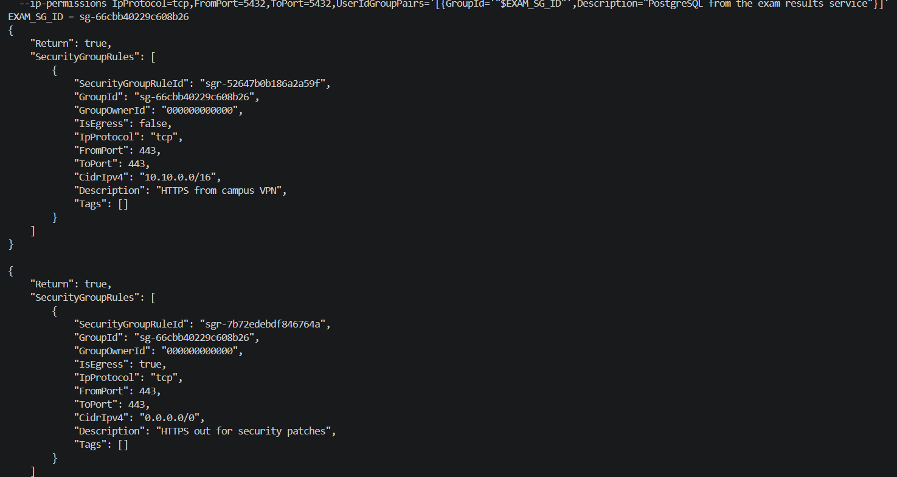

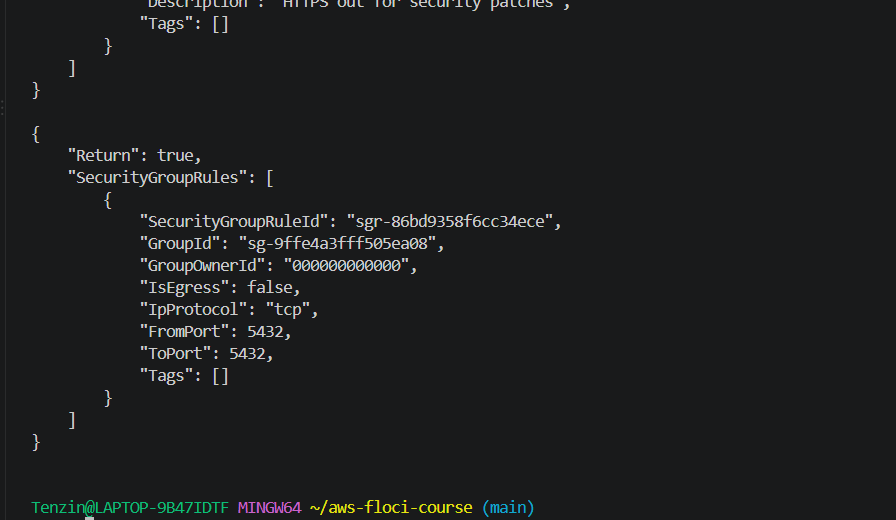

## Exercise 5: Integration, complete the second Availability Zone

RDS needs subnets in at least two Availability Zones for its subnet group in a later lab. So far the private tier only existed in one AZ. I had to create usms-private-subnet-b while holding usms-developer-role credentials, not my normal identity.

My steps were:

1. I checked my identity before assuming the role.
2. I assumed the role.
3. I checked my identity again to confirm the switch.
4. I created the subnet and associated it with usms-private-rt, still holding the assumed role's credentials.

```bash
aws sts get-caller-identity

aws sts assume-role \
  --role-arn "$ROLE_ARN" \
  --role-session-name "lab02-exercise5" \
  --profile usms-dev \
  > outputs/lab-02-exercise5-assumed-role.json

export AWS_ACCESS_KEY_ID=$(jq -r '.Credentials.AccessKeyId' outputs/lab-02-exercise5-assumed-role.json)
export AWS_SECRET_ACCESS_KEY=$(jq -r '.Credentials.SecretAccessKey' outputs/lab-02-exercise5-assumed-role.json)
export AWS_SESSION_TOKEN=$(jq -r '.Credentials.SessionToken' outputs/lab-02-exercise5-assumed-role.json)

aws sts get-caller-identity

PRIVATE_SUBNET_B_ID=$(aws ec2 create-subnet \
  --vpc-id "$VPC_ID" \
  --cidr-block 10.0.4.0/24 \
  --availability-zone "${AWS_REGION_COURSE}b" \
  --tag-specifications 'ResourceType=subnet,Tags=[{Key=Name,Value=usms-private-subnet-b},{Key=Project,Value=USMS},{Key=Tier,Value=private},{Key=AZ,Value=b}]' \
  --query 'Subnet.SubnetId' \
  --output text)

aws ec2 associate-route-table \
  --route-table-id "$PRIVATE_RT_ID" \
  --subnet-id "$PRIVATE_SUBNET_B_ID"
```

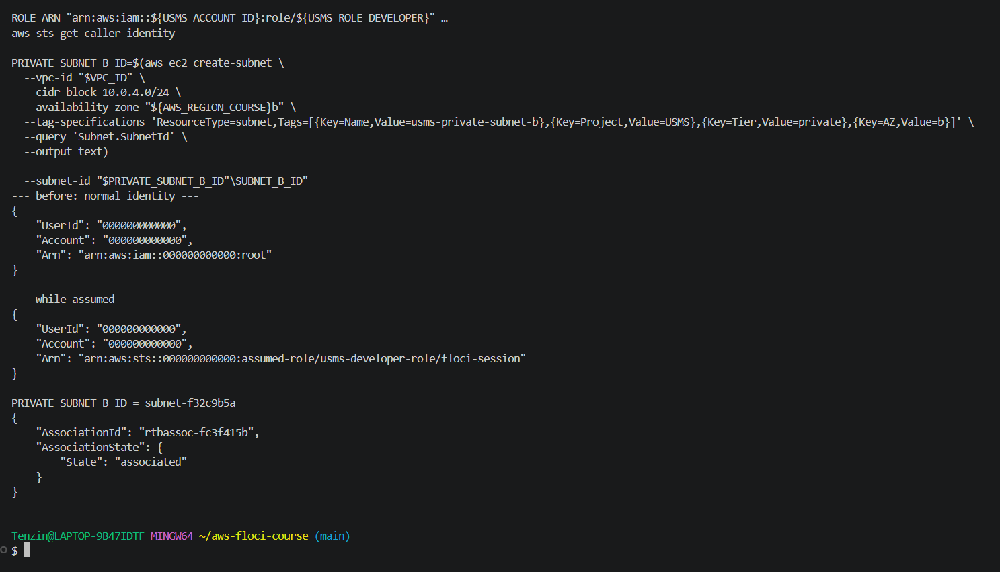

The identity before shows my normal root account. The identity while assumed shows the assumed role ARN instead. So the subnet really was created while holding usms-developer-role, not my own identity.

Next I applied usms-private-nacl to the new subnet, with the same replace association pattern from Step 18. This time I checked that it landed on the right subnet before moving on, because I made exactly that mistake the first time in Step 18.

```bash
NACL_ASSOC_B=$(aws ec2 describe-network-acls \
  --filters "Name=association.subnet-id,Values=$PRIVATE_SUBNET_B_ID" \
  --query 'NetworkAcls[0].Associations[?SubnetId==`'"$PRIVATE_SUBNET_B_ID"'`].NetworkAclAssociationId | [0]' \
  --output text)

aws ec2 replace-network-acl-association \
  --association-id "$NACL_ASSOC_B" \
  --network-acl-id "$PRIVATE_NACL_ID"
```

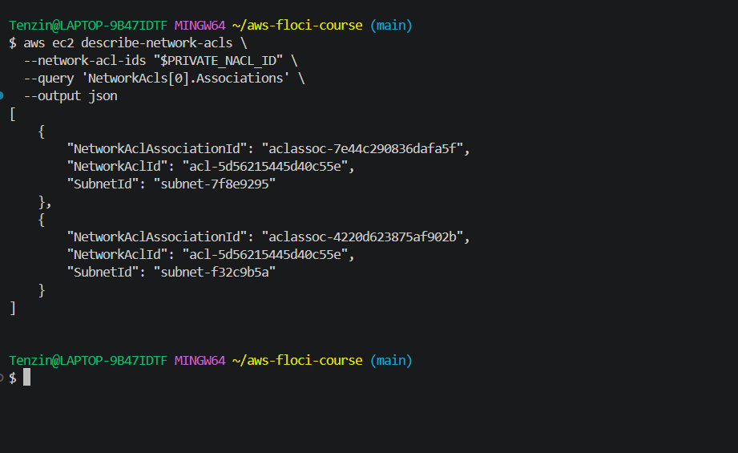

Both usms-private-subnet-a and usms-private-subnet-b now show up under usms-private-nacl, and nothing else does.

Then I restored my normal identity right away.

```bash
unset AWS_ACCESS_KEY_ID AWS_SECRET_ACCESS_KEY AWS_SESSION_TOKEN
./scripts/utilities/whoami.sh
```

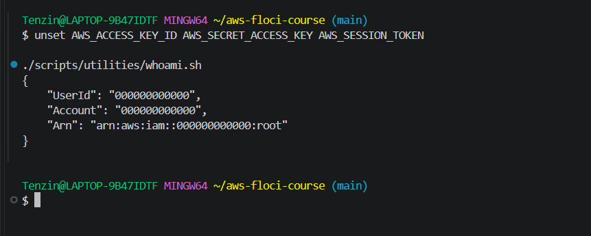

The lab wants my identity restored right away because usms-developer-role only lasts one hour, so if I kept using those credentials for other work they would expire partway through and give a confusing error that has nothing to do with what actually broke.

Finally I generated configs/lab-02.env again so USMS_PRIVATE_SUBNET_B would be filled in.

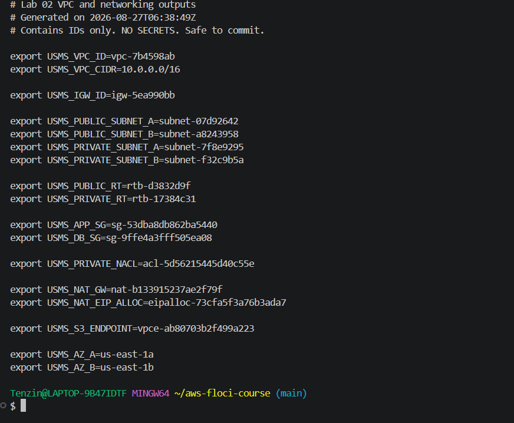

I ran verify-lab-02.sh again afterwards, and the empty value check passed. The only check still failing is "usms-db-sg is sourced from usms-app-sg (not a CIDR)". This is the same Floci bug from Step 15, where group referenced rules get silently dropped. I already tried to fix that one three different ways back then, so I left it documented instead.

```bash
./scripts/utilities/verify-lab-02.sh
```


PASS=32 FAIL=1.
