# Lab 2: Virtual Private Cloud and Networking

**Student Name:** Tenzin Namgay

**Student ID:** 02230307

**Module:** DSO303 : Cloud Native Infrastructure

**Practical:** Lab 2 : VPC

## 1. Aim / Objective

In this lab I built the networking base for the University Student Management System (USMS) using a local AWS emulator (Floci). I built and verified everything with the AWS CLI.

The network includes:

- a VPC
- public and private subnets across multiple Availability Zones
- routing
- security groups
- a network ACL
- a NAT gateway
- an S3 gateway endpoint

## 2. Introduction

A Virtual Private Cloud (VPC) is an isolated network inside AWS where all of a project's resources live. Subnets divide that network into smaller pieces. Some are meant to be reachable from the internet (public), and some are meant to never be reachable from it (private).

The other main pieces are:

- **Route tables:** decide where traffic goes.
- **Security groups and network ACLs:** two different kinds of firewall.
- **NAT gateway:** lets private resources reach out to the internet without letting the internet reach in.

In this lab I built all of these pieces for USMS. I reused the IAM identities from Lab 1, especially `usms-developer-role`, which I used to actually create the VPC.

## 3. Use Case

- Hosting a public facing web server for students and staff while keeping the database completely unreachable from the internet
- Letting the database server download security patches without ever accepting an inbound connection from outside the VPC
- Limiting SSH access to a small, controlled range instead of leaving it open to the whole internet
- Splitting access control into two layers: a firewall per instance (security groups) and a backstop for the whole subnet (network ACLs)

## 4. System Architecture / Design

The VPC uses the address range `10.0.0.0/16`. Inside it there are three public subnets (`usms-public-subnet-a/b/c`) and two private subnets (`usms-private-subnet-a/b`), spread across three Availability Zones.

The public subnets route out through an internet gateway. The private subnets route out through a NAT gateway, and the NAT gateway itself sits in a public subnet.

Two security groups control access at the instance level: `usms-app-sg` for the web tier and `usms-db-sg` for the database tier. A custom network ACL (`usms-private-nacl`) acts as a backstop for the whole private tier.

An S3 gateway endpoint lets the private subnets reach S3 without going through the NAT gateway at all.

## 5. Implementation Procedure

### Part A: Building the network

I started by sourcing the Lab 1 environment and confirming my identity. Then I read the current policy version of `USMSDeveloperBase` before using it. By this point it was already v3 because of Lab 1 Exercise 5. This meant the two extra actions this lab needs (creating a NAT gateway and allocating an Elastic IP) were already in place.

I assumed `usms-developer-role` and created the VPC as that identity, not as my normal root identity. Then I restored my own identity right away.

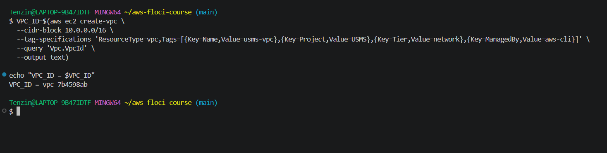

The assume-role output, with the temporary credentials, went into outputs/lab-02-assumed-role.json. I checked that Git ignores it, and git check-ignore named rule 1 of .gitignore, outputs/*.

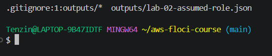

I enabled DNS support and DNS hostnames on the VPC. Then I created and attached an internet gateway.

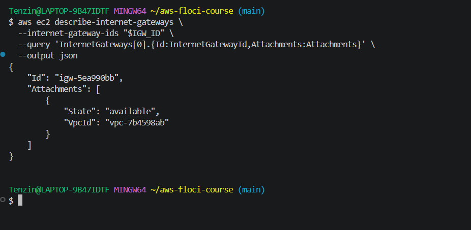

I created the public subnet and turned on auto assign public IPv4. Then I created the private subnet without it, on purpose. An instance in a subnet with no route out should not get a public address it can never use.

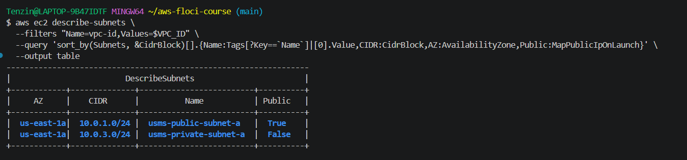

I built a public route table with a default route to the internet gateway. I built a private route table with no default route at all. That missing route is the whole technical difference between a public and a private subnet. Nothing else about the two subnets is different at the API level.

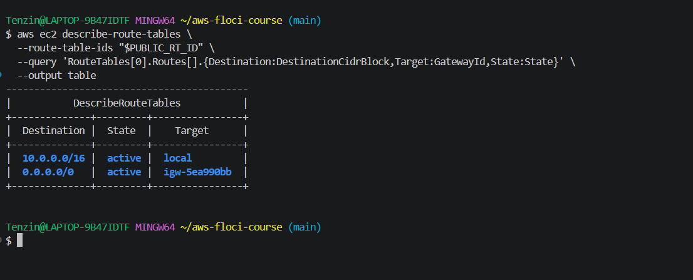

Step 13 asked me to prove the two subnets were really different, not just assume it because the commands succeeded. So I wrote a loop that reads back each subnet's effective route table and reports its default route target.

### Part B: Firewalls and outbound access

I created `usms-app-sg` to allow HTTP, HTTPS, and SSH limited to the VPC's own address range.

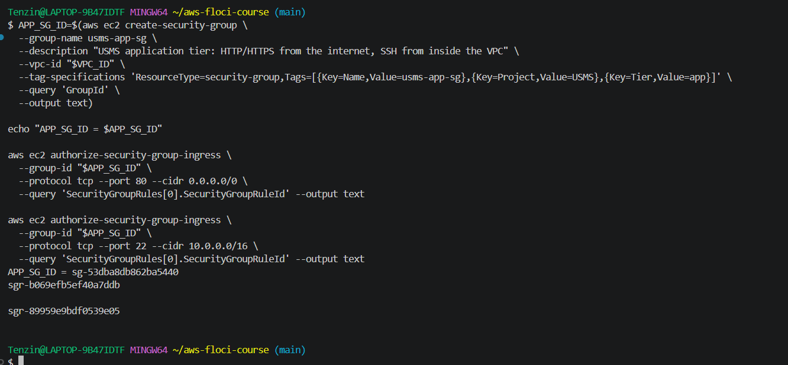

I created `usms-db-sg` and tried to source its PostgreSQL rule from `usms-app-sg` by group reference instead of an address range. This is where I hit a real Floci limitation. I explain it fully in the Analysis section below.

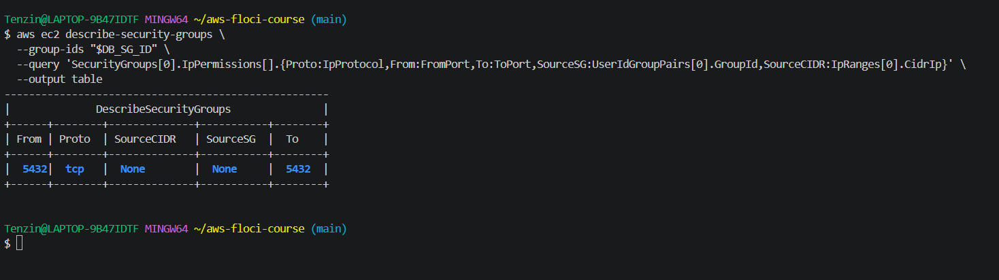

I created a custom network ACL for the private subnet with four explicit rules. One of them is the ephemeral port rule, which is needed because NACLs are stateless.

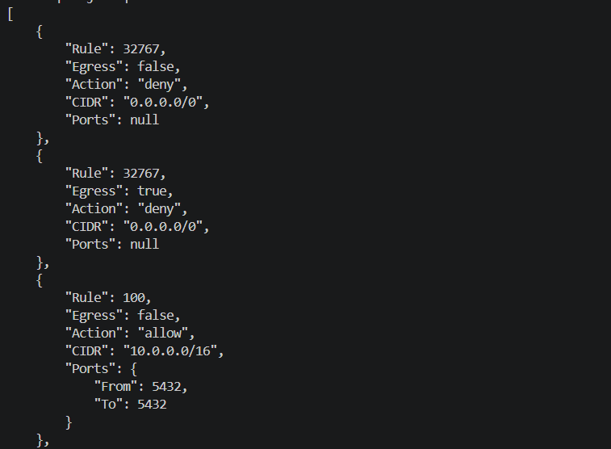

I associated the NACL with the private subnet. On my first attempt I attached it to the wrong subnet, the public one, by mistake. I caught it during verification and fixed it properly. I also explain this in the Analysis section below.

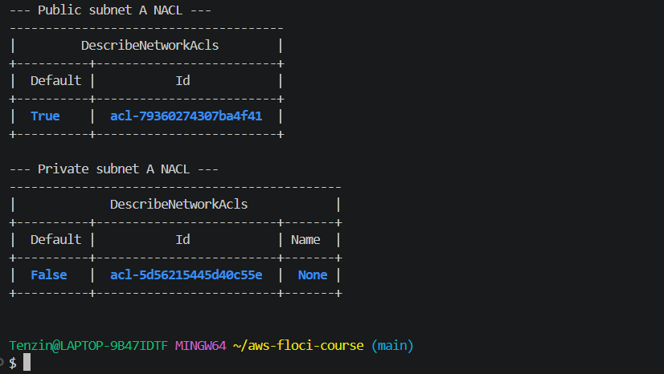

I allocated an Elastic IP and created a NAT gateway in the public subnet. Then I pointed the private route table's default route at it.

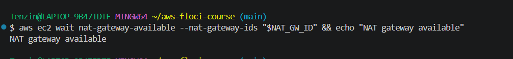

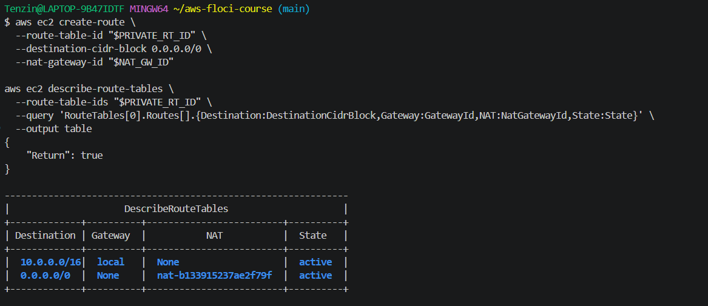

I created a gateway endpoint for S3, so the private subnet can reach S3 without going through the NAT gateway.

### Part C: Proving it survives, and recording it

I audited every resource's tags to confirm the `Project=USMS` convention held everywhere. Then I completed the exercise that produces a sorted subnet inventory with the private subnet listed first.

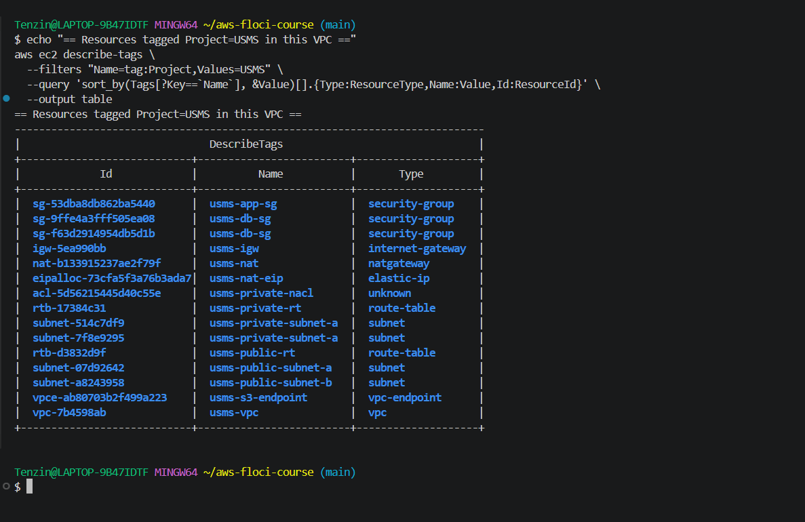

I proved the whole network survives a restart. I recorded the VPC ID, subnet count, and security group count, restarted Floci, and looked everything up again by tag instead of reusing shell variables.

I wrote `configs/lab-02.env` with every resource ID Lab 3 will need. Then I wrote and ran `verify-lab-02.sh`, which checks 33 separate things about the network.

## 6. Results and Evidence

### 6.1 CLI / SDK Evidence

All screenshots are shown above. The independent exercises, with their own evidence, are in `labs/lab-02-vpc/exercises.md`.

### 6.2 AWS Management Console Verification

Like in Lab 1, Floci has no graphical console. So I did all verification through the CLI, and it is shown in Section 5 above and in `exercises.md`.

## 7. Analysis and Discussion

I built the full network as designed. Along the way I hit two real Floci limitations that I could repeat, not just my own mistakes.

**Limitation 1: duplicate CIDR block**

Floci let me create a second subnet with the exact same address range as an existing one, `10.0.3.0/24`. Real AWS would reject this as an overlapping CIDR. I found it while checking my subnet count during the Exercise 1 "Your turn" task. I deleted the duplicate after I confirmed it had no route table association yet.

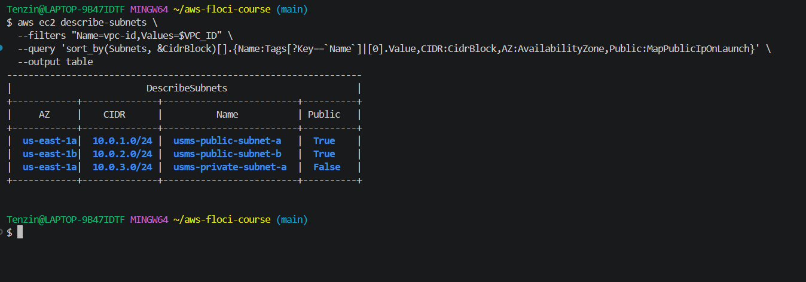

**Limitation 2: group referenced security group rules are not saved**

This is the bigger one. Every time I authorized a rule with `UserIdGroupPairs` (using another security group as the source instead of a CIDR block), the command reported success and returned a real rule ID. But when I read the rule back, the source was silently gone.

I made sure this was not a mistake in my commands. In Step 15 alone I tried it three different ways:

- the original attempt
- a fresh security group created from scratch
- again after a full Floci restart

All three gave the same result. I hit the same bug two more times on my own, in the Exercise 2 bastion rule and the Exercise 4 exam service rule. A classmate on a completely different machine also got the same failure, so it is not something specific to my setup.

`revoke-security-group-ingress` had a matching problem. It reported success but did not actually remove the rule it was told to remove.

**My own mistake: NACL on the wrong subnet**

I also made one real mistake of my own in Step 18, when I associated the private NACL with a subnet. The `replace-network-acl-association` command succeeded, but I had passed the wrong subnet's association ID. So my custom NACL ended up on the public subnet instead of the private one.

I caught this by reading the association back instead of trusting the success message. I put the public subnet back on the default NACL and then associated the private one correctly. This is the same habit the lab teaches all the way through: a command succeeding is not the same as it doing the right thing.

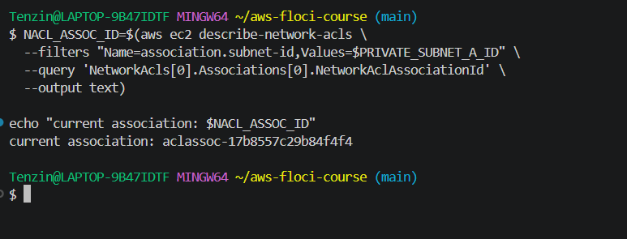

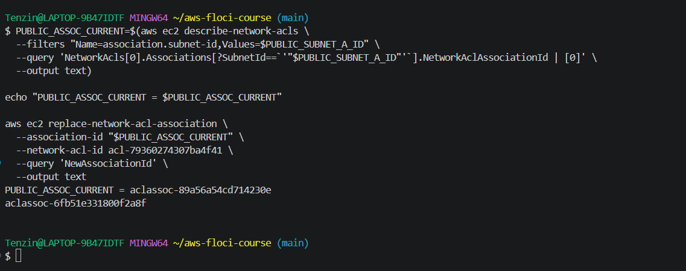

Floci does not enforce security groups or NACLs against real traffic at all. So to judge whether my rules were correct, I had to read the actual JSON documents and API responses. Testing a connection would not help, because it would work the same whether the rule was tight or wide open.

## 8. Reflection

**What did I learn about this AWS service?**

I learned that "public" is not a property of the subnet itself. It is a property of its route table, and only depends on whether that table has a default route to an internet gateway. Nothing else makes any difference: not the name, not a tag, and not the auto assign IP setting.

**What challenges did I encounter?**

Most of my real challenges came from Floci, not from the networking concepts. The group referenced security group bug was the biggest one. I only trusted my conclusion after I had repeated it three separate ways and a classmate had repeated it on their own machine.

I also made one real mistake myself when I put a NACL on the wrong subnet. It taught me to always read a change back instead of trusting that a successful command did what I meant.

**How would I apply this in a real world cloud environment?**

I would design the public and private split the same way, using the route table as the real mechanism instead of naming conventions. I would use security groups as the main access control layer, because they are stateful and can reference each other. I would keep NACLs as a safety net for the whole subnet.

I would also plan the budget for NAT gateways carefully. Exercise 4 showed me that one NAT gateway already costs around $32 a month before any data crosses it. A second one for high availability would double that, and it is often the largest line item on a small VPC's bill.

**What additional concepts would I like to explore?**

I would like to see how VPC peering and Transit Gateway connect multiple VPCs together, since this lab only covered a single network.

## 9. Conclusion

In this lab I built the complete network layer for USMS: a VPC with five subnets across three Availability Zones, public and private routing, two security groups, a custom network ACL, a NAT gateway, and an S3 endpoint.

I completed all five independent exercises. I wrote a verification script that checks 33 separate facts about the network, and I wrote a cleanup script without ever running it.

Along the way I found and properly looked into two real Floci limitations, instead of assuming my own work was wrong. I also caught and fixed one real mistake of my own by checking my work instead of trusting a command's success message.

## 10. Appendix (Optional)

- GitHub repository: https://github.com/Eyemusican/dso303-lab01-iam
- Exercises with full evidence: `labs/lab-02-vpc/exercises.md`
- Review questions: `notes/lab-02-notes.md`
- Scripts: `scripts/utilities/verify-lab-02.sh`, `scripts/cleanup/lab-02-cleanup.sh`, `scripts/utilities/lab-02-network-report.sh`
