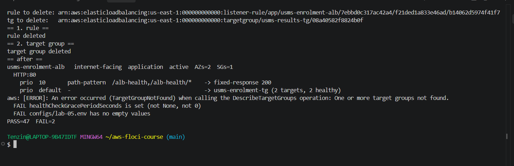
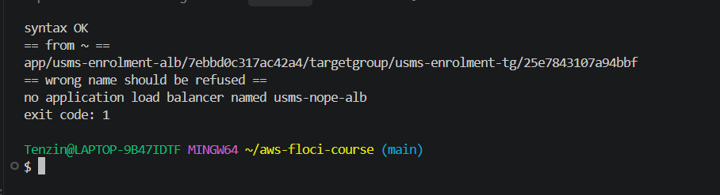
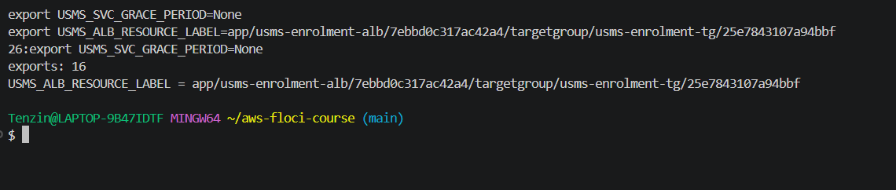
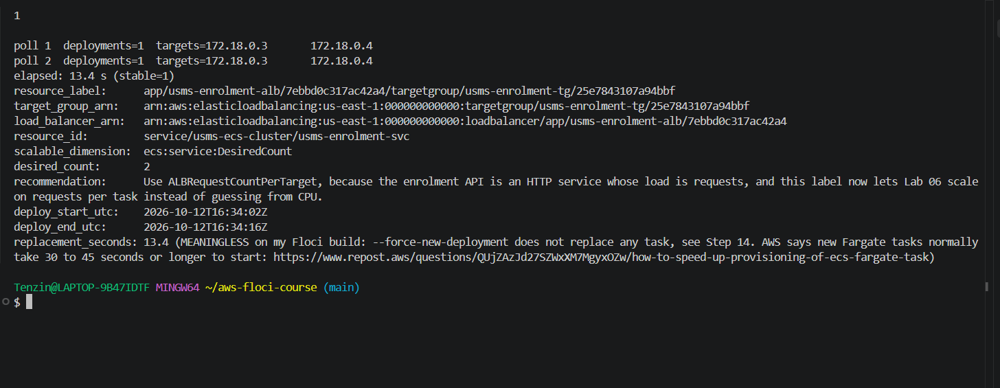
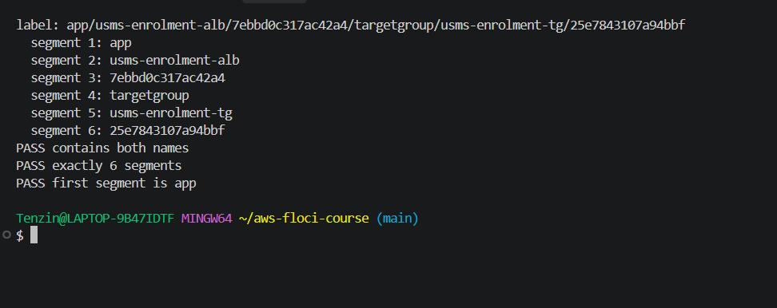

# Lab 05 Exercises

Tenzin Namgay (02230307), DSO303

## Exercise 1: a second path through the same load balancer

### What I built

1. Target group usms-results-tg: target type ip, HTTP on port 80, in usms-vpc, health check GET / with matcher 200-399, deregistration delay 15 seconds.
2. Listener rule at priority 20 on the existing HTTP:80 listener, path patterns /results and /results/*, forwarding to usms-results-tg.
3. Both tagged Project=USMS, Tier=app, Lab=05, Service=results.

The rule's conditions and actions are JSON documents in templates/ (lab-05-ex1-results-conditions.json and lab-05-ex1-results-actions.json). The conditions file used a quoted heredoc because it has no variables, and the actions file used an unquoted heredoc so $RESULTS_TG_ARN became the real ARN. grep -c '\$' printed 0.
Every ARN was captured with $(...) and --query. I did not register any targets, did not create a second ECS service, and did not add either object to configs/lab-05.env, because Exercise 4 removes them.

### Commands

```bash
RESULTS_TG_ARN=$(aws elbv2 create-target-group --name usms-results-tg \
  --protocol HTTP --port 80 --vpc-id "$USMS_VPC_ID" --target-type ip \
  --health-check-protocol HTTP --health-check-path / --health-check-port traffic-port \
  --health-check-interval-seconds 30 --health-check-timeout-seconds 5 \
  --healthy-threshold-count 2 --unhealthy-threshold-count 2 --matcher HttpCode=200-399 \
  --tags Key=Project,Value=USMS Key=Tier,Value=app Key=Lab,Value=05 Key=Service,Value=results \
  --query 'TargetGroups[0].TargetGroupArn' --output text)

aws elbv2 modify-target-group-attributes --target-group-arn "$RESULTS_TG_ARN" \
  --attributes Key=deregistration_delay.timeout_seconds,Value=15

RESULTS_RULE_ARN=$(aws elbv2 create-rule --listener-arn "$LISTENER_ARN" --priority 20 \
  --conditions file://templates/lab-05-ex1-results-conditions.json \
  --actions file://templates/lab-05-ex1-results-actions.json \
  --tags Key=Project,Value=USMS Key=Tier,Value=app Key=Lab,Value=05 Key=Service,Value=results \
  --query 'Rules[0].RuleArn' --output text)

aws elbv2 describe-rules --listener-arn "$LISTENER_ARN" \
  --query 'sort_by(Rules,&Priority)[].{Priority:Priority,Default:IsDefault,Paths:Conditions[0].PathPatternConfig.Values,Action:Actions[0].Type,TargetGroup:Actions[0].TargetGroupArn}' --output json
```

### Result

describe-rules sorted by priority shows three entries in evaluation order: priority 10 (/alb-health, fixed-response 200), priority 20 (/results, forward to usms-results-tg) and the default action (forward to usms-enrolment-tg).
describe-target-health on usms-results-tg returned [] and describe-target-groups shows it attached to 1 load balancer.
I sorted with sort_by(Rules,&Priority) because describe-rules does not promise priority order. Priority is a string, so the sort is alphabetical. It works here because "10" < "20" < "default", but a rule at priority 5 would sort after "20" as text, which is the trap the hint points at.


### What a request to /results would get

A request to /results would match the priority 20 rule, but usms-results-tg has no healthy targets, so the load balancer would answer 503 Service Temporarily Unavailable itself, the Section 11 code for "the listener worked but there was nothing healthy to send it to". On my build I could not test this with curl because there is no data path from my shell (Step 12).

## Exercise 2: repairing the verification script I broke

### 1. The property the old check asserted

The enrolment tasks accept traffic only from a named security group, never from an address range. The old check expressed that as "the first source group is usms-app-sg", which was only true for the Lab 04 architecture.

### 2 to 4. What I changed in scripts/utilities/verify-lab-04.sh

- I kept the original check and changed what it asserts: "usms-enrolment-sg is sourced from a group, usms-alb-sg (not a CIDR)". It now passes only if usms-alb-sg is among the source groups and the IpRanges list is empty. It also reads every IpPermissions entry instead of only [0], because the old [0][0] lookup depended on rule order.
- I added a second check straight after it, "usms-enrolment-sg no longer admits usms-app-sg". Without it, the first check would still pass if both the old and the new rule existed.
- usms-alb-sg's ID comes from configs/lab-05.env, which is sourced with 2>/dev/null || true so the script still runs in a repo that has done Lab 04 but not Lab 05.
- I added : "${USMS_ALB_SG:=none}" next to the other defaults. With set -u in force, a missing USMS_ALB_SG now gives a readable FAIL on the check instead of an unbound variable abort.
- The REPO_ROOT line using ${BASH_SOURCE[0]} is unchanged, so it still works from any directory.


### 5. Result

verify-lab-04.sh: PASS=39 FAIL=0. The new expected count is written as a comment at the top of the script: 38 Lab 04 checks plus the 1 I added.
verify-lab-05.sh: PASS=47 FAIL=2. The two failures are the grace period Floci limitation documented in my notes (Step 10 and Section 9), which this exercise cannot fix, so FAIL=0 is not reachable on my build for that script.


An undocumented count is worse than no count because when the number changes nobody can tell whether a check was added on purpose or one silently stopped running, so a written expected count turns any difference into something to investigate.

### When to update a verification script, and when it hides a regression

Updating a verification script is right when the architecture changed on purpose and the new check still asserts the same property, ideally in the same commit as the change. It becomes a way to hide a regression when you change the expected value just to make the script green without being able to point to the deliberate change that made the old value wrong.

## Exercise 3: a load balancer report tool

I wrote scripts/utilities/usms-lb-report.sh. It takes no arguments, finds every Application Load Balancer whose name starts with usms-, and prints its full decision table: the load balancer, each listener, and each rule in evaluation order with where it sends the request and how many targets are healthy. It also writes the same data to outputs/lab-05-lb-report.json (git ignored).

### Design decisions

- It resolves the repo from ${BASH_SOURCE[0]}, the same way Section 9's script does, so it works from any directory.
- Nothing is hard coded except the usms- prefix. The load balancers come from describe-load-balancers with a starts_with filter, then one describe-listeners call per load balancer, one describe-rules call per listener, and one describe-target-health call per target group (cached so a target group used twice is only asked once).
- Bash does the setup, then python3 does the four levels of nesting and the formatting, because nested bash loops over JSON at four levels are hard to get right. Python calls the AWS CLI with --output json at each level.
- Rule order: Priority is a string and the default action's priority is the word "default", so a plain string sort would put "10" before "5" and could put "default" in the wrong place. My sort key turns numeric priorities into integers and forces default last, which is the order the listener evaluates them. There is a comment in the script saying this.
- A non forward action prints its own summary (fixed-response 200, or redirect with its target) instead of an empty target group column.
- It handles a load balancer with no listeners (prints "no listeners"), a listener with no extra rules (only the default line), and a target group with no targets (0 targets, 0 healthy).
- Floci keeps path values only in PathPatternConfig.Values (Step 15), so the script reads Values first and falls back to the <Field>Config.Values block.
- set -uo pipefail without -e: it is a read only report, so one failed describe call should be reported on that row and the rest should still print, rather than the whole script stopping half way with no output.

### Results

Run from my home folder, after Exercise 1 added usms-results-tg:


The output was identical from ~ and from labs/lab-05-ecs-alb/ (diff printed nothing), and the JSON report is valid:


I temporarily deleted the /alb-health rule, ran the report (only priority 20 and default were shown, no crash and no empty row), then recreated the rule straight away with Step 15's own command and templates. verify-lab-05.sh still reported PASS=47 FAIL=2 with both rule checks ok.


## Exercise 4: the exposure review

### What changed

The network path changed from usms-web-01 calling a task's private address directly to every request entering through usms-enrolment-alb in the two public subnets and being forwarded to the tasks in the private subnets. The security groups changed from usms-enrolment-sg admitting tcp/80 from usms-app-sg to admitting tcp/80 only from usms-alb-sg, while usms-alb-sg is the one group that admits 0.0.0.0/0.

### Internal or internet facing

The case for --scheme internal: in Step 5 I would pass --scheme internal and the two PRIVATE subnet IDs instead of the public ones. The DNS name would start with internal- and resolve only to private addresses, so it could only be reached from inside usms-vpc (or a peered or VPN connected network). The listener, the rule, the target group, the service attachment, the security group chain and the tasks would not change at all. Because the portal on usms-web-01 is the only known client and it is already inside the VPC, I would recommend internal for USMS enrolment: nothing on the internet needs to reach this API, and an internal scheme removes the only 0.0.0.0/0 path in the design.

The other side: internet facing gives one managed public front door where HTTPS, a WAF and access logs can be added later, which is useful if a mobile app or a partner system ever needs to call enrolment directly. The tasks stay private either way, and usms-alb-sg can be narrowed to known address ranges instead of 0.0.0.0/0.

### Exposure, before and after this lab

| | Before Lab 05 | After Lab 05 |
| --- | --- | --- |
| What can reach the load balancer | No load balancer existed | Anyone on the internet on tcp/80 (a listener answers) and tcp/443 (port open from my Step 4 Your turn, but no listener, so nothing answers) |
| What can reach the tasks | Anything carrying usms-app-sg (usms-web-01) on tcp/80 | Only the load balancer, because usms-enrolment-sg admits tcp/80 from usms-alb-sg and nothing else |
| What can reach the tasks DIRECTLY | usms-web-01, by the task's private address | Nothing. The tasks have no public address and no security group rule names any source except usms-alb-sg |

So the security officer should not be worried about the tasks: nothing on the internet can open a connection to a task, it can only send an HTTP request to the listener, which forwards to the one target group I configured. What is new is that the listener itself is public, which is why HTTPS (below) or the internal scheme matters.

### Monthly cost (us-east-1, 730 hours a month)

Sources: Elastic Load Balancing pricing page (ALB examples are stated in us-east-1), AWS Fargate pricing page.

| Item | Derivation | Per month |
| --- | --- | --- |
| ALB hourly charge, idle | 730 h x $0.0225 per ALB-hour | $16.43 |
| ALB capacity units, idle | about 0 LCU | about $0.00 |
| ALB idle total | | $16.43 |
| ALB capacity units, under load | 0.80 LCU x 730 h x $0.008 per LCU-hour | $4.67 |
| ALB total, under load | $16.43 + $4.67 | $21.10 |
| Two Fargate tasks (0.25 vCPU, 1 GB each) | 2 x (0.25 x $0.04048 + 1 x $0.004445) per hour x 730 h | $21.27 |

Under load assumptions: 20 requests per second around the clock, every request on a new connection (no client keep alive), about 1 KB request plus 10 KB response.
LCU is billed on the largest of four dimensions:
- New connections: 20 per second / 25 per LCU = 0.80 LCU (the largest)
- Processed bytes: 20 x 11 KB = 220 KB/s = about 0.79 GB per hour / 1 GB per LCU = 0.79 LCU
- Active connections: about 20 at a time / 3,000 per LCU = about 0.01 LCU
- Rule evaluations: 0, because I have 3 rules and the first 10 are free

For a low traffic API the dominating dimension is new connections, not processed bytes. The idle load balancer alone costs about 77% of the two tasks it fronts. Data transfer out, the NAT gateway and CloudWatch are not included.

### HTTPS plan

Opening tcp/443 on usms-alb-sg (my Step 4 Your turn) only opens the port. Something has to LISTEN on it, and that is an HTTPS listener with a certificate. In order:

1. A domain name, for example enrol.usms.example. This comes from outside AWS (a registrar) or from Route 53 domain registration, and it is the part that costs money from outside the course account.
2. A DNS zone for it. Route 53 hosted zone at $0.50 per month, or the registrar's own DNS.
3. A public certificate from AWS Certificate Manager (ACM) for that name. Public certificates provisioned through ACM are free.
4. A DNS validation CNAME record that ACM gives me, created in the zone. It proves I control the domain, and ACM renews the certificate automatically as long as the record stays and the certificate is in use.
5. An HTTPS:443 listener on usms-enrolment-alb with --certificates CertificateArn=<the ACM ARN> and an --ssl-policy, default action forward to usms-enrolment-tg, plus the same /alb-health rule.
6. tcp/443 from 0.0.0.0/0 on usms-alb-sg. This already exists from Step 4.
7. On the existing HTTP:80 listener, change the default action (or add a rule that matches every path) to a redirect action: Type redirect, Protocol HTTPS, Port 443, StatusCode HTTP_301, so nobody uses the plaintext login flow.
8. A Route 53 alias A record pointing enrol.usms.example at the load balancer's DNS name. Alias queries to an ELB are free.

Free from AWS: the ACM certificate, its automatic renewal, and alias queries. Needs something from outside AWS: the domain name.

Sources:
- ELB pricing: https://aws.amazon.com/elasticloadbalancing/pricing/
- Fargate pricing: https://aws.amazon.com/fargate/pricing/
- ACM public certificates: https://docs.aws.amazon.com/acm/latest/userguide/gs-acm-request-public.html
- ACM DNS validation: https://docs.aws.amazon.com/acm/latest/userguide/dns-validation.html
- ACM price (public certificates free): https://repost.aws/questions/QUKocICe2IR0i-GHhnD-P_nQ/aws-certificate-manager-billings and https://aws.amazon.com/certificate-manager/pricing/
- Route 53 pricing: https://aws.amazon.com/route53/pricing/

### Tidy up of the Exercise 1 practice objects

Order matters: the rule first, then the target group, because delete-target-group fails with ResourceInUseException while any rule still forwards to it. Both ARNs were looked up fresh from the API.

> **What will be deleted:** the listener rule at priority 20 forwarding /results and /results/* to usms-results-tg. Not the /alb-health rule and not the default action.
> **What depends on it:** nothing. No service uses usms-results-tg and nothing in configs/lab-05.env names it.
> **Reversible?** Yes. templates/lab-05-ex1-results-*.json and Exercise 1's command recreate it.
> **Effect on later labs:** none. Section 16 lists it under CLEAN UP.

```bash
RESULTS_RULE_ARN=$(aws elbv2 describe-rules --listener-arn "$LISTENER_ARN" \
  --query "Rules[?Priority=='20'].RuleArn | [0]" --output text)
aws elbv2 delete-rule --rule-arn "$RESULTS_RULE_ARN"
```

> **What will be deleted:** the empty target group usms-results-tg. Not usms-enrolment-tg.
> **What depends on it:** only the priority 20 rule, which is deleted first.
> **Reversible?** Yes, with Exercise 1's create-target-group command.
> **Effect on later labs:** none. Lab 06 uses usms-enrolment-tg, not this one.

```bash
RESULTS_TG_ARN=$(aws elbv2 describe-target-groups --names usms-results-tg \
  --query 'TargetGroups[0].TargetGroupArn' --output text)
aws elbv2 delete-target-group --target-group-arn "$RESULTS_TG_ARN"
```

Result: the report shows only the priority 10 /alb-health rule and the default action, describe-target-groups --names usms-results-tg returns TargetGroupNotFound, and verify-lab-05.sh is at PASS=47 FAIL=2. The doc asks for FAIL=0, but the two remaining failures are the grace period Floci limitation from Step 10, not something the tidy up caused. Nothing in the Section 16 KEEP column was touched.



## Exercise 5: the ResourceLabel hand-off to Lab 06

### 1. The script

scripts/utilities/usms-resource-label.sh takes a load balancer name and a target group name (defaults usms-enrolment-alb and usms-enrolment-tg), looks both ARNs up from the API, builds the label, validates it, and prints it. It does not read configs/lab-05.env for the ARNs, because a script that reads the answer from a file it helped write proves nothing. It works from any directory and refuses a name that does not exist (exit code 1).

The two suffixes need different parameter expansion, and that is exactly how AWS defines ResourceLabel:
- Load balancer: ${LB_ARN#*:loadbalancer/} removes everything up to and including ":loadbalancer/", so the word loadbalancer is dropped and the label starts at app/...
- Target group: ${TG_ARN##*:} removes everything up to the last colon only, so the word targetgroup is KEPT.



### 2. configs/lab-05.env

I appended USMS_ALB_RESOURCE_LABEL using the script's output, not a typed value. The file now has 16 exports. The empty value check still flags only USMS_SVC_GRACE_PERIOD=None, the Floci limitation from Step 10. (I ran the append twice by mistake, which gave 17 exports with a duplicate line, so I deleted both lines and appended it once again from the script.)



### 3 and 4. Readiness file and the measurement

outputs/lab-05-lab04c-readiness.txt (git ignored) contains:

```text
resource_label:      app/usms-enrolment-alb/7ebbd0c317ac42a4/targetgroup/usms-enrolment-tg/25e7843107a94bbf
target_group_arn:    arn:aws:elasticloadbalancing:us-east-1:000000000000:targetgroup/usms-enrolment-tg/25e7843107a94bbf
load_balancer_arn:   arn:aws:elasticloadbalancing:us-east-1:000000000000:loadbalancer/app/usms-enrolment-alb/7ebbd0c317ac42a4
resource_id:         service/usms-ecs-cluster/usms-enrolment-svc
scalable_dimension:  ecs:service:DesiredCount
desired_count:       2
recommendation:      Use ALBRequestCountPerTarget, because the enrolment API is an HTTP service whose load is requests, and this label now lets Lab 06 scale on requests per task instead of guessing from CPU.
deploy_start_utc:    2026-10-12T16:34:02Z
deploy_end_utc:      2026-10-12T16:34:16Z
replacement_seconds: 13.4 (meaningless on my build, see below)
```

I took the timestamps with python3, forced a new deployment, and polled until the service had exactly one deployment and the target list was the same on two polls in a row. It took 13.4 seconds, but that number is meaningless on my Floci build: as Step 14 showed, --force-new-deployment does not replace any task, so the targets stayed 172.18.0.3 and 172.18.0.4 and the 13.4 seconds is just the time of about six AWS CLI calls. For Lab 06's cooldowns I would use AWS's figure instead: new Fargate tasks normally take 30 to 45 seconds or longer to start (https://www.repost.aws/questions/QUjZAzJd27SZWxXM7MgyxOZw/how-to-speed-up-provisioning-of-ecs-fargate-task), plus the 30 second deregistration delay for the old task to drain.



### 5. Verifying the label

The label contains both names, has exactly six slash separated segments, and its first segment is app.



The first segment is app because it is the load balancer type taken from its ARN (an Application Load Balancer); for a Network Load Balancer it would be net.
