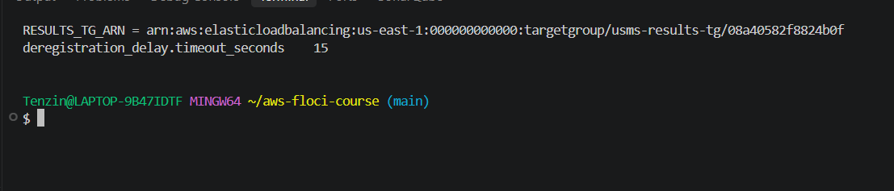
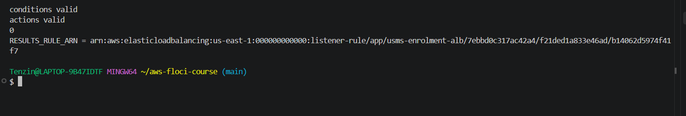
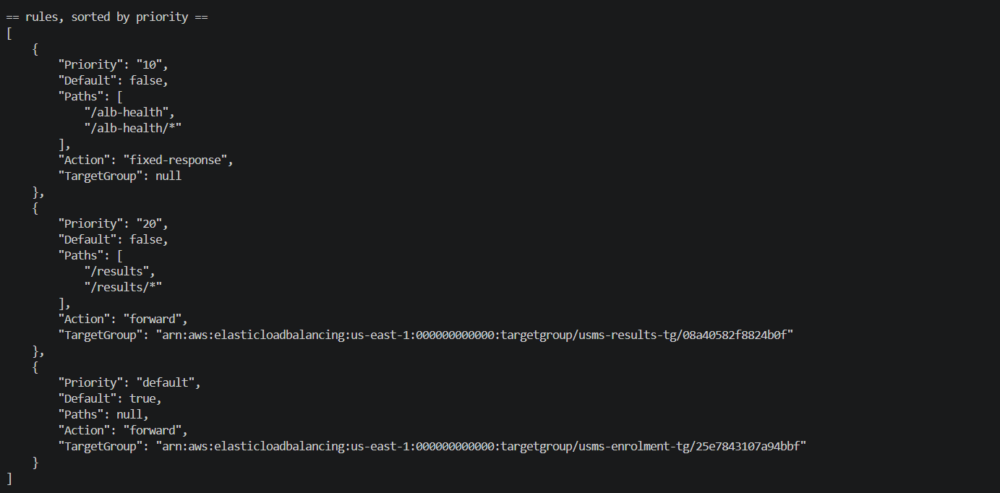
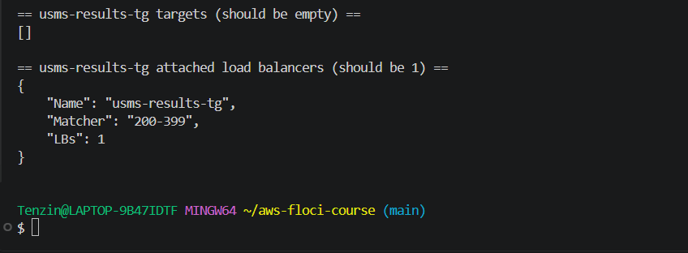
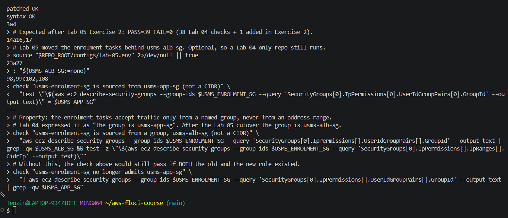
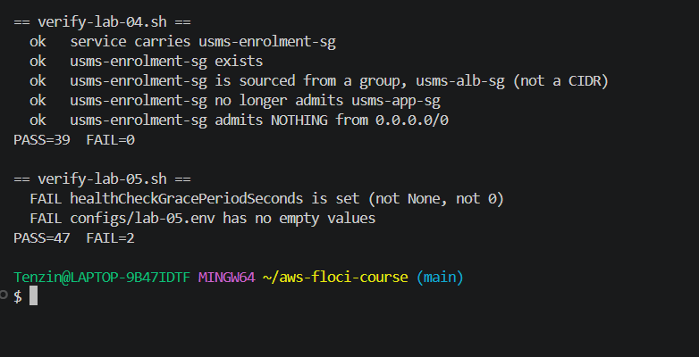
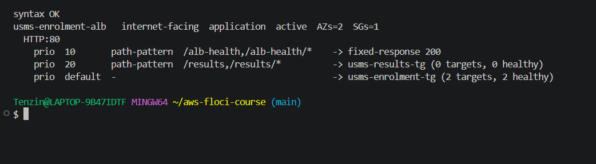
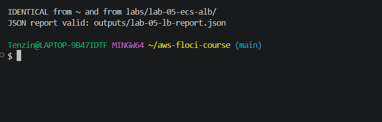
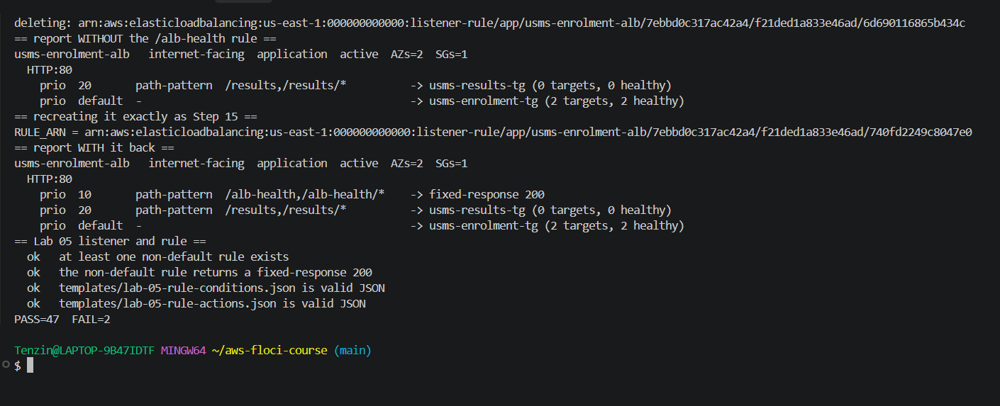

# Lab 05 Exercises

Tenzin Namgay (02230307), DSO303

## Exercise 1: a second path through the same load balancer

### What I built

1. Target group usms-results-tg: target type ip, HTTP on port 80, in usms-vpc, health check GET / with matcher 200-399, deregistration delay 15 seconds.
2. Listener rule at priority 20 on the existing HTTP:80 listener, path patterns /results and /results/*, forwarding to usms-results-tg.
3. Both tagged Project=USMS, Tier=app, Lab=05, Service=results.

The rule's conditions and actions are JSON documents in templates/ (lab-05-ex1-results-conditions.json and lab-05-ex1-results-actions.json). The conditions file used a quoted heredoc because it has no variables, and the actions file used an unquoted heredoc so $RESULTS_TG_ARN became the real ARN. grep -c '\$' printed 0.
Every ARN was captured with $(...) and --query. I did not register any targets, did not create a second ECS service, and did not add either object to configs/lab-05.env, because Exercise 4 removes them.

### Commands

```bash
RESULTS_TG_ARN=$(aws elbv2 create-target-group --name usms-results-tg \
  --protocol HTTP --port 80 --vpc-id "$USMS_VPC_ID" --target-type ip \
  --health-check-protocol HTTP --health-check-path / --health-check-port traffic-port \
  --health-check-interval-seconds 30 --health-check-timeout-seconds 5 \
  --healthy-threshold-count 2 --unhealthy-threshold-count 2 --matcher HttpCode=200-399 \
  --tags Key=Project,Value=USMS Key=Tier,Value=app Key=Lab,Value=05 Key=Service,Value=results \
  --query 'TargetGroups[0].TargetGroupArn' --output text)

aws elbv2 modify-target-group-attributes --target-group-arn "$RESULTS_TG_ARN" \
  --attributes Key=deregistration_delay.timeout_seconds,Value=15

RESULTS_RULE_ARN=$(aws elbv2 create-rule --listener-arn "$LISTENER_ARN" --priority 20 \
  --conditions file://templates/lab-05-ex1-results-conditions.json \
  --actions file://templates/lab-05-ex1-results-actions.json \
  --tags Key=Project,Value=USMS Key=Tier,Value=app Key=Lab,Value=05 Key=Service,Value=results \
  --query 'Rules[0].RuleArn' --output text)

aws elbv2 describe-rules --listener-arn "$LISTENER_ARN" \
  --query 'sort_by(Rules,&Priority)[].{Priority:Priority,Default:IsDefault,Paths:Conditions[0].PathPatternConfig.Values,Action:Actions[0].Type,TargetGroup:Actions[0].TargetGroupArn}' --output json
```

### Result

describe-rules sorted by priority shows three entries in evaluation order: priority 10 (/alb-health, fixed-response 200), priority 20 (/results, forward to usms-results-tg) and the default action (forward to usms-enrolment-tg).
describe-target-health on usms-results-tg returned [] and describe-target-groups shows it attached to 1 load balancer.
I sorted with sort_by(Rules,&Priority) because describe-rules does not promise priority order. Priority is a string, so the sort is alphabetical. It works here because "10" < "20" < "default", but a rule at priority 5 would sort after "20" as text, which is the trap the hint points at.









### What a request to /results would get

A request to /results would match the priority 20 rule, but usms-results-tg has no healthy targets, so the load balancer would answer 503 Service Temporarily Unavailable itself, the Section 11 code for "the listener worked but there was nothing healthy to send it to". On my build I could not test this with curl because there is no data path from my shell (Step 12).

## Exercise 2: repairing the verification script I broke

### 1. The property the old check asserted

The enrolment tasks accept traffic only from a named security group, never from an address range. The old check expressed that as "the first source group is usms-app-sg", which was only true for the Lab 04 architecture.

### 2 to 4. What I changed in scripts/utilities/verify-lab-04.sh

- I kept the original check and changed what it asserts: "usms-enrolment-sg is sourced from a group, usms-alb-sg (not a CIDR)". It now passes only if usms-alb-sg is among the source groups and the IpRanges list is empty. It also reads every IpPermissions entry instead of only [0], because the old [0][0] lookup depended on rule order.
- I added a second check straight after it, "usms-enrolment-sg no longer admits usms-app-sg". Without it, the first check would still pass if both the old and the new rule existed.
- usms-alb-sg's ID comes from configs/lab-05.env, which is sourced with 2>/dev/null || true so the script still runs in a repo that has done Lab 04 but not Lab 05.
- I added : "${USMS_ALB_SG:=none}" next to the other defaults. With set -u in force, a missing USMS_ALB_SG now gives a readable FAIL on the check instead of an unbound variable abort.
- The REPO_ROOT line using ${BASH_SOURCE[0]} is unchanged, so it still works from any directory.



### 5. Result

verify-lab-04.sh: PASS=39 FAIL=0. The new expected count is written as a comment at the top of the script: 38 Lab 04 checks plus the 1 I added.
verify-lab-05.sh: PASS=47 FAIL=2. The two failures are the grace period Floci limitation documented in my notes (Step 10 and Section 9), which this exercise cannot fix, so FAIL=0 is not reachable on my build for that script.



An undocumented count is worse than no count because when the number changes nobody can tell whether a check was added on purpose or one silently stopped running, so a written expected count turns any difference into something to investigate.

### When to update a verification script, and when it hides a regression

Updating a verification script is right when the architecture changed on purpose and the new check still asserts the same property, ideally in the same commit as the change. It becomes a way to hide a regression when you change the expected value just to make the script green without being able to point to the deliberate change that made the old value wrong.

## Exercise 3: a load balancer report tool

I wrote scripts/utilities/usms-lb-report.sh. It takes no arguments, finds every Application Load Balancer whose name starts with usms-, and prints its full decision table: the load balancer, each listener, and each rule in evaluation order with where it sends the request and how many targets are healthy. It also writes the same data to outputs/lab-05-lb-report.json (git ignored).

### Design decisions

- It resolves the repo from ${BASH_SOURCE[0]}, the same way Section 9's script does, so it works from any directory.
- Nothing is hard coded except the usms- prefix. The load balancers come from describe-load-balancers with a starts_with filter, then one describe-listeners call per load balancer, one describe-rules call per listener, and one describe-target-health call per target group (cached so a target group used twice is only asked once).
- Bash does the setup, then python3 does the four levels of nesting and the formatting, because nested bash loops over JSON at four levels are hard to get right. Python calls the AWS CLI with --output json at each level.
- Rule order: Priority is a string and the default action's priority is the word "default", so a plain string sort would put "10" before "5" and could put "default" in the wrong place. My sort key turns numeric priorities into integers and forces default last, which is the order the listener evaluates them. There is a comment in the script saying this.
- A non forward action prints its own summary (fixed-response 200, or redirect with its target) instead of an empty target group column.
- It handles a load balancer with no listeners (prints "no listeners"), a listener with no extra rules (only the default line), and a target group with no targets (0 targets, 0 healthy).
- Floci keeps path values only in PathPatternConfig.Values (Step 15), so the script reads Values first and falls back to the <Field>Config.Values block.
- set -uo pipefail without -e: it is a read only report, so one failed describe call should be reported on that row and the rest should still print, rather than the whole script stopping half way with no output.

### Results

Run from my home folder, after Exercise 1 added usms-results-tg:



The output was identical from ~ and from labs/lab-05-ecs-alb/ (diff printed nothing), and the JSON report is valid:



I temporarily deleted the /alb-health rule, ran the report (only priority 20 and default were shown, no crash and no empty row), then recreated the rule straight away with Step 15's own command and templates. verify-lab-05.sh still reported PASS=47 FAIL=2 with both rule checks ok.


