# Lab 5: Putting the ECS Service Behind an Application Load Balancer

**Student Name:** Tenzin Namgay

**Student ID:** 02230307

**Module:** DSO303 : Cloud Native Infrastructure

**Practical:** Lab 5 : ECS behind an Application Load Balancer

## 1. Aim / Objective

The aim of this lab was to give the USMS enrolment service from Lab 4 a stable front door. At the end of Lab 4 I had two Fargate tasks running in private subnets. Their addresses change every time a task is replaced, so nothing could point at them.

In this lab I did the following:

- I put an internet facing Application Load Balancer in front of the tasks, with its own security group, a target group, a listener and a listener rule.
- I attached the existing ECS service so that it registers its own targets.
- I cut the security groups over so that the load balancer is the only thing that can reach the tasks.
- I proved that the whole setup survives a restart.
- I built a verification script and an end of course cleanup script.
- I did the five exercises.

## 2. Introduction

An Application Load Balancer (ALB) is made of four objects:

- **The load balancer.** It has the DNS name, the subnets it places nodes in, and a security group.
- **A listener.** This is one port and protocol on the load balancer. It has exactly one default action.
- **A rule.** This is a condition and an action with a priority. Rules are checked lowest number first, before the default action.
- **A target group.** This is a set of targets plus the health check. So the health check lives on the target group, not on the load balancer.

For Fargate the target group must use target type ip. A Fargate task has no instance ID, only an IP address on its network interface.

The main idea is indirection. The load balancer is a stable name in front of a set of task addresses that keep changing. The ECS service keeps that list up to date by registering and deregistering its own tasks.

## 3. Use Case

- Giving the USMS portal one stable name for the enrolment API, instead of a list of task addresses that change on every deployment
- Making sure the only path to the enrolment tasks is through the load balancer, so the tasks stay private with no public address
- Letting deployments and scaling happen without anyone editing a list of targets, because the ECS service registers new tasks and removes old ones
- Answering a simple health path on the load balancer itself, without touching any task
- Preparing a target group and a ResourceLabel so Lab 06 can scale the service on requests per target instead of CPU

## 4. System Architecture / Design

usms-enrolment-alb is internet facing. It has a node in usms-public-subnet-a (us-east-1a) and one in usms-public-subnet-b (us-east-1b), and both subnets route to usms-igw. The load balancer carries usms-alb-sg, which admits tcp 80 (and tcp 443, from the Step 4 Your turn) from 0.0.0.0/0.

The HTTP:80 listener has two parts:

- A rule at priority 10 that answers /alb-health with a fixed 200.
- A default action that forwards to usms-enrolment-tg (target type ip, HTTP 80, health check GET / every 30 seconds, matcher 200, deregistration delay 30 seconds).

usms-enrolment-svc from Lab 4 is attached to that target group and registers its two tasks itself. The tasks stay in the private subnets with no public IP. After the cutover, usms-enrolment-sg admits tcp 80 only from usms-alb-sg.

    Internet
       |  http://usms-enrolment-alb-...elb.floci/
       v
    usms-igw -> usms-public-rt
       |
    usms-enrolment-alb  [usms-alb-sg: tcp 80, 443 from 0.0.0.0/0]
     nodes in usms-public-subnet-a (1a) and usms-public-subnet-b (1b)
     listener HTTP:80
       rule priority 10   /alb-health, /alb-health/*  -> fixed-response 200
       default action                                  -> forward usms-enrolment-tg
                                                          target type ip, GET / every 30s
       |
       | tcp 80, source = usms-alb-sg ONLY (after the Step 13 cutover)
       v
    usms-enrolment-svc  (registers and deregisters its own targets)
       task in usms-private-subnet-a  [usms-enrolment-sg]
       task in usms-private-subnet-b  [usms-enrolment-sg]

    usms-web-01 [usms-app-sg] still exists, but usms-app-sg no longer grants it anything on the tasks.

## 5. Implementation Procedure

### Part A: Getting ready (Steps 1 to 3)

I loaded all five env files and checked that I was on Floci. All twelve values the lab needs were filled in. This included usms-public-subnet-b, which I need because an ALB requires two Availability Zones.

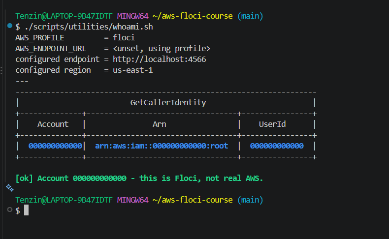
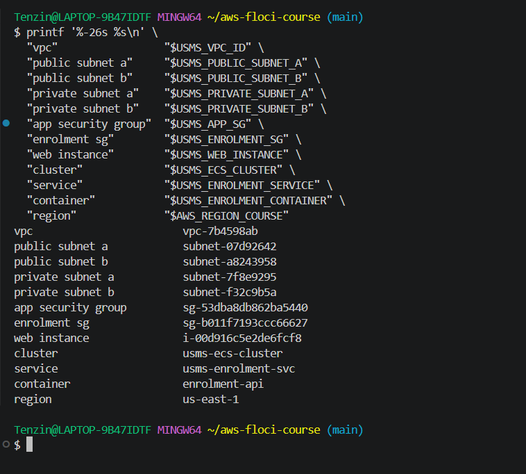

The earlier labs were still intact. verify-lab-02.sh and verify-lab-03.sh showed the same known Floci failures as when I finished those labs. verify-lab-04.sh gave PASS=38 FAIL=0, which the lab requires before starting. I saved that run as the "before" file for Step 13.

All ten ELBv2 probes answered SUPPORTED. My final support path is A for the control plane and health checks, and B for the client data path. I chose B for the data path because in Step 12 the DNS name did not resolve from my shell.

### Part B: Security group, load balancer and target group (Steps 4 to 7)

I created usms-alb-sg with one inbound rule, tcp 80 from 0.0.0.0/0. This is the only 0.0.0.0/0 rule in the course, and it is there on purpose. For the Your turn I added tcp 443 from a JSON document. I noted that an open port alone does not give HTTPS. Nothing listens on that port until there is an HTTPS listener and a certificate.

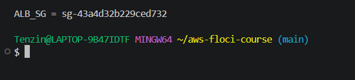
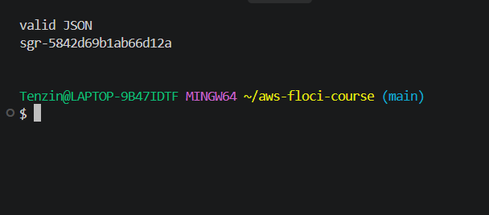
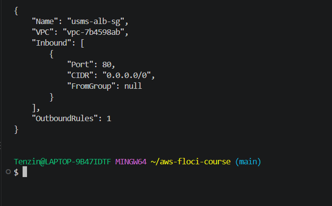

I created the load balancer across both public subnets. It went active on the first poll. It has two different AZs, is internet facing, is of type application, and carries usms-alb-sg. I also set the idle timeout to 60 and turned on dropping invalid header fields.

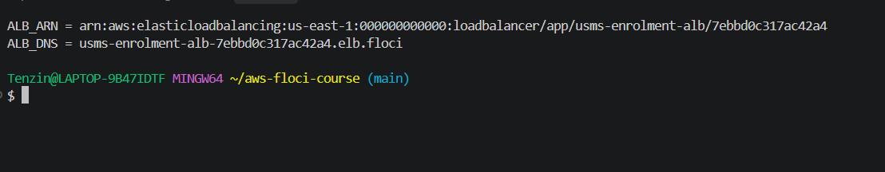

I created usms-enrolment-tg with target type ip. On Windows its health check path is / only because I set MSYS_NO_PATHCONV=1. Without it, Git Bash turns a lone / into a Windows path. The target group was empty, which is correct until the service fills it. For the Your turn I widened the matcher to 200-399 and then set it back to 200. Both changes were made in place.

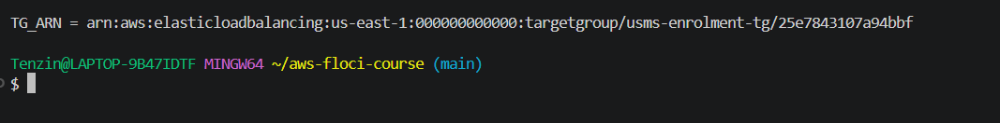
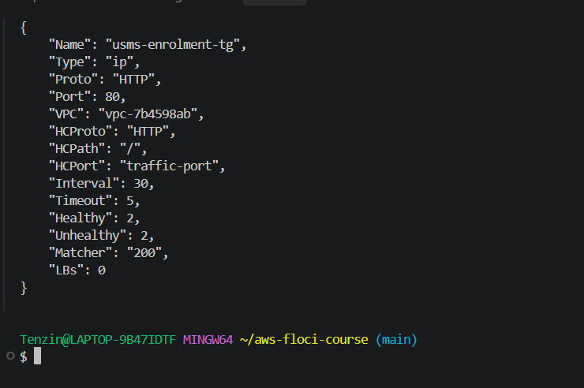
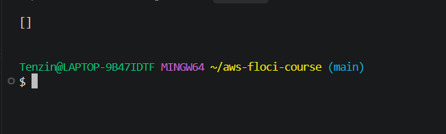

I set the deregistration delay to 30 seconds and the algorithm to least_outstanding_requests.

### Part C: Listener, the tasks' firewall and attaching the service (Steps 8 to 10)

I wrote the default action as a JSON document with an unquoted heredoc and checked that no $ was left. Then I created the HTTP:80 listener. After that the target group showed one attached load balancer.

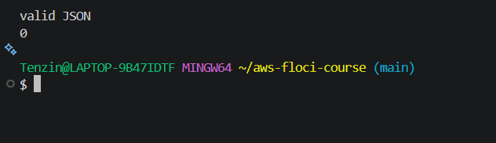
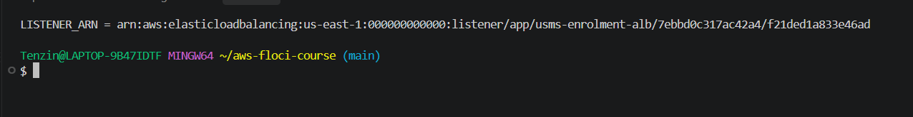

I added tcp 80 from usms-alb-sg to usms-enrolment-sg. The old rule from usms-app-sg was still there at this point, so the new path existed before I removed the old one.

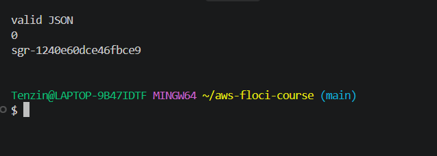

update-service with --load-balancers returned no error. But the service still showed loadBalancers and the grace period as null, so my Floci build silently ignores it. I used the lab's fallback. I scaled the service to 0, deleted it, and recreated it with create-service and the load balancer attached. I kept the same name, cluster, revision usms-enrolment:4, desired count, subnets and security group. This time the load balancer entry was stored, but the 60 second grace period stayed null.

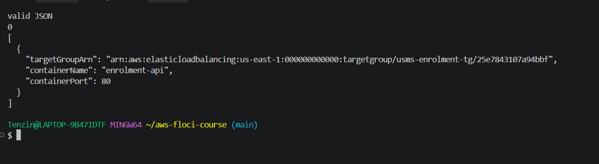

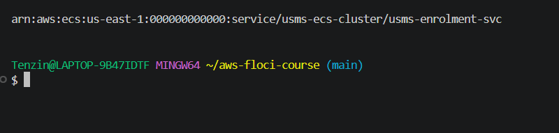

### Part D: Targets, proving the path and the cutover (Steps 11 to 13)

The target group filled itself with two healthy targets. I did not register anything. The addresses were Docker network addresses (172.18.0.3 and 172.18.0.4), not addresses from my private subnets. ECS reported no healthStatus or task IP, so I could only observe the load balancer half of the side by side comparison. For the Your turn I scaled to 3 and back to 2. The third target appeared and went away by itself.

The DNS name did not resolve on my laptop and curl returned 000, so I did not get a 200. I used the control plane proof instead. It shows each link of the chain, from listener to target group to service to security group.

For the cutover I found the old rule by its ID. Revoking it by rule ID returned True but removed nothing. So I revoked the same rule with --ip-permissions and Lab 4's own policy document. After that, usms-enrolment-sg had only usms-alb-sg as a source. verify-lab-04.sh then changed exactly one check from ok to FAIL, which is the expected result.

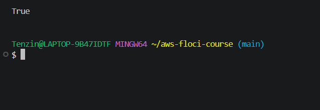

### Part E: Deployment, rule, restart and recording it (Steps 14 to 19)

A forced deployment returned success. But the same two tasks and addresses were still running afterwards, so I could not see initial, healthy and draining during a deployment. The poll loop's stop check in the lab has a small bug (length(deployments) without services[0]), so it always ran all 15 polls.

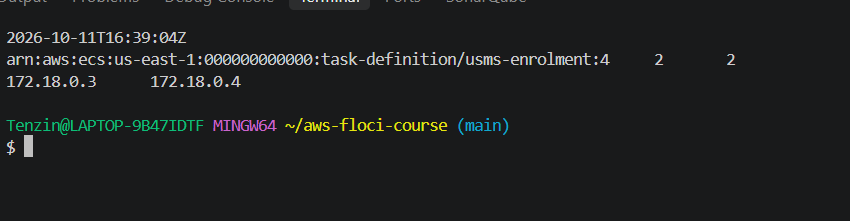

I added the priority 10 rule that answers /alb-health with a fixed 200. Floci stored the paths only in PathPatternConfig.Values, and curl still could not connect.

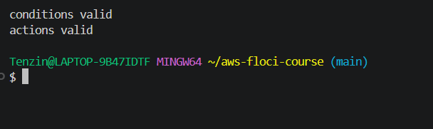
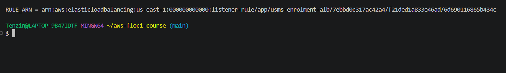

I restarted Floci and got every ARN again from the API. All seven facts matched, so the script printed PERSISTENCE PROVEN.

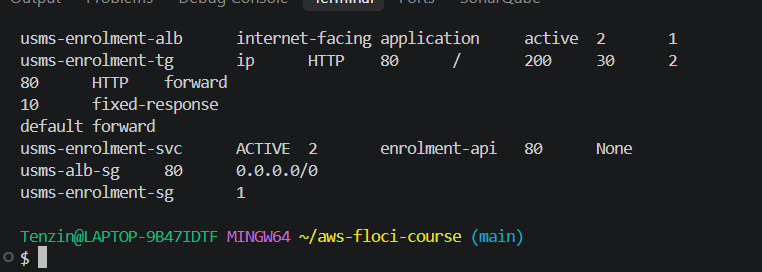

When I closed the loop, the script printed CUTOVER CONFIRMED and LOOP CLOSED. The audit showed the Lab=05 tags.

I wrote configs/lab-05.env by lookup. The lab's listener filter failed on my shell, because the escaped backticks reached the AWS CLI together with the backslash. I rewrote only that filter as to_string(Port)=='80'.

### Part F: Verification and cleanup scripts (Section 9)

verify-lab-05.sh first gave PASS=46 FAIL=3. One failure was a bug in the lab's git check. It fails on outputs/.gitkeep, even though that file is meant to be tracked. I fixed it the same way as in Lab 4. The final result is PASS=47 FAIL=2. Both remaining failures come from the grace period Floci limitation. The cleanup script passes bash -n and I have not run it.

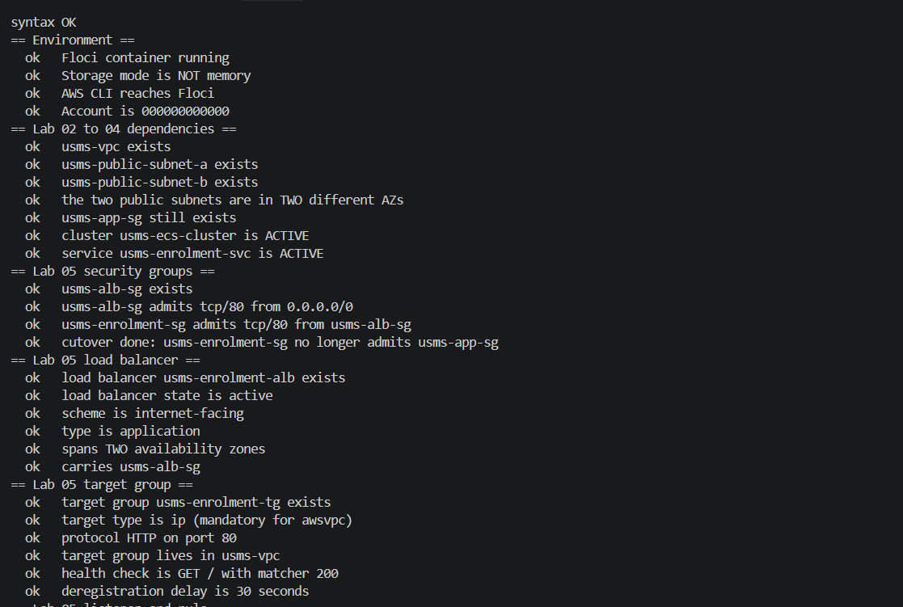

## 6. Results and Evidence

### 6.1 CLI / SDK Evidence

All screenshots are referenced in Section 5.

- verify-lab-05.sh reports PASS=47 FAIL=2. Both failures are explained as benign in notes/lab-05-notes.md.
- After Exercise 2, verify-lab-04.sh reports PASS=39 FAIL=0.
- The five exercises are in labs/lab-05-ecs-alb/exercises.md.
- The support path, the Section 12.1 observed versus conceptual list and the seven review questions are in notes/lab-05-notes.md.

### 6.2 AWS Management Console Verification

Floci has no graphical console, so I did all verification through the CLI.

## 7. Analysis and Discussion

The load balancer, target group, listener, rule, service attachment and security cutover are all in place, and everything survived a restart. Below are the things that did not go as the lab expected.

**Floci limitations:**

1. update-service --load-balancers was accepted and ignored, so I used the lab's fallback and recreated the service.
2. healthCheckGracePeriodSeconds was never stored, on create-service or update-service. This causes both verify-lab-05.sh failures. Real AWS would store 60.
3. The load balancer's DNS name did not resolve on my laptop and curl returned 000, so I never saw a 200 through the load balancer.
4. Targets were registered with Docker network addresses (172.18.0.x) and no Availability Zone, not with addresses from my private subnets.
5. ECS returned no healthStatus or private IP for tasks, and service events were None.
6. --force-new-deployment replaced no tasks, so I never saw a target draining.
7. revoke-security-group-ingress by rule ID returned True and removed nothing. describe-security-group-rules also kept showing the old rule after it was really revoked.
8. describe-target-group-attributes showed only the attributes I set. SslPolicy came back as "" instead of null, and rule paths were only in PathPatternConfig.Values.
9. Two security group rules on the same port stayed as two separate entries instead of being merged.

**Bugs in the lab's commands:**

- The Step 14 poll loop uses length(deployments) instead of length(services[0].deployments).
- The Step 18 listener filter's escaped backticks fail inside $(...) on my shell.
- The Section 9 git check fails on outputs/.gitkeep.
- The cleanup script's comment says lab-04-cleanup.sh twice, where one of them should be the Lab 06 cleanup.

**Windows issues:** I set MSYS_NO_PATHCONV=1 so that --health-check-path / was not turned into a Windows path.

**Revision:** the lab assumes usms-enrolment:2, but my service runs usms-enrolment:4 because of the nginx image problem in Lab 4. I did not register a new revision in this lab.

## 8. Reflection

**What did I learn about this AWS service?**

I learned that a load balancer is really four objects, and that the health check is on the target group, not on the load balancer. The biggest idea for me was that the ECS service keeps the target group up to date by itself. I never register a task's address by hand. This is the same idea as the group based security rule in Lab 4.

**What challenges did I encounter?**

The hardest part was that several commands returned success without doing anything, like update-service with a load balancer and revoking a rule by ID. I learned to always read the result back with a describe call instead of trusting the success message. I also learned to use the lab's fallback when one exists.

**How would I apply this in a real world cloud environment?**

I would keep services in private subnets behind a load balancer, and allow only the load balancer's security group into the tasks. I would do a cutover in the order add, prove, then remove. I would also set the deregistration delay and grace period on purpose, and put HTTPS with an ACM certificate in front of anything that handles logins.

**What additional concepts would I like to explore?**

I want to use the ResourceLabel from Exercise 5 in Lab 06 to scale the service on requests per target. I would also like to try an HTTPS listener with a real certificate.

## 9. Conclusion

In this lab I put the USMS enrolment service behind an internet facing Application Load Balancer. I used a target group of type ip, an HTTP listener and a health rule, and the ECS service registers its own targets. After the cutover, the load balancer is the only thing that can reach the tasks, and the setup survived a restart. verify-lab-05.sh passes 47 of 49 checks, and both failures come from one Floci limitation. All five exercises are done. The objectives were achieved, and the ResourceLabel for Lab 06 is ready.

## 10. Appendix (Optional)

- GitHub repository: https://github.com/Eyemusican/dso303-lab01-iam
- Exercises: labs/lab-05-ecs-alb/exercises.md
- Notes, support path and review questions: notes/lab-05-notes.md
- Config: configs/lab-05.env
- Policies: policies/usms-alb-sg-ingress.json, policies/usms-alb-sg-ingress-443.json, policies/usms-enrolment-sg-ingress-alb.json
- Templates: templates/lab-05-listener-default-actions.json, lab-05-rule-conditions.json, lab-05-rule-actions.json, lab-05-service-load-balancers.json
- Scripts: scripts/utilities/verify-lab-05.sh, scripts/utilities/usms-lb-report.sh, scripts/utilities/usms-resource-label.sh, scripts/cleanup/lab-05-cleanup.sh
