# Lab 06 Exercises

Tenzin Namgay (02230307), DSO303

## Exercise 1: a memory policy, and a scale out only policy

### What I built

I added a third target tracking policy, usms-enrolment-memory-target-tracking, on the same scalable target. It tracks ECSServiceAverageMemoryUtilization at a target of 70, with a scale out cooldown of 60 and a scale in cooldown of 600. DisableScaleIn is true, so this policy can only add tasks. The file has no variables, so I wrote it with a quoted heredoc and grep found 0 dollar signs.

`templates/lab-06-target-tracking-memory.json`

```json
{
  "TargetValue": 70.0,
  "PredefinedMetricSpecification": {
    "PredefinedMetricType": "ECSServiceAverageMemoryUtilization"
  },
  "ScaleOutCooldown": 60,
  "ScaleInCooldown": 600,
  "DisableScaleIn": true
}
```

### Commands

```bash
MEM_POLICY="usms-enrolment-memory-target-tracking"
MEM_POLICY_ARN=$(aws application-autoscaling put-scaling-policy \
  --service-namespace ecs --resource-id "$RID" --scalable-dimension "$SDIM" \
  --policy-name "$MEM_POLICY" --policy-type TargetTrackingScaling \
  --target-tracking-scaling-policy-configuration file://templates/lab-06-target-tracking-memory.json \
  --query 'PolicyARN' --output text)

aws cloudwatch describe-alarms --alarm-name-prefix "TargetTracking-${RID}" \
  --query 'length(MetricAlarms)' --output text
```

I did not record the policy in configs/lab-06.env and I did not change the bounds.

### Result

The policy showed ECSServiceAverageMemoryUtilization, Target 70.0, Out 60, In 600 and NoScaleIn true. On real AWS the managed alarm count goes from four to five. On my Floci build it went to **six**, because Floci also created an AlarmLow for this policy even though scale in is disabled.

My prediction was that verify-lab-06.sh would not change, because no check looks at a third policy and the managed alarm check only asks for 2 or more. It still reported PASS=39 FAIL=3, with the same three scheduled action failures as before (a Floci limitation, see Step 11). So it did not reach FAIL=0, but the memory policy did not add any failure.

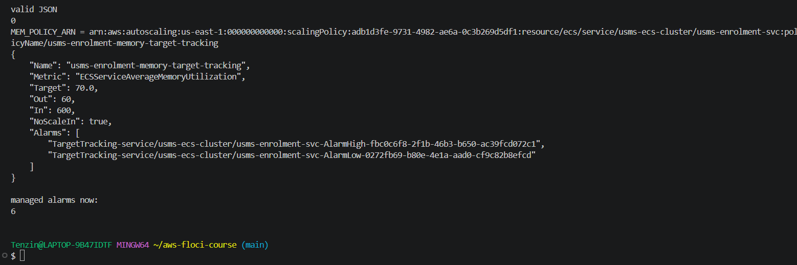
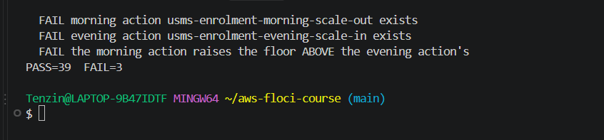

### Answers

- **Why five and not six:** the policy has DisableScaleIn true, so AWS does not create the low alarm, because there is nothing for it to trigger, and its absence means this policy will never ask for fewer tasks. (Floci created it anyway, which is a Floci limitation.)
- **Memory 70 against CPU 50:** whichever metric is further above its own target scales out first, and to answer properly I would need the real CPU and memory usage of one task under load, which only a load test gives.
- **Does it change scale in for the other two:** no, because with no low alarm it never asks to scale in, so the rule from Step 9 (scale in only when every policy agrees) is decided by the CPU and request policies as before.

## Exercise 2: the scale in half of step scaling

### What I built

`templates/lab-06-step-scaling-in.json`

```json
{
  "AdjustmentType": "ChangeInCapacity",
  "MetricAggregationType": "Average",
  "Cooldown": 300,
  "StepAdjustments": [
    { "MetricIntervalLowerBound": -10, "MetricIntervalUpperBound": 0, "ScalingAdjustment": -1 },
    { "MetricIntervalUpperBound": -10, "ScalingAdjustment": -2 }
  ]
}
```

Then usms-enrolment-queue-step-in (StepScaling) and the alarm usms-enrolment-queue-low on USMS/Enrolment EnrolmentQueueDepth: Average, period 60, 3 evaluation periods, LessThanThreshold 20, and its only action is the step in policy. I created the policy first because the alarm needs its ARN.

```bash
aws cloudwatch put-metric-alarm --alarm-name usms-enrolment-queue-low \
  --namespace USMS/Enrolment --metric-name EnrolmentQueueDepth \
  --dimensions Name=Service,Value=enrolment --statistic Average \
  --period 60 --evaluation-periods 3 --threshold 20 \
  --comparison-operator LessThanThreshold --treat-missing-data notBreaching \
  --alarm-actions "$STEP_IN_ARN"
```

### Signs of every bound and adjustment

The bounds are measured from the threshold of 20, and the breach is metric minus 20. Below the threshold the breach is negative, so every bound is zero or negative and every adjustment is negative because it removes tasks.

| Interval | Lower bound | Upper bound | Metric range | Adjustment |
| --- | --- | --- | --- | --- |
| mild | -10 | 0 | 10 to 20 | -1 |
| strong | none | -10 | below 10 | -2 |

- `MetricIntervalUpperBound: 0` with `ScalingAdjustment: -1` means: when the metric is anywhere from 10 up to just under 20, remove one task.
- The cooldown is 300, longer than the scale out policy's 60, because removing capacity is the risky direction. A new task needs 20 to 60 seconds to start plus 60 seconds of grace, so scaling in quickly right after a scale out would throw away tasks that were just paid for and make the count flap.
- **The unreachable step:** the -2 step. 2 + (-2) = 0, which is below MinCapacity 2, so at the floor it can never apply. At desired 2 the -1 step is blocked as well, and -2 only takes full effect once the service has 4 or more tasks.

### Forcing the low alarm

I published 5 three times (a breach of -15, which selects the -2 step) and forced the low alarm to ALARM with set-alarm-state.

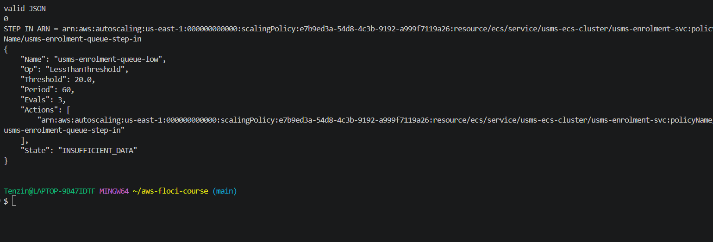
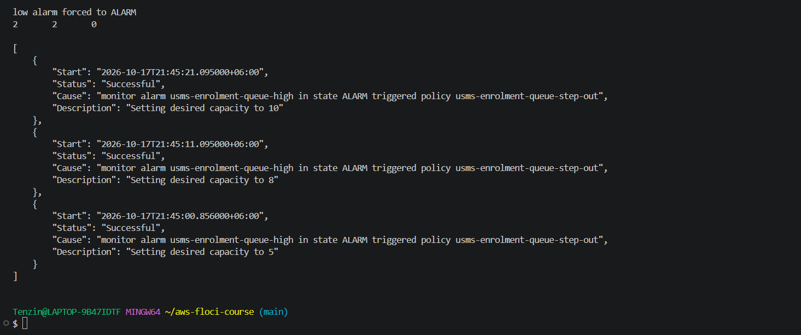

**What happened: nothing.** desiredCount stayed 2 (running 2, pending 0) and no new scaling activity was recorded; the newest one was still the Step 12 scale out at 21:45. This matches the floor of 2. When I checked the alarm before deleting it, Floci had already put it back to OK at its next evaluation (3 periods are needed, there was only one minute of data, and missing data is notBreaching). Real CloudWatch also overwrites a forced state at the next evaluation.

### Deleting both objects

**Delete the alarm usms-enrolment-queue-low**
- **What will be deleted:** one CloudWatch alarm that I created in this exercise.
- **What depends on it:** nothing. It is the one that points at the policy, not the other way round.
- **Reversible?** Yes, one put-metric-alarm recreates it.
- **Effect on later labs:** none. It is not in configs/lab-06.env.

```bash
aws cloudwatch delete-alarms --alarm-names usms-enrolment-queue-low
```

**Delete the policy usms-enrolment-queue-step-in**
- **What will be deleted:** one step scaling policy from this exercise.
- **What depends on it:** only the alarm above, which is already gone. Deleting the policy first would leave an alarm whose action points at nothing.
- **Reversible?** Yes, one put-scaling-policy with templates/lab-06-step-scaling-in.json recreates it.
- **Effect on later labs:** none.

```bash
aws application-autoscaling delete-scaling-policy \
  --service-namespace ecs --resource-id "$RID" --scalable-dimension "$SDIM" \
  --policy-name usms-enrolment-queue-step-in
```

After this the alarm count for that name was 0, four policies were left (cpu, memory, step out, requests) and verify-lab-06.sh was back to PASS=39 FAIL=3.

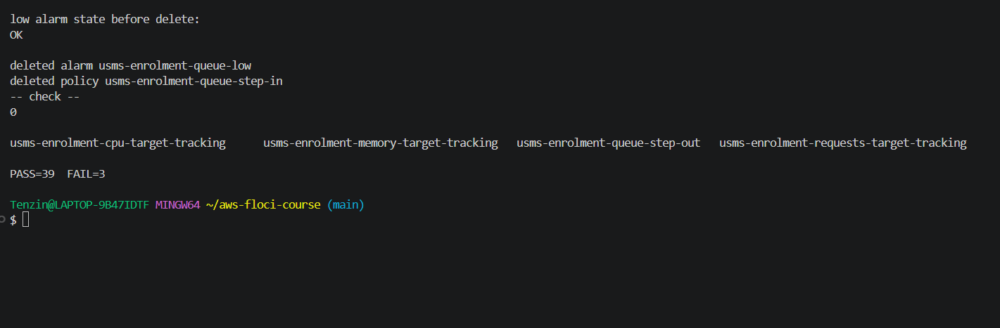

### A step policy on CPU next to the CPU target tracking policy

If someone adds a step scaling policy on CPU with its own alarm at 60 per cent next to the CPU target tracking policy at 50, the two fight over the same number. Target tracking does not add a fixed step. It computes the capacity that should bring CPU back to 50 (current tasks x current CPU / 50). So the step policy adds its fixed tasks at 60, CPU drops below 50, target tracking now sees too much capacity and works to remove it, CPU climbs back past 60, and the step policy fires again. The count keeps going up and down and nobody can explain the graph. I would keep the target tracking policy, because it already reacts in proportion to how far CPU is from the target, and delete the step policy (or move it to a different signal such as the queue depth).

## Exercise 3: a scaling report tool

I wrote `scripts/utilities/usms-scaling-report.sh`. It takes no arguments, finds every scalable target in the ecs namespace whose cluster starts with usms-, and prints its decision table with a computed verdict. It also writes outputs/lab-06-scaling-report.json.

### Design decisions

- **Runs from any directory:** REPO_ROOT comes from `${BASH_SOURCE[0]}`, then the script changes into it and sources configs/course.env.
- **set -uo pipefail and not -e:** it is a report, not a change. On my Floci describe-scheduled-actions always fails, and with -e that first failure would stop the report half way. Every call is checked on its own in the Python part instead.
- **Nothing hard coded** apart from the usms- prefix. The target, policies, alarms and activities are all discovered.
- **Batched alarm lookups:** one describe-alarms call with all the managed alarm names, and the step policy's own alarm is found by matching its AlarmActions against the policy ARN.
- **No blank rows:** a target with no policies prints `policies none`, an empty Alarms list prints `none listed`, an unsupported describe-scheduled-actions prints `unavailable`, and an unsupported describe-scaling-activities prints `unavailable` too.
- **Step adjustments** are printed as a signed list (+1 / +3) built from the configuration.
- **Verdict order:** PINNED, then FROZEN, then AT-CEILING, then AT-FLOOR, then ELASTIC. PINNED comes first because with min equal to max nothing else can matter. FROZEN outranks AT-CEILING because a suspended target is the hazard nobody sees (the policies and alarms look normal), while being at the ceiling shows up on any graph. A target that is frozen at the ceiling is still frozen, and that is what someone has to act on.

### Results

```text
service/usms-ecs-cluster/usms-enrolment-svc   ecs:service:DesiredCount
  bounds       min=2  max=10   desired=2   running=2   AT-FLOOR
  suspended    none
  target-track usms-enrolment-cpu-target-tracking       CPU/50.0   out=60  in=300
                 alarms  AlarmHigh=INSUFFICIENT_DATA  AlarmLow=INSUFFICIENT_DATA
  target-track usms-enrolment-memory-target-tracking    Memory/70.0   out=60  in=600  scale-in OFF
                 alarms  AlarmHigh=INSUFFICIENT_DATA  AlarmLow=INSUFFICIENT_DATA
  step         usms-enrolment-queue-step-out            +1 / +3   cooldown=60
                 alarm   usms-enrolment-queue-high = OK  (USMS/Enrolment EnrolmentQueueDepth >= 100.0)
  target-track usms-enrolment-requests-target-tracking  ALBReq/1000.0   out=60  in=300
                 alarms  AlarmHigh=INSUFFICIENT_DATA  AlarmLow=INSUFFICIENT_DATA
  scheduled    unavailable (describe-scheduled-actions not supported on this build)
  last activity  2026-10-17T21:45:21.095000+06:00  Successful  Setting desired capacity to 10
```

- The output was identical when I ran it from `~` and from `labs/lab-06-ecs-autoscaling/` (diff was empty), and the JSON file was valid.
- The verdict is AT-FLOOR, not ELASTIC like the doc's example, because desired 2 equals MinCapacity 2 and more than one policy exists. That is what the doc's own rules say.
- While scale in was suspended the verdict was **FROZEN** with DynamicScalingInSuspended listed. With min and max both 3 it was **PINNED**. After I put everything back it was AT-FLOOR again, and verify was still PASS=39 FAIL=3.
- In the PINNED test desired stayed at 2 even though min was 3, which is the same Floci limitation as Step 6 (the floor is stored but not enforced).

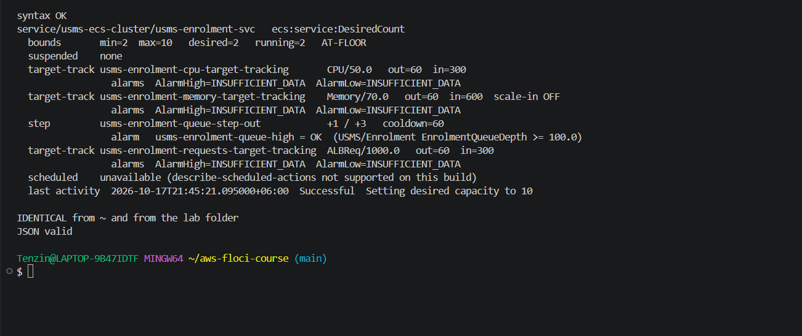
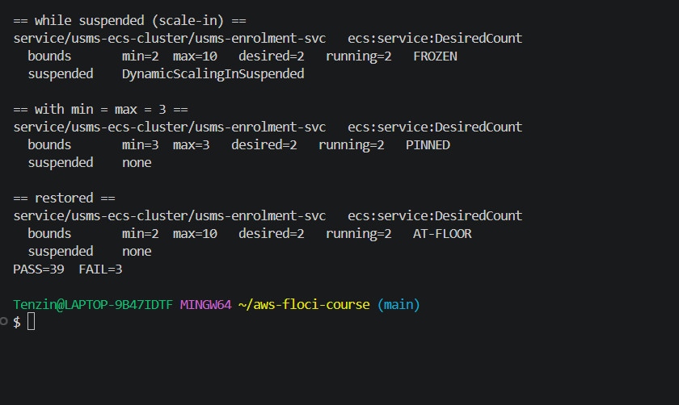

## Exercise 4: the enrolment week capacity plan

### Is it solved

Reactive scaling is good at following load that grows over minutes, and it gives capacity back when the load drops, so the extra two weeks at double traffic are handled well. It is bad at sudden jumps, because it only acts after a metric has already been high for a while and new tasks then still need time to start. In the first twenty minutes of a cohort day, 40 times the traffic arrives in seconds, so reactive scaling alone would repeat last year's failure, and the capacity has to be there before the doors open.

### Why forty times traffic is not a scaling problem

From this lab's own numbers, going from 2 tasks to 10 with the step policy:

| Delay | Value | Where it is set |
| --- | --- | --- |
| Alarm evaluation | 60 s x 1 period = 60 s | my alarm usms-enrolment-queue-high |
| Policy invocation | about 0 s | Application Auto Scaling |
| Step +3, then cooldown, +3, then cooldown, +2 (clamped) | 2 to 5 at 60 s, 5 to 8 at 120 s, 8 to 10 at 180 s | Cooldown 60 in the step config, MaxCapacity 10 |
| Task start | 20 to 60 s | Fargate (Lab 04, cited) |
| Health check grace | 60 s | Lab 05 Step 10 |

So the last tasks serve at about 180 + 60 + 60 = **300 seconds**, five minutes. With the CPU target tracking policy it is about the same: 3 x 60 = 180 s before the high alarm fires, then 20 to 60 s start and 60 s grace (260 to 300 s), even though target tracking jumps straight to the computed count.

The bigger problem is the ceiling. At the Step 9 target of 1000 requests per target per minute, 10 tasks hold 10 x 1000 = 10,000 requests a minute, which is only **about 167 requests per second**. Lab 04 Exercise 4 assumed one task serves about 10 requests per second and that the enrolment peak is about 100 requests per second. Forty times normal is far beyond 10 tasks. So more scaling speed does not fix it. It is a capacity decision made in advance.

### The ceiling, checked against Lab 02

- usms-private-subnet-a is 10.0.3.0/24 and usms-private-subnet-b is 10.0.4.0/24, so 256 addresses each.
- AWS reserves 5 addresses in every subnet: "The first four IP addresses and the last IP address in each subnet CIDR block are not available for your use" ([AWS VPC User Guide, Subnet CIDR blocks](https://docs.aws.amazon.com/vpc/latest/userguide/subnet-sizing.html)). That leaves 251, which is exactly what Floci reported as AvailableIpAddressCount.
- Each subnet already has 1 network interface in use, so 250 are free in each, 500 in total.
- Every Fargate task in awsvpc mode takes one address. A rolling deployment can run old and new tasks side by side (up to double), so I keep half for that. The largest ceiling I would support is about **250 tasks**, and well before that the service quota for Fargate tasks would matter.

### The capacity plan

These are for real AWS. On my Floci build put-scheduled-action is unsupported (Step 11), so I could not run them here. I assumed enrolment opens on Saturday 14 November 2026 and the three cohort days are the 14th, 21st and 28th. The project lead needs to confirm these (see below). Time zone Asia/Thimphu on every action.

| Action | Schedule | Bounds |
| --- | --- | --- |
| usms-enrolment-window-start | `at(2026-11-14T00:00:00)` | min 4, max 30 |
| usms-enrolment-cohort-1-open | `at(2026-11-14T07:30:00)` | min 20, max 30 |
| usms-enrolment-cohort-1-close | `at(2026-11-14T10:00:00)` | min 4, max 30 |
| cohort 2 (open and close) | `at(2026-11-21T07:30:00)` and `at(2026-11-21T10:00:00)` | min 20 then min 4, max 30 |
| cohort 3 (open and close) | `at(2026-11-28T07:30:00)` and `at(2026-11-28T10:00:00)` | min 20 then min 4, max 30 |
| usms-enrolment-window-end | `at(2026-12-05T00:00:00)` | min 2, max 10 |

Example of one of them:

```bash
aws application-autoscaling put-scheduled-action \
  --service-namespace ecs --resource-id service/usms-ecs-cluster/usms-enrolment-svc \
  --scalable-dimension ecs:service:DesiredCount \
  --scheduled-action-name usms-enrolment-cohort-1-open \
  --schedule "at(2026-11-14T07:30:00)" --timezone Asia/Thimphu \
  --scalable-target-action MinCapacity=20,MaxCapacity=30
```

- **Floor:** 4 for the three weeks (double normal) and 20 for two and a half hours on each cohort morning, starting half an hour before the doors open.
- **Ceiling:** raised from 10 to 30 for the window, far inside the 250 the subnets allow.
- **Target value:** lower the request target from 1000 to 500 requests per target per minute (about 8 per second, under Lab 04's assumed 10 per second per task), so each task is not run at its limit.
- **Reversible in one command:** every one of these. Each scheduled action is removed with one delete-scheduled-action, the bounds with one register-scalable-target, and the target value with one put-scaling-policy. The at() actions stay behind after firing, so the window-end action and a cleanup of all of them belong on the same runbook page.

### Monthly cost estimate

Fargate Linux x86 in us-east-1 is $0.000011244 per vCPU second and $0.000001235 per GB second ([AWS Fargate pricing](https://aws.amazon.com/fargate/pricing/)), which is $0.0404784 per vCPU hour and $0.004446 per GB hour. My task is 256 CPU units (0.25 vCPU) and 1024 MB (1 GB) from configs/lab-04.env:

- One task hour = 0.25 x 0.0404784 + 1 x 0.004446 = **$0.0146 per task hour**.
- Three week floor of 4 instead of 2: 2 extra tasks x 504 hours = 1,008 task hours = **$14.68**.
- Cohort mornings: 16 extra tasks (20 instead of 4) x 2.5 hours x 3 days = 120 task hours = **$1.75**.
- CloudWatch: 5 standard alarms (4 managed and the queue alarm) at $0.10 each = $0.50, and 1 custom metric at $0.30 = $0.30 ([CloudWatch pricing summary, us-east-1](https://cloudchipr.com/blog/cloudwatch-pricing)).
- **Total: about $17.23 for the enrolment month.**

Assumptions: list prices with no free tier and no Savings Plan; the load balancer and the base 2 tasks are already paid for and not counted; reactive scale out above these floors is not counted because nobody has measured the real load yet.

### What I need from the project lead

1. The exact dates and opening times of the three cohort days, and the number of requests per second that "normal" means.
2. A load test that measures how many requests one task really serves. Section 11 says no step in this lab is load testing, so every number here (target 50, 1000 requests, threshold 100, ceiling 10) is provisional.
3. Approval for the cost above and for raising the ceiling to 30, plus a named person on call on each cohort morning.

### The tidy up

Exercise 2's alarm and policy were already deleted in Exercise 2. The only thing left was the Exercise 1 policy.

**Delete the policy usms-enrolment-memory-target-tracking**
- **What will be deleted:** the memory target tracking policy from Exercise 1, and with it the managed alarms Application Auto Scaling created for it.
- **What depends on it:** nothing. It is not in configs/lab-06.env and no verify check uses it.
- **Reversible?** Yes, one put-scaling-policy with templates/lab-06-target-tracking-memory.json recreates it.
- **Effect on later labs:** none. Nothing in Section 15's KEEP column is touched.

```bash
aws application-autoscaling delete-scaling-policy \
  --service-namespace ecs --resource-id "$RID" --scalable-dimension "$SDIM" \
  --policy-name usms-enrolment-memory-target-tracking
```

Afterwards there were 3 policies (cpu, step out, requests), the managed alarm count was back to 4 (Floci deleted the policy's alarms with it, like AWS), and verify-lab-06.sh reported PASS=39 FAIL=3. That is not the FAIL=0 the exercise asks for, but the three failures are only the scheduled action checks that Floci cannot pass (Section 8 lists them as benign), so the tidy up left nothing behind.

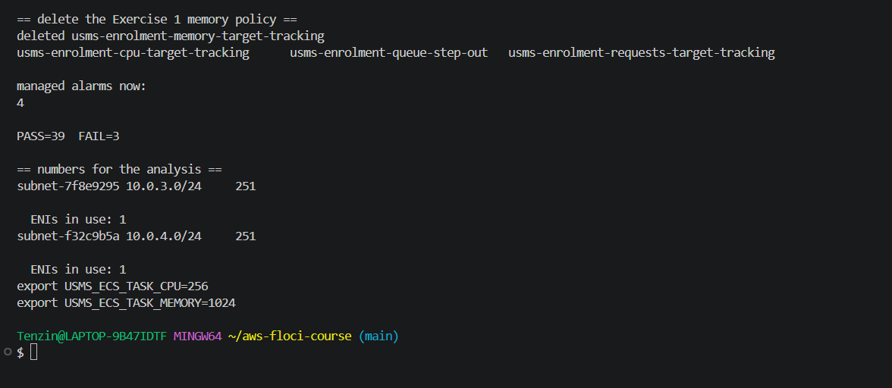

## Exercise 5: the hand off to Lab 10

### 1 and 2. The export script

I wrote `scripts/utilities/usms-scaling-history.sh`. It finds the usms- cluster and the enrolment service, builds the resource ID from the service ARN, and writes one JSON document to outputs/lab-06-scaling-history.json with:

- a top level `generated` UTC timestamp from python3 and the `resourceId`
- the scalable target with its bounds and suspended state
- every scaling policy with its full configuration
- every scheduled action (on my Floci this is stored as `{"unavailable": "...UnsupportedOperation..."}` instead of crashing)
- every alarm involved: the managed ones the policies list, plus any alarm whose AlarmActions names one of the policies
- every scaling activity, asking for not scaled ones with `--include-not-scaled-activities` and falling back if a build does not know the flag

Result: 3 policies, 5 alarms, 3 activities, valid JSON, **14,509 bytes**. I ran it from `~` and it worked.

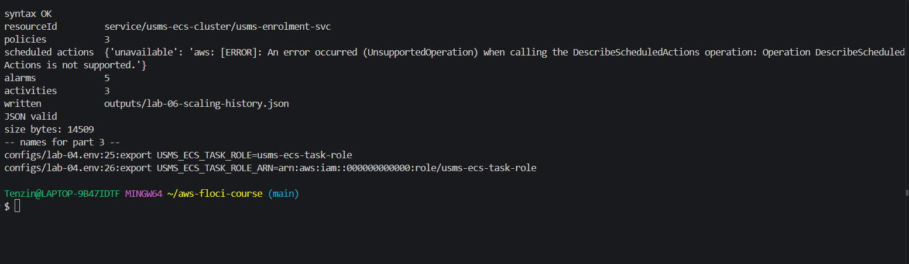

### 3. Scale out latency

I recorded a UTC timestamp, raised MinCapacity to 4 by registering again, and polled every 5 seconds for 60 seconds. desiredCount stayed 2 and runningCount stayed 2 the whole time, because Floci stores a raised floor but never pushes desiredCount up. So there was nothing to measure. As the exercise allows, I used the cited Fargate start up figure (20 to 60 seconds, from the Lab 04 Floci vs AWS table) and recorded the upper end, 60 seconds, clearly marked as cited and not measured. The floor went back to 2 afterwards.

```text
start_utc=2026-10-17T16:31:34Z
end_utc=2026-10-17T16:32:55Z
capacity_before_desired_running=2/2
capacity_after_desired_running=2/2
min_capacity_requested=4
elapsed_seconds=60
method=cited, not measured: Floci stored MinCapacity 4 but never raised desiredCount ...
```

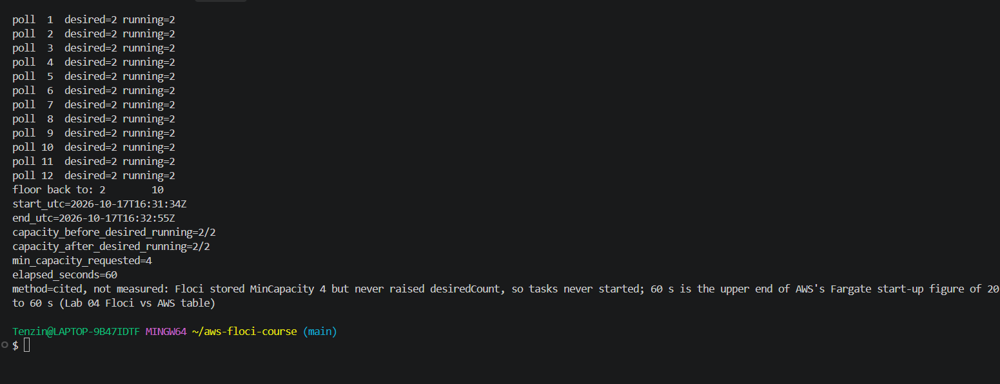

### 4. configs/lab-06.env

I appended `USMS_SCALING_HISTORY_FILE=outputs/lab-06-scaling-history.json` and `USMS_SCALE_LATENCY_SECONDS=60`, both read from the files and not typed. The empty value check still printed "all values populated", and the file now has **24 exports**.

### 5 and 6. Readiness for Lab 10

I found the USMSStudentDataReadWrite policy through the role's attached policies, read its default version (v1) with get-policy-version, and took the bucket ARN from the document. The document has two Resource entries: the bucket (arn:aws:s3:::usms-student-data) and its objects (arn:aws:s3:::usms-student-data/*). I recorded the **bucket** one, which grants s3:ListBucket and s3:GetBucketLocation.

```text
history_file=outputs/lab-06-scaling-history.json
history_file_bytes=14509
scale_latency_seconds=60 (cited, see outputs/lab-06-scale-latency.txt)
task_role_arn=arn:aws:iam::000000000000:role/usms-ecs-task-role
student_data_policy_arn=arn:aws:iam::000000000000:policy/USMSStudentDataReadWrite
bucket_arn_from_policy_document=arn:aws:s3:::usms-student-data

aws: [ERROR]: An error occurred (404) when calling the HeadBucket operation: Not Found
head_bucket_exit_code=254
```

head-bucket failed with 404 and exit code 254, as expected, because the bucket does not exist yet. After Lab 10 Step 1 creates usms-student-data, the same command returns exit code 0, and the permissions usms-ecs-task-role has carried since Lab 04 start pointing at a real bucket at that same moment.

No script reads or contains an access key.

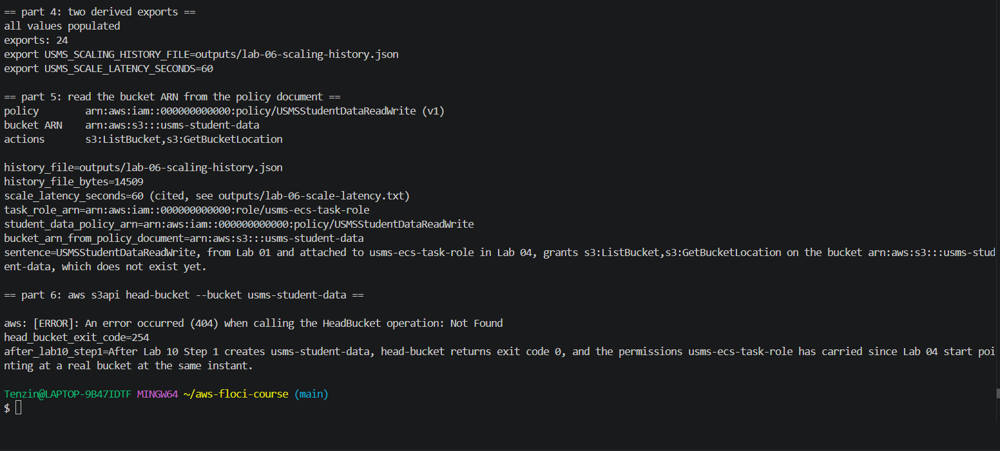
