# Lab 6: ECS Service Auto Scaling

**Student Name:** Tenzin Namgay

**Student ID:** 02230307

**Module:** DSO303 : Cloud Native Infrastructure

**Practical:** Lab 6 : ECS Service Auto Scaling

## 1. Aim / Objective

In this lab I wanted the USMS enrolment service to change its own number of tasks. At the end of Lab 5 the service ran a fixed 2 tasks behind usms-enrolment-alb. In this lab I gave it rules that pick that number for it.

These are the things I did:

- I created the service linked role and registered the service as a scalable target with a floor of 2 and a ceiling of 10.
- I added two target tracking policies (CPU at 50 and requests per target at 1000) and read the alarms they made for me.
- I added a step scaling policy that runs from my own CloudWatch alarm on a custom metric.
- I tried to add two scheduled actions, but my Floci build does not support them.
- I fired the alarm and showed that something other than me changed desiredCount.
- I suspended and resumed scaling, and showed that everything survives a restart.
- I wrote configs/lab-06.env, a verification script and an end of course cleanup script, and I did the five exercises.

## 2. Introduction

ECS does not scale the service by itself. Application Auto Scaling does it. It only works on one number, the service's desiredCount. It has four parts:

- **The scalable target.** This is the address of the thing I scale (namespace ecs, resource ID service/usms-ecs-cluster/usms-enrolment-svc, dimension ecs:service:DesiredCount) plus its MinCapacity and MaxCapacity.
- **Scaling policies.** Target tracking keeps one metric close to a target value and makes its own two CloudWatch alarms. Step scaling adds or removes a fixed number of tasks, based on how far my own alarm's metric is past its threshold.
- **Scheduled actions.** These change the bounds at a set time. This is the only way to have capacity ready before a spike I know is coming.
- **The service linked role.** Application Auto Scaling uses it to call ECS UpdateService.

The key idea is that auto scaling only picks the number. Everything else stays the same: the task definition, subnets, security groups and target group from Labs 4 and 5. That is why the service could already run any number of identical tasks.

## 3. Use Case

- Adding tasks by itself when students start to register, and giving them back when it is quiet, so the portal does not pay for 10 tasks at 3 a.m.
- Scaling on requests per target, which follows the real cause of load, and not only on CPU
- Scaling on a custom metric (the enrolment queue depth) with a fixed response that target tracking cannot give
- Raising the floor before a known spike like enrolment opening, because reactive scaling is always a few minutes late
- Freezing scaling during an incident or a load test without deleting any policy

## 4. System Architecture / Design

The scalable target sits on top of the Lab 5 service and only writes desiredCount. Three policies and their alarms pick the value, and the bounds 2 and 10 limit it.

    CloudWatch metrics                      alarms                         policies
    AWS/ECS CPU            -> TargetTracking AlarmHigh / AlarmLow -> usms-enrolment-cpu-target-tracking (50)
    ALB requests per target -> TargetTracking AlarmHigh / AlarmLow -> usms-enrolment-requests-target-tracking (1000)
    USMS/Enrolment queue   -> usms-enrolment-queue-high (>= 100)  -> usms-enrolment-queue-step-out (+1 / +3)
                                                                           |
                                                                           v
                     scalable target service/usms-ecs-cluster/usms-enrolment-svc  min 2  max 10
                                                                           |
                                         service linked role -> ECS UpdateService desiredCount
                                                                           |
                                                                           v
                     usms-enrolment-svc (usms-enrolment:4, private subnets) -> usms-enrolment-tg -> usms-enrolment-alb

The scheduled actions (morning floor 4 at 07:45, evening floor 2 at 20:00, Asia/Thimphu) are part of the design, but I could not create them on Floci.

## 5. Implementation Procedure

### Part A: Getting ready (Steps 1 to 3)

I loaded course.env and the five earlier env files. I checked the Floci latency and ran the verify scripts for Labs 2 to 5. Lab 5 gave PASS=47 FAIL=2, which is the known grace period gap. I saved that Lab 5 output in outputs/lab-06-pre-verify-05.txt so I could compare it at the end. The service was at desired 2, running 2, with one deployment.

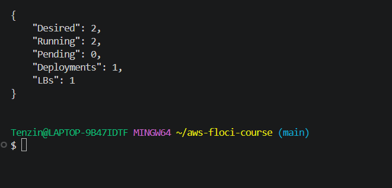

The Step 3 probe showed which calls my build supports. describe-scheduled-actions returned UnsupportedOperation. That is why Step 11 failed later.

### Part B: Role and scalable target (Steps 4 to 6)

I created the service linked role. Floci gave it its own name, AWSServiceRoleForEcsApplicationAutoscaling, with the path /aws-service-role/ecs.application-autoscaling.amazonaws.com/ and the trust principal ecs.application-autoscaling.amazonaws.com.

I built the resource ID from the service ARN instead of typing it. Then I registered the target with min 2 and max 10. The RoleARN came back filled in with the doc's name AWSServiceRoleForApplicationAutoScaling_ECSService, and all three suspension switches were false. The service stayed at desired 2, because registering does nothing when the count is already inside the bounds.

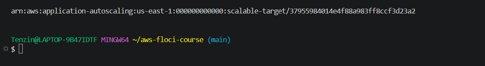

In Step 6 I learned how changes work. There is no update call. Registering again replaces only what I pass. When I passed only --max-capacity 12 I got 2 12, and when I put it back I got one row with 2 and 10.

For the Your turn I raised MinCapacity to 5. Floci stored 5 10, but desiredCount stayed 2 and no scaling activity was recorded. On AWS the count would go to 5 straight away. I put the floor back to 2.

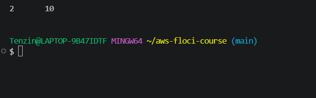

### Part C: Target tracking (Steps 7 to 9)

I created usms-enrolment-cpu-target-tracking (ECSServiceAverageCPUUtilization, target 50, out 60, in 300). Floci made both managed alarms as a side effect.

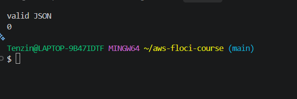

In Step 8 I read the two alarms that I did not create. The high one uses 3 evaluations of 60 s and the low one uses 15. Both AlarmActions were my CPU policy ARN, and both names start with TargetTracking- plus the resource ID. On Floci the metric name was the predefined type and not CPUUtilization. Both thresholds were 50, so there is no dead band.

In Step 9 I took the ResourceLabel I recorded in Lab 5. I checked that it had six segments, with app first and targetgroup fourth. Then I created usms-enrolment-requests-target-tracking at 1000 requests per target per minute. Each of the two policies has two alarms (Checkpoint 3).

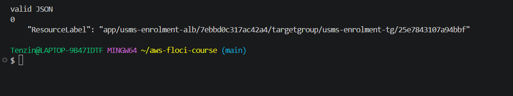

### Part D: Step scaling and scheduled actions (Steps 10 and 11)

Before this part I restarted my laptop. Everything was still there after floci-up.sh, so I only had to load my shell variables again.

I published EnrolmentQueueDepth in USMS/Enrolment. I wrote the step configuration (+1 for a breach of 0 to 100, +3 for 100 or more). I created usms-enrolment-queue-step-out first, and then the alarm usms-enrolment-queue-high (>= 100, 1 period of 60 s) that points at it. Floci did not store TreatMissingData (null). The policy's Alarms list was also empty, even though the alarm points at the policy.

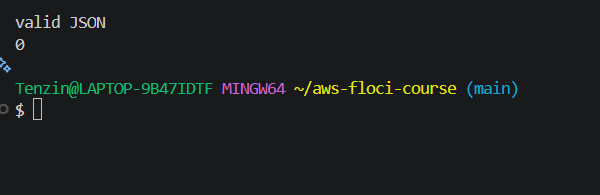

In Step 11 every scheduled action call failed with UnsupportedOperation. That was the morning action, its UTC fallback, the evening action, describe-scheduled-actions, the one off at() action and its delete. The bounds were still 2 10 after that.

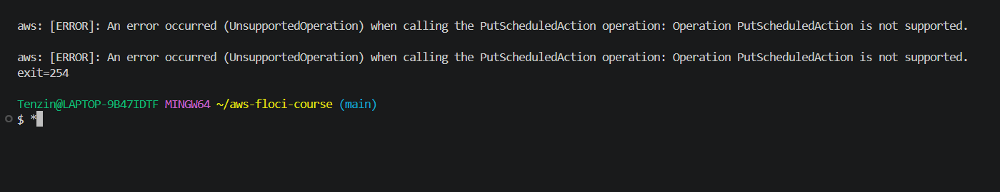

### Part E: Firing the alarm (Step 12)

I recorded the state before (2 2 0, 0 activities). I predicted +3 tasks for a breach of 160, and I published 260 three times. The alarm went to ALARM by itself on the first poll, so I did not need set-alarm-state. describe-scaling-activities then showed the Cause "monitor alarm usms-enrolment-queue-high in state ALARM triggered policy usms-enrolment-queue-step-out". This is path A. The alarm and the policy moved the number, not me.

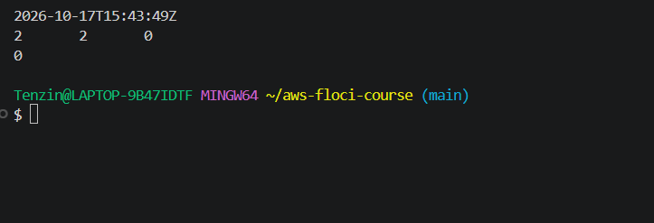
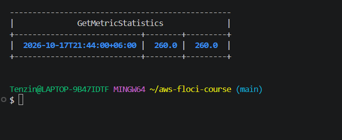

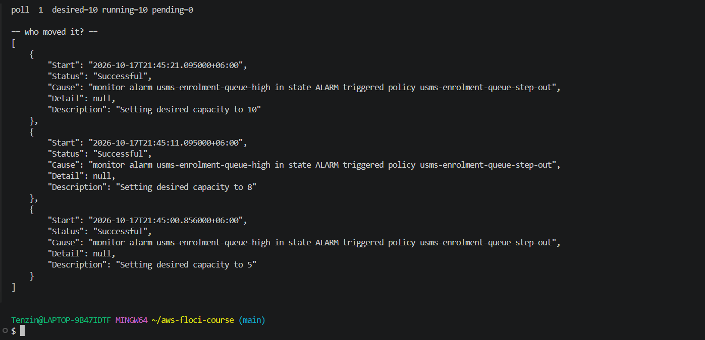

The first activity set 5, as I predicted. But Floci fired again 10 seconds later (8) and then again (10). It ignored the 60 second cooldown, and only the ceiling of 10 stopped it. I pushed the metric down first and then set the count back to 2. Floci took a few seconds to stop the extra containers.

### Part F: Suspend, persistence and the full path (Steps 13 to 15)

I suspended scale in only. I saw that all 3 policies and the 4 managed alarms were not touched. Then I resumed, and I proved it with grep -ci true returning 0 (the values are False with a capital F).

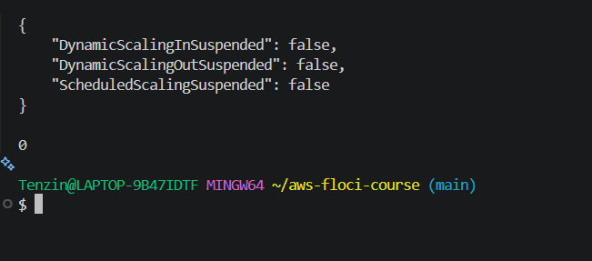

For Step 14 I recorded the configuration and stopped and started Floci. Then I got every name again from the API and compared. The diff was empty and it printed PERSISTENCE PROVEN (Checkpoint 7). The diff proves nothing about scheduled actions, because there were none on either side.

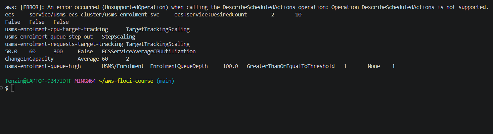

Step 15 followed the path from the metric to a serving task. Blocks 4 to 7 showed that the task definition (:4), subnets, security group, load balancer and deployment count are exactly what Lab 5 left. Two old unhealthy targets were still in the target group from the scale out to 10, because Floci did not deregister them.

### Part G: Recording it (Steps 16 and 17)

The doc's lab-06.env block had a bug. `'{print \$NF}'` inside `$(...)` sends a backslash to awk, so the resource ID came out empty. I removed only that backslash. After that the file had 22 exports, all filled in, with bounds 2 .. 10 and the resource ID matching the API.

In Step 17, lab-04-cleanup.sh was already correct. In lab-05-cleanup.sh I fixed only the three stale strings (the Run AFTER lines and the refusal message). I did not use the doc's blanket replace, because it would also have broken the Run BEFORE lab-04 lines, which were correct. The script still parses, and I deleted the backup. git status showed nothing under outputs/, and check-ignore named the outputs/* rule.

### Part H: Verification and cleanup scripts (Section 8)

verify-lab-06.sh is the doc's script with one fix. The last check counted outputs/.gitkeep as a secret, so I changed it to ignore .gitkeep. This is the same fix as in Lab 5. It reported PASS=39 FAIL=3. All three failures are the scheduled action checks, and Section 8 lists these as benign when describe-scheduled-actions is not implemented. Every check that the doc calls not benign passed.

The cleanup script passes bash -n. I have not run it.

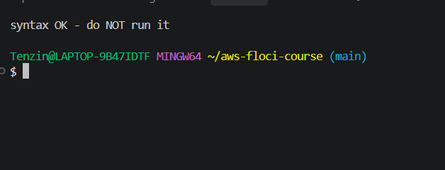

## 6. Results and Evidence

### 6.1 CLI / SDK Evidence

| Check | Result |
| --- | --- |
| Scalable target | 1 target, service/usms-ecs-cluster/usms-enrolment-svc, min 2, max 10, no switch suspended |
| Policies | cpu target tracking (50), requests target tracking (1000), queue step out (+1 / +3) |
| Managed alarms | 4 (2 per target tracking policy) |
| Custom alarm | usms-enrolment-queue-high, >= 100, calls the step policy |
| Scheduled actions | not created, UnsupportedOperation on this build |
| Scaling observed | 2 to 5 to 8 to 10, Cause names the alarm and the policy |
| Persistence | PERSISTENCE PROVEN after a Floci restart, and the state also survived a laptop restart |
| configs/lab-06.env | 24 exports after Exercise 5, all filled in |
| verify-lab-06.sh | PASS=39 FAIL=3 (scheduled actions only) |
| verify-lab-05.sh | same as Step 2, PASS=47 FAIL=2 |

### 6.2 AWS Management Console Verification

Floci has no console, so all my evidence comes from the AWS CLI. On real AWS I would check three places: the service's Auto Scaling tab in the ECS console (bounds and policies), the CloudWatch alarms (the two TargetTracking alarms per policy and my queue alarm), and the scaling activity history.

## 7. Analysis and Discussion

The most useful result was Step 12. I expected the alarm not to fire by itself on Floci, but it did. I got real scaling activities with a Cause string. That proved the whole chain: metric, alarm, policy, scalable target, ECS. It also showed two things that Floci does differently. First, it ignored the 60 second cooldown and kept stepping up every 10 seconds until the ceiling stopped it. Second, the new tasks were running at once. So I could not see the 20 to 60 seconds of start up and the 60 seconds of grace that make reactive scaling late on AWS. On AWS the same test would show 2 to 5, then nothing for at least a minute, with pending tasks.

The second lesson was how much depends on the floor and the ceiling. On AWS a raised MinCapacity takes effect at once, with no alarm and no policy. That makes it the right tool during an incident, but it is also easy to forget. On Floci it was stored but not enforced. So I could only show it through describe-scalable-targets, which is also the call a monitor should use to catch a forgotten floor.

The scheduled actions were the one part I could not do at all. With the UTC fallback I proved that the timezone was not the cause, and Section 8 lists the result as benign. It still matters. Exercise 4 showed that reactive scaling takes about five minutes to reach 10 tasks, so known spikes like enrolment opening need scheduled actions. On my build that part of the lab is only conceptual.

I also found three bugs in the doc and fixed each one in the smallest way I could. These were the escaped `\$NF` in the env block, the blanket replace in Step 17 that would have broken correct lines, and the .gitkeep check in the verify script. I wrote up each one in my notes.

These are the Floci limitations I recorded, each with what AWS does:

- Scheduled actions are not supported (AWS: stored and fired on time).
- A raised MinCapacity is not enforced (AWS: desiredCount moves to the new floor at once).
- The step cooldown is ignored (AWS: waits 60 seconds after each step).
- Tasks start at once and grace is not stored (AWS: 20 to 60 s start, then 60 s grace).
- TreatMissingData is not stored, and the step policy does not list its alarm.
- Managed alarms are named by the predefined type, with no dead band, and the request alarm is in AWS/ECS. An AlarmLow is created even with DisableScaleIn.
- The service linked role is created under a different name, and it is never assumed.
- Scaled in tasks are left as unhealthy targets.

## 8. Reflection

Before this lab I thought auto scaling would be one setting on the service. It turned out to be a separate service with its own objects, and the ECS service does not even know it is being scaled. Once I knew that the only thing it changes is desiredCount, the rest was easier to follow.

The hardest part for me was the step bounds. They are measured from the threshold, not as fixed values. So for the scale in policy in Exercise 2 every bound is negative. It made sense to me once I worked out that the -2 step can never apply at a floor of 2.

I also learned to be careful with what an emulator shows. Floci made scaling look instant and perfect, and it let a policy fire three times in 20 seconds. If I had not compared every result with what AWS would do, I would have learned the wrong timing. The five minute sum in Exercise 4 is the real lesson, and I only got it by adding up the delays myself.

Last, I followed the doc carefully but I did not trust it blindly. Three of its commands were wrong for my setup, and a blanket replace would have quietly broken a cleanup script. Reading what a command will change before I ran it saved me there.

## 9. Conclusion

The enrolment service now has a scalable target with a floor of 2 and a ceiling of 10, two target tracking policies, and a step policy that runs from my own alarm. I proved on Floci that an alarm can change desiredCount without me. Scaling can be suspended and resumed, everything survives a restart, and configs/lab-06.env holds every name for later labs. Scheduled actions are the one part my Floci build cannot do, and I recorded that honestly instead of hiding it. verify-lab-06.sh reports PASS=39 FAIL=3, and all three failures are the documented benign scheduled action checks.

## 10. Appendix (Optional)

- Notes, limitations and review questions: [notes/lab-06-notes.md](../../notes/lab-06-notes.md)
- Exercises: [exercises.md](exercises.md)
- Files: configs/lab-06.env, templates/lab-06-*.json, scripts/utilities/verify-lab-06.sh, usms-scaling-report.sh, usms-scaling-history.sh, scripts/cleanup/lab-06-cleanup.sh
