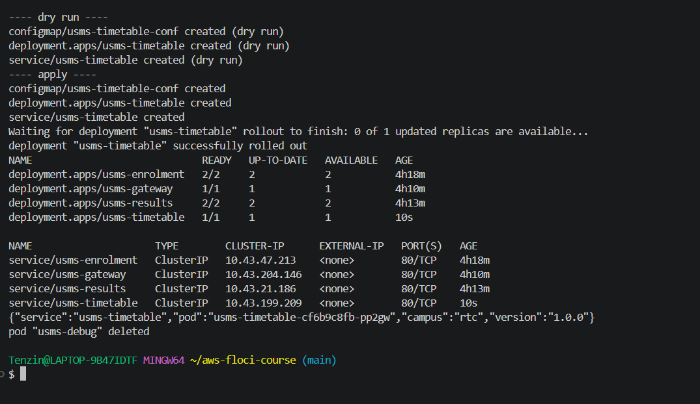
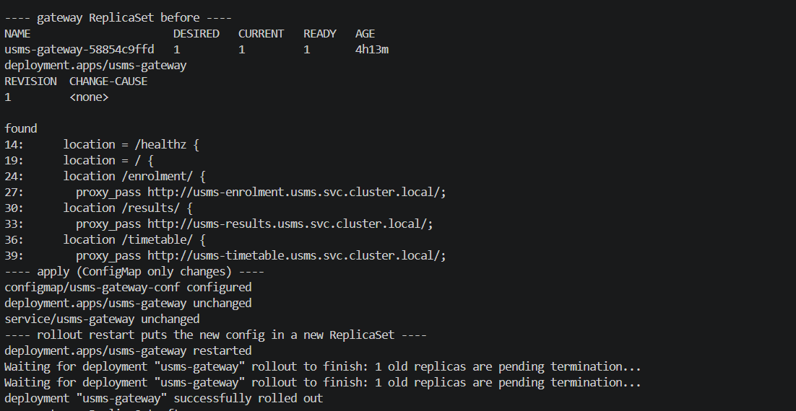
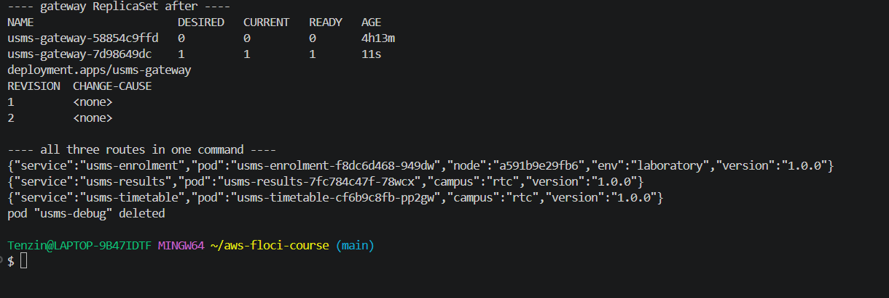
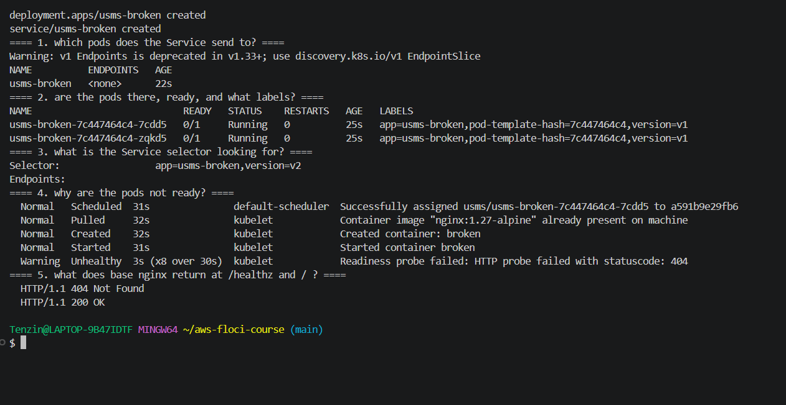
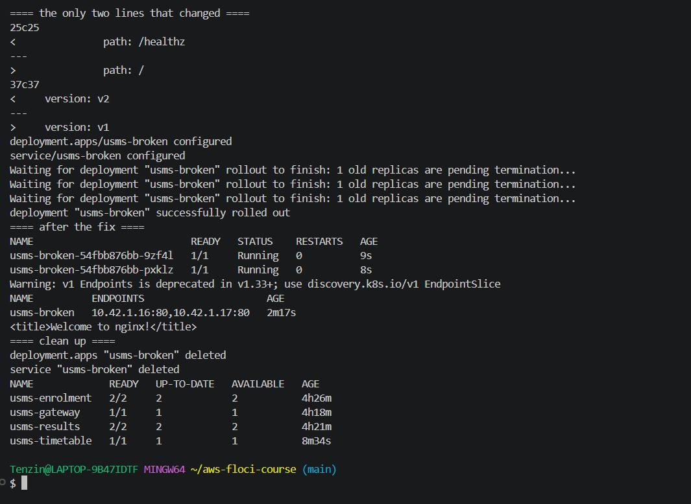
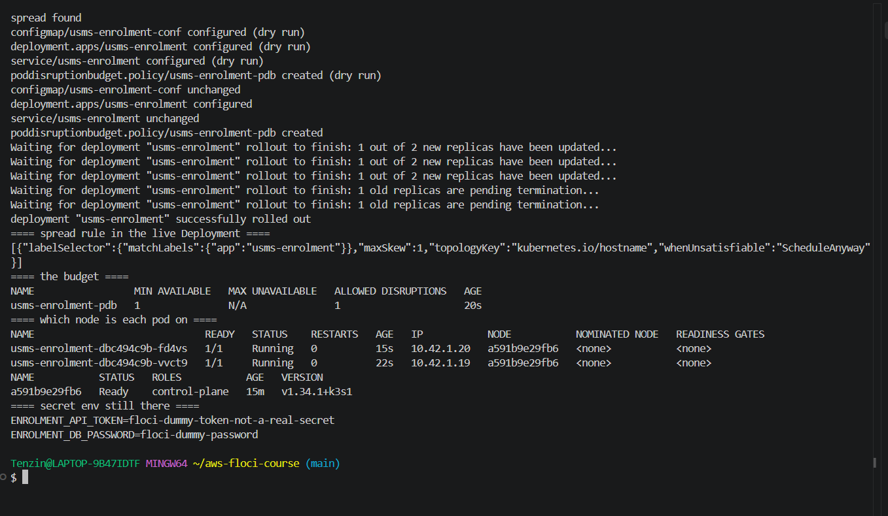
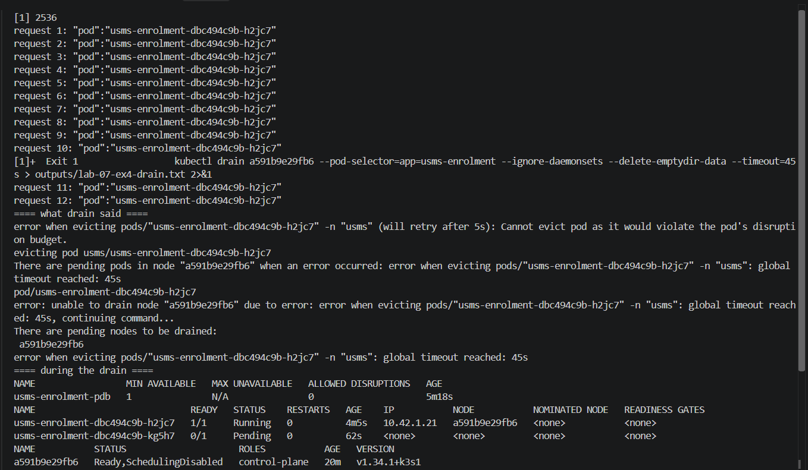
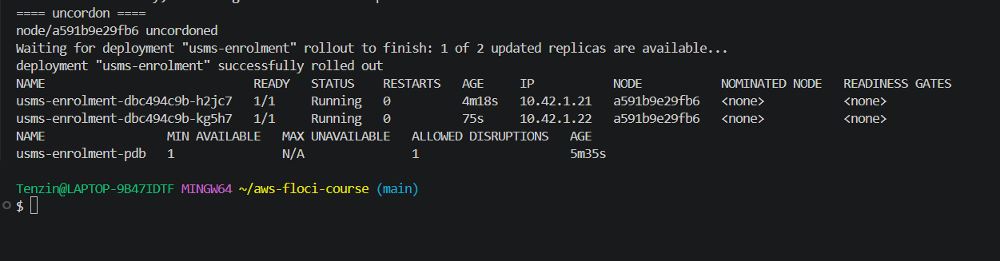
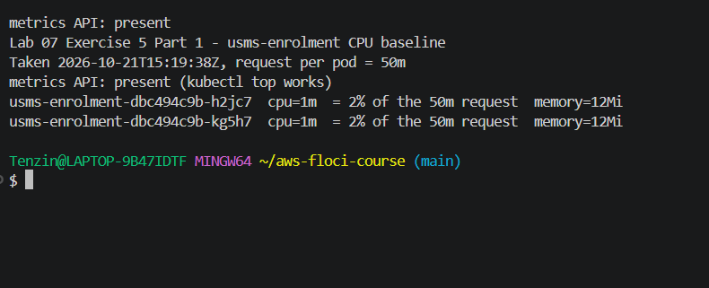
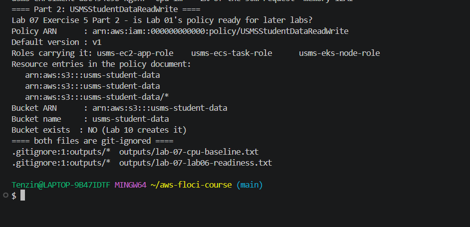

# Lab 07 Exercises

## Exercise 1: a fourth microservice, usms-timetable

**Task:** deploy usms-timetable with one replica of nginx:1.27-alpine, its own ConfigMap returning JSON with the service and pod name, a readiness probe on /healthz and a ClusterIP Service on port 80. Everything in one file, manifests/lab-07/70-timetable.yaml, written by hand, with the app, project and tier labels and CPU and memory requests.

**What I did:** I wrote the three objects (ConfigMap usms-timetable-conf, Deployment usms-timetable, Service usms-timetable) in one file, copying the structure of 30-results.yaml. I checked it first with a dry run, then applied it.

```bash
kubectl apply --dry-run=client -f manifests/lab-07/70-timetable.yaml
kubectl apply -f manifests/lab-07/70-timetable.yaml
kubectl rollout status deployment/usms-timetable --timeout=120s
kubectl get deploy,svc -n usms
kubectl run usms-debug --rm -i --restart=Never --image=busybox:1.36 -- \
  wget -qO- http://usms-timetable.usms.svc.cluster.local/
```

**Result:** the dry run passed and all three objects were created. kubectl get deploy,svc showed four Deployments and four Services, with usms-timetable at 1/1 and ClusterIP 10.43.199.209. The busybox pod got {"service":"usms-timetable","pod":"usms-timetable-cf6b9c8fb-pp2gw","campus":"rtc","version":"1.0.0"}.



## Exercise 2: route /timetable/ through the gateway

**Task:** add a /timetable/ route to usms-gateway by editing 40-gateway.yaml and applying it again, end on a new ReplicaSet and show which command caused it, and show /enrolment/, /results/ and /timetable/ working in one command.

**What I did:** I added a location /timetable/ block with proxy_pass http://usms-timetable.usms.svc.cluster.local/ to the gateway ConfigMap in 40-gateway.yaml and applied it. Only the ConfigMap changed (the Deployment and Service were unchanged), and as Step 18 showed, a ConfigMap change does not restart pods. kubectl annotate would not help either because it changes the Deployment's own metadata, not the pod template. So I used kubectl rollout restart, which writes a timestamp into the pod template.

```bash
kubectl apply -f manifests/lab-07/40-gateway.yaml
kubectl rollout restart deployment/usms-gateway
kubectl rollout status deployment/usms-gateway --timeout=120s
kubectl get rs -n usms -l app=usms-gateway
kubectl rollout history deployment/usms-gateway
```

**Result:** before, the gateway had one ReplicaSet (usms-gateway-58854c9ffd) and one revision. After the rollout restart there was a new ReplicaSet usms-gateway-7d98649dc with 1 pod, the old one was at 0, and rollout history showed revisions 1 and 2. One busybox command returned three JSON documents, from usms-enrolment, usms-results and usms-timetable.




## Exercise 3: find the misconfiguration

**Task:** apply the given usms-broken manifest exactly as it is, find with commands why the Service returns nothing, find both problems, and fix each with one line.

**What I did:** I saved the manifest as outputs/lab-07-ex3-broken.yaml, applied it and diagnosed it from the outside in.

```bash
kubectl get endpoints usms-broken
kubectl get pods -l app=usms-broken --show-labels
kubectl describe svc usms-broken | grep -E "Selector|Endpoints"
kubectl describe pod <pod> | sed -n '/Events:/,$p'
kubectl exec <pod> -- wget -S -qO /dev/null http://localhost/healthz
kubectl exec <pod> -- wget -S -qO /dev/null http://localhost/
```

**Diagnosis:**

1. kubectl get endpoints showed <none>. kubectl get pods --show-labels showed the pods with version=v1, while describe svc showed the selector app=usms-broken,version=v2. The Service selector did not match the pod labels.
2. The pods were Running but 0/1. Their Events said "Readiness probe failed: HTTP probe failed with statuscode: 404". Inside the pod, /healthz returned 404 Not Found and / returned 200 OK, because the plain nginx image has no /healthz page. A pod that is not ready is left out of the Service, so fixing only the selector would still give no endpoints.

**Fix:** I changed exactly one line for each fault. diff showed line 25 path: /healthz changed to path: /, and line 37 version: v2 changed to version: v1. After applying, both pods were 1/1, the Service had two endpoints (10.42.1.16:80 and 10.42.1.17:80), and a request returned <title>Welcome to nginx!</title>. Then I deleted usms-broken as a clean up item.




## Exercise 4: survive a node going away

**Task:** change usms-enrolment so that it does not keep all its pods on one node, never drops below one healthy pod during a voluntary disruption like a drain, and can show from the cluster which node each pod is on.

**What I did:** I changed 20-enrolment.yaml in two ways.

- I added a topologySpreadConstraints rule with maxSkew 1, topologyKey kubernetes.io/hostname and whenUnsatisfiable ScheduleAnyway. It asks the scheduler to spread the enrolment pods across nodes. I made it advisory (ScheduleAnyway) on purpose: my cluster has only one schedulable node, and DoNotSchedule would have left the second pod Pending forever.
- I added a new object, the PodDisruptionBudget usms-enrolment-pdb with minAvailable 1. This one is enforced. The eviction API refuses any voluntary eviction that would leave fewer than one ready enrolment pod.
- kubectl get pods -o wide answers the third requirement from the cluster itself, in the NODE column.

My cluster has only one node (a591b9e29fb6), so both pods are on it and I could not show the pods moving to another node. With two or more nodes I would drain one node, show the spread rule had placed one pod on each node, and show the drained pod being recreated on the other node while the PDB kept the second pod serving. What my cluster did allow was to show the PDB working.

```bash
kubectl drain a591b9e29fb6 --pod-selector=app=usms-enrolment \
  --ignore-daemonsets --delete-emptydir-data --timeout=45s
# at the same time, 12 requests through the gateway pod, one every 3 seconds
kubectl exec deploy/usms-gateway -- wget -qO- -T 3 http://127.0.0.1/enrolment/
kubectl uncordon a591b9e29fb6
```

**Result:** the drain cordoned the node and evicted one enrolment pod. The replacement pod was Pending because the only node was cordoned. The drain then tried to evict the last pod and got "Cannot evict pod as it would violate the pod's disruption budget" until the 45 second timeout. During the drain the PDB showed ALLOWED DISRUPTIONS 0, and all 12 requests through the gateway were answered by the surviving pod usms-enrolment-dbc494c9b-h2jc7. After uncordon the Pending pod started, enrolment went back to 2/2, and ALLOWED DISRUPTIONS went back to 1.

My first request loop failed every time. That was my test, not the service: inside the gateway pod localhost resolved to the IPv6 address ::1, but nginx only listens on IPv4. Using 127.0.0.1 fixed it, and I ran the drain again.

**Why this design:** the spread rule is about where pods start, so it protects against a node failing suddenly, but it is only advisory and cannot stop anything. The PDB is about voluntary disruptions like drains and upgrades, and it is enforced by the API. Together they cover both kinds of node loss. The PDB does not help with a node crash, because that is not an eviction, which is why the spread rule is needed too. With only two replicas, minAvailable 1 means a drain can move one pod at a time and never takes enrolment fully down.





## Exercise 5: prepare what Lab 08 needs, using what Lab 01 built

**Part 1, CPU baseline (outputs/lab-07-cpu-baseline.txt):** the metrics API is present and kubectl top works. Both enrolment pods use 1m CPU, which is 2% of the 50m request, and 12Mi memory. My first check of the metrics API said NotFound because Git Bash turned /apis/metrics.k8s.io/v1beta1 into a Windows path. With MSYS_NO_PATHCONV=1 it answered, so I wrote the file again.

```bash
MSYS_NO_PATHCONV=1 kubectl get --raw /apis/metrics.k8s.io/v1beta1
kubectl top pods -l app=usms-enrolment -n usms
```

**Part 2, Lab 01's policy (outputs/lab-07-lab06-readiness.txt):** I read everything from IAM, not from Lab 1's document. The policy ARN is arn:aws:iam::000000000000:policy/USMSStudentDataReadWrite, default version v1. It is on three roles: usms-ec2-app-role, usms-ecs-task-role and usms-eks-node-role. Its Resource entries are the bucket ARN arn:aws:s3:::usms-student-data and the object ARN arn:aws:s3:::usms-student-data/*, which are different entries. head-bucket says the bucket usms-student-data does not exist yet. Lab 10 creates it.

```bash
aws iam get-policy --policy-arn "$S3_RW_ARN" --query 'Policy.DefaultVersionId'
aws iam get-policy-version --policy-arn "$S3_RW_ARN" --version-id v1 \
  --query 'PolicyVersion.Document.Statement[].Resource'
aws iam list-entities-for-policy --policy-arn "$S3_RW_ARN"
aws s3api head-bucket --bucket usms-student-data
```

Both files are git ignored: git check-ignore -v shows .gitignore:1:outputs/* for each.

**Part 3:** I wrote which configs/lab-07.env variables Lab 08 needs, one line each with the reason, in notes/lab-07-notes.md under "Exercise 5 Part 3".



