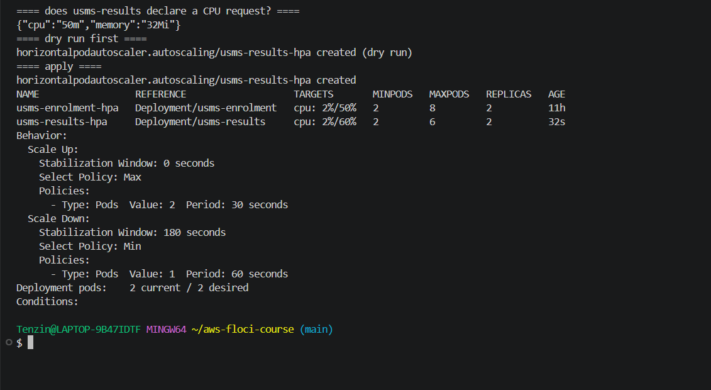
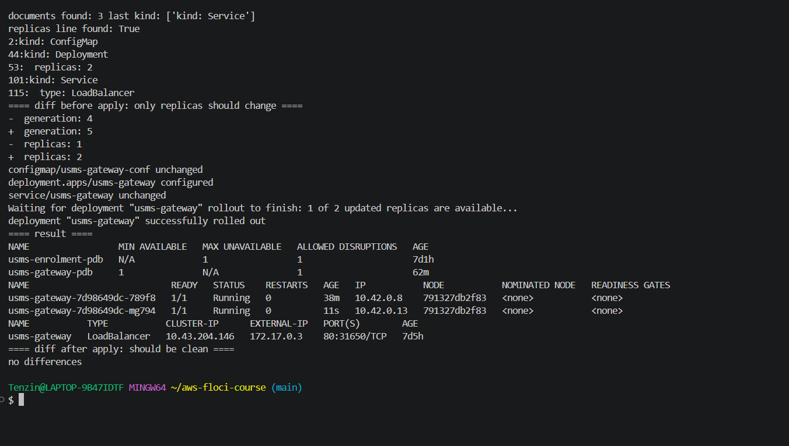
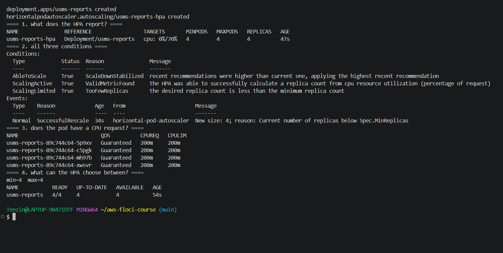
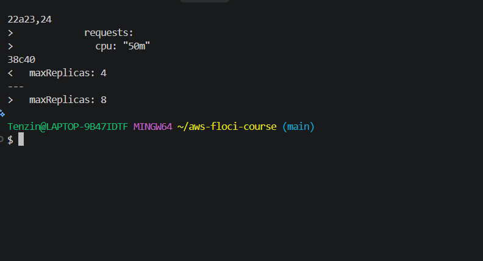
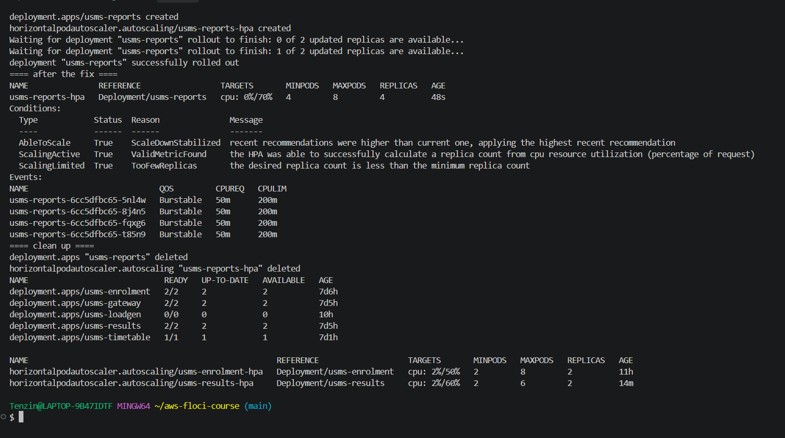
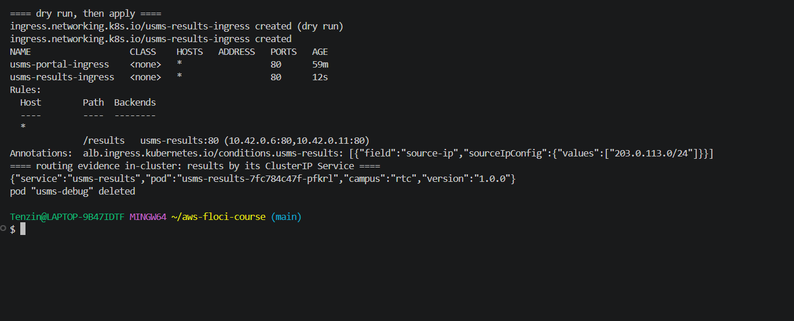
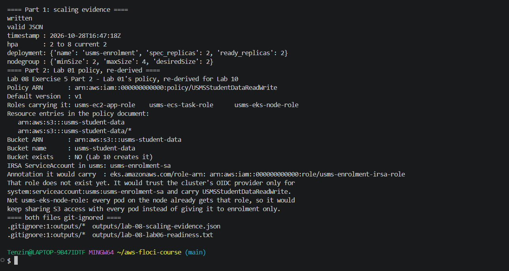

# Lab 08 Exercises

## Exercise 1: a second autoscaler

**Task:** give usms-results its own HPA with min 2, max 6, 60% CPU, a 180 second scale in window and a scale up policy of at most 2 pods every 30 seconds, written as manifests/lab-08/11-hpa-results.yaml (autoscaling/v2, no kubectl autoscale), with a client side dry run first.

**What I did:** I checked usms-results declares a CPU request ({"cpu":"50m","memory":"32Mi"}), because without it the HPA would show <unknown>. Then I wrote the manifest using 10-hpa-enrolment.yaml as the model, with one scale up policy (type Pods, value 2, period 30) and a 180 second scale down window.

```bash
kubectl apply --dry-run=client -f manifests/lab-08/11-hpa-results.yaml
kubectl apply -f manifests/lab-08/11-hpa-results.yaml
kubectl get hpa
kubectl describe hpa usms-results-hpa
```

**Result:** the dry run passed and the HPA was created. kubectl get hpa shows two HPAs reporting percentages: usms-enrolment-hpa at 2%/50% (2 to 8) and usms-results-hpa at 2%/60% (2 to 6). describe shows scale up Pods 2 per 30 seconds and a 180 second scale down window.

**Why 60% for results:** results is read mostly and every request is the same cheap lookup, so it can safely run its pods hotter before adding more, while enrolment gets bursts of writes in registration week and needs spare room sooner, so it scales at 50%.



## Exercise 2: make the gateway drainable

**Task:** usms-gateway-pdb allowed zero disruptions. Fix it properly without weakening the PDB, so ALLOWED DISRUPTIONS is at least 1, update manifests/lab-07/40-gateway.yaml and show a clean kubectl diff.

**What I did:** the PDB was not the problem. minAvailable 1 with only 1 replica means any eviction would leave zero pods, so zero disruptions are allowed. The fix is two replicas, so one can be evicted while the other serves. I kept minAvailable: 1.

40-gateway.yaml still held Lab 07's ClusterIP version of the usms-gateway Service, while Step 15 made the live Service a LoadBalancer from 50-service-loadbalancer.yaml. Applying 40-gateway.yaml as it was would have turned the gateway back into ClusterIP, so I replaced its Service section with the same content as 50-service-loadbalancer.yaml and changed replicas: 1 to replicas: 2.

```bash
kubectl diff -f manifests/lab-07/40-gateway.yaml
kubectl apply -f manifests/lab-07/40-gateway.yaml
kubectl get pdb
kubectl get pods -l app=usms-gateway -o wide
kubectl diff -f manifests/lab-07/40-gateway.yaml
```

**Result:** the diff before applying showed only replicas 1 to 2 (and the generation number). After applying, usms-gateway-pdb shows MIN AVAILABLE 1 and ALLOWED DISRUPTIONS 1, the Service stayed LoadBalancer (172.17.0.3, 80:31650), and the second kubectl diff printed nothing.

Both gateway pods are on node 791327db2f83 because my cluster has only one node. With more nodes I would add the same topologySpreadConstraints by kubernetes.io/hostname that Lab 07 Exercise 4 put on usms-enrolment, so the two gateway pods land on different nodes and a single node drain or failure cannot take both.



## Exercise 3: the autoscaler that will not act

**Task:** apply the given usms-reports Deployment and HPA exactly, find with commands why the replica count never changes, state both causes and fix each with one field.

**What I did:** I saved the manifest as outputs/lab-08-ex3-reports.yaml, applied it, waited 45 seconds and read the HPA from the outside in.

```bash
kubectl get hpa usms-reports-hpa
kubectl describe hpa usms-reports-hpa
kubectl get pods -l app=usms-reports -o custom-columns='NAME:.metadata.name,QOS:.status.qosClass,CPUREQ:...,CPULIM:...'
kubectl get hpa usms-reports-hpa -o jsonpath='{"min="}{.spec.minReplicas}{"  max="}{.spec.maxReplicas}'
```

**Diagnosis:**

1. The fault that stops action even with perfect metrics: min=4 max=4. ScalingLimited was True with TooFewReplicas ("the desired replica count is less than the minimum replica count"), and the only event was "New size: 4; reason: Current number of replicas below Spec.MinReplicas". With min and max equal, every answer from the formula is clamped to exactly 4, so the HPA can never move.
2. The fault that should give <unknown>: the container sets limits but no requests. The doc expected <unknown> with "missing request for cpu", but on my cluster Kubernetes copied the 200m limit into the request, so the pods were Guaranteed with CPUREQ 200m and ScalingActive was True at 0%/70%. It is still a fault, just a quieter one: the HPA divides by a request nobody chose, so 70% means 140m per pod, each pod reserves the full 200m, and on a cluster with different defaults it would be <unknown>.

**Fix:** one field each, shown with diff --strip-trailing-cr (the plain diff marked every line because the two files had different line endings): I added requests cpu: "50m", and changed maxReplicas: 4 to maxReplicas: 8. After applying, the HPA showed MINPODS 4 and MAXPODS 8 and the pods were Burstable with 50m and 200m. ScalingLimited still said TooFewReplicas at idle because 0% wants fewer than 4, but now there is room for the HPA to go up to 8 under load. Then I deleted usms-reports and its HPA.





## Exercise 4: expose the results service properly

**Task:** make results reachable from the university network at a stable address, on normal HTTP and its own path, without giving enrolment the same exposure and without a second load balancer, and explain the cost and what breaks if the cluster is unavailable.

**Design:**

- No second type LoadBalancer Service, because each one is its own NLB and its own bill, and it would expose the whole results Service rather than one path.
- An Ingress (rung 4 of the Step 13 ladder) on top of results' existing ClusterIP Service (rung 1). I wrote manifests/lab-08/70-ingress-results.yaml, usms-results-ingress, with only /results, so enrolment is not part of it.
- It carries alb.ingress.kubernetes.io/group.name: usms-portal. The AWS Load Balancer Controller merges every Ingress with the same group.name into one ALB, so usms-portal-ingress needs the same annotation too. My Step 16 file follows the doc and does not have it, so on real EKS I would add it there, otherwise the controller would build two ALBs. With both in the group there is no second load balancer, and the address stays the ALB's stable DNS name.
- alb.ingress.kubernetes.io/conditions.usms-results adds a source-ip condition to just this rule, so /results only answers the university's range. I used 203.0.113.0/24 as an example range because I do not have the real one.
- The Step 16 Ingress is a starting point but the wrong shape, because it sends /results and /enrolment to anyone. In production I would remove both paths from usms-portal-ingress and leave / to the gateway, so the restricted rule is the only route to results.

**What my build showed:** dry run, then usms-results-ingress created. describe shows /results to usms-results:80 with the two results pod IPs and no /enrolment, and the source-ip condition is stored. Like Step 16 there is no ingress controller, so both Ingresses have no class and no address. A request through results' ClusterIP Service returned the results JSON from inside the cluster. On real EKS the AWS Load Balancer Controller would turn the annotations into a listener rule on the shared ALB with an ip target group.

**Cost:** one ALB is billed per hour (about $0.0225 an hour in us-east-1, roughly $16 a month, plus LCU usage, to be checked against current pricing). Adding /results as a rule on the existing ALB adds only LCU usage, not another hourly charge. A second LoadBalancer Service would add a whole NLB with its own hourly charge, and ten of them would be ten.

**Failure mode:** the ALB lives in the VPC outside the cluster, so its address keeps working even if the cluster has problems. If only the control plane is down, the pods keep running and the ALB keeps sending traffic to the targets it already has, but nothing updates the targets if pods move. If the nodes or pods are down, the targets fail the /healthz check and the ALB answers 503 Service Unavailable for /results.



## Exercise 5: what Lab 10 needs

**Part 1, outputs/lab-08-scaling-evidence.json:** built with Python from live calls (kubectl get hpa and deploy -o json, aws eks describe-nodegroup), not from pasted text. python3 -m json.tool says it is valid JSON. It holds the timestamp, the HPA spec and status (min 2, max 8, current 2), the Deployment (spec replicas 2, ready 2) and the node group 2 / 4 / 2, with a note that the update to 2 / 6 / 3 failed on my Floci build.

**Part 2, outputs/lab-08-lab06-readiness.txt:** looked up again from IAM, not copied from Lab 07. USMSStudentDataReadWrite (arn:aws:iam::000000000000:policy/USMSStudentDataReadWrite, version v1) is on usms-ec2-app-role, usms-ecs-task-role and usms-eks-node-role. Its Resource entries are the bucket ARN arn:aws:s3:::usms-student-data and the object ARN arn:aws:s3:::usms-student-data/*, and head-bucket says the bucket does not exist yet. Under IRSA the ServiceAccount usms-enrolment-sa in usms would carry eks.amazonaws.com/role-arn: arn:aws:iam::000000000000:role/usms-enrolment-irsa-role. That role does not exist yet; it would trust the cluster's OIDC provider only for system:serviceaccount:usms:usms-enrolment-sa and carry USMSStudentDataReadWrite. It is not usms-eks-node-role, because every pod on the node already gets the node role, so it would keep sharing S3 access with every pod instead of giving it to enrolment only.

Both files are git ignored (.gitignore:1:outputs/*).

**Part 3:** "ECS or Kubernetes for USMS" is in notes/lab-08-notes.md (329 words).


