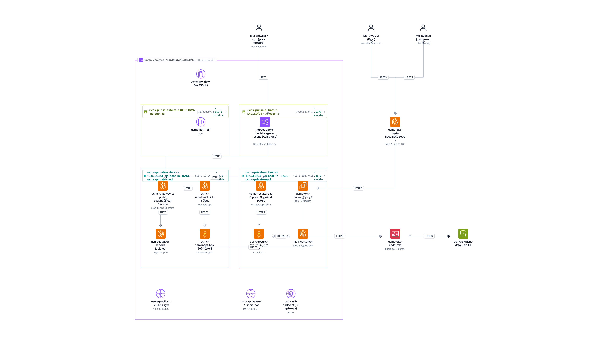

# DSO303 Practical Report

**Student Name:** Tenzin Namgay
**Student ID:** 02230307
**Module:** DSO303 : Cloud Native Infrastructure
**Practical:** Lab 08 : Scaling and Exposing USMS on EKS

## 1. Aim / Objective

To scale the USMS services on my EKS cluster by hand and automatically with Horizontal Pod Autoscalers, keep them available during disruptions with PodDisruptionBudgets, and expose them with ClusterIP, NodePort, LoadBalancer and Ingress, then prove the setup survives a restart.

## 2. Introduction

Amazon EKS runs the Kubernetes control plane for me, and Kubernetes gives two separate ways to scale. The Horizontal Pod Autoscaler changes the number of pods of a Deployment based on metrics such as CPU, which it reads from metrics-server. The node group changes the number of EC2 worker nodes, and nothing links the two unless a Cluster Autoscaler or Karpenter is installed. Requests and limits decide how a pod is scheduled and its QoS class, PodDisruptionBudgets stop voluntary evictions such as a node drain from taking too many pods at once, and Services and Ingress decide how traffic reaches the pods, from ClusterIP inside the cluster up to an AWS load balancer. Together these are what let a cloud native app like USMS handle registration week without paying for peak capacity all year.

## 3. Use Case

- During registration week enrolment gets a burst of requests, so its HPA adds pods and removes them when the load stops.
- Results is read mostly, so it has its own HPA with a higher CPU target.
- When a node is drained for patching, the PDBs make sure the gateway and enrolment always keep a pod running.
- Students reach the portal through one load balancer, and path rules on an Ingress send /enrolment and /results to the right service.

## 4. System Architecture / Design

My browser reaches the cluster through port forwarding on Floci (an Ingress on real EKS). The usms-gateway LoadBalancer Service sends /enrolment/ and /results/ to the two backend services. metrics-server feeds pod CPU to usms-enrolment-hpa and usms-results-hpa, which set the replica counts of their Deployments. usms-loadgen created the load in Step 9. On the AWS side the node group usms-eks-nodes stays at 2 / 4 / 2, a separate control loop that the HPA does not change.

## 5. Implementation Procedure

1. I recovered the cluster after a restart, checked kubectl, the node and the four Lab 07 deployments, and recorded a baseline.
2. I scaled enrolment by hand, saw the topology spread, then showed drift by comparing the live state with the manifest using kubectl diff, and restored it.
3. I checked the QoS class of each pod and made a Guaranteed pod to compare.
4. I checked metrics-server with kubectl top and the metrics API, then created usms-enrolment-hpa (autoscaling/v2, 50% CPU, 2 to 8 pods, with a behavior block).
5. I ran usms-loadgen (3 busybox pods) and watched the HPA scale enrolment from 2 to 3, then back to 2 after the 300 second window.
6. I tried to raise the node group to 2 / 6 / 3, which failed on Floci with 400 InvalidArgument.
7. I labelled the node, added a nodeSelector to enrolment and showed a pod staying Pending when no node matched.
8. I created PDBs for the gateway and enrolment and compared the eviction API, kubectl delete and kubectl drain.
9. I exposed the services step by step: ClusterIP with port-forward, NodePort usms-results-np on 30080, the gateway as a LoadBalancer, and usms-portal-ingress.
10. I compared ECS and EKS for USMS, restarted Docker to prove persistence, and saved the values to configs/lab-08.env.
11. I ran verify-lab-08.sh and a smoke test, wrote the cleanup script without running it, did Exercises 1 to 5 and cleaned up the load generator.

## 6. Results and Evidence

### 6.1 CLI Output

Baseline before any change.

metrics-server working, kubectl top shows pod CPU.

usms-enrolment-hpa created.

The HPA scaling enrolment out under load and back in after the load stopped.

The node group update failing on Floci.

PDBs and the eviction, delete and drain comparison.

NodePort, LoadBalancer and Ingress.

Persistence after a Docker restart and the verify script.

### 6.2 Console Verification

Floci has no web console, so I verified with kubectl get and describe and aws eks describe.

QoS class of each pod, read from the pod status.

The nodeSelector being enforced, describe shows the Pending pod and why.

The ClusterIP Service and its endpoints.

configs/lab-08.env with the values for later labs.

Final state after clean up, 4 deployments, 2 HPAs and the Services.

## 7. Analysis and Discussion

I achieved the main goals. The HPA scaled enrolment from 2 to 3 under load and back to 2, the PDBs blocked evictions that would break availability, and each Service type worked, with the LoadBalancer getting 172.17.0.3 from the k3s service load balancer. verify-lab-08.sh gave PASS=33 FAIL=1, and Step 18 showed PERSISTENCE PROVEN.

Some results did not match the doc because of Floci. update-nodegroup-config failed with 400 InvalidArgument, which is the known issue for this lab, so the node group stayed 2 / 4 / 2 and that is the one failed check. The node group labels never reached the k3s node, so I added workload=usms and tier=app by hand. Ports 8081 and 8082 were not published on the rebuilt k3s container, so I used kubectl port-forward. There is no ingress controller on this build, so the Ingresses have no address.

The biggest problem was restarts. After a Docker or laptop restart the cluster often stayed at CREATING, and the pods were stuck on a dead node. I fixed it by removing the k3s container, restarting Floci, deleting the old node and labelling the new one again. Because HPA events expire after about an hour, I also had to repeat the load test later to capture them.

One thing surprised me in Exercise 3. A container with only a CPU limit did not give <unknown>, because Kubernetes copied the limit into the request. The HPA still worked, but it was dividing by a request nobody chose.

## 8. Reflection

**What did I learn?** I learned that pod scaling and node scaling are two separate loops. The HPA only changes replicas, it needs a CPU request to calculate a percentage, and its behavior block controls how fast it moves. I also learned how PDBs protect against drains but not against kubectl delete, and how each Service type builds on the one below it.

**What challenges did I face?** Keeping the cluster alive across restarts was the hardest part, together with Floci features that do not work, like the node group update, the published ports and the ingress controller. I had to separate what was my mistake from what was a limit of the emulator.

**How would I apply this in the real world?** For USMS I would give enrolment an HPA with fast scale up and slow scale down for registration week, run at least two replicas of anything behind a PDB, spread them across nodes and zones, use one ALB through an Ingress group instead of many load balancers, and add Cluster Autoscaler or Karpenter so Pending pods get new nodes.

**What would I like to explore next?** I would like to try Karpenter or Cluster Autoscaler on a real EKS cluster, the AWS Load Balancer Controller building an actual ALB from my Ingress, scaling on custom metrics like request count, and IRSA so only enrolment gets S3 access in Lab 10.

## 9. Conclusion

The objectives of this lab were achieved. I scaled USMS by hand and with two HPAs, protected it with PDBs and a nodeSelector, and exposed it through four Service and Ingress layers, all from manifests I can apply again. The node group change could not be done on Floci, and I recorded that honestly.

I now understand how Kubernetes keeps an app available while its size changes, and why scaling and exposure need to be designed together. These skills matter for any service on EKS that has busy and quiet periods.

## 10. Appendix

- Exercises: [exercises.md](exercises.md)
- Notes and review questions: [../../notes/lab-08-notes.md](../../notes/lab-08-notes.md)
- Manifests: [../../manifests/lab-08/](../../manifests/lab-08/)
- Config: [../../configs/lab-08.env](../../configs/lab-08.env)
- Scripts: [../../scripts/utilities/verify-lab-08.sh](../../scripts/utilities/verify-lab-08.sh), [../../scripts/utilities/hpa-watch.sh](../../scripts/utilities/hpa-watch.sh), [../../scripts/cleanup/lab-08-cleanup.sh](../../scripts/cleanup/lab-08-cleanup.sh)
