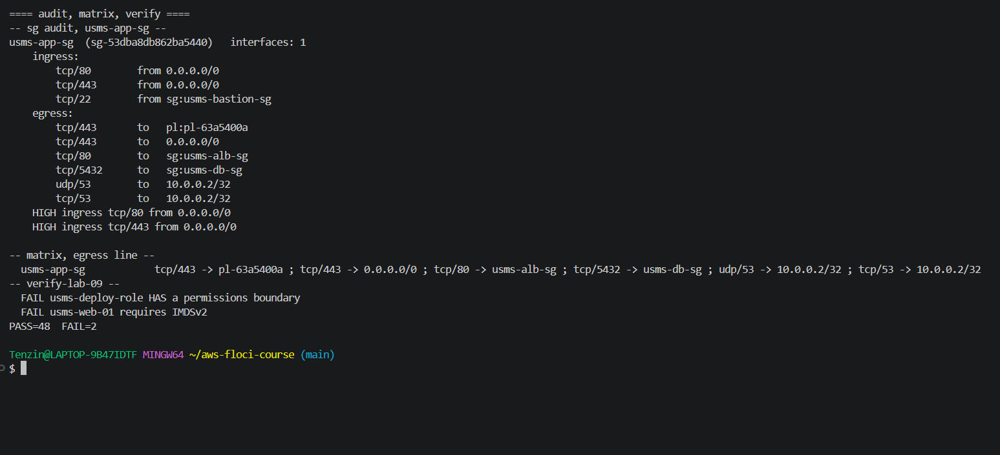
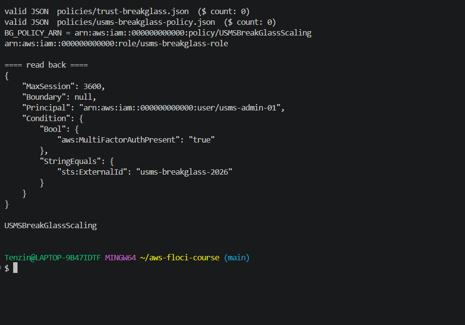
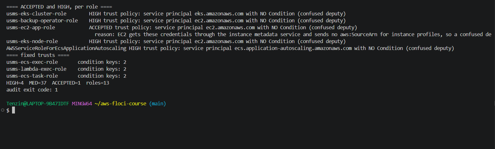
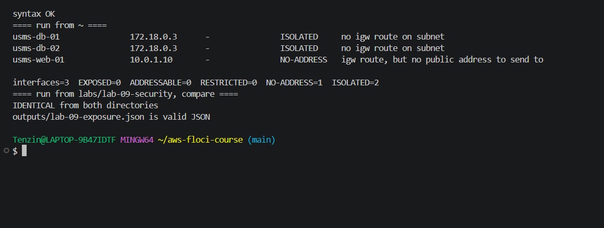
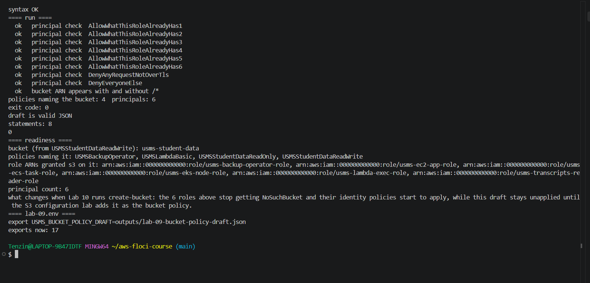

# Lab 09 Exercises

## Exercise 1: finish the egress work on the web tier

**Task:** write egress for usms-app-sg so usms-web-01 can still reach S3, AWS endpoints, the enrolment API, the database and DNS, authorise it before revoking the default, and do not touch its ingress.

**What I did:** I wrote policies/usms-app-sg-egress.json with an unquoted heredoc, because the file has to contain my real prefix list and group IDs (pl-63a5400a, sg-43a4d32b229ced732, sg-9ffe4a3fff505ea08); a quoted heredoc would leave ${...} in the file. It is valid JSON with no $ left, and every rule has a Description.

| Must reach | Rule | Why |
| --- | --- | --- |
| S3 for Lab 10's transcripts | tcp/443 to pl-63a5400a | the S3 prefix list of the Lab 02 gateway endpoint |
| AWS endpoints, including STS | tcp/443 to 0.0.0.0/0 | HTTPS service APIs |
| The enrolment API | tcp/80 to usms-alb-sg | since Lab 05 the API is the load balancer, so it is a group reference |
| The database | tcp/5432 to usms-db-sg | PostgreSQL, a group reference |
| DNS | udp/53 and tcp/53 to 10.0.0.2/32 | the VPC resolver is the base address plus two, one of the five addresses AWS reserves in every subnet (Lab 02). DNS uses UDP first and falls back to TCP when an answer is too big, so it needs both |

I authorised the six rules first and revoked the default second, so there was never a moment with no way out. Ingress stayed at three rules.

**Result:** usms-sg-audit.sh shows the six written egress rules on usms-app-sg and no DEFAULT allow-all line; only the two HIGH ingress findings remain (Exercise 4). The reachability matrix lists all six destinations. verify-lab-09.sh is unchanged at PASS=48 FAIL=2, the two known Floci failures.

**usms-bastion-sg is different in kind.** The other groups protect servers, so their egress should be as small as the work they do; a jump host's whole job is to start SSH sessions to the machines it administers. So its egress should be tcp/22 to usms-app-sg (and to usms-db-sg if the database needs admin access), not allow-all.

**169.254.169.254** is a link-local address handled by the host the instance runs on. Metadata requests never leave through the instance's network interface, so security groups never see them; that is why IMDSv2 and the hop limit (Step 11) are the controls for it, not an egress rule.



## Exercise 2: the break glass role, and the findings this lab left open

**Part A: usms-breakglass-role.** The trust is in policies/trust-breakglass.json and the permissions in policies/usms-breakglass-policy.json (USMSBreakGlassScaling).

1. Principal arn:aws:iam::000000000000:user/usms-admin-01 only.
2. Bool aws:MultiFactorAuthPresent true.
3. StringEquals sts:ExternalId usms-breakglass-2026.
4. --max-session-duration 3600, the shortest maximum IAM allows for a role (3600 to 43200 seconds).
5. --permissions-boundary USMSPermissionsBoundary, which allows application-autoscaling:*. Floci did not store it (Boundary null), the same Known Issue as Step 8.
6. Only application-autoscaling:RegisterScalableTarget and application-autoscaling:DescribeScalableTargets, the two calls Lab 06 Step 13 used to suspend and check scaling. No wildcard actions.

Both conditions are in one Condition block, and conditions in one block always combine with AND, so the admin needs MFA and the ExternalId together. OR would need two separate statements.

ExternalId is normally for a third party in another account. Inside one account it is not a secret, but it makes assuming the role a deliberate act: the person has to know and type the value, scripts and tools cannot pick the role up by accident, and the value shows in CloudTrail, so every use of break glass is easy to find.



**Part B: the three unconditioned trusts.**

| Role | Decision | Why |
| --- | --- | --- |
| usms-ecs-exec-role | Fixed | ECS sends aws:SourceAccount and aws:SourceArn, so it now uses policies/trust-ecs-tasks-scoped.json, the same as Step 7 |
| usms-lambda-exec-role | Fixed | Lambda sends them too. policies/trust-lambda-scoped.json: aws:SourceAccount 000000000000 and aws:SourceArn like arn:aws:lambda:us-east-1:000000000000:function:* |
| usms-ec2-app-role | Accepted | EC2 hands the credentials to the instance through the metadata service and sends no aws:SourceArn for instance profiles, so a condition on it would deny the instance itself. Compensating controls: USMSDeployBase explicitly denies passing any role to EC2, and IMDSv2 with hop limit 1 (Step 11, designed but not stored by Floci) |

I saved both old trusts to outputs/ as the undo before replacing them. The accepted finding is in configs/iam-accepted-findings.txt, which is committed and has a written reason on its line, so it is a decision and not a suppression list. I changed usms-iam-audit.sh to read that file (path in ACCEPTED_FINDINGS, default configs/iam-accepted-findings.txt) and print ACCEPTED with the reason instead of HIGH.

**Result:** on a fresh inventory the three fixed roles have 2 condition keys each, usms-ec2-app-role shows ACCEPTED with its reason, and HIGH=4 MED=37 ACCEPTED=1 roles=13. The audit still exits 1, because usms-eks-cluster-role, usms-eks-node-role, usms-backup-operator-role and the Lab 06 service linked role are still unconditioned and not accepted.



## Exercise 3: the exposure report

scripts/utilities/usms-exposure-report.sh prints one line per network interface in usms-vpc and writes outputs/lab-09-exposure.json. The verdict is computed from three facts only: whether the subnet's route table sends 0.0.0.0/0 to an internet gateway, whether the interface has a public address, and what its security groups admit from 0.0.0.0/0. Names are only labels.

| Verdict | When |
| --- | --- |
| ISOLATED | no internet gateway route on the subnet |
| NO-ADDRESS | internet gateway route but no public address |
| EXPOSED | internet gateway route, public address, and a group admits 0.0.0.0/0 |
| ADDRESSABLE | internet gateway route and public address, but no ingress rule at all |
| RESTRICTED | internet gateway route and public address, but groups admit only named sources |

For a public interface with no ingress rule at all (the NAT example) I chose ADDRESSABLE, not EXPOSED: packets can reach the address, but nothing admits a new connection, so it is one rule away from exposed and worth listing.

It runs from any directory (it finds configs/ from BASH_SOURCE), takes no arguments and has no hard-coded IDs. It handles a group that is not in the VPC listing (fetched on its own, noted if that fails), an interface with no description, a subnet with no explicit route table (it uses the VPC's main table), and an interface whose instance is gone. It uses set -uo pipefail but not -e, so one failed lookup does not stop the report for every other interface.

**Result:** identical output from ~ and from labs/lab-09-security. usms-db-01 and usms-db-02 are ISOLATED; usms-web-01 is NO-ADDRESS, because Floci gave it no public address (the Lab 03 limitation). On real AWS, with its Elastic IP and 80/443 from 0.0.0.0/0, it would be EXPOSED. Floci does not create interfaces for the ALB, the NAT or the Fargate tasks, so they do not appear.



## Exercise 4: the security review for the information security officer

### 1. The second front door

Lab 02 Step 14 created usms-app-sg with tcp/80 from 0.0.0.0/0 and tcp/22 from 10.0.0.0/16, and its Your turn added tcp/443 from 0.0.0.0/0. usms-app-sg admits tcp/80 and tcp/443 from 0.0.0.0/0 because usms-web-01 was the original web server from Labs 02 and 03, before there was a load balancer. Since then Lab 05 put the enrolment API behind usms-enrolment-alb, and this lab narrowed SSH to usms-bastion-sg and wrote its egress, but the web server is still reachable straight from the internet. It also carries usms-ec2-app-role, which can read and write transcripts, so a bug in it is a direct path to the data.

It should not stay reachable directly. Moving it behind the load balancer needs a target group for usms-web-01, a listener rule on the existing HTTP:80 listener, usms-app-sg admitting tcp/80 from usms-alb-sg instead of 0.0.0.0/0, the load balancer allowed to send tcp/80 to usms-app-sg, and then removing the Elastic IP. What would break: anyone using the Elastic IP or a DNS name that points at it, and HTTPS on the instance itself unless the certificate moves to the load balancer.

The other side: keeping the direct path gives a second way in if the load balancer fails, and costs nothing extra. But it also doubles what has to be watched and patched, and the backup path is the one holding a transcripts role, so I would still move it.

### 2. What egress control bought

It prevents:
1. An attacker on the database or a task sending data out through DNS queries, because neither may send DNS to the internet any more.
2. A reverse shell or command and control channel on a non HTTPS port, like SSH out or IRC, from the database, the tasks or the load balancer.
3. A compromised enrolment task connecting to the database or the web server inside the VPC, because its egress is only tcp/443.

It does not prevent:
1. Data sent out in an HTTPS POST to any host, because tcp/443 to 0.0.0.0/0 is still open. The control for that is filtering by hostname, for example AWS Network Firewall with a domain allow list, about $0.395 per endpoint hour plus $0.065 per GB processed in us-east-1 ([pricing](https://aws.amazon.com/network-firewall/pricing/)).
2. Stolen credentials being used from outside the network, because that is an IAM problem, not a packet. The control is detection with Amazon GuardDuty, priced on the volume of CloudTrail events and logs it analyses, with a 30 day free trial ([pricing](https://aws.amazon.com/guardduty/pricing/)).

### 3. Who can read or write a transcript

| Principal | How it gets access | Read | Write | Granting document |
| --- | --- | --- | --- | --- |
| usms-ec2-app-role | USMSStudentDataReadWrite, instance profile on usms-web-01 | GetObject, ListBucket | PutObject, DeleteObject | policies/usms-student-data-rw-policy.json |
| usms-ecs-task-role | USMSStudentDataReadWrite, task role of usms-enrolment-svc | GetObject, ListBucket | PutObject, DeleteObject | policies/usms-student-data-rw-policy.json |
| usms-eks-node-role | USMSStudentDataReadWrite, attached in Lab 07, so every pod on the node | GetObject, ListBucket | PutObject, DeleteObject | policies/usms-student-data-rw-policy.json |
| usms-transcripts-reader-role | USMSStudentDataReadOnly | GetObject, ListBucket | none, explicit Deny | policies/usms-student-data-ro-policy.json |
| usms-backup-operator-role | USMSBackupOperator | GetObject, ListBucket | none on this bucket, DeleteObject denied | policies/usms-backup-operator-policy.json |
| usms-lambda-exec-role | USMSLambdaBasic | GetObject | none | policies/usms-lambda-basic-policy.json |
| usms-developer-role, and users in usms-developers and usms-admins | USMSDeveloperBase, s3:List* on "*" | object names only, no GetObject | none | policies/usms-developer-base-policy-v3.json |
| account root | owns the account | everything | everything | not a policy |

How I know it is complete: on real AWS I would run IAM Access Analyzer, and get-account-authorization-details to dump every user, group, role and policy at once. Step 3 showed neither is available on Floci, and the bucket does not exist yet. Instead I built it from outputs/lab-09-identity-inventory-ex2.json with Exercise 5's script, which found 4 policies naming the bucket and 6 roles, checked each with list-entities-for-policy, and read policies/ by hand for statements on Resource "*", which is how I found the developer listing access. The inventory covers roles; for users and groups I relied on reading the group policies, so that part is weaker.

### 4. Knowing when it changes

Preventive controls (security groups, IAM policies, the boundary) stop things; detective controls tell me something happened.

| Service | Reports | Cost |
| --- | --- | --- |
| AWS CloudTrail | every API call, including AuthorizeSecurityGroupIngress, AttachRolePolicy and AssumeRole | first copy of management events in a trail is free ([pricing](https://aws.amazon.com/cloudtrail/pricing/)) |
| Amazon EventBridge | a rule on those CloudTrail events that sends an alert to SNS | no charge for AWS service events on the default bus ([pricing](https://aws.amazon.com/eventbridge/pricing/)) |
| AWS Config | a timeline of every security group and IAM change | about $0.003 per configuration item recorded ([pricing](https://aws.amazon.com/config/pricing/)) |
| IAM Access Analyzer | buckets and roles shared outside the account | external access analysis is free ([pricing](https://aws.amazon.com/iam/access-analyzer/pricing/)) |
| Amazon GuardDuty | unusual AssumeRole or credential use | per event volume, 30 day trial ([pricing](https://aws.amazon.com/guardduty/pricing/)) |

The morning after an incident I would read, in order: CloudTrail for every call made by the suspected principal in the time window, the AWS Config timeline for usms-app-sg, usms-db-sg and the three IAM roles that can write transcripts, the GuardDuty findings, and then VPC Flow Logs, which I would have to turn on first because this course never did.

### Moving the web tier behind the load balancer (written, NOT run)

1. Create a target group for the web server.
```bash
aws elbv2 create-target-group --name usms-web-tg --protocol HTTP --port 80 \
  --vpc-id "$USMS_VPC_ID" --target-type instance --health-check-path /
```
2. Register usms-web-01.
```bash
aws elbv2 register-targets --target-group-arn "$WEB_TG_ARN" --targets Id="$USMS_WEB_INSTANCE"
```
3. Add a listener rule on the existing HTTP:80 listener.
```bash
aws elbv2 create-rule --listener-arn "$USMS_LISTENER_ARN" --priority 20 \
  --conditions Field=path-pattern,Values='/portal*' \
  --actions Type=forward,TargetGroupArn="$WEB_TG_ARN"
```
4. Let the load balancer reach the web tier, both directions.
```bash
aws ec2 authorize-security-group-ingress --group-id "$USMS_APP_SG" \
  --ip-permissions 'IpProtocol=tcp,FromPort=80,ToPort=80,UserIdGroupPairs=[{GroupId='"$USMS_ALB_SG"'}]'
aws ec2 authorize-security-group-egress --group-id "$USMS_ALB_SG" \
  --ip-permissions 'IpProtocol=tcp,FromPort=80,ToPort=80,UserIdGroupPairs=[{GroupId='"$USMS_APP_SG"'}]'
```
5. Check the target is healthy through the load balancer before removing anything.
```bash
aws elbv2 describe-target-health --target-group-arn "$WEB_TG_ARN"
```
6. Remove the direct internet access.

> **What will be deleted:** the tcp/80 and tcp/443 rules from 0.0.0.0/0 on usms-app-sg.
> **What depends on it:** anyone reaching usms-web-01 directly by its address.
> **Reversible?** Yes, one authorize-security-group-ingress per rule puts it back.
> **Effect on later labs:** none on Floci; Section 8 has no check on these rules.

```bash
aws ec2 revoke-security-group-ingress --group-id "$USMS_APP_SG" --protocol tcp --port 80 --cidr 0.0.0.0/0
aws ec2 revoke-security-group-ingress --group-id "$USMS_APP_SG" --protocol tcp --port 443 --cidr 0.0.0.0/0
```
7. Release the Elastic IP.

> **What will be deleted:** usms-web-eip, the public address of usms-web-01.
> **What depends on it:** any DNS record or bookmark using that address.
> **Reversible?** No, a released address is gone; a new one will be different.
> **Effect on later labs:** Lab 03's verify loses its public address check for good.

```bash
aws ec2 disassociate-address --association-id "$USMS_EIP_ASSOC"
aws ec2 release-address --allocation-id "$USMS_EIP_ALLOC"
```

## Exercise 5: the bucket policy the S3 configuration lab will apply

scripts/utilities/usms-bucket-policy-draft.sh reads the identity inventory and gets the bucket name from USMSStudentDataReadWrite's document, never typed. It uses shell parameter expansion (${BUCKET_ARN##*:::} and ${BUCKET%%/*}) to cut the bare name out of the ARN, with a comment saying why, and python3 for all the JSON. It contains, reads and references no access key, and it applies nothing.

**Result:** 4 policies name the bucket, not 3: USMSStudentDataReadWrite, USMSStudentDataReadOnly, and two from Lab 01 that I had forgotten, USMSBackupOperator and USMSLambdaBasic. That gives 6 principals: usms-ec2-app-role, usms-ecs-task-role, usms-eks-node-role, usms-transcripts-reader-role, usms-backup-operator-role and usms-lambda-exec-role. outputs/lab-09-bucket-policy-draft.json has 8 statements: an Allow per role limited to the s3 actions it already has, a Deny for "*" when aws:SecureTransport is false, and DenyEveryoneElse with NotPrincipal naming those 6 roles and the account root. All the mechanical checks passed: every Principal is an ARN except the TLS Deny's "*", and the bucket ARN appears with and without /*. outputs/lab-09-lab10-readiness.txt has the bucket, the 4 policy names, the 6 role ARNs, the count and what create-bucket changes. configs/lab-09.env now has USMS_BUCKET_POLICY_DRAFT, 17 exports.

On real AWS a Deny with NotPrincipal would also need the assumed role session ARNs to let those roles in, so AWS now recommends Principal "*" with a condition on aws:PrincipalArn instead. I kept NotPrincipal so every Principal stays an ARN, as this exercise's check requires.

**The two Denies compared.** The Deny in USMSStudentDataReadOnly is part of an identity policy, so it only stops the role it is attached to, usms-transcripts-reader-role. The DenyEveryoneElse statement in the bucket policy sits on the resource, so it stops any principal at all, whichever policies they carry. For a principal in another account, my identity policies are never consulted, so only the bucket policy can stop them.


