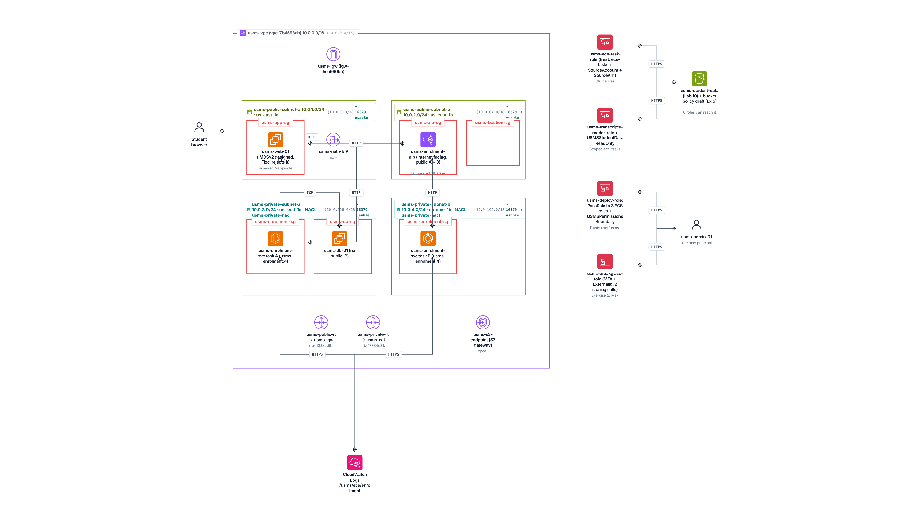

# DSO303 Practical Report

**Student Name:** Tenzin Namgay
**Student ID:** 02230307
**Module:** DSO303 : Cloud Native Infrastructure
**Practical:** Lab 09 : Securing the USMS Application with IAM Roles and Security Groups

## 1. Aim / Objective

To review the USMS system from Labs 1 to 6 on both access control axes, who can call what (IAM) and what can reach what (security groups and routing), find the weaknesses with read only audit scripts, fix them, and prove the fixes survive a restart without breaking any earlier lab.

## 2. Introduction

AWS Identity and Access Management decides every API call: identity policies grant actions, trust policies decide who may assume a role, permissions boundaries and session policies only take away, and an explicit Deny always wins. Security groups decide every packet: they are stateful firewalls on each network interface, they can name another group instead of an address, and every new group allows all outbound traffic until someone writes egress rules. The two systems never consult each other, so a request needs a yes from both. Together they are how a cloud application follows least privilege and defence in depth, so that one mistake or one stolen credential does not expose everything.

## 3. Use Case

- The transcripts bucket holds every student's academic record, so only the roles that need it should reach it, and the reporting task should only read.
- A deployment pipeline needs to hand roles to ECS, but must not be able to hand an admin role to an EC2 instance it controls.
- If an enrolment task or the database is compromised, written egress rules stop it from opening SSH, database or DNS connections out.
- An administrator needs a break glass role for emergencies that cannot be assumed casually.

## 4. System Architecture / Design

Inside usms-vpc each tier sits in its own security group. The load balancer may only send tcp/80 to usms-enrolment-sg, the enrolment tasks and the database may only start HTTPS, the web tier's egress is written rule by rule, and SSH to the web tier is allowed only from usms-bastion-sg. On the identity side, usms-ecs-task-role keeps its read and write transcripts policy but its trust now has confused deputy conditions, the new usms-transcripts-reader-role can only read, and usms-admin-01 is the only user who can assume the deploy role (scoped PassRole plus a permissions boundary) and the break glass role (MFA plus ExternalId).

## 5. Implementation Procedure

1. I resumed Floci, loaded seven env files and recorded what the Lab 2 to 6 verify scripts said, as a baseline.
2. I probed which IAM and EC2 calls my Floci build supports (Path B, with simulation available).
3. I inventoried every role, its trust policy and its policy documents, and wrote usms-iam-audit.sh, which found 8 HIGH confused deputy findings.
4. I read the transcripts policy, created USMSStudentDataReadOnly and usms-transcripts-reader-role, and added SourceAccount and SourceArn conditions to usms-ecs-task-role's trust.
5. I created a permissions boundary, USMSDeployBase with iam:PassRole scoped to three roles, and usms-deploy-role.
6. I assumed usms-developer-role with a session policy and worked out the intersection by hand and with the simulator.
7. I rotated usms-dev-01's access key in the order create, move, deactivate, delete.
8. I tried to require IMDSv2 on usms-web-01.
9. I wrote usms-sg-audit.sh, then wrote egress rules for usms-enrolment-sg, usms-alb-sg and usms-db-sg, and moved SSH on usms-app-sg to usms-bastion-sg.
10. I wrote usms-reachability-matrix.sh and listed the five controls that keep usms-db-01 off the internet.
11. I stopped and started Floci to prove persistence, ran the five earlier verify scripts again, and wrote configs/lab-09.env.
12. I built verify-lab-09.sh and the cleanup script (not run), then did Exercises 1 to 5.

## 6. Results and Evidence

### 6.1 CLI Output

The security baseline before any change.

The IAM audit: every HIGH finding is a service trust with no condition.

The scoped trust replaced on usms-ecs-task-role: same principal, new condition.

Scoped iam:PassRole, and the course fallback model for the boundary.

The session policy intersection.

Access key rotation.

Written egress and the SSH cutover.

Persistence and nothing broken.

The final verify run.

### 6.2 Console Verification

Floci has no web console, so I verified everything with describe and get calls.

The reachability matrix, computed from rules only.

The five controls on usms-db-01.

IMDS options read back, showing the Floci limitation.

configs/lab-09.env with every value looked up live.

## 7. Analysis and Discussion

I achieved what the lab asked. The audits turned up 8 HIGH confused deputy trusts, an SSH rule open to the whole VPC and default allow all egress on every group. I fixed the trusts on three roles and accepted one with a written reason, wrote egress on four groups, narrowed SSH to the bastion group, split the transcripts policy into a read only version, scoped iam:PassRole and rotated the only long lived key. PERSISTENCE PROVEN and NOTHING BROKE both came out as expected, and verify-lab-09.sh ended at PASS=48 FAIL=2.

Two results did not match the doc because of Floci, and both are the course Known Issue for Lab 09. The permissions boundary is accepted but never stored, and modify-instance-metadata-options returns UnsupportedOperation, so IMDSv2 stays optional. I ran the course fallback model and recorded both as not demonstrated. Floci also enforces no IAM and carries no traffic, so I proved every control by reading it, never by waiting for AccessDenied.

For IMDSv2 the doc asks for three things in the report. --http-tokens required stops server side request forgery (SSRF): a bug that makes the app fetch a URL of the attacker's choice can do a plain GET to 169.254.169.254 and hand back usms-ec2-app-role's credentials under IMDSv1, but it cannot do the PUT with a header that IMDSv2 needs for a token. The hop limit of 1 stops a different attack: a container on the instance is one network hop further away, so it cannot reach the metadata service and borrow the host's role. The rollout order that avoids an outage is to watch the MetadataNoToken metric until it reaches zero, so nothing still uses IMDSv1 (Lab 03's user-data.sh already uses the token flow), and only then require tokens.

I hit several real problems. The first revoke of a default egress rule returned True but describe-security-group-rules still showed it; describe-security-groups was correct, so I checked everything there. Several of the doc's commands had bugs that I fixed and recorded: queries missing SecurityGroups[0]., IpProtocol compared to the number -1, a bastion lookup with an extra | [0] that returned nothing and created a rule with no source, and /tmp paths inside python3 -c that Windows Python could not open. That last one made my first security group audit report 0 interfaces for every group, which I had wrongly blamed on Floci at first.

The biggest thing I noticed was in Exercise 5. I expected two or three policies to name the transcripts bucket, but the script found four and six roles, because two Lab 01 policies for the backup operator and Lambda also read it. Computing the list instead of remembering it is the only reason I found them.

## 8. Reflection

**What did I learn?** I learned that IAM and security groups are two separate checks that never talk to each other. Trust policies are often more dangerous than permission policies, because they decide who becomes the role. Boundaries and session policies can only take away, iam:PassRole needs both a resource scope and iam:PassedToService, and a group reference in a security group rule stays correct while addresses change.

**What challenges did I face?** The hardest part was that Floci accepts calls it does not apply, so a True or exit code 0 proved nothing; I had to read everything back, sometimes from two different calls. Fixing bugs in the lab's own commands without changing what they were meant to check also took care.

**How would I apply this in the real world?** For USMS I would add these trust conditions and the scoped PassRole from the start, write egress on every group when it is created, keep accepted findings in a file with reasons, and run the audit scripts in CI so a new wildcard or an open SSH rule fails the build. People would use IAM Identity Center instead of access keys.

**What would I like to explore next?** IAM Access Analyzer and CloudTrail on a real account, AWS Network Firewall for filtering egress by hostname, applying the Exercise 5 bucket policy in the S3 lab, and seeing a real permissions boundary and IMDSv2 actually block a request.

## 9. Conclusion

The objectives of this lab were achieved. I audited identity and network access with scripts that read configuration instead of trusting names, fixed the findings in a safe order with the undo written first, and proved with persistence and regression checks that the system still did exactly what it did before. The boundary and IMDSv2 could not be demonstrated on Floci, and I recorded that honestly with the course fallback.

I now understand least privilege and defence in depth as specific rules I can read and check, not just ideas. This matters for any system holding sensitive data, like student transcripts, where one wrong trust policy or one open rule can be the whole breach.

## 10. Appendix

- Exercises: [exercises.md](exercises.md)
- Notes and review questions: [../../notes/lab-09-notes.md](../../notes/lab-09-notes.md)
- Policies: [../../policies/](../../policies/)
- Config: [../../configs/lab-09.env](../../configs/lab-09.env), [../../configs/iam-accepted-findings.txt](../../configs/iam-accepted-findings.txt)
- Scripts: [../../scripts/utilities/verify-lab-09.sh](../../scripts/utilities/verify-lab-09.sh), [../../scripts/utilities/usms-iam-audit.sh](../../scripts/utilities/usms-iam-audit.sh), [../../scripts/utilities/usms-sg-audit.sh](../../scripts/utilities/usms-sg-audit.sh), [../../scripts/utilities/usms-reachability-matrix.sh](../../scripts/utilities/usms-reachability-matrix.sh), [../../scripts/cleanup/lab-09-cleanup.sh](../../scripts/cleanup/lab-09-cleanup.sh)
