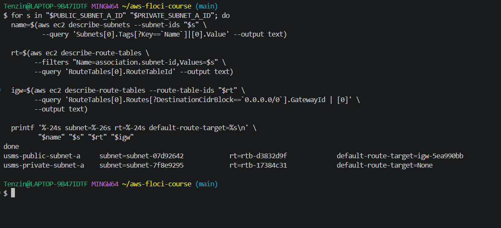
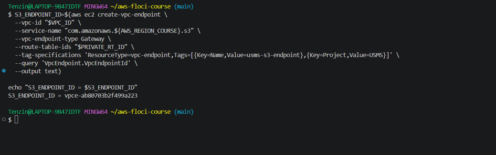
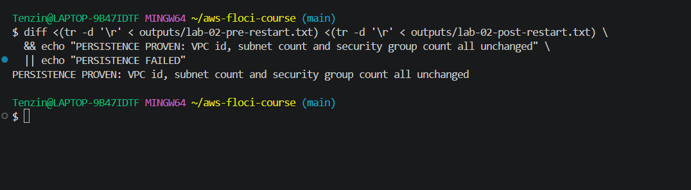
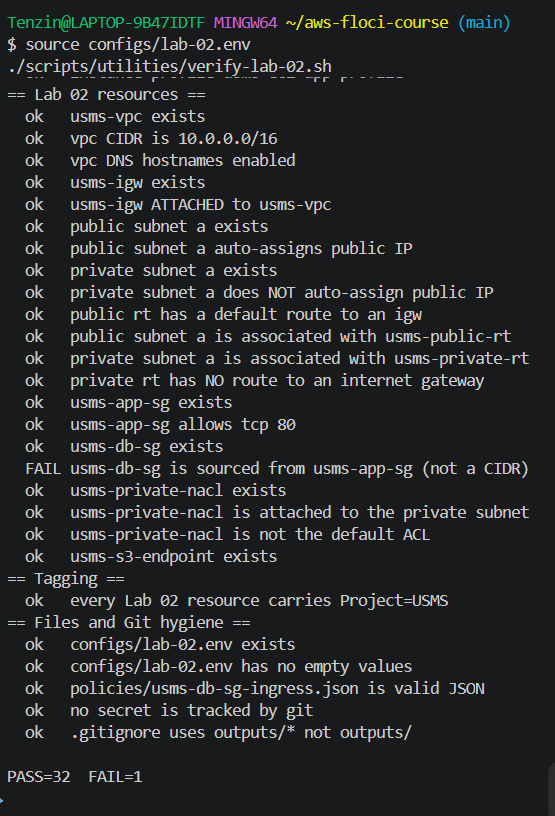

# Lab 02 Notes

## Review Questions

**1. A colleague creates a subnet, names it public-subnet, tags it Tier=public, and turns on auto-assign public IPv4. Instances launched into it cannot reach the internet. Explain exactly what is missing, and explain why the name, the tag and the public IP address all failed to make it public.**

What is missing is a route. A subnet is only public because its route table has a 0.0.0.0/0 route to an internet gateway. Nothing else about it matters.

- The name is just text.
- The tag is just metadata.
- An auto assigned public IP only gives the instance an address. It does not create a path for traffic to leave the VPC.

I proved this myself in Step 13. My public and private subnets had identical route tables until I added the default route to the internet gateway. The only thing that ever separated them was that one route.

**2. Security groups are stateful and network ACLs are stateless. Describe a specific USMS request path, name the ports and the direction of each leg, where that difference changes how many rules you must write. Then say which of the two you would reach for first when a new requirement arrives, and why.**

Take a student's browser calling the web server on port 80.

- **Security group:** I only had to write one inbound rule for TCP 80. The reply going back out is allowed automatically, because the group remembers the connection.
- **My private NACL:** I had to write two separate rules for the same kind of traffic. One allows the actual inbound port. The second allows the whole ephemeral range (1024 to 65535), just so the replies can get back out.

Stateless means nothing is remembered between the request and its reply.

I would reach for security groups first for any new requirement, because one rule usually covers a full request and reply. I would only use NACLs for a restriction on the whole subnet that has to hold no matter what any single instance's security group says.

**3. usms-db-sg allows PostgreSQL from usms-app-sg rather than from 10.0.1.0/24. Give two concrete changes to the USMS architecture that would silently break the CIDR-based version while leaving the group-referenced version correct.**

First, the web tier might need to scale into a second subnet, like usms-public-subnet-b. A CIDR based rule for only 10.0.1.0/24 would silently stop covering the new instances. A rule sourced from usms-app-sg keeps working, because it is not tied to any address range.

Second, the app tier might move to a completely different subnet. An address based rule would need to be rewritten by hand. A group based rule would still be correct automatically, because it only checks group membership, not location.

**4. The NAT gateway sits in usms-public-subnet-a but exists to serve usms-private-subnet-a. Explain why it must be in the public subnet. Then explain what would happen to the private subnet in AZ b if AZ a became unavailable, and what that implies about where the availability boundary really sits.**

It has to sit in the public subnet because it needs its own route to the internet gateway to reach the internet, and only the public subnet has that route.

If AZ a went down, usms-private-subnet-b would lose outbound internet access too, even though its own instances would be completely fine. This is because the one NAT gateway that serves both private subnets lives in AZ a.

So the real availability boundary in this design is not each subnet on its own. It is wherever the NAT gateway is. This is the same tradeoff I wrote about in Exercise 4, when I decided whether a second NAT gateway in AZ b was worth the extra cost.

**5. This lab created a gateway endpoint for S3. Describe the path a request from a private instance to usms-student-data takes with the endpoint, and the path it would take without one. Identify which path leaves the AWS network and what that costs in money and in exposure.**

With the endpoint, traffic to S3 follows a route straight to Amazon's network using a prefix list. It never touches the internet gateway or the NAT gateway.

Without the endpoint, the same request would have to go out through the NAT gateway to the public internet and come back in to reach S3.

That second path leaves the AWS network completely. In money, it means paying NAT data processing charges for traffic that never needed to go near the internet. In exposure, it means student data crosses a public path instead of staying inside AWS the whole time.

**6. Step 23 restarted Floci and looked the VPC up by tag rather than reusing the VPC_ID shell variable. Explain what specifically would not have been proven had the variable been reused. Relate your answer to the failure described in Lab 1 Step 14.**

If I had just reused $VPC_ID after the restart, it would only prove that my terminal still remembered a string. It would not prove that Floci itself still had the VPC.

Looking it up again by tag forces a real API call to Floci's storage. So I only get a correct result if the VPC really survived.

This is the same lesson as Lab 1 Step 14. There, checking the account root ARN after a restart proved nothing, because that value never changes anyway. Real persistence has to be proven by creating something, restarting, and looking it up again from scratch.

**7. Floci does not enforce security groups. Given that, explain how you can still be confident that the rules you wrote in Steps 14 and 15 are correct and describe one specific mistake that this lab's verification would catch and one that it would not.**

I can still be confident because I read the actual rule documents back and checked them against what I intended: port numbers, sources, and descriptions. I did not trust that a command succeeding meant the logic was right.

**A mistake the verification would catch:** an internet gateway that is not attached. describe-internet-gateways would show an empty Attachments list, even though the gateway itself exists.

**A mistake it would not catch:** whether the usms-db-sg rule really blocks traffic from everywhere except usms-app-sg. Floci does not check real traffic against security groups at all. So an overly open rule and a correctly limited one would look the same if you only tested by trying to connect to something.

