# Lab 04 Notes

## Floci support path

**Path A (full), with one gap.**

I ran the Step 3 probe. These are supported:

- ECS (list-clusters, register-task-definition, describe-services)
- Application Auto Scaling (describe-scalable-targets, describe-scaling-policies)
- CloudWatch and CloudWatch Logs

Two probe lines first said "not available", so I checked the real errors:

- ecs describe-services returned ClusterNotFoundException. That is expected, because the probe uses a cluster called "probe" that does not exist. So ECS is supported.
- application-autoscaling describe-scheduled-actions returned UnsupportedOperation. This one is really missing from this Floci build.

Nothing in this lab uses scheduled actions, so Lab 4 is not affected. In Lab 6, scheduled scaling (for example scaling up before enrolment week) will not work on this build, and I will need the documented fallback there.

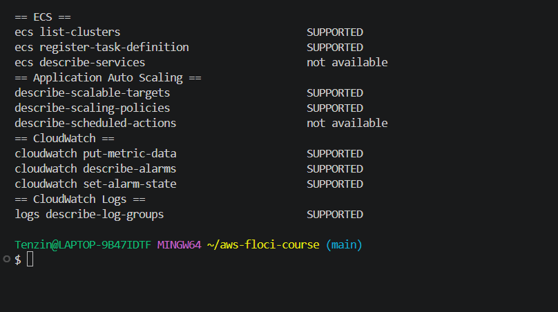
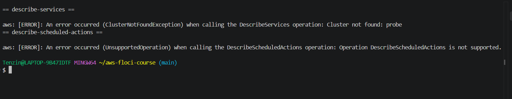

## Step 7: One policy, two kinds of compute

I attached USMSStudentDataReadWrite to the new ECS task role usms-ecs-task-role. This is the same policy Lab 1 made for the EC2 role. When I read the policy back, it was exactly the same document that Lab 3 Step 11 printed. It allows listing the bucket and getting, putting and deleting objects inside it, and it has a Deny on DeleteBucket, all on arn:aws:s3:::usms-student-data.

So now two things hold the same permission through two different mechanisms:

- usms-web-01, through the instance profile and usms-ec2-app-role
- the enrolment task, through taskRoleArn and usms-ecs-task-role

Neither has an access key on disk, and the policy did not need any change. Both will start working at the same moment a later lab creates the usms-student-data bucket.

Small note: my lab-01.env stores USMS_POLICY_S3_RW and USMS_ROLE_DEVELOPER as full ARNs, not just names. So I used the variables directly instead of building the ARN the way the lab's commands do.

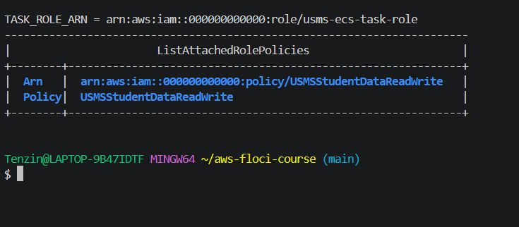
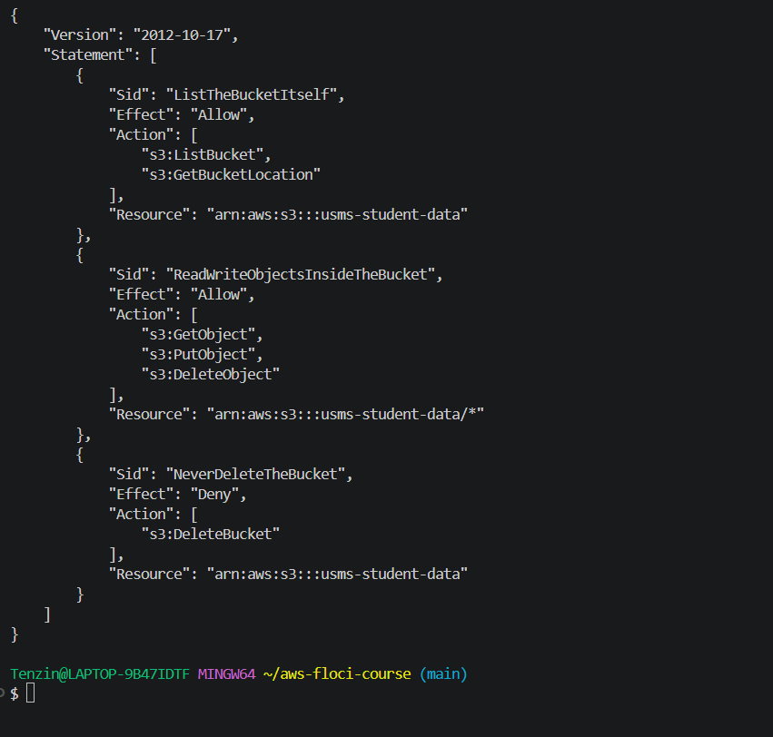

## Step 10: Tasks crashing, and switching to revision 3

After I created usms-enrolment-svc, runningCount stayed at 0 with desiredCount 2. The Floci logs showed that it did start real Docker containers for both tasks. But each one crashed straight away with "exec /docker-entrypoint.sh: exec format error". The service kept starting new tasks that crashed again. This loop froze Docker Desktop once, so I had to restart it.

I followed the lab's troubleshooting section:

- The service events came back as None, because Floci does not record them.
- The stopped task's stoppedReason was "Essential container in task exited". This matches essential=true in the task definition.

To find the real cause, I ran the image directly with docker run, without Floci. The lab's image nginx:stable-alpine failed with the same error. A freshly downloaded nginx:alpine from the Docker library also failed. The Debian based nginx:stable worked (nginx/1.30.5, exit code 0). Both images and my laptop are amd64, so it was not a chip mismatch. Alpine based nginx images just do not run on my Docker Desktop setup.

A task definition revision cannot be edited. So I copied the template to templates/lab-04-taskdef-v3.json and changed only the image to public.ecr.aws/nginx/nginx:stable. I registered it as usms-enrolment:3 and pointed the service at it with update-service. I left the original template as it was, because it produced revisions 1 and 2. After the update the service reached desired=2 running=2, with two real containers running.

I got revision 2 instead of 1 because the register command ran twice. Revision 1 is the same document as revision 2.

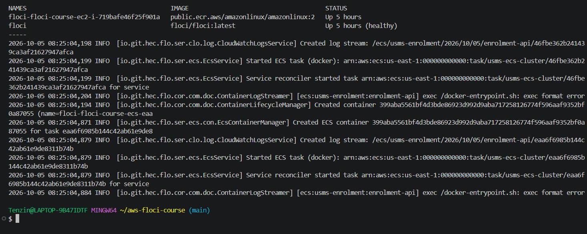
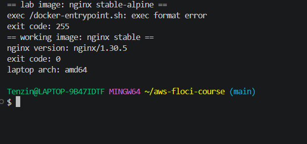
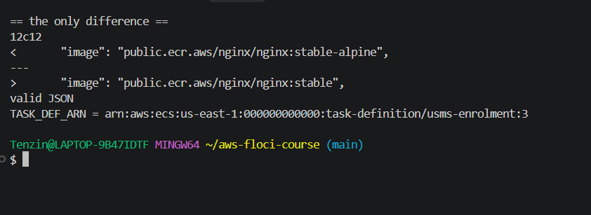

## Verify script: a bug in the git check

The first run gave PASS=37 FAIL=1. The failing check was "no secret is tracked by git", which ran git ls-files | grep -q '^outputs/'.

git ls-files outputs/ only listed outputs/.gitkeep, so no secret was tracked. The problem is that the check fails on any file in outputs/, including .gitkeep. That file has to be there to keep the folder in Git. The lab's own Step 13 also says git ls-files outputs/ should list exactly outputs/.gitkeep. So on a correct repository this check can never pass.

I changed it to ignore .gitkeep and fail on anything else: git ls-files outputs/ | grep -vx 'outputs/.gitkeep' | grep -q . After that the script gave PASS=38 FAIL=0.

I also added export MSYS_NO_PATHCONV=1 at the top of the script. Git Bash on Windows turns /usms/ecs/enrolment into a Windows path, and that would make the log group checks fail for no real reason.

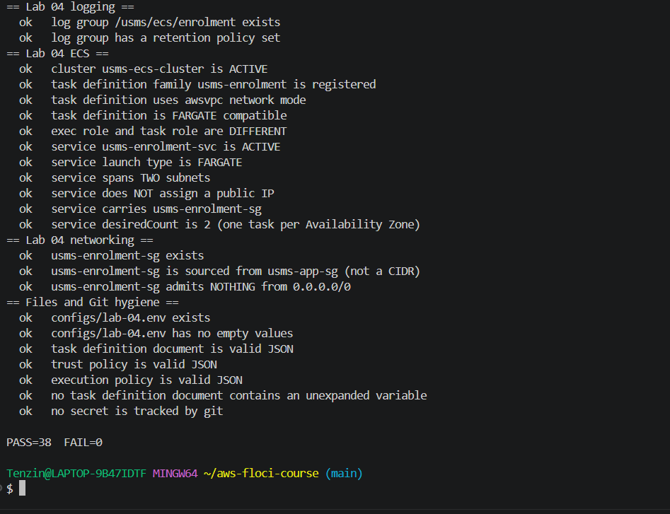

## Review Questions

### 1. "I put auto scaling on the task definition"

This is not correct. The task definition is just a recipe for how the task should run. Auto scaling is attached to the ECS service instead.

Auto scaling changes the service's `desiredCount`. This is the same number I changed by hand from 2 to 3 and back in Step 11. The ECS service scheduler then starts or stops tasks until the `runningCount` matches the `desiredCount`. The task definition itself does not do any scaling.

In Lab 06 the service will be registered with Application Auto Scaling as a scalable target. Application Auto Scaling is a separate service from ECS. Because of that, ECS itself knows nothing about the scaling, so `describe-services` shows no scaling settings. Also, if someone changes `desiredCount` by hand, the next scaling action can overwrite it.

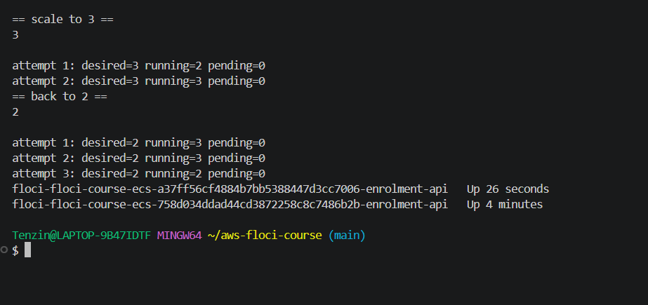

### 2. One policy, two delivery mechanisms

In Lab 3, the policy reaches `usms-web-01` through an instance profile. The profile contains `usms-ec2-app-role`, and AWS gives the instance temporary credentials through the instance metadata service.

In this lab, the same policy reaches the enrolment task through `taskRoleArn`. ECS gives the task temporary credentials for `usms-ecs-task-role`, and the application can use them automatically.

In both cases, I do not need to store permanent access keys because AWS provides temporary credentials. The policy gives access to the S3 bucket `arn:aws:s3:::usms-student-data`. If the bucket exists, both the EC2 instance and the ECS task can access it, as the policy allows.

At runtime, the instance gets its credentials from the instance metadata service. The Fargate task gets its own from the ECS container credentials endpoint inside the task (the AWS_CONTAINER_CREDENTIALS_RELATIVE_URI that the SDK reads automatically). Both are temporary and AWS rotates them automatically, so there is nothing permanent to leak.

Today any S3 call to usms-student-data fails with a 404 because the bucket does not exist. As soon as the bucket is created at that ARN, the same calls start working for both usms-web-01 and the enrolment task at the same time. There is no change to the policy, the roles, the instance or the task definition.

### 3. Execution role vs task role

If the task cannot start because it cannot pull its image or create its log stream, the problem is with the execution role.

If the task is already running but the application gets `AccessDenied` when it accesses S3, the problem is with the task role.

Both roles trust `ecs-tasks.amazonaws.com`, but they have different permissions. ECS uses the execution role to start the task. The task role gives permissions to the application running inside the task.

The trust policy is the same because it only says who is allowed to assume the role, and in both cases that is the ECS tasks service. What each role can do comes from its own permissions policy.

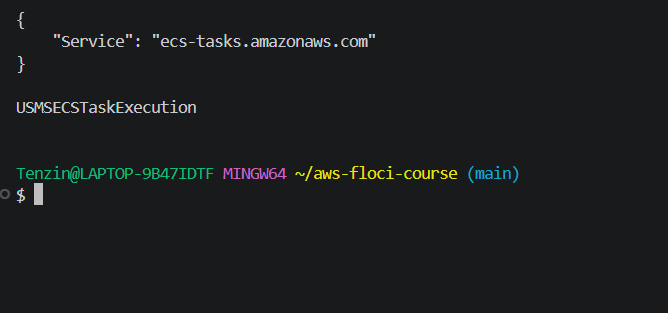

### 4. Sourcing the rule from usms-app-sg

Using `usms-app-sg` as the source is better than using a CIDR such as `10.0.1.0/24`, because it lets only the web tier reach the enrolment API.

A CIDR could let in anything inside that subnet. Also, if the web instance moved to another subnet, the rule might stop working.

Using the security group keeps the rule based on its real purpose: only the web tier can call the enrolment API. This also helps when the number of tasks changes, because new tasks can have different private IP addresses.

So there are two separate reasons:

- Even if the task count never changed, the group reference is still correct. It says who may call the service (the web tier), not where that caller happens to sit.
- Once Lab 06 lets the task count change by itself, the group reference becomes close to mandatory. Every new task and every new web server automatically carries its security group and gets the right access, with no list of IP addresses to keep updated.

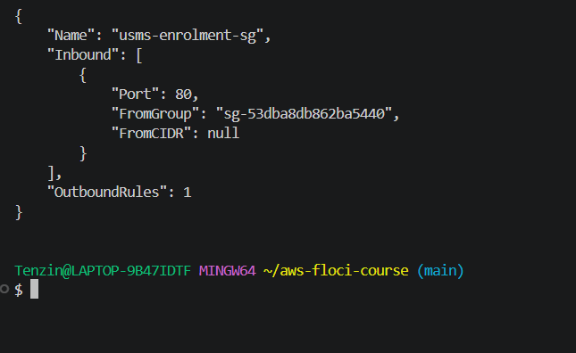
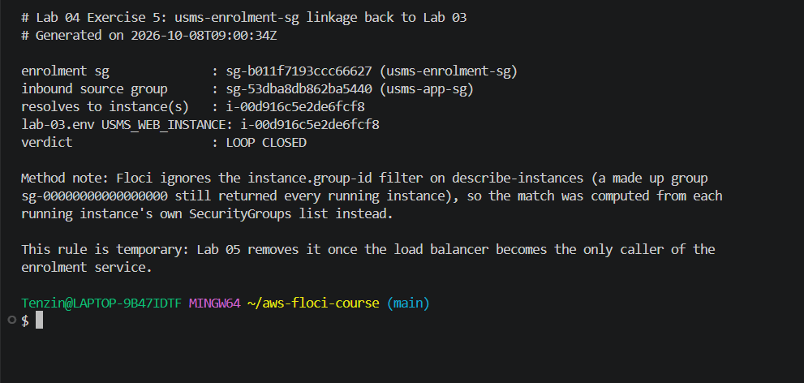

### 5. What Fargate removes and what it does not

Fargate removes the need to manage the servers where the containers run. With EC2, I would need to choose an AMI and instance type, manage servers, think about storage and patching, and scale the EC2 instances when needed.

With Fargate, I only set what the task needs, such as `0.25 vCPU` and `512` or `1024 MiB` memory. AWS manages the servers underneath.

But Fargate does not remove networking. The task still runs in `awsvpc` mode and gets its own network interface. It uses the private subnet and `usms-enrolment-sg`, and it follows the private route table. It has no public IP and needs the NAT gateway to reach the internet and pull its image.

### 6. A command that cannot tell memory mode from hybrid mode

`aws ecs describe-clusters --clusters usms-ecs-cluster` cannot prove memory mode or hybrid mode while Floci is running. Both modes can show the cluster as `ACTIVE`.

To test persistence, I need to stop Floci and start it again with `floci-down.sh` and `floci-up.sh`. In hybrid mode, the cluster is still there because the data was saved to disk. In memory mode, the cluster would disappear because the data only existed in memory.

I saw the hybrid behaviour myself when Docker Desktop froze and Floci restarted in Step 10. The cluster, service, task definition revisions and roles were still there.
