# Lab 05 Working Notes

## Support path (Step 3)

Final: path A for the control plane and health checks, and path B for the client data path.

- All ten probes in Step 3 answered SUPPORTED.
- Step 5 returned an ARN.
- In Step 11 Floci really health checked the containers and marked both targets healthy.
- But in Step 12 the DNS name did not resolve and curl could not connect, so I never saw a 200 from my shell. The details are under Step 12.

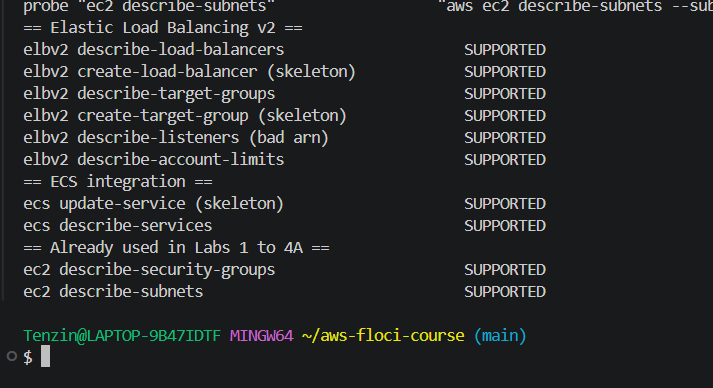

## Pre lab checks (Steps 1 and 2)

- floci-storage-check.sh: my version prints [ok] lines instead of a PASS=16 total. Every line was [ok], so I counted it as passing.
- verify-lab-02.sh: PASS=32 FAIL=1, the same Floci limitation I recorded in Lab 2.
- verify-lab-03.sh: PASS=34 FAIL=2, the same two Floci limitations I recorded in Lab 3.
- verify-lab-04.sh: PASS=38 FAIL=0. The doc example shows 49 because its script has more checks than mine. FAIL=0 is what the doc requires.

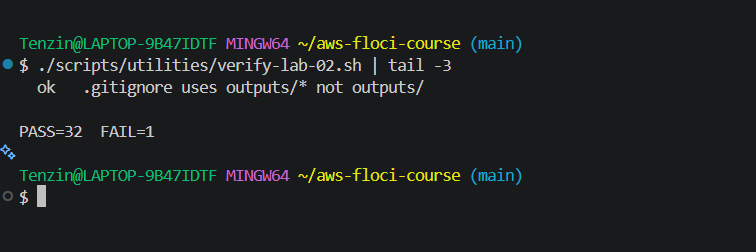
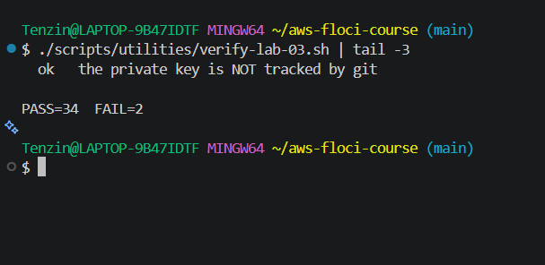
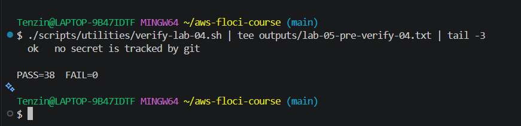

## Step 4 Your turn: why port 443 alone does not give HTTPS

Opening 443 on usms-alb-sg only opens the firewall. Two things are still missing:

- an HTTPS listener on port 443, because a listener is what actually accepts connections
- a TLS certificate attached to that listener, because HTTPS needs a certificate to do the TLS handshake

AWS Certificate Manager gives the public certificate for free. But it can only issue it for a domain name I own, and I have to get that domain from a registrar.

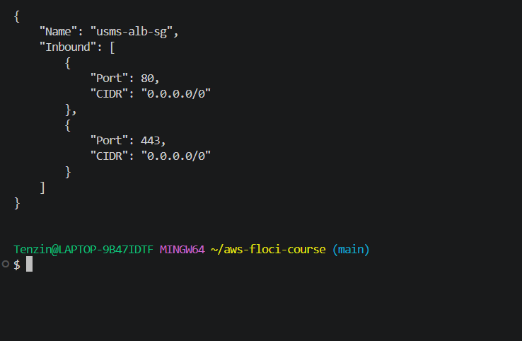

## Step 5: the load balancer

- ARN: arn:aws:elasticloadbalancing:us-east-1:000000000000:loadbalancer/app/usms-enrolment-alb/7ebbd0c317ac42a4
- DNS name: usms-enrolment-alb-7ebbd0c317ac42a4.elb.floci (Floci format, not the real AWS elb.amazonaws.com form)
- The state went active on the first poll and the waiter returned straight away.
- Two AZs, us-east-1a and us-east-1b.
- Both attributes were accepted.

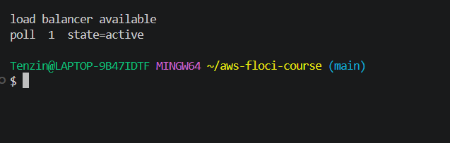
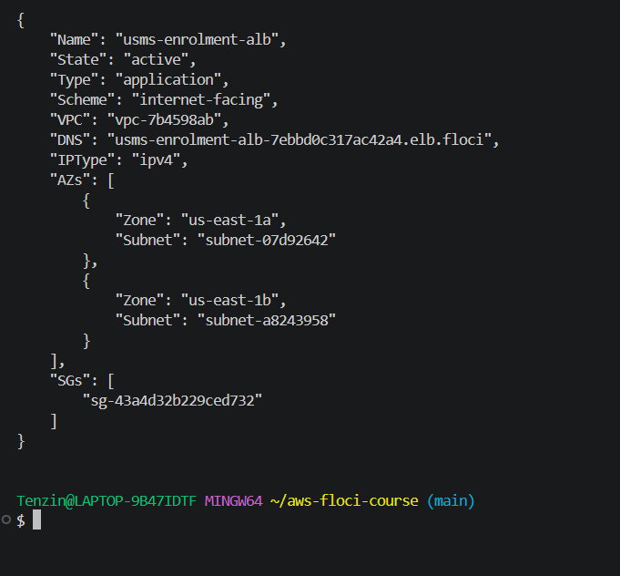
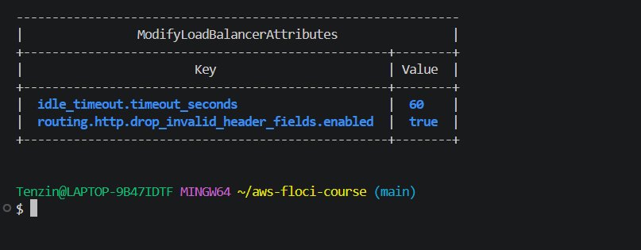

## Step 6 Your turn: the health check matcher

I widened the matcher to 200-399 with modify-target-group, read it back, and then set it back to 200. Both changes worked straight away without recreating the target group.

(a) A web app that redirects / to /login with a 302 when you are not signed in would work perfectly, but it would fail a strict 200 health check forever.

(b) It would be a bug in my work, not in the script. A verification script exists to check the build against the agreed baseline in Section 5.1, which says matcher 200. So a failure there means the script correctly caught that my config drifted from the spec.

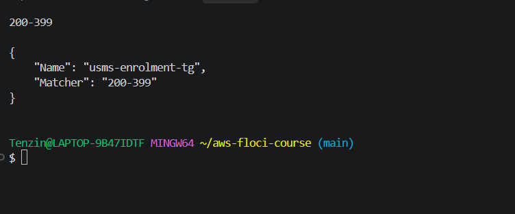
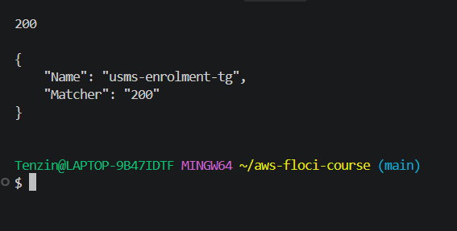

## Step 7: target group attributes

- deregistration_delay.timeout_seconds 30 and load_balancing.algorithm.type least_outstanding_requests were both accepted.
- Floci limitation: describe-target-group-attributes only listed the two attributes I set. Real AWS returns the full list, including defaults like stickiness.enabled false and slow_start.duration_seconds 0.

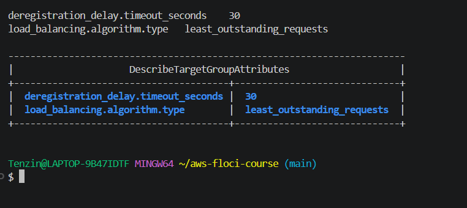

## Step 8: the listener

- I created the HTTP:80 listener with the default action forward to usms-enrolment-tg. AttachedToLoadBalancers went from 0 to 1.
- Floci difference: SslPolicy came back as an empty string "" instead of null. Both mean there is no TLS policy, because it is an HTTP listener.

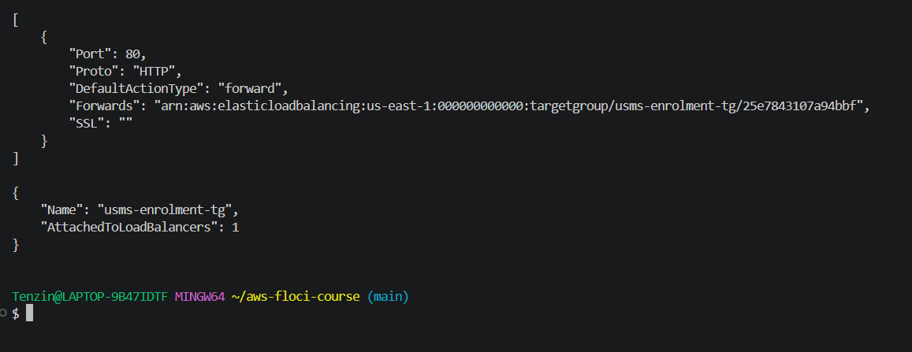

## Step 9: enrolment sg now admits usms-alb-sg

- Both sources are on port 80: usms-app-sg (from Lab 04, still there on purpose) and usms-alb-sg (from this step). CIDRs are empty.
- Floci difference: real AWS merges the two rules into one IpPermission entry with two UserIdGroupPairs, because they share protocol and port. Floci kept them as two separate IpPermission entries. Unlike Lab 2, the group referenced rule was not dropped.

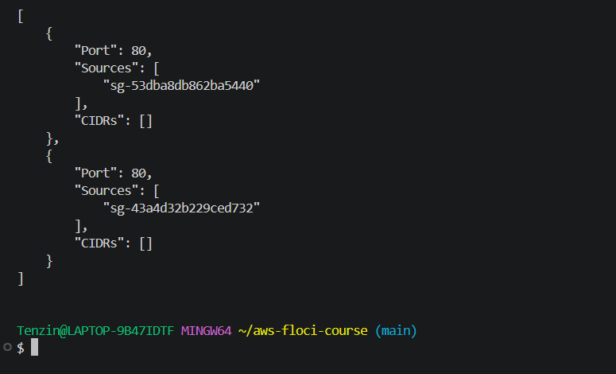

## Step 10: attaching the service (fallback path taken)

- update-service --load-balancers --health-check-grace-period-seconds 60 returned no error. But the response and describe-services both showed loadBalancers null and grace null. My Floci build accepts the flag on update-service and silently ignores it.
- I took the doc's fallback path. I scaled the service to 0, deleted it, and recreated it with create-service and --load-balancers attached.
- I made two changes to the doc's fallback command:
  - I used usms-enrolment:4 instead of :2, because :4 is my Lab 04 revision (the doc's rule is to use the same task definition as Lab 04).
  - I left out --deployment-configuration file://templates/lab-04-deployment-config.json, because Lab 04 never created that file and Lab 04's own create-service did not use it.
- I kept the same name, cluster, desired count 2, private subnets a and b, usms-enrolment-sg, assignPublicIp DISABLED and the Lab=04 tag.
- Result: loadBalancers now has one entry (enrolment-api on port 80, usms-enrolment-tg). The task definition is still usms-enrolment:4, with no new revision.
- Floci limitation: healthCheckGracePeriodSeconds stays null after both create-service and a second update-service. Real AWS would store 60 and ignore target health for the first 60 seconds of each task.

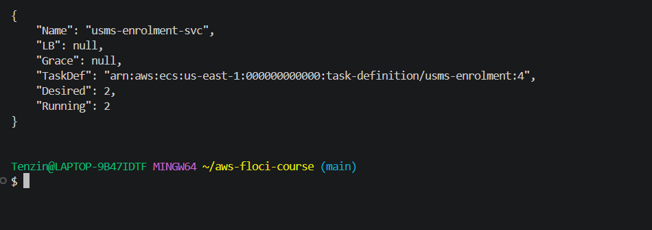
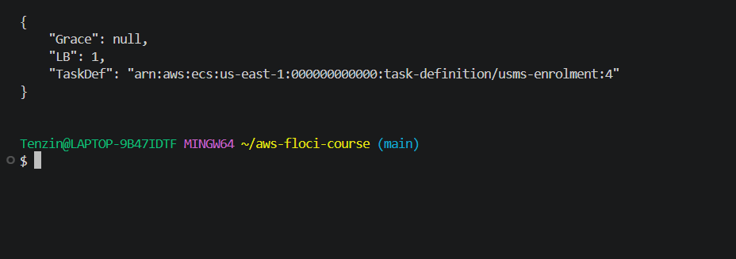
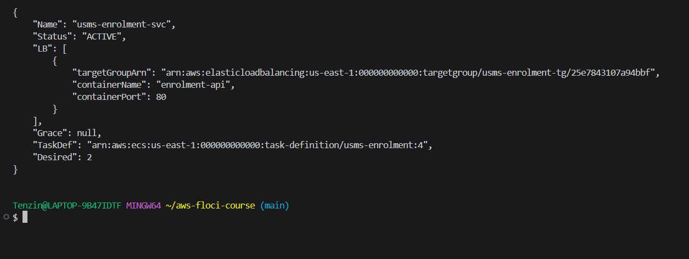

## Step 11: targets registered by the service

- Two targets appeared on the first poll, both healthy. I never ran register-targets. The ECS service registered them.
- Floci difference: the target addresses were 172.18.0.3 and 172.18.0.4. These are the Docker network addresses of the real nginx containers on my laptop, not addresses from my private subnets. AvailabilityZone came back None. Real AWS would register one 10.x address in each private subnet, one per AZ.
- Because the targets went healthy, Floci's load balancer really probed GET / on the containers and got 200.
- Service: desired 2, running 2, pending 0, one deployment, rolloutState COMPLETED, and loadBalancers pointing at usms-enrolment-tg. The events list was None, the same as Lab 04.
- Part 3: list-tasks returned four tasks. Two were RUNNING (the new service) and two were STOPPED (the old service before the fallback). For every task, healthStatus and the private IP were None, so I could only observe the load balancer half of the side by side comparison. Real AWS would give HEALTHY or UNKNOWN and the task's 10.x address, so I could line them up by address.

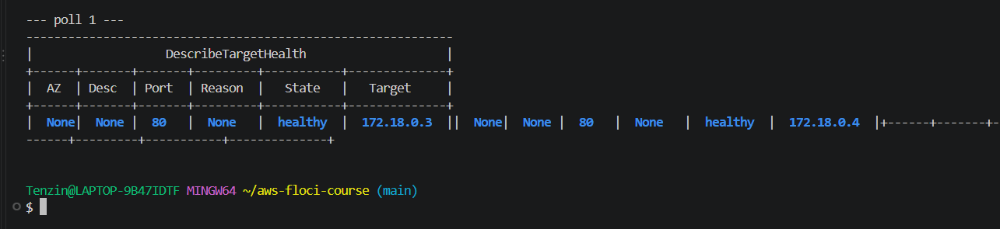
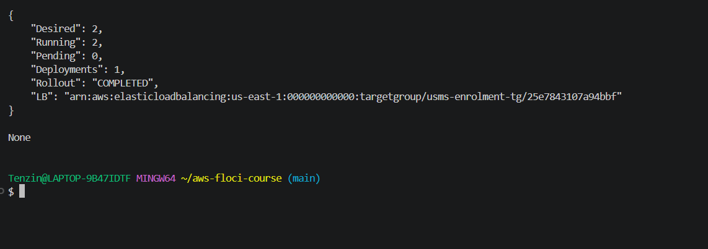
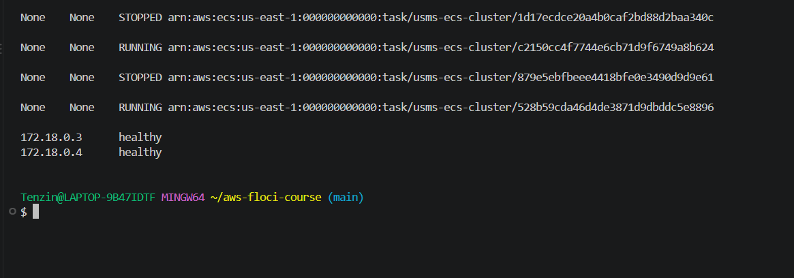

### Reading ECS health and target health together

| ECS healthStatus | Target health | Diagnosis |
| --- | --- | --- |
| HEALTHY | healthy | Working |
| HEALTHY | unhealthy | The network path is broken: security group, subnet, or the health check path returning the wrong code |
| UNHEALTHY | unhealthy | The application is broken, read the container logs |
| UNKNOWN | healthy | Not a fault, the task definition has no container health check |
| anything | unused | Nothing forwards to this target group |

## Step 11 Your turn: scaling 2 to 3 to 2

- At desired 3, a third target (172.18.0.5) appeared as initial on the second poll.
- Back at desired 2, it was gone on the first poll and the two original targets stayed healthy.
- I never ran register-targets or deregister-targets.
- Floci difference: the removed target disappeared straight away, instead of showing draining for the 30 second deregistration delay.

If the service did not register its own targets, I would have had to update the target group by hand after every scaling event. I would run register-targets with each new task's IP address and deregister-targets for each task that stopped.

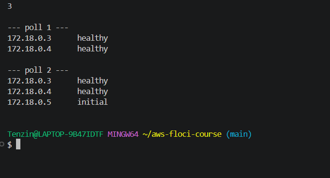
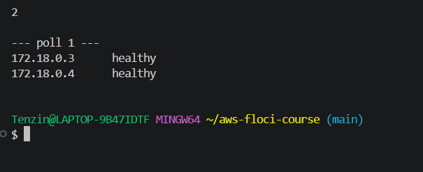

## Step 12: proving the path

Part 1, data path: usms-enrolment-alb-7ebbd0c317ac42a4.elb.floci did not resolve on my Windows host (getaddrinfo failed), and curl returned http_code=000. I did NOT get a 200. Floci does not publish the load balancer on any host port, and the doc says not to publish extra ports to force it. Real AWS would resolve the name to the public addresses of the nodes in us-east-1a and us-east-1b and forward to a healthy target.

Part 2, control plane proof, saved in outputs/lab-05-path-proof.txt:

1. Listener HTTP 80 forwards to usms-enrolment-tg.
2. usms-enrolment-tg is type ip, HTTP 80, health check /, in vpc-7b4598ab.
3. Two targets, 172.18.0.3 and 172.18.0.4. The script says NOT in a Lab 02 private subnet, because Floci registers the Docker network address of each container. This is the same difference I recorded in Step 11.
4. usms-enrolment-svc registered them, container enrolment-api on port 80. Grace period None, as recorded in Step 10.
5. usms-enrolment-sg admits usms-alb-sg (sg-43a4d32b229ced732), so the link that matters on real AWS is in place. usms-app-sg is still there until Step 13.

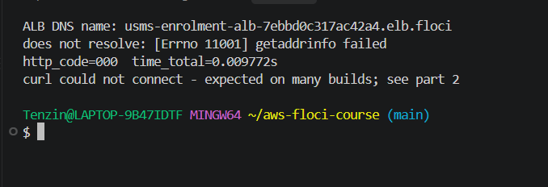
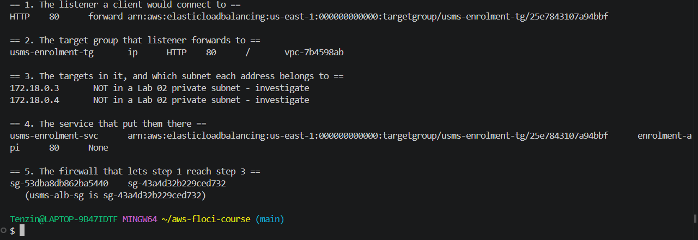

## Step 13: the cutover

- describe-security-group-rules found the Lab 04 rule as sgr-bf15d58c0dae9e42c (inbound tcp/80 from usms-app-sg).
- Floci limitation: revoke-security-group-ingress --security-group-rule-ids returned True but removed nothing. Both describe views still showed usms-app-sg.
- Workaround: I revoked the same rule using --ip-permissions file://policies/usms-enrolment-sg-ingress.json. This is the Lab 04 document for exactly this rule, and the doc's danger box names it as the way to restore the rule. That also returned True.
- After that, describe-security-groups (the view the doc's Verify uses) shows one source on port 80, usms-alb-sg (sg-43a4d32b229ced732), and usms-app-sg is gone. The load balancer is now the only thing that can open a connection to an enrolment task.
- Floci limitation: describe-security-group-rules still lists the old sgr-bf15d58c0dae9e42c, so Floci keeps a separate rule list that went stale. On real AWS both views always agree.

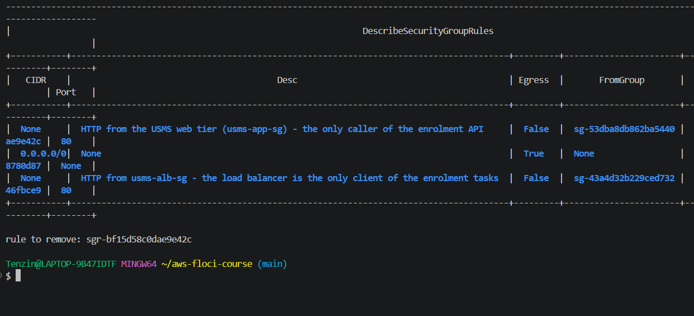
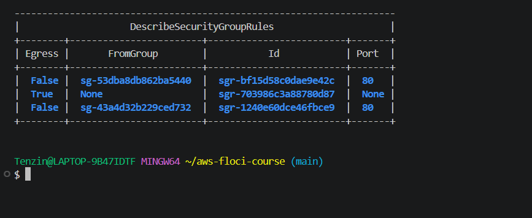
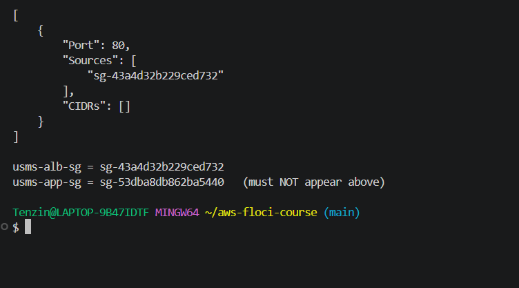

## Step 13 part 3: verify-lab-04.sh after the cutover

verify-lab-04.sh went from PASS=38 FAIL=0 (outputs/lab-05-pre-verify-04.txt) to PASS=37 FAIL=1 (outputs/lab-05-post-verify-04.txt). The diff shows exactly one check changing: "usms-enrolment-sg is sourced from usms-app-sg (not a CIDR)" went from ok to FAIL. This is expected, because that check describes the architecture before the load balancer. The script did its job by failing.

There are three possible responses:

- Leave it and document the expected failure. This is what I am doing now, because Lab 04's script is a record of what Lab 04 built.
- Update the check to assert usms-alb-sg as the source (Exercise 2).
- Delete the check. This is almost never right, because the property still matters and only the expected value changed.

From here, verify-lab-05.sh is the script of record.

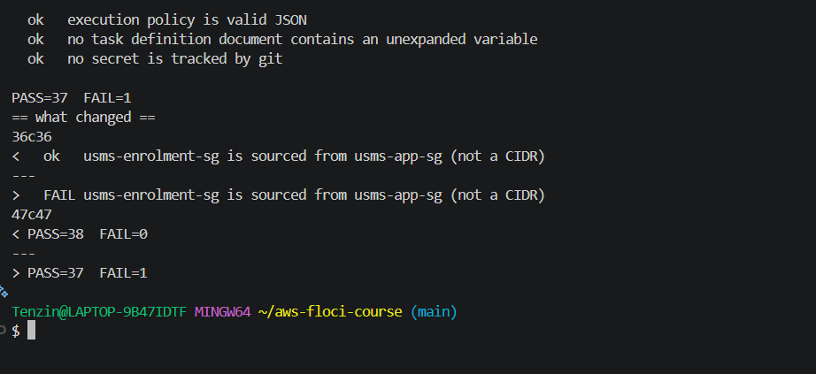

## Step 14: forced deployment behind the load balancer

- update-service --force-new-deployment returned Deployments 1 straight away. Over 15 polls the deployment stayed COMPLETED with 2 running, and both targets stayed 172.18.0.3 and 172.18.0.4 and healthy.
- Pre and post deploy (outputs/lab-05-pre-deploy.txt and lab-05-post-deploy.txt): same task definition usms-enrolment:4, same counts 2 and 2, and the SAME addresses.
- As the doc says, I then checked the task ARNs. The running tasks were still c2150cc4... and 528b59cd..., the same ones as in Step 11.
- Floci limitation: --force-new-deployment returns success but does not replace any tasks, so I could not observe initial, healthy and draining during a deployment. Real AWS would start new tasks, register them as initial, and wait for healthy. Then it would mark the old ones draining for up to the 30 second deregistration delay before stopping them.
- Doc bug: the poll loop's stop check uses --query 'length(deployments)'. This errors with "invalid type for value: None" because the path is missing services[0]. It should be 'length(services[0].deployments)'. Because of this the loop always ran all 15 polls, but the polls themselves were not affected.

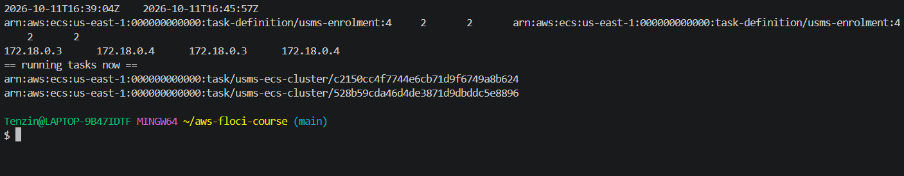
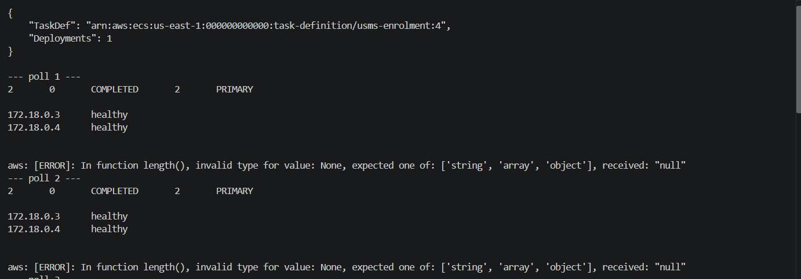

## Step 15: listener rule

- I created the rule at priority 10. Path pattern /alb-health and /alb-health/* returns a fixed-response 200 text/plain "usms-enrolment-alb ok" without contacting any target.
- describe-rules shows two entries: my rule (Priority "10", IsDefault false, fixed-response, status "200", no target group) and the default action (Priority "default", IsDefault true, forward to usms-enrolment-tg).
- Floci difference: Conditions[0].Values came back empty. The two paths are stored only in Conditions[0].PathPatternConfig.Values, which I checked separately. Real AWS fills both.
- Part 3: curl to / and to /alb-health both returned 000. This is the same missing data path as in Step 12, so describe-rules is my evidence that the rule is in place and is checked before the default action.

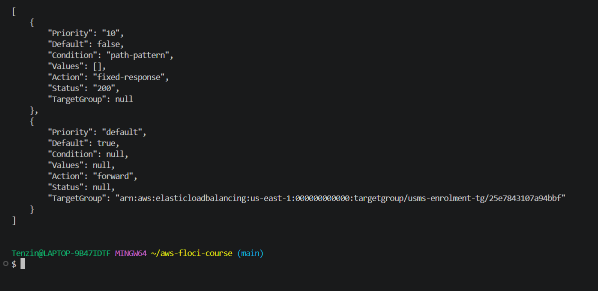
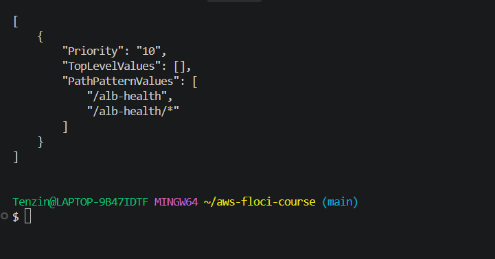
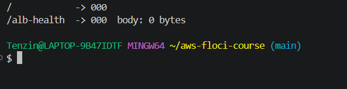

## Step 16: persistence

- After floci-down.sh and floci-up.sh, I got the load balancer ARN, target group ARN, listener ARN and usms-alb-sg again from the API. All four matched the values from before the restart.
- The diff of outputs/lab-05-pre-restart.txt and lab-05-post-restart.txt was empty, so the script printed PERSISTENCE PROVEN.
- Honest note: the grace period was None both before and after (the Step 10 limitation). So the check proves that the None survived, not a stored value of 60.
- The tag:Name filter on describe-security-groups returned the right group, sg-43a4d32b229ced732.

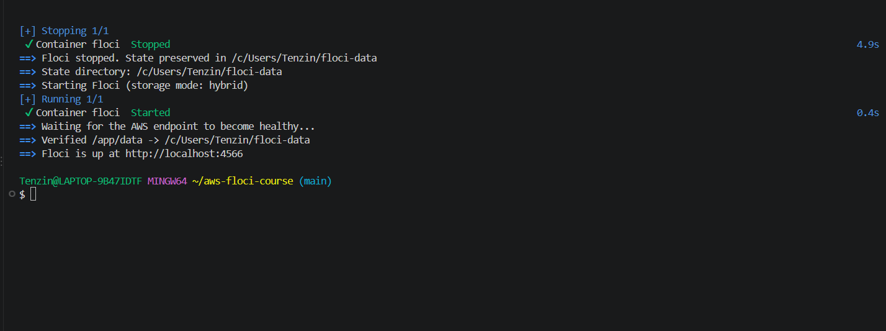
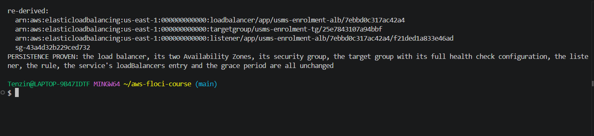

## Step 17: closing the loop

- usms-alb-sg admits tcp/80 and tcp/443 from 0.0.0.0/0. The 443 rule is from my Step 4 Your turn, so I have one more rule than the doc's example.
- CUTOVER CONFIRMED: the only source group on usms-enrolment-sg is usms-alb-sg (sg-43a4d32b229ced732).
- LOOP CLOSED: usms-web-01 (i-00d916c5e2de6fcf8) still carries usms-app-sg, but that group no longer grants it anything on the tasks. It now has to call usms-enrolment-alb-7ebbd0c317ac42a4.elb.floci instead of a task address. The instance.group-id filter worked this time and returned only usms-web-01.
- Audit: usms-alb-sg, the load balancer and the target group are all tagged Lab=05, and elbv2 describe-tags worked on my build.

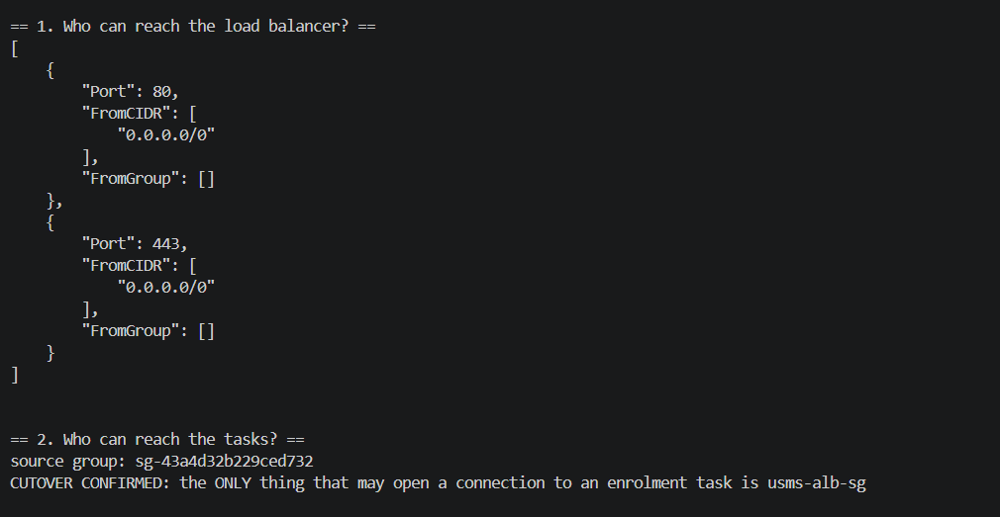
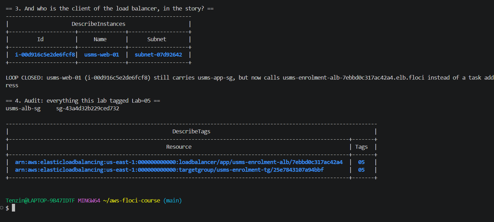

## Step 18: configs/lab-05.env

- I wrote it by lookup. It has 15 exports, all filled in except USMS_SVC_GRACE_PERIOD=None. That is the Step 10 Floci limitation (real AWS would record 60).
- Doc bug: the listener line's filter Listeners[?Port==\`80\`] failed on my shell with "Bad jmespath expression: Unknown token \". Inside $(...) the backslash reached the AWS CLI together with the backtick, which left USMS_ALB_LISTENER_ARN empty. I changed only that filter to Listeners[?to_string(Port)=='80']. It means the same thing and needs no backticks. After that the listener ARN was filled in.

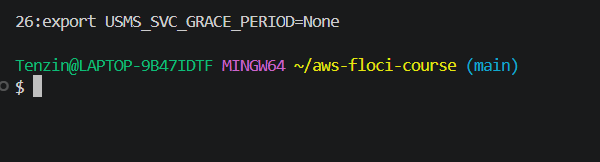
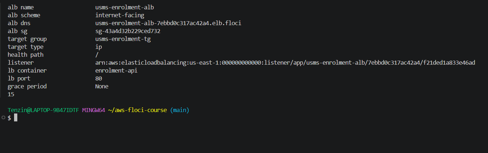

## Section 9: verify-lab-05.sh

- First run: PASS=46 FAIL=3 out of 49 checks.
- Doc bug I fixed: "no secret is tracked by git" used ! git ls-files | grep -q '^outputs/'. This always fails, because outputs/.gitkeep is meant to be tracked (Step 19 confirmed it is the only tracked file there). I changed it to ! git ls-files outputs/ | grep -vx 'outputs/.gitkeep' | grep -q . which is the same fix I made to verify-lab-04.sh in Lab 04.
- Final run: PASS=47 FAIL=2. Both remaining failures are benign and have one cause:
  1. "healthCheckGracePeriodSeconds is set (not None, not 0)": my Floci build accepts --health-check-grace-period-seconds on create-service and update-service but does not store it (Step 10). This is in the doc's own benign table. Real AWS would store 60.
  2. "configs/lab-05.env has no empty values": the file records USMS_SVC_GRACE_PERIOD=None for the same reason. Every other value in the file is filled in.
- Cleanup script: I built scripts/cleanup/lab-05-cleanup.sh and checked it with bash -n (syntax OK). I have NOT run it.
- Doc typo: its comments say "Run AFTER lab-04-cleanup.sh and BEFORE lab-04-cleanup.sh". From the doc's own order list, the first one should be the Lab 06 cleanup (scaling configuration). I copied it as written because it is only a comment.

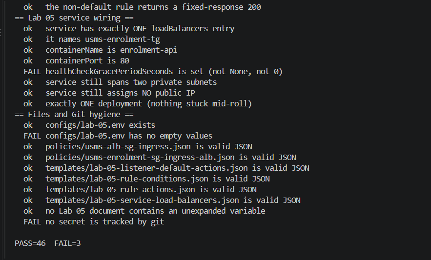
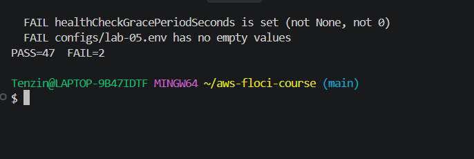
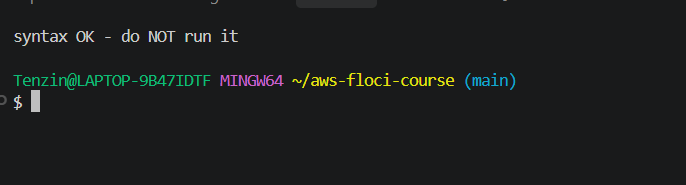

## Section 12.1: what I actually observed on my build

OBSERVED (I saw it in command output):

- usms-alb-sg admitting 0.0.0.0/0, and usms-enrolment-sg admitting only usms-alb-sg after the cutover (Steps 4, 13, 17)
- a load balancer across two subnets in us-east-1a and us-east-1b (Step 5)
- a target group with target-type ip (Step 6)
- the target group's LoadBalancerArns count going from 0 to 1 when I created the listener (Steps 6 and 8)
- the ECS service filling the target group itself with two targets, without me registering anything, and scaling to 3 and back to 2 (Step 11)
- targets reported healthy, and a new target reported initial (Step 11)
- a listener rule at priority 10 ordered ahead of the default action (Step 15, and the report tool in Exercise 3)
- the security cutover, and verify-lab-04.sh changing exactly one check from ok to FAIL (Step 13)
- all of it surviving a Floci restart, with every ARN looked up again from the API (Step 16)

NOT OBSERVED, even though the doc lists it as observable:

- "a load balancer with no listener, answering nothing": I never ran describe-listeners or curl before Step 8, so I reasoned this instead of seeing it
- "refusing to be anything else afterwards": I did not try to change the target type, I only read that there is no command for it
- "target addresses inside Lab 02's private subnet CIDRs": my targets were 172.18.0.3 and 172.18.0.4, which are Docker network addresses (Step 11)
- "a forced deployment producing new addresses": Floci kept the same two tasks and addresses (Step 14)

CONCEPTUAL (reasoned, not seen):

- a request going from a client to a task and back: no 200, the DNS did not resolve and curl got 000 (Step 12)
- a health check probe being sent: the healthy state suggests Floci probed the containers, but I never saw a probe itself
- a target going from initial to healthy: I saw a target at initial and others at healthy, but I never watched one change
- a target draining: the removed target disappeared straight away (Steps 11 and 14)
- least_outstanding_requests choosing a target: the setting is stored, but there was no traffic to choose for
- a rule's path condition checked against a real URL: no data path (Step 15 curl got 000)
- the 2 to 4 minute provisioning time: mine went active on the first poll
- HTTPS, certificates and the TLS listener: planned in Exercise 4 only
- the cost: calculated from the AWS pricing pages in Exercise 4, never billed

## Review questions

**1. The group rule in Lab 04 and the load balancer in Lab 05**

Both exist because the tasks have no stable address. When a task stops, its IP goes with it, and a new task gets a new IP. So anything written against an address is wrong as soon as the next deployment happens. The security group rule solved this for the firewall by naming a group instead of an address. The load balancer solves it for clients by giving them one stable DNS name instead of a list of task IPs.

The general problem is indirection. You put something stable in front of something that changes. Then you give the job of keeping it up to date to whatever already knows about the changes. Here, the ECS service registers and deregisters its own targets.

A third example from elsewhere in computing is DNS itself. People use a hostname, and the record is updated when the server's IP changes. Virtual memory is another example. Programs use virtual addresses, and the operating system maps them to physical memory that can move.

**2. "The health check says unhealthy, so the app is broken"**

That is not a safe conclusion. The target group health check is sent from outside the task across the network. So it fails in the same way whether the application is broken or the network path to it is broken. It cannot tell "the process is dead" apart from "the process is fine, but the security group, subnet or health check path stops the probe reaching it".

The field that separates them is the ECS task's healthStatus from the container health check, which runs inside the task. My order for diagnosing would be:

1. Look at healthStatus for the same task.
2. If it is UNHEALTHY, read the container logs, because the app is broken.
3. If it is HEALTHY, check that usms-enrolment-sg admits usms-alb-sg on the target port, then the health check path and matcher, then the subnets and NACLs.

**3. Configuration versus identity**

There is no update-target-group-target-type, because AWS treats the target type as part of what the target group is, not as a setting on it. Changing it would make it a different object, so the only way is to create a new one. It is the same idea as Lab 04's task definition revisions. You never edit a revision, you register a new one.

Two other fields in this lab that behave the same way are the load balancer's scheme and its type (application or internet facing cannot be changed after creation), and the target group's VPC. One field that looks like it should be fixed but is not is the load balancer's security groups. They can be changed later with set-security-groups. The health check path and matcher can also be changed in place, as I did in the Step 6 Your turn.

**4. A request in flight when its task is stopped**

When ECS decides to stop the task, it first deregisters it from usms-enrolment-tg. The load balancer marks it draining. It sends no new requests to the task, but it lets requests already in flight finish. This lasts up to deregistration_delay.timeout_seconds, which I set on the target group to 30 seconds. After draining, ECS sends SIGTERM to the container and waits for the stopTimeout from the task definition before it sends SIGKILL. During a deployment, minimumHealthyPercent on the service decides if a new task has to be healthy before the old one is taken out.

So a normal request that takes milliseconds succeeds, because it finishes well inside the 30 second drain. If the delay were left at the default of 300 seconds, the request would still succeed. But every task would wait up to five minutes before stopping, so a deployment of two tasks could take around ten minutes for no benefit.

**5. Fix the Lab 04 script or leave it failing**

The case for updating it straight away: a script that fails for a known reason trains people to ignore it, and then a real failure gets missed among the expected ones. The case for leaving it failing and documenting it: Lab 04's script is a record of what Lab 04 built, and changing it quietly can hide a regression.

On a system with four other engineers, I would update the check in the same commit as the architecture change and explain why in the commit message. The others cannot know the failure is expected unless they read my notes. With only me on the system, leaving it failing for a short time with a note is more acceptable, because the person reading the failure is the person who knows why. That is what I did until Exercise 2.

**6. Internet facing load balancer, private tasks**

Both are true because the load balancer and the tasks are in different subnets.

- The load balancer's nodes are in usms-public-subnet-a and usms-public-subnet-b. Their route table usms-public-rt sends 0.0.0.0/0 to usms-igw, so the nodes get public addresses and can be reached from the internet.
- The tasks are in usms-private-subnet-a and usms-private-subnet-b. Their route table usms-private-rt only goes out through usms-nat (outbound only), and the tasks have no public IP. So nothing outside the VPC can start a connection to them.
- The load balancer reaches the tasks because it is inside the same usms-vpc and usms-enrolment-sg admits usms-alb-sg.

An attacker who controlled the load balancer's configuration could change listeners and rules, send traffic to other target groups in the VPC, or read and redirect the requests passing through it. But they could still only reach the tasks on tcp/80, because usms-enrolment-sg admits nothing else, and they could not reach usms-db-01.

If the tasks had public addresses, anyone could try to connect to them directly and skip the load balancer, its listener and its rules. The only thing protecting them would be their own security group.

**7. Requests per target versus CPU**

Requests per target is a better signal for a web API, because the load on the service is the number of requests coming in. It scales on the demand itself and can add tasks before CPU has gone up.

CPU is the better choice when the work is CPU heavy and the cost of each request varies a lot, for example generating large reports. It is also better when most of the work does not come through the load balancer at all.

ALBRequestCountPerTarget would scale the enrolment service badly in two cases:

- A small number of requests are very expensive while most are cheap, so the request count stays low while the tasks are overloaded.
- Clients keep long lived connections that send few requests but use a lot of resources.
