# Lab 06 Working Notes

## Support path (Step 3)

My provisional path is A or B, and Step 12 decides it. It is not path C. When I ran describe-scalable-targets directly it answered with an empty list and exit code 0, and the doc says that is a successful answer. The probe first printed "not available" for it. That was most likely a one off failure on the first call, because the same call worked straight after.
Known gap: describe-scheduled-actions returns UnsupportedOperation ("Operation DescribeScheduledActions is not supported"), the same as in Lab 04 Step 3. Floci's Application Auto Scaling has no scheduled action operations at all, so I will record Step 11 (scheduled actions) as a Floci limitation. Docker is not the cause.

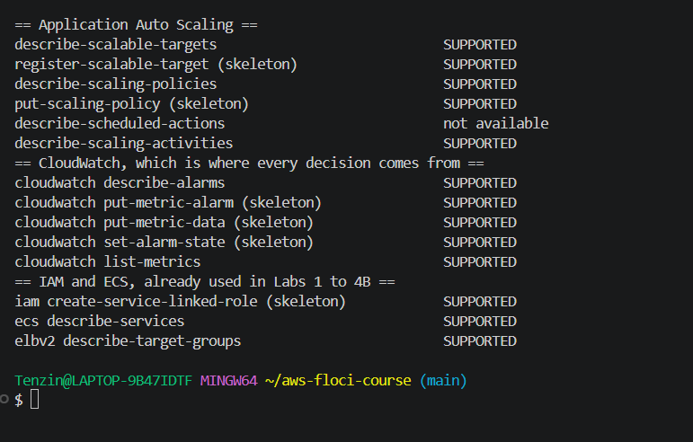
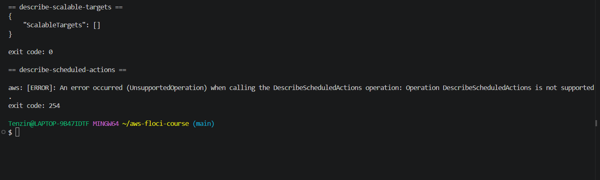

## Pre lab checks (Steps 1 and 2)

- AWS_PROFILE was empty in a new terminal before I sourced configs/course.env (the Errata 01 check). course.env sets it to floci, and I used that, the same as in Lab 05.
- floci-storage-check.sh: every line was [ok]. My version prints [ok] lines, not a PASS=16 total.
- I never measured the Lab 04 latency, so the cooldowns use the cited figure: new Fargate tasks normally take 30 to 45 seconds or longer to start (from my Lab 05 Exercise 5 readiness file, outputs/lab-05-lab04c-readiness.txt).
- Step 1: all 14 values were filled in, and the baseline desired count was 2. Grace period is None, which is the Lab 05 Step 10 Floci limitation.
- Step 2: verify-lab-02 PASS=32 FAIL=1, verify-lab-03 PASS=34 FAIL=2, verify-lab-04 PASS=39 FAIL=0 (after Lab 05 Exercise 2), verify-lab-05 PASS=47 FAIL=2. The doc asks for Lab 05 at FAIL=0. My two failures are the grace period limitation that I explained in my Lab 05 notes. Saved to outputs/lab-06-pre-verify-05.txt.
- The service was at baseline: desired 2, running 2, pending 0, one deployment, one load balancer.

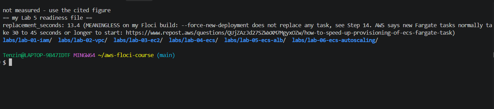
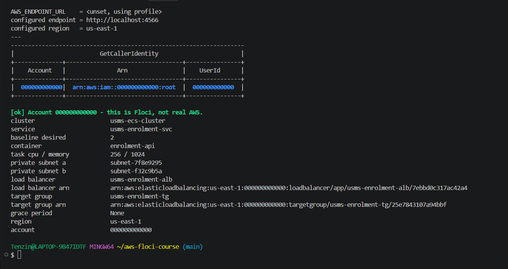
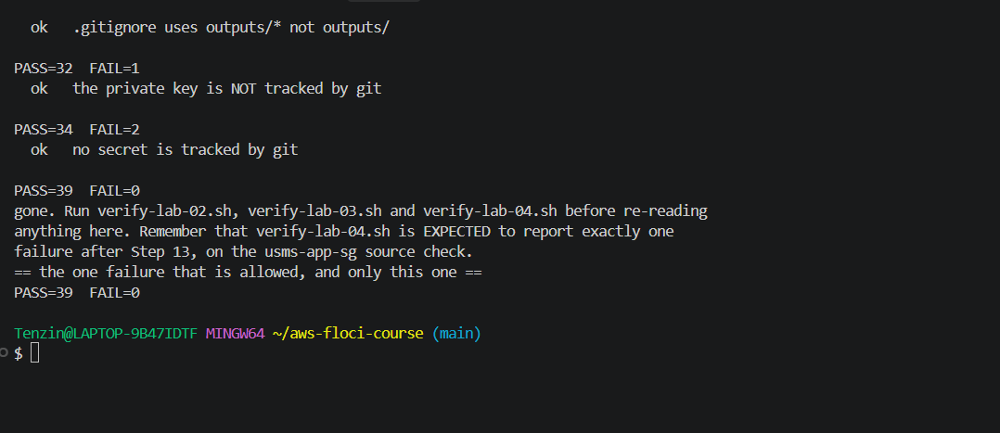

## Step 4: the service linked role

- create-service-linked-role with ecs.application-autoscaling.amazonaws.com worked. But Floci named the role AWSServiceRoleForEcsApplicationAutoscaling. On real AWS the fixed name is AWSServiceRoleForApplicationAutoScaling_ECSService.
- get-role with the doc's name returned NoSuchEntity, so the doc's fallback printed "role not present on this build". I read it back with Floci's name instead.
- The path is /aws-service-role/ecs.application-autoscaling.amazonaws.com/ (not /), and the trust principal is ecs.application-autoscaling.amazonaws.com, so the role is owned by a service. To remove it I would use delete-service-linked-role, not delete-role.
- No attached policy was listed. The doc says the policy name may be different or missing on this build.
- Floci limitation: Floci does not assume this role or check IAM. On real AWS, Application Auto Scaling uses this role for every UpdateService call it makes, and CloudTrail records it.

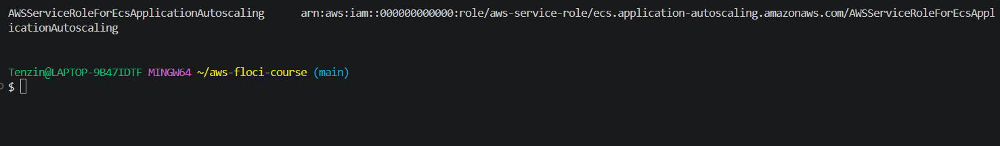
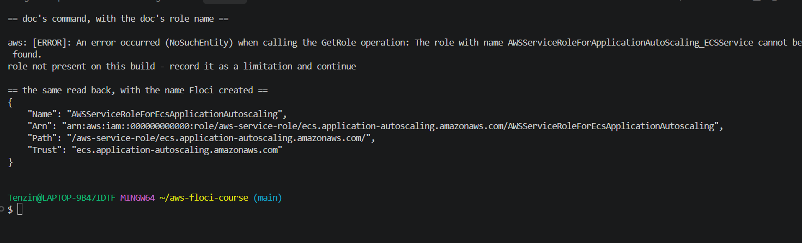

## Step 5: Register the scalable target

- I built the resource ID from the service ARN instead of typing it: `service/usms-ecs-cluster/usms-enrolment-svc`. I checked that it was valid before I registered it.
- Registered ARN: `arn:aws:application-autoscaling:us-east-1:000000000000:scalable-target/37955984014e4f88a983ff8ccf3d23a2`
- MinCapacity 2, MaxCapacity 10. All three SuspendedState switches are false.
- RoleARN came back with the doc's name `AWSServiceRoleForApplicationAutoScaling_ECSService`, but IAM only has Floci's role `AWSServiceRoleForEcsApplicationAutoscaling` (Step 4). So Floci fills in the role ARN by itself and does not check that the role exists.
- The service stayed at Desired 2, Running 2, Pending 0 with 1 deployment. Registering a target does nothing when the current count is already inside the bounds.
- `USMS_SCALABLE_RESOURCE_ID` was not recorded in Lab 4, so I got it from the ARN in this step.

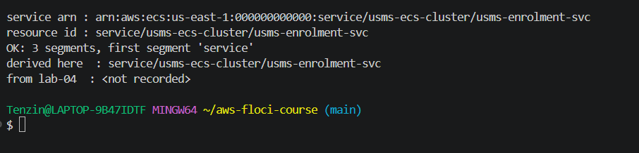
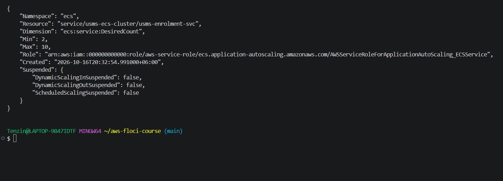
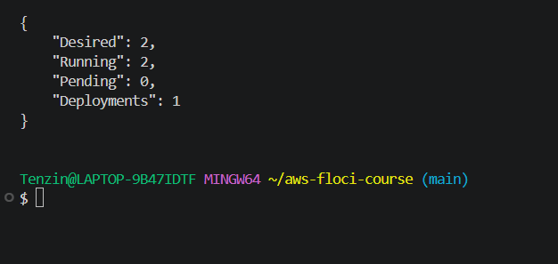

## Step 6: Change the bounds

- When I raised only `--max-capacity 12` I got `2 12`, so the minimum I left out did not change. When I put it back I got one row with Min 2 and Max 10, and `length(ScalableTargets)` printed `1`.

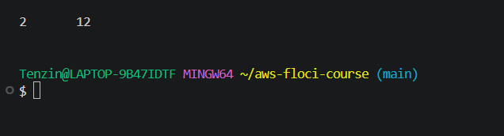
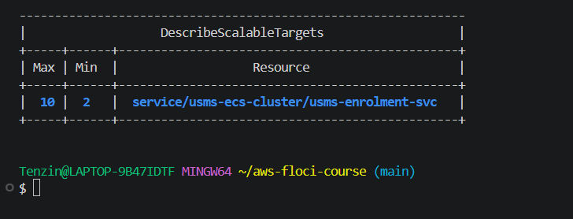
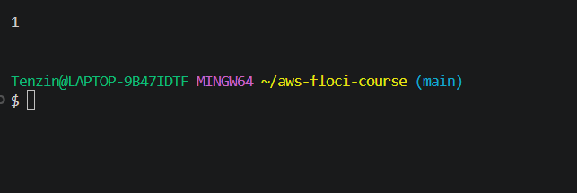

### Your turn: MinCapacity 5 while the service runs 2 tasks

- My prediction: desiredCount goes to 5 within seconds, with no scaling policy and no alarm.
- What I saw on Floci: the target stored `5 10`, but after 15 seconds the service still showed Desired 2, Running 2, Pending 0. Floci saves the new minimum but does not call ECS UpdateService to enforce it. On real AWS, desiredCount would go to 5.
- describe-scaling-activities returned 0 activities (exit 0), so this build recorded nothing.
- I put the minimum back to 2 and read back `2 10`.
- (a) The scalable target made the change, because its MinCapacity alone forces desiredCount up, with no scaling policy involved and ECS only carrying out the new count.
- (b) The cost is paying for 3 extra tasks all night while scale in can never go below 5, and a single `describe-scalable-targets` call returning MinCapacity 5 would have told me it had happened.

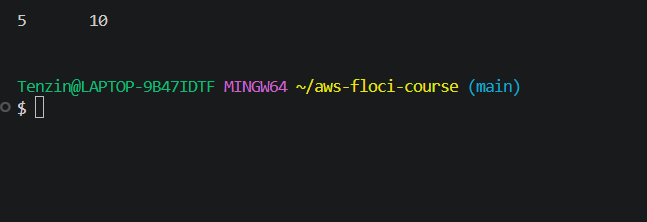
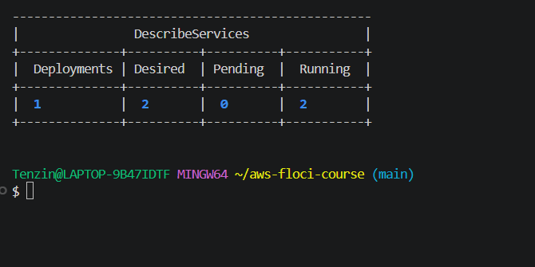
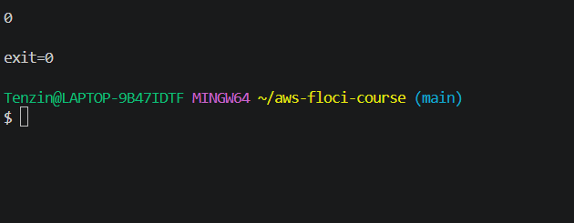

## Step 7: CPU target tracking policy

- The policy file `templates/lab-06-target-tracking-cpu.json` is valid JSON with no `$` in it (quoted heredoc).
- CPU_POLICY_ARN: `arn:aws:autoscaling:us-east-1:000000000000:scalingPolicy:c565c0cc-cf6e-4202-b5a6-48faa910f1e4:resource/ecs/service/usms-ecs-cluster/usms-enrolment-svc:policyName/usms-enrolment-cpu-target-tracking`. The ARN uses the `autoscaling` namespace and has the whole resource ID inside it.
- Verify showed TargetTrackingScaling, ECSServiceAverageCPUUtilization, Target 50.0, Out 60, In 300, NoScaleIn false.
- Floci made both managed alarms as a side effect, AlarmHigh `...-9d88f3bb-2bc6-4342-ac4d-d345114526a3` and AlarmLow `...-83e9e2c6-5584-4cb3-8221-0219ff9cc086`. I did not make them myself.

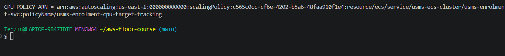
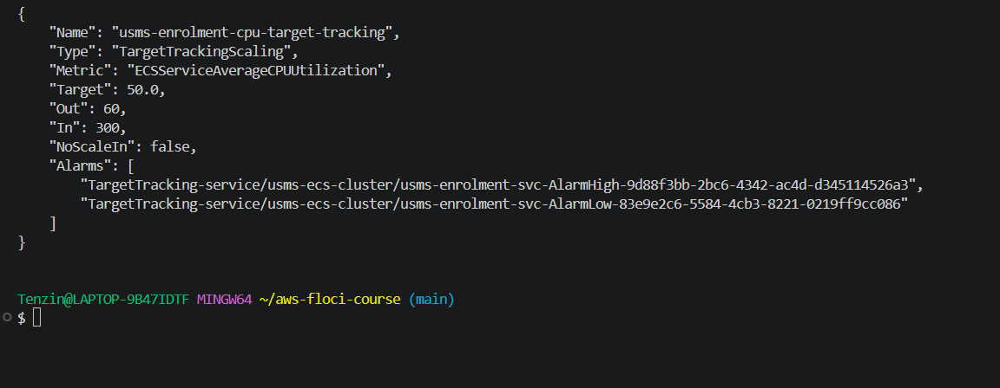

## Step 8: The two managed alarms

- Both alarms have Namespace AWS/ECS, Stat Average, Period 60, Actions 1, State INSUFFICIENT_DATA. The high alarm is GreaterThanThreshold with Evals 3, and the low alarm is LessThanThreshold with Evals 15.
- Floci difference 1: the Metric shows `ECSServiceAverageCPUUtilization`, which is the predefined type name. On AWS it turns into the real metric `CPUUtilization`.
- Floci difference 2: both thresholds are 50. On AWS the low alarm is lower (the doc shows 45). That gives a dead band, so a metric sitting at the target does not flip the count up and down. Floci has no dead band.
- Both AlarmActions lines were exactly my CPU_POLICY_ARN.
- `length(MetricAlarms)` with the prefix `TargetTracking-service/usms-ecs-cluster/usms-enrolment-svc` printed `2`, so I can work out the alarm names from the resource ID.
- I will not edit or delete these alarms, because they belong to the policy.

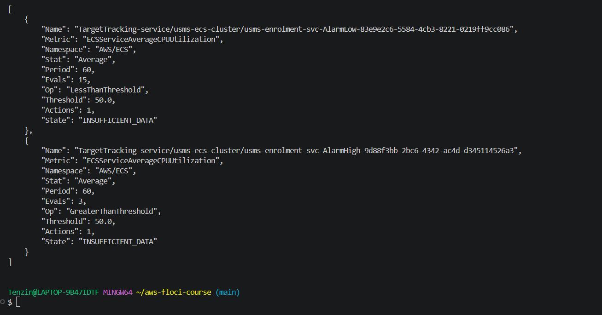
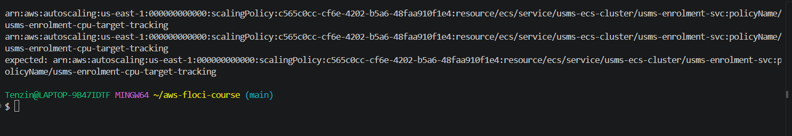
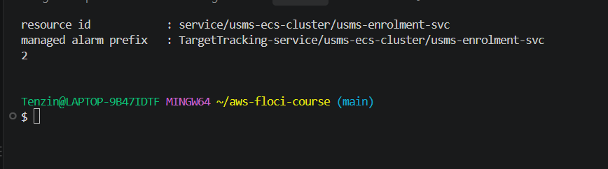

### Your turn: time at 100 per cent CPU before a third task serves traffic

- High alarm Period x Evals: 60 x 3 = 180 s (AWS picks this, it is not in my config).
- Policy invocation: about 0 s.
- Task start up: 20 to 60 s (the Fargate figure cited in Lab 04, not in my config; my Lab 04 Exercise 5 did not time a task start, and Floci starts tasks instantly).
- Health check grace period: 60 s (Lab 05 Step 10; Floci did not store it).
- Total: 180 + 0 + 20 to 60 + 60 = about 260 to 300 seconds, so 4 to 5 minutes.
- I would change the alarm term first by moving to step scaling with my own alarm that needs only 1 period of 60 s, and the cost is that I would scale out on short one minute spikes and pay for tasks I did not need.

## Step 9: Request count policy

- The ResourceLabel came from Lab 05 Exercise 5 (`USMS_ALB_RESOURCE_LABEL` in lab-05.env): `app/usms-enrolment-alb/7ebbd0c317ac42a4/targetgroup/usms-enrolment-tg/25e7843107a94bbf`. The check printed segments=6, first=app, fourth=targetgroup, OK.
- `templates/lab-06-target-tracking-requests.json` used an unquoted heredoc so the label would expand. It is valid JSON, `grep -c '\$'` printed 0, and the real label is in the file.
- TargetValue 1000.0 means 1000 requests per target per minute, not per second. It stays a provisional number until a load test (Exercise 4).
- REQ_POLICY_ARN: `arn:aws:autoscaling:us-east-1:000000000000:scalingPolicy:0d1df4d8-84c3-4edc-9976-6329402e41f0:resource/ecs/service/usms-ecs-cluster/usms-enrolment-svc:policyName/usms-enrolment-requests-target-tracking`. Floci accepted ALBRequestCountPerTarget, so I did not need the fallback message.
- Verify showed 2 policies, CPU at 50.0 and requests at 1000.0, each with 2 alarms.
- Scale out takes the largest capacity that any policy asks for. Scale in only happens when every policy agrees. Nothing has fired yet, because no metric has moved.

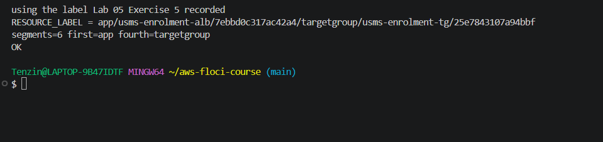
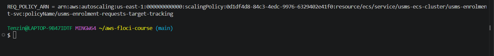
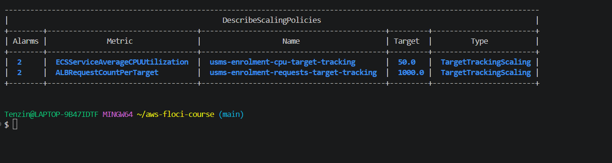

## Step 10: Step scaling policy and my own alarm

- Before this step I restarted my laptop. After floci-up.sh and sourcing the env files, the scalable target (2 to 10) and both policy ARNs were exactly the same, so hybrid storage kept everything. I rebuilt my shell variables by reading them back from Floci.
- I published EnrolmentQueueDepth (values 3, 5, 4) in namespace USMS/Enrolment with dimension Service=enrolment, and list-metrics showed it.
- `templates/lab-06-step-scaling-out.json` is valid JSON with no `$` (quoted heredoc). The steps are measured from the threshold of 100. A breach of 0 to 100 adds 1 task, and a breach of 100 or more adds 3.
- STEP_POLICY_ARN: `arn:aws:autoscaling:us-east-1:000000000000:scalingPolicy:4a2dc87b-fb8b-46fe-adc7-c6e656814542:resource/ecs/service/usms-ecs-cluster/usms-enrolment-svc:policyName/usms-enrolment-queue-step-out`. I created the policy first, because the alarm needs its ARN.
- Alarm usms-enrolment-queue-high: Average, Period 60, Evals 1, GreaterThanOrEqualToThreshold 100, Actions holds my step policy ARN, State OK.
- Floci limitation: I passed `--treat-missing-data notBreaching`, but describe-alarms shows Missing as null, so Floci did not store it.
- Verify showed StepScaling, ChangeInCapacity, Average, Cooldown 60, and two steps where the second has no upper bound.
- Floci limitation: the policy's Alarms list is empty. On AWS it would list usms-enrolment-queue-high. The link only exists on the alarm side (AlarmActions), and Floci does not fill in the link the other way.

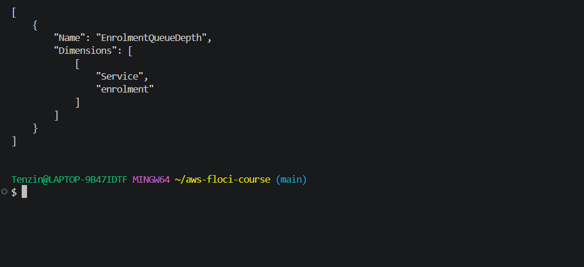
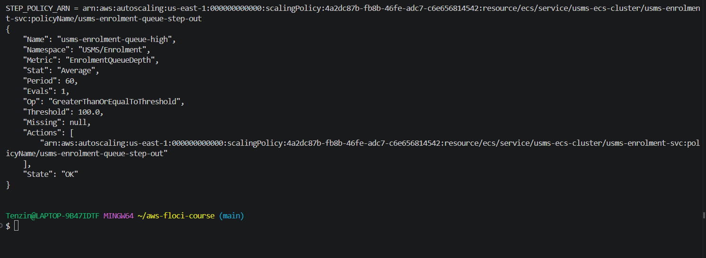
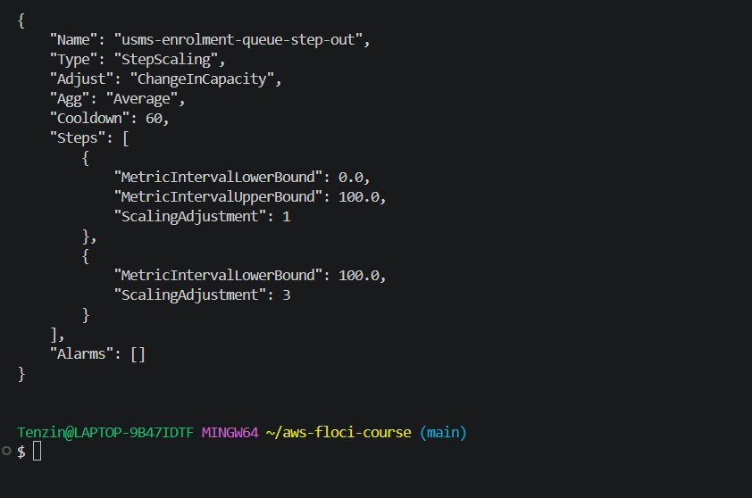

## Step 11: Scheduled actions (not supported on my Floci build)

- I ran the doc's morning command (`cron(45 7 ? * MON-FRI *)`, Asia/Thimphu, min 4 max 10). Floci returned `UnsupportedOperation: Operation PutScheduledAction is not supported`.
- The doc's UTC fallback (`cron(45 1 ? * MON-FRI *)`, no `--timezone`) failed with the same error and exit 254. So the problem is the whole operation, not the timezone.
- The evening command (`cron(0 20 ? * MON-FRI *)`, min 2 max 10) and its UTC fallback (`cron(0 14 ...)`) both failed the same way.
- describe-scheduled-actions also returned UnsupportedOperation (exit 254), so no scheduled action was stored.
- This matches Section 8's benign failure: "Only if describe-scheduled-actions is unimplemented ... Check whether Step 11's actions exist at all". I checked, and they do not exist. Floci's Application Auto Scaling code only has scalable targets, scaling policies and scaling activities. So this is a gap in Floci, not in my commands or Docker.
- What it would do on AWS: at 07:45 Thimphu time on weekdays the floor goes up to 4, which pulls desiredCount up before enrolment opens. At 20:00 the floor goes back to 2, which only lets the reactive policies scale in. A scheduled action changes the bounds, never desiredCount directly.

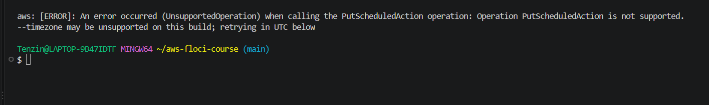
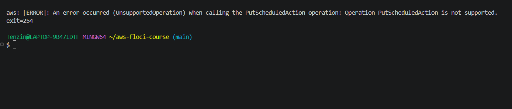
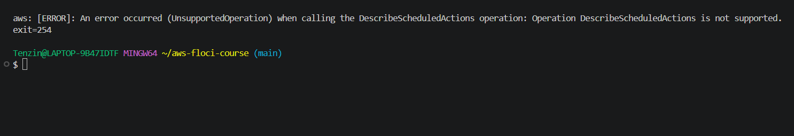

### Your turn: one off at() action

- I built the time with the doc's hint (`at(2026-10-17T15:50:19)`, UTC) and ran put-scheduled-action for usms-enrolment-results-night with min 6 max 10. It failed with UnsupportedOperation, so the action does not exist and I could not observe how it works.
- The doc's cleanup: delete-scheduled-action was also not supported. I registered the bounds again as 2 and 10, and describe-scalable-targets read back `2 10`.
- An at() action stays behind as an old entry after it fires, and the MinCapacity of 6 it set stays too, so six months later nobody remembers why the floor is 6 and we keep paying for extra tasks. On the same runbook page as the create command, I would put `aws application-autoscaling delete-scheduled-action --service-namespace ecs --resource-id service/usms-ecs-cluster/usms-enrolment-svc --scalable-dimension ecs:service:DesiredCount --scheduled-action-name usms-enrolment-results-night`, and then register-scalable-target with `--min-capacity 2` to put the floor back.

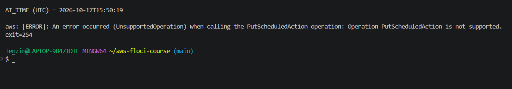
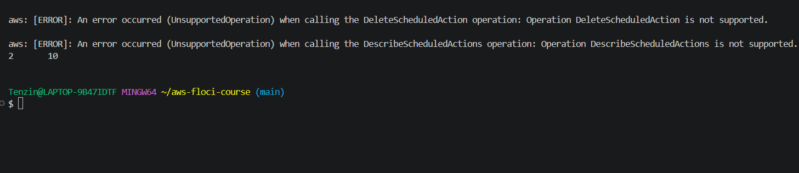

## Step 12: Fire the alarm and prove who moved the number

- Before: 2026-10-17T15:43:49Z, desired 2, running 2, pending 0, and 0 scaling activities (outputs/lab-06-pre-scale.txt).
- My prediction: 260 against a threshold of 100 is a breach of 160. That falls in the open ended second step, so +3 tasks, from 2 to 5.
- I published 260 three times. get-metric-statistics showed Average 260 and Maximum 260 for that minute.
- The alarm went to ALARM by itself on the first poll ("Threshold Crossed: 1 datapoint(s) breaching the threshold"), so I did not need Part 3 (set-alarm-state) or the Part 5 fallback. I got path A, with real scaling observed.
- describe-scaling-activities showed 3 Successful activities, each with the Cause "monitor alarm usms-enrolment-queue-high in state ALARM triggered policy usms-enrolment-queue-step-out". This proves that the alarm and the policy moved desiredCount, not me.
- Floci difference 1: the first activity set desired capacity to 5 (as I predicted). But 10 seconds later it set 8, and 10 seconds after that it set 10. Floci did not honour the 60 second Cooldown in my step config, and only the MaxCapacity of 10 stopped it. On AWS the policy would wait 60 seconds after the first step.
- Floci difference 2: running went straight to 10 with pending 0. On real Fargate the new tasks would stay pending for 20 to 60 seconds, plus the 60 second grace period.
- Floci difference 3: the StatusMessage (Detail) was null. On AWS it says that ECS carried out the change.
- Back to baseline: I set the alarm to OK, pushed the metric down first (4, 3, 2), and then set the desired count to 2. The post file (15:48:55Z) caught running still at 10 while Floci stopped the extra containers, and a few seconds later it was 2, 2, 0.
- I pushed the metric down before setting the count because the policies are still watching, and a high metric would scale it out again.

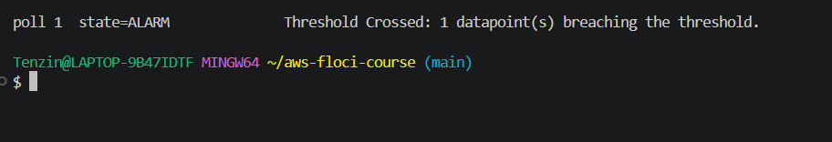
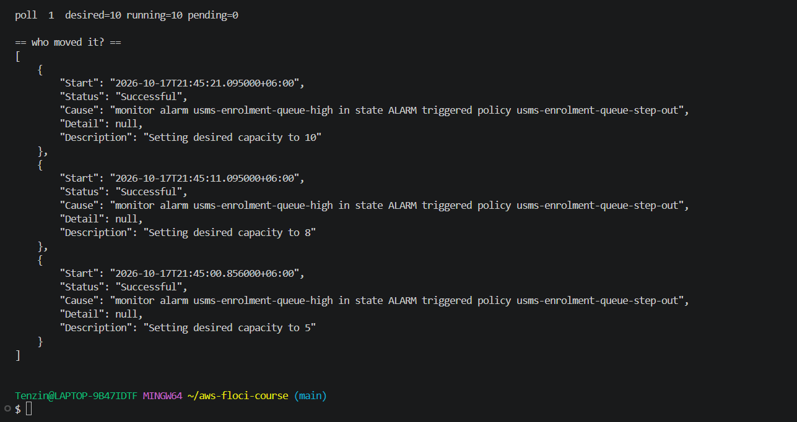
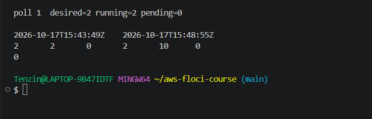

## Step 13: Suspend and resume

- There is no suspend-scaling call. I used register-scalable-target with `--suspended-state file://templates/lab-06-suspended-state.json` (valid JSON). It showed DynamicScalingInSuspended true, the other two false, and Min 2 Max 10 unchanged.
- I suspended scale in only, because that is the safe choice. Suspending scale out is dangerous. A quiet hour can shrink the service to the floor, and then it cannot grow back in the next incident.
- While it was suspended, all 3 policies were still listed (2 TargetTrackingScaling, 1 StepScaling) and the managed alarm count was still 4. So suspending changed no configuration.
- I resumed with the shorthand form, all three false, and `SuspendedState.* | grep -ci true` printed 0. The text output is `False False False` with a capital F, which is why I need `-i`.
- templates/lab-06-suspended-state.json stays in Git as the runbook page for this action.

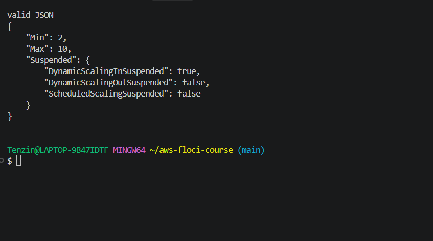
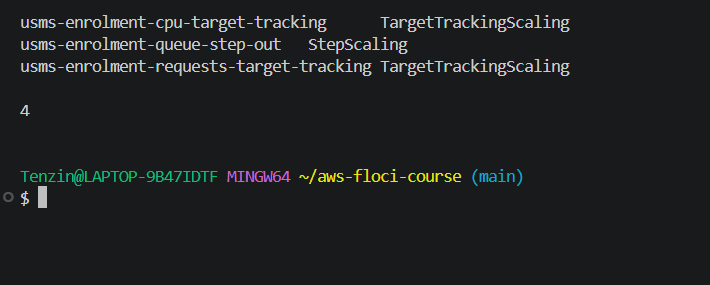
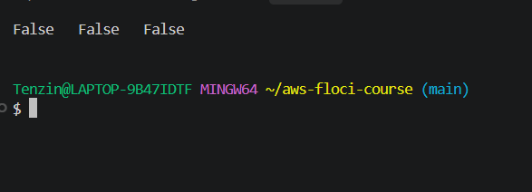

## Step 14: Persistence across a restart

- I recorded the target, the suspension switches, all 3 policies, the CPU and step configurations, the scheduled actions and the queue alarm into outputs/lab-06-pre-restart.txt.
- floci-down.sh (docker compose stop, "State preserved") and floci-up.sh (hybrid mode) restarted Floci.
- After the restart, I got every name again from the API instead of reusing my variables: the resource ID from the service ARN, the dimension from the target, the CPU policy by part of its name, the step policy by type StepScaling, and the alarm by prefix. All five matched.
- diff found no differences and printed PERSISTENCE PROVEN.
- Honest limit: the message also says the two scheduled actions are unchanged. But describe-scheduled-actions is not supported on Floci, so neither file had any scheduled action lines. The diff proves nothing about scheduled actions. TreatMissingData was None in both files (the Step 10 gap), so it matched, but it does not show notBreaching.
- Laptop restart: the same configuration also survived a full laptop restart before Step 10.

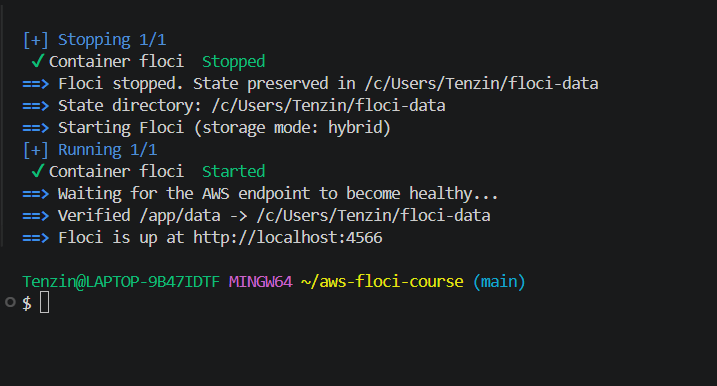
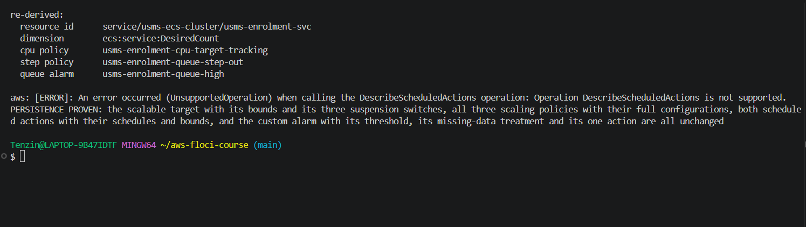

## Step 15: From one request to one new task

- Block 1 showed the two AlarmHigh alarms (requests at 1000.0 and CPU at 50.0) and my queue alarm (EnrolmentQueueDepth >= 100.0).
- Floci difference: the request count alarm shows namespace AWS/ECS and metric ALBRequestCountPerTarget. On AWS it is AWS/ApplicationELB with metric RequestCountPerTarget (and CPU would be CPUUtilization).
- Block 2 listed the 3 policies, and block 3 showed the target service/usms-ecs-cluster/usms-enrolment-svc, ecs:service:DesiredCount, 2 to 10.
- Block 4: usms-enrolment-svc, desired 2, running 2, usms-enrolment:4 (the doc's example says :2, but my Lab 05 left the service on :4), grace period None (the Lab 05 gap).
- Block 5: subnet-7f8e9295 and subnet-f32c9b5a, sg-b011f7193ccc66627 (usms-enrolment-sg), assignPublicIp DISABLED.
- Block 6: usms-enrolment-tg, container enrolment-api, port 80.
- Block 7: usms-enrolment:4, 1 load balancer, 1 deployment, exactly what Lab 05 left. This lab did not change the blueprint, the service or the load balancer.
- This lab owns three of the nine lines: the metric threshold that starts it, an alarm that fires and calls a policy, and the policy that writes desiredCount limited to 2..10. Everything else (the task definition, the subnets, the security group, the target registration and the health checks) came from Labs 04 and 05.
- Floci limitation: a minute later the target group still lists 172.18.0.5 and 172.18.0.12 as unhealthy (Target.FailedHealthChecks). They are left over from the Step 12 scale out to 10. Floci stopped the extra containers but did not deregister their IPs. On AWS, ECS deregisters a task's target when it stops the task. The first two tasks, 172.18.0.3 and 172.18.0.4, are still healthy. No verify check counts targets, so I left them and recorded it.

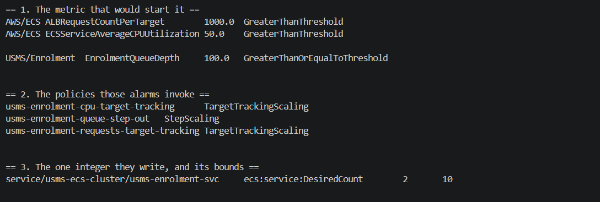
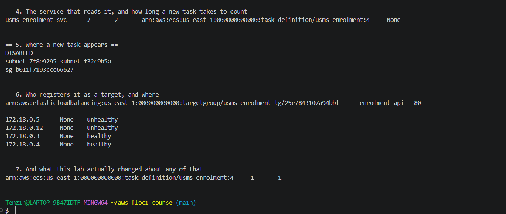
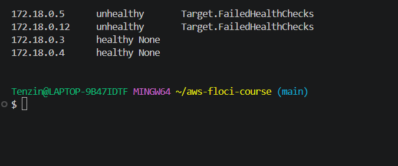

## Step 16: configs/lab-06.env

- Doc bug: the doc's block uses `awk -F: '{print \$NF}'` inside `$(...)`. Inside a command substitution the single quotes already protect `$NF`. So the backslash reached awk, and awk failed with "backslash not last character on line", which left USMS_SCALABLE_RESOURCE_ID empty. I removed only that backslash (`'{print $NF}'`) and wrote the file again.
- After the fix it printed "all values populated". The verify showed 22 exports, bounds 2 .. 10, all three policy ARNs as real arn:aws:autoscaling ARNs (none not-created), and the resource ID matching describe-scalable-targets. I also checked for Windows CR characters and found 0.
- USMS_SCHEDULED_OUT and USMS_SCHEDULED_IN are recorded as names only. These scheduled actions do not exist on Floci (Step 11).
- USMS_ASA_SLR records the doc's role name AWSServiceRoleForApplicationAutoScaling_ECSService, which is also what the scalable target's RoleARN shows. In Floci's IAM the role is really named AWSServiceRoleForEcsApplicationAutoscaling (Step 4).

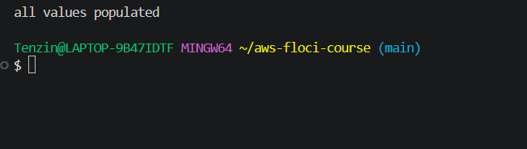
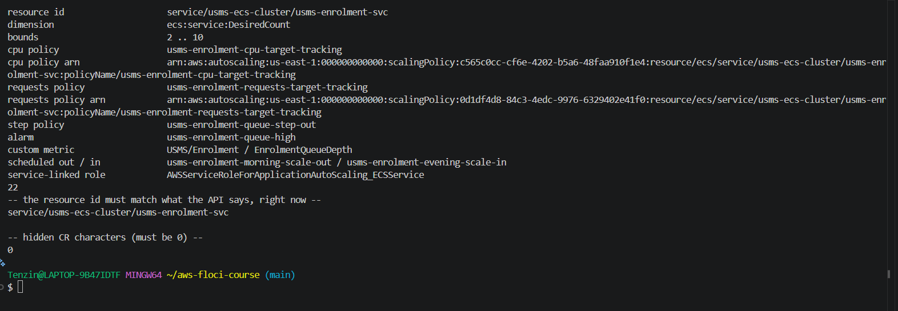

## Step 17: Repair the stale cleanup hints

- grep found no stale string in lab-04-cleanup.sh. It already says to run after lab-06-cleanup.sh and lab-05-cleanup.sh.
- In lab-05-cleanup.sh I did not use the doc's blanket replace of every lab-04-cleanup.sh. The teardown order is 06, then 05, then 04. So only the "Run AFTER" lines and the refusal message ("Run ... first", shown while the Lab 06 scalable target exists) were stale. The "Run BEFORE lab-04-cleanup.sh" lines and "lab-04-cleanup.sh may now run" are correct, and the blanket replace would have broken them.
- I used the doc's method (backup, python3 replace, bash -n) on only those 3 strings. Each one was found exactly once, and the script still parses. Lines 4, 23 and 35 now say lab-06-cleanup.sh, and line 4 (BEFORE), 24 and 76 still say lab-04-cleanup.sh. I deleted the backup afterwards.
- I did not run any cleanup script.

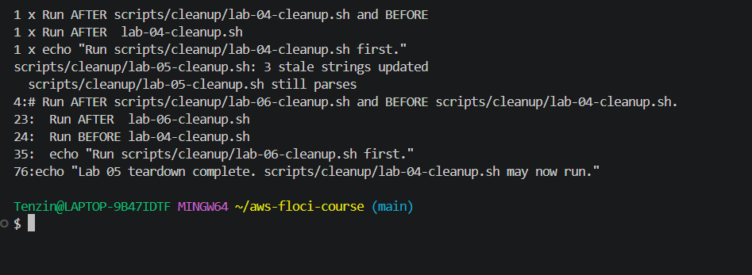

## Section 8.1: verify-lab-06.sh

- Result: PASS=39 FAIL=3 (the doc expects PASS=42 FAIL=0).
- All 3 failures are in the scheduled actions block: morning action exists, evening action exists, and the morning floor above the evening floor. They all have one cause. PutScheduledAction and DescribeScheduledActions return UnsupportedOperation on my Floci build (Step 11), so the actions were never created. Section 8 lists the third check as benign "only if describe-scheduled-actions is unimplemented", and the two exists checks fail for the same reason.
- All the checks the doc calls Not benign passed: no suspension switch left true, desiredCount back at the baseline of 2, and MinCapacity at the Lab 04 baseline of 2.
- Doc bug fixed: the last check `! git ls-files | grep -q '^outputs/'` always fails, because outputs/.gitkeep is tracked on purpose. I changed it to `! git ls-files outputs/ | grep -vx 'outputs/.gitkeep' | grep -q .`, the same fix as in Lab 05. I tested that it passes with only .gitkeep and fails if a real output file is tracked. I also left out the `` website tags around the doc's code block.

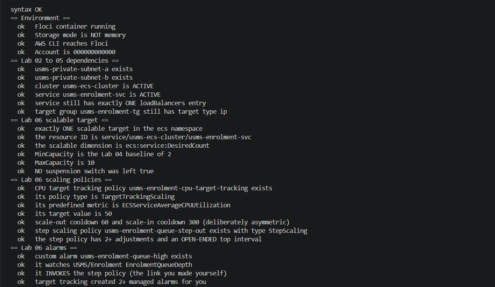
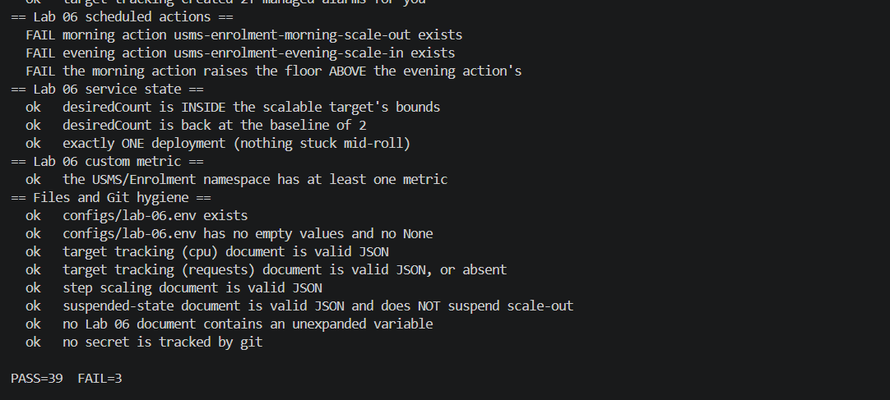

## Final support path

My support path ended up as **path A** for the scaling loop. On my Floci build the custom alarm evaluated by itself and called the step policy. Then Application Auto Scaling changed desiredCount through ECS (Step 12), and the Cause string was recorded in describe-scaling-activities. The one part that stayed conceptual is scheduled scaling, because PutScheduledAction and DescribeScheduledActions return UnsupportedOperation on this build.

## Exercises 1 to 5 (summary, details in exercises.md)

- Exercise 1: the memory policy with DisableScaleIn true gave 6 managed alarms on Floci instead of AWS's 5 (Floci still made an AlarmLow). Verify stayed PASS=39 FAIL=3.
- Exercise 2: forcing the low alarm with the metric at 5 did nothing, because the floor of 2 blocks both negative steps. I deleted the alarm first and then the policy.
- Exercise 3: usms-scaling-report.sh gives AT-FLOOR normally, FROZEN while suspended and PINNED at min = max = 3, with the same output from any directory.
- Exercise 4: the memory policy is deleted (its managed alarms went with it, so the count is back to 4). Verify PASS=39 FAIL=3.
- Exercise 5: the history file is 14,509 bytes. The latency is cited (60 s) because Floci never raised desiredCount for MinCapacity 4. lab-06.env has 24 exports, and head-bucket gave 404 with exit code 254.
- Final checks: verify-lab-05.sh output is the same as in Step 2 (empty diff, PASS=47 FAIL=2), and verify-lab-06.sh is PASS=39 FAIL=3.

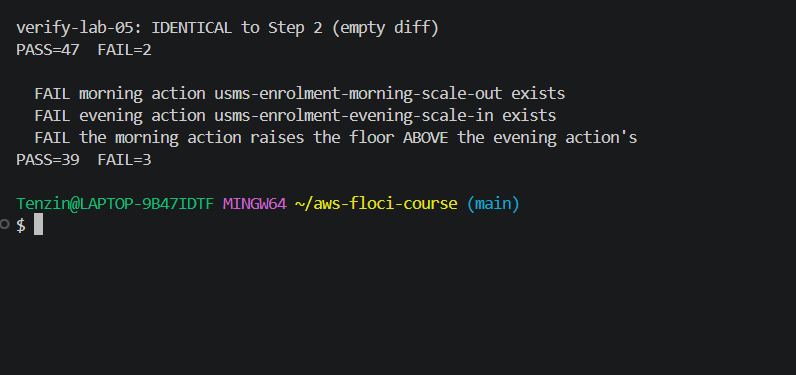

## Section 11: observed versus conceptual on my build

**Observed on Floci**

- The service linked role (created under Floci's own name AWSServiceRoleForEcsApplicationAutoscaling) and the scalable target with RoleARN filled in.
- Registering again replaces only what I passed (Step 6).
- Both target tracking policies and their managed alarms, including the request policy with its six segment ResourceLabel.
- The step policy, my custom metric and my alarm, with the alarm calling the policy.
- The alarm evaluating on its own, the step choice (+3 for a breach of 160), MaxCapacity stopping at 10, and scaling activities with a Cause string (Step 12).
- Suspension stored and cleared, and persistence across a Floci restart and a laptop restart.
- Deleting a target tracking policy also deletes its managed alarms (Exercise 4).

**Observed, but different from AWS**

- A raised MinCapacity is stored, but desiredCount does not move (Step 6 Your turn, Exercise 3, Exercise 5).
- The step policy's 60 second cooldown was ignored. Floci went 5, 8, 10 at 10 second intervals.
- Tasks start instantly (pending 0), so I cannot see the start up latency or the grace period.
- TreatMissingData is not stored (shown as null).
- Managed alarms use the predefined type as the metric name and have no dead band (both thresholds 50), and the request alarm is in AWS/ECS instead of AWS/ApplicationELB.
- A policy with DisableScaleIn true still gets an AlarmLow.
- The step policy does not list its alarm in Alarms (only the alarm side has the link).
- Scaled in tasks were not deregistered from the target group (2 stale unhealthy targets).

**Conceptual only (not observable here)**

- Scheduled actions of every form (cron, at, timezone) and the scheduler firing them.
- The target tracking capacity calculation on real CPU or request metrics, because Floci publishes no AWS/ECS or AWS/ApplicationELB datapoints.
- Fargate start latency, the health check grace period, NotScaledReasons, cost, quotas, subnet exhaustion (Unfulfilled), IAM authorization, the role really being assumed, and CloudTrail.

## Review questions

### 1. The nine lines from Register to a serving task

1. A student clicks Register, and the requests per target go past 1000, or the work queue goes past 100.
2. An alarm fires and calls a scaling policy.
3. The policy writes desiredCount, limited to 2..10.
4. ECS starts a task from the usms-enrolment task definition (:4 on my service).
5. The task gets a network interface in usms-private-subnet-a or b, with no public address.
6. usms-enrolment-sg lets in tcp 80 only from usms-alb-sg.
7. The service registers the task's address in usms-enrolment-tg.
8. The load balancer health checks it, and after the grace period it takes traffic.
9. Nothing about the blueprint, the service or the load balancer changed.

This lab owns lines 1 to 3: the metric thresholds, the alarms and policies, and the scalable target's bounds. The other six needed no change, because Lab 04 and Lab 05 already built a service that can run any number of identical tasks. The task definition, subnets, security groups and target group do not care if there are 2 tasks or 10, and the service already registers and deregisters its own tasks. My one sentence answer is that auto scaling changes only one number about my application, desiredCount, and decides it automatically.

### 2. The resource ID

The resource ID is not an ARN. It is a string that Application Auto Scaling builds for each namespace. For ECS it is `service/<cluster>/<service>`, so the full service ARN is rejected. It uses a built string because one service (Application Auto Scaling) scales many different AWS services, and it names every scalable thing with the same three parts: namespace, resource ID and scalable dimension. The format changes for each namespace: `service/usms-ecs-cluster/usms-enrolment-svc` for ecs, `table/<table>` (or `table/<table>/index/<index>`) for dynamodb, and `function:<function>:<alias>` for lambda. This architecture uses other built names too. The ResourceLabel `app/<alb>/<id>/targetgroup/<tg>/<id>` is built from the load balancer ARN and the target group ARN. The managed alarm names `TargetTracking-<resource id>-AlarmHigh/Low-<uuid>` are built from the resource ID. And the scaling policy ARN has the whole resource ID inside it.

### 3. Registering with minimum 2 against one task

The scalable target made that change. Its MinCapacity is a bound, and registering a minimum above the current count pulls desiredCount up at once. A policy changes the count only when an alarm fires. It moves in steps or toward a target, and it respects cooldowns. A raised minimum has no alarm and no cooldown, and it stays in force until someone lowers it. A 3 a.m. incident: the enrolment API is slow, so the on call engineer raises MinCapacity from 2 to 6 so the service cannot shrink while they look into it. The incident ends and they go to bed. At 8 the person taking over should find the evidence in three places: describe-scalable-targets (MinCapacity 6, which is the value a monitor would compare), describe-scaling-activities if the build records it, and CloudTrail, where RegisterScalableTarget shows who did it and when. On my Floci build the raised floor was stored but desiredCount did not move, so I could only show the stored value.

### 4. Managed alarms against my own alarm

The two managed alarms belong to the target tracking policy. Application Auto Scaling creates them, overwrites any edit at the next put-scaling-policy, and deletes them with the policy (I saw this in Exercise 4). If someone deletes one by hand, the policy stops scaling in that direction, while describe-scaling-policies still lists the alarm. My queue alarm belongs to me. Nothing creates, changes or deletes it for me, and if the step policy is deleted the alarm stays, with an action that points at nothing. My alarm can do things a managed alarm cannot: watch my own custom metric, use my own period and evaluation count, and notify an SNS topic as well as the policy. For TreatMissingData, the case for `breaching` is that the queue metric comes from my own publisher. If that publisher crashes during enrolment, the queue could be growing while no data arrives. Breaching would then scale out, which is the safe direction. If I were right and used breaching, then every time the publisher stopped for a harmless reason (a quiet night, a deployment, a bug) the service would scale out step after step to the ceiling and stay there, costing money until someone noticed.

### 5. Why reactive scaling cannot absorb the first minutes

The delays add up. The high alarm needs 3 periods of 60 seconds (180 s, chosen by AWS for the managed alarm, or 60 s for my own step alarm). The policy invocation takes about 0 s. A Fargate task needs 20 to 60 s to start (set by AWS). The health check grace period is 60 s (Lab 05 Step 10 on the service). That is about 260 to 300 seconds before the first new task serves traffic. There are three results of this. First, the existing tasks must survive the first minutes alone, which is why I need the floor of 2 and a CPU target of 50 that leaves room. Second, a spike I know about must be handled before it starts, which is why I need the scheduled actions in Step 11. Third, the policy must not act again before its new tasks count, which is why I need a scale out cooldown of 60 sized against start up and grace, and a longer scale in cooldown of 300.

### 6. When the CPU and request policies disagree

On scale out, the largest capacity any policy asks for wins. On scale in, the service only shrinks when every policy agrees it is safe. The rule is not the same both ways because the two mistakes cost different things. Too few tasks means students cannot enrol, while too many tasks only costs a little money for a few minutes. Two target tracking policies on the same metric with different targets are a fault, because at the same reading one always wants more capacity and the other always wants less, so the count goes up and down. A step policy and a target tracking policy on the same metric are the same mistake. The step policy adds a fixed number of tasks, then target tracking sees the metric below its target and works to remove them, and the two keep undoing each other.

### 7. ALBRequestCountPerTarget against CPU

It is better than CPU for the enrolment API for three reasons. It measures the cause (requests) and not a symptom (CPU). It does not depend on the 256 unit CPU reservation of the task. And it moves as soon as load arrives, not after the tasks are already busy. CPU is better for CPU bound work where the cost of each request changes a lot, for example making transcripts or PDF reports, where a few heavy requests can fill up a task. ALBRequestCountPerTarget would scale this service badly if the bottleneck were outside the tasks, for example a slow database. The request count per target would stay flat or even fall while every request got slower, so the policy would see nothing wrong (or it would add tasks that only add load on the database). The metric that would have warned me is the target group's TargetResponseTime (and HTTPCode_Target_5XX_Count), which rises while the request count stays flat.
