# Lab 08 Working Notes

## Before Step 1: getting the Lab 07 cluster back

- After a few days off, describe-cluster said CREATING and kubectl could not reach the API server. Docker Desktop also crashed once with an unexpected WSL error, so I ran wsl --shutdown, started Docker again, and later restarted my laptop because it was freezing.
- Same Floci limitation as in Lab 07: after a Docker restart the k3s container cannot start properly, so I removed it with docker rm -f, ran floci-down.sh and floci-up.sh, and Floci built a new k3s container. The cluster went back to ACTIVE.
- I ran update-kubeconfig again and deleted the old node c5e66a882694. The new node is 2e0b171b5bf4. All four Deployments came back ready (usms-enrolment 2/2, usms-gateway 1/1, usms-results 2/2, usms-timetable 1/1), so nothing was lost.

## Step 1: the two things Lab 07 had to leave behind

- usms-enrolment still declares requests {"cpu":"50m","memory":"32Mi"}, so the HPA in Step 8 has its denominator.
- The _lb_ports_ tag reads 8081,8082 both in configs/lab-07.env and on the cluster, so Step 15 can publish the LoadBalancer Service on my machine.
- verify-lab-07.sh gives PASS=30 FAIL=0. There are four Deployments, not three, because usms-timetable from Lab 07 Exercise 1 is still there. All four Services are ClusterIP with no external address, and usms-enrolment-secret is present.

- I started Floci with ./scripts/setup/floci-up.sh (FLOCI_STORAGE_MODE=hybrid in configs/course.env) and sourced configs/course.env, lab-01.env, lab-02.env, lab-04.env and lab-07.env.

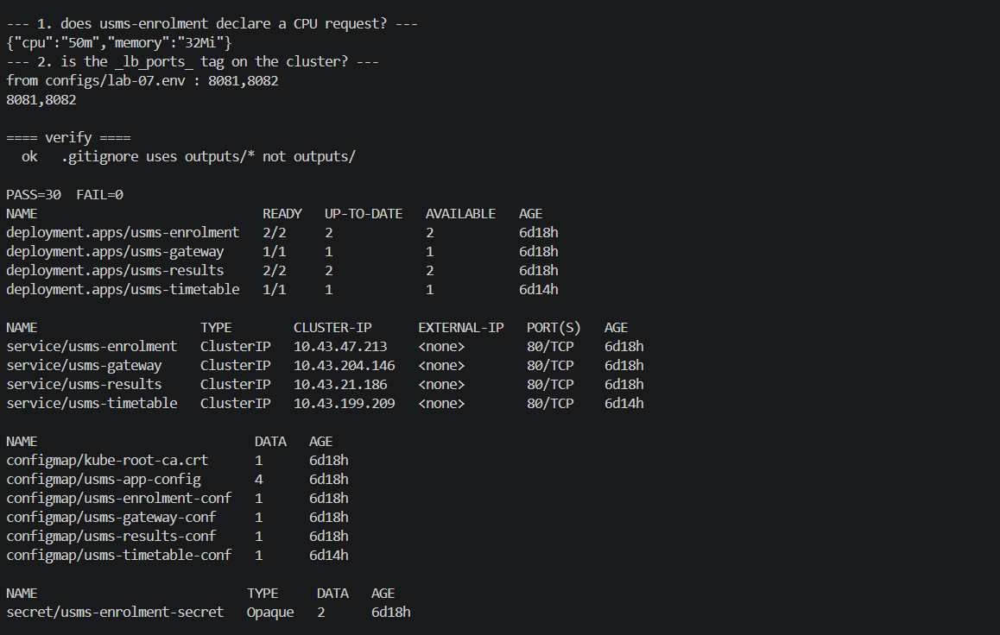

## Step 2: baseline

- Both Lab 07 Exercise 5 files exist (outputs/lab-07-cpu-baseline.txt and outputs/lab-07-lab06-readiness.txt).
- Baseline saved to outputs/lab-08-baseline.txt: usms-enrolment 2, usms-gateway 1, usms-results 2, usms-timetable 1, every Service ClusterIP with no external address, and one node 2e0b171b5bf4 Ready with 16 CPUs and about 8 GiB memory. The node reports my whole laptop, so Step 9 has to aim at the pod's 50m request and not at the node.

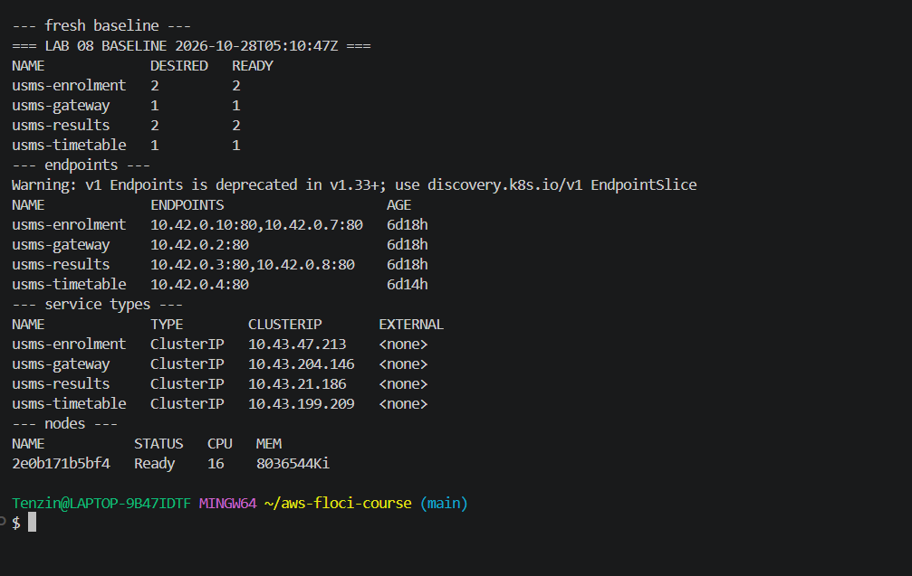

## Step 3: the four dimensions of scaling (Your turn)

If usms-enrolment had to handle ten times its traffic, I would start with dimension 1 and raise the replicas (or let an HPA do it), then check with kubectl get pods that the new pods are Running and not Pending, and that kubectl top shows each pod below its CPU target. If pods start going Pending, I would use dimension 3 and add nodes to the node group, then check that the new nodes are Ready and the Pending pods got scheduled. Only if each pod is still overloaded at its limit would I use dimension 2 and raise the requests and limits, checking that it still fits on a node, because that restarts every pod. Dimension 4, bigger instance types, comes last because it means a new node group and draining the old one.

## Step 4: scaling by hand

- kubectl scale deployment/usms-enrolment --replicas=5 only changed spec.replicas, so the same ReplicaSet (dbc494c9b) made three more pods and no rollout happened. 5/5 ready, and the endpoints showed five addresses.
- In the watcher the new pods went Pending, ContainerCreating, Running 0/1 at 1 second, then 1/1 at 7 seconds. A pod is only added to the endpoints once its readiness probe passes, not when it starts.
- 40 requests through the gateway were answered by all five pods (16, 7, 7, 5 and 5). The gateway was not touched; it still uses one ClusterIP.
- Scaling back to 2 put three pods into Terminating, and the endpoints dropped to two addresses. Pods leave the endpoints first and then get SIGTERM and 30 seconds of grace, like Lab 05's 30 second deregistration delay.

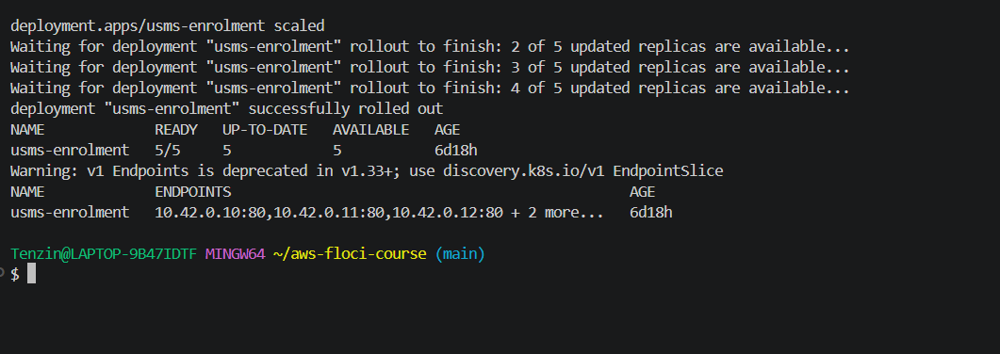
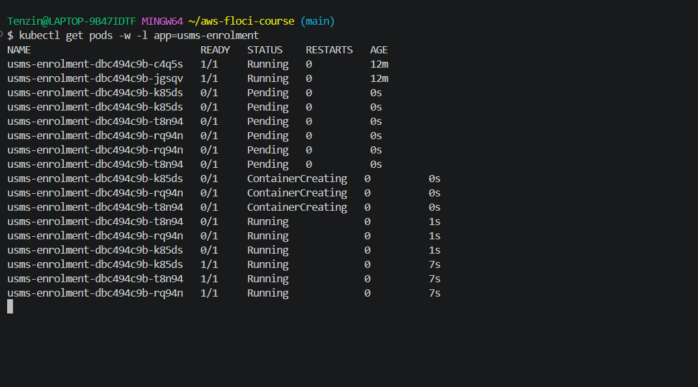
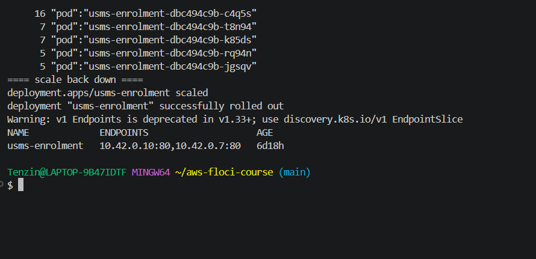
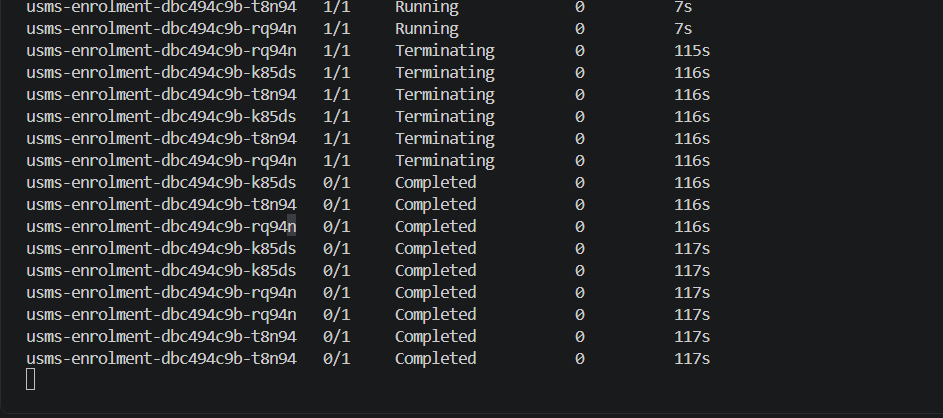

## Step 5: configuration drift

- I scaled usms-enrolment to 6 by hand while line 35 of manifests/lab-07/20-enrolment.yaml still said replicas: 2. Nothing warned me about the difference.
- kubectl apply of that file put the cluster back to 2 without any warning, which is how an unrelated apply can remove capacity.
- I changed the file to replicas: 3 and ran kubectl diff first. It showed replicas 2 changing to 3 (and the generation number). Then apply gave 3. I put the file back to 2, applied it, and removed the .bak files. usms-enrolment ended at 2/2.
- The diff did not show the Secret env entries from Lab 07 Step 17, so apply keeps fields that were added with kubectl set env.
- The full diff output was very long because of the last-applied-configuration annotation, so I ran Parts 3 and 4 again with the diff filtered to the changed lines for the screenshot.

- kubectl diff exits with code 1 when it finds a difference and 0 when there is none, so 1 here is a result, not an error. In a script with set -e I would add || true so the diff does not stop the script.

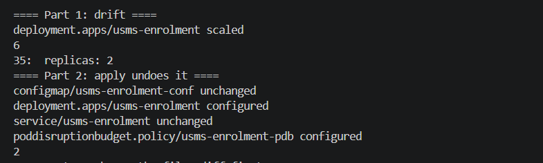
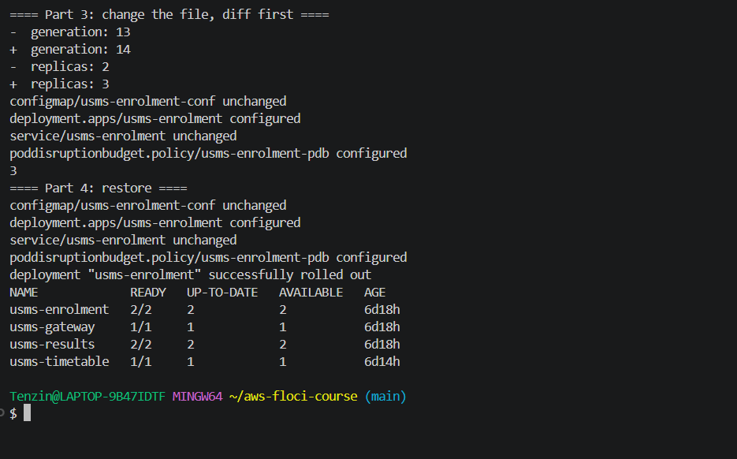

## Step 6: requests, limits and QoS classes

- All six pods are Burstable with a 50m CPU request and a 200m limit. On node 2e0b171b5bf4 the requests add up to 500m CPU (3%) and 332Mi memory (4%) of allocatable. The percentages are small because the node is my whole 16 core laptop.
- The HPA target of 50% means 50% of the 50m request, so 25m average per pod, not 50% of the node or of the limit.
- Your turn: usms-gateway went Burstable (pod 7d98649dc-477pc), then Guaranteed after I set requests equal to the limits (cpu 200m, memory 128Mi, pod 66f7c64fcf-fhflr), then Burstable again when I set the requests back to 50m and 32Mi (pod 7d98649dc-fnvfn). The limits never changed, so the gateway could do the same work.
- The pod was replaced each time, not adjusted, because requests and limits are part of the pod template and changing them is dimension 2 from Step 3. That is why VerticalPodAutoscaler is used far less than the HPA. Putting it back reused the old ReplicaSet 7d98649dc because the template was the same as before.
- I would want Guaranteed for a pod that must not be evicted or slowed down under node pressure, like a database or a payment service, where I would rather reserve the full capacity than share it.

- The third class is BestEffort: no requests or limits at all. It is evicted first under node pressure, and an HPA cannot compute a percentage for it because there is no request. None of my pods are BestEffort.
- Capacity is everything the node has. Allocatable is capacity minus what is kept back for the kubelet, the system and eviction thresholds, and the scheduler only places pods against allocatable, so the percentages in describe node are of allocatable.

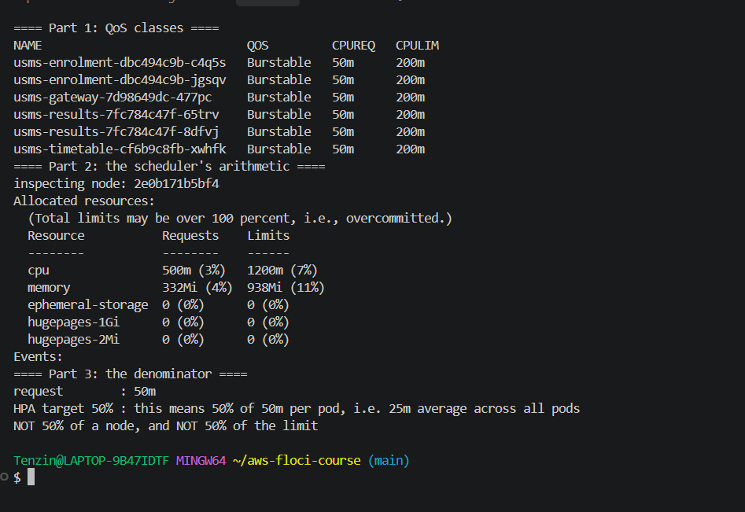
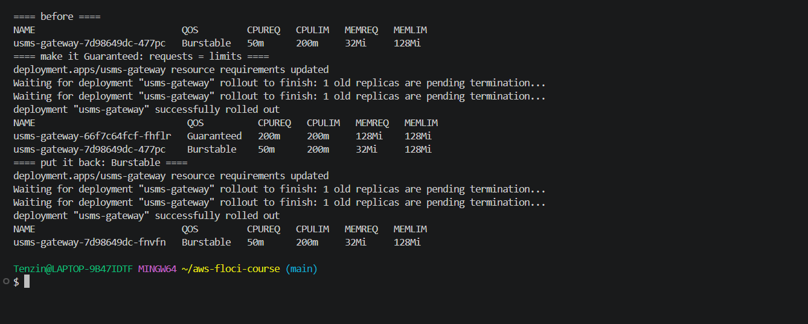

## Step 7: metrics pipeline

- The APIService v1beta1.metrics.k8s.io is True and metrics-server is 1/1 in kube-system, so k3s ships it and I did not need Parts 2 and 3.
- I ran kubectl get --raw /apis/metrics.k8s.io/v1beta1 with MSYS_NO_PATHCONV=1, because Git Bash otherwise turns /apis/... into a Windows path and the check falsely says NOT AVAILABLE (the same thing happened in Lab 07 Exercise 5).
- kubectl top works: the node uses 118m CPU and every pod is at 1m CPU, which is 2% of the 50m request. That is the idle figure for Step 9.

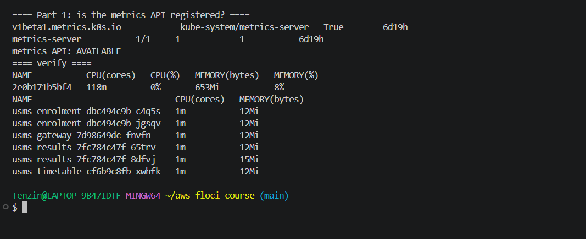

## Step 8: the HorizontalPodAutoscaler

- I applied manifests/lab-08/10-hpa-enrolment.yaml (autoscaling/v2, target usms-enrolment, min 2, max 8, CPU 50% of the request).
- Two seconds after creation TARGETS was <unknown>/50% and REPLICAS 0, because the HPA had not read a metric yet. After 30 seconds it showed cpu: 2%/50% and REPLICAS 2.
- describe shows the behavior block as written: scale up with no window, the higher of 100% or 2 pods every 15 seconds; scale down with a 300 second window and at most 1 pod every 60 seconds.
- Conditions: AbleToScale True, ScalingActive True with ValidMetricFound ("the HPA was able to successfully calculate a replica count from cpu resource utilization (percentage of request)"), and ScalingLimited False.
- From now on the HPA owns spec.replicas of usms-enrolment.

- The HPA spec mapped to Lab 06 field by field: scaleTargetRef is RegisterScalableTarget on service/cluster/service; minReplicas and maxReplicas are MinCapacity and MaxCapacity; the cpu metric with averageUtilization 50 is TargetTrackingScaling on ECSServiceAverageCPUUtilization (but the HPA divides by the container request, ECS by the task's reserved CPU); scaleDown.stabilizationWindowSeconds 300 is ScaleInCooldown 300; scaleUp.stabilizationWindowSeconds with its policies is ScaleOutCooldown, plus rate limits; and there are no CloudWatch alarms, because the controller polls the metric itself.

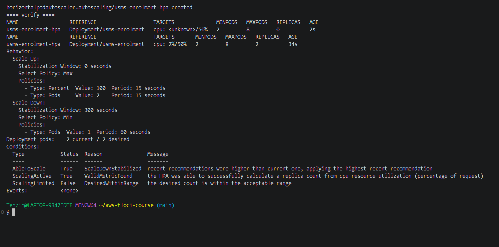

## Step 9: load and the autoscaler's response

- I wrote scripts/utilities/hpa-watch.sh, which prints the HPA CPU, the desired replicas, ready replicas and pods every 10 seconds. Each line actually took 16 to 20 seconds because kubectl takes a few seconds per call.
- Idle, the HPA read 2%/50% with 2 replicas.
- First run (morning): I applied manifests/lab-08/20-loadgen.yaml, three busybox pods looping wget against the gateway's /enrolment/. CPU went to 55%/50% at 05:47:31 and at 05:47:49 the HPA set replicas to 3. By the formula ceil(2 x 55 / 50) = ceil(2.2) = 3. With three pods the CPU settled at about 42%, below the target, so it stayed at 3.
- The doc's example went to 4 because doubling was allowed. On my run 55% gave 3, because the scale up policies (double, or add 2, every 15 seconds) are only the most the HPA may add. The formula decides how many it wants.
- I scaled usms-loadgen to 0 at 05:54:20. CPU fell to 2% by 05:55:35, but replicas stayed at 3 until 06:00:01 and then went to 2. That is the 300 second scale down stabilisation window, and then it stopped at minReplicas 2.
- Events only last about an hour, and I restarted my laptop before reading them, so I had to recover the cluster again (new node 07e991e6bac2) and repeat the test in the evening. Load on at 15:10:58 gave 3 replicas by 15:11:40, and load off at 15:13:41 held 3 until 15:19:40, then 2.
- The HPA's own reasons from kubectl describe hpa:
  - "New size: 3; reason: cpu resource utilization (percentage of request) above target"
  - "New size: 2; reason: All metrics below target" (its age showed 9h because Kubernetes merged it with the identical event from the morning run)
- Right after the recovery the events also showed "FailedGetResourceMetric ... unable to fetch metrics from resource metrics API: the server is currently unable to handle the request" and "did not receive metrics for targeted pods (pods might be unready)". That is the minute the HPA showed <unknown>/50% while metrics-server restarted on the new node.
- usms-loadgen is kept at 0 replicas for Step 12.

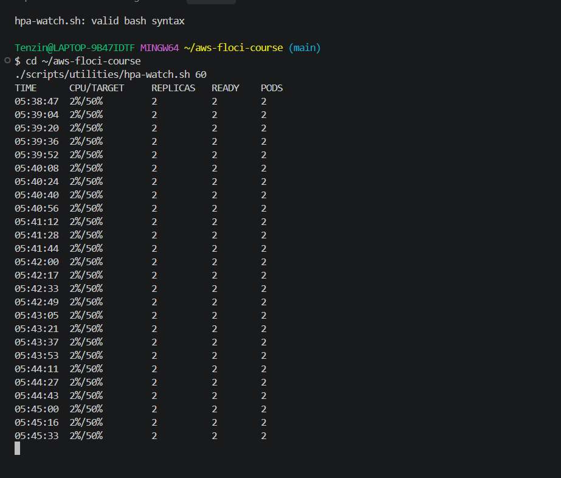
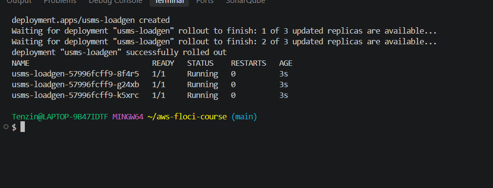
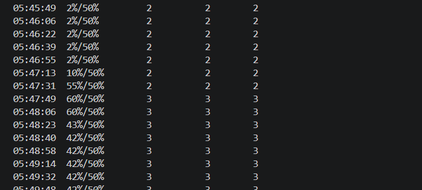
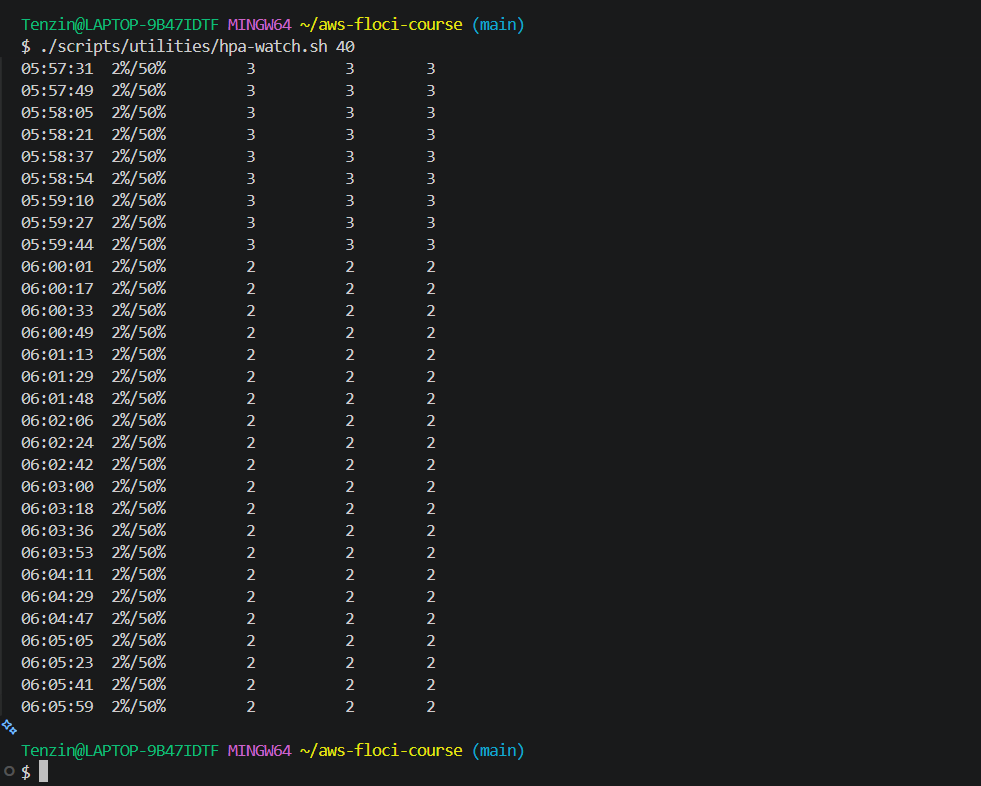
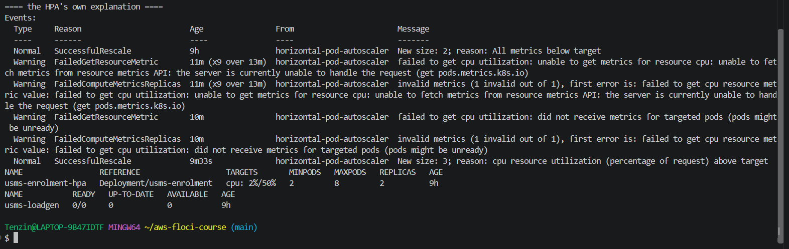

## Step 10: scaling the data plane from the AWS side

- describe-nodegroup: usms-eks-nodes ACTIVE, min 2 / max 4 / desired 2, t3.small, subnets subnet-7f8e9295 and subnet-f32c9b5a, labels workload=usms and tier=app. Saved to outputs/lab-08-nodegroup-before.json.
- Floci limitation: update-nodegroup-config to min 2 / max 6 / desired 3 failed with 400 InvalidArgument and an S3 message ("POST requires either ?uploads, ?uploadId, ?restore or ?select parameter"), so Floci sent the EKS request to its S3 handler. This is listed on the course Known Issues page for Lab 08, which says to use the HPA drill from Steps 8 and 9 instead. I did that drill.
- There was no update id, so describe-update printed the doc's fallback message. The node group stayed at min 2 / max 4 / desired 2 (outputs/lab-08-nodegroup-after.json) and Kubernetes still had one node.
- Even on a build where the update works, Floci only records desiredSize and starts no node. On real AWS the Auto Scaling group would launch a third t3.small that joins as Ready. Raising replicas (the HPA) and raising desiredSize are separate operations on separate APIs, and nothing connects them unless a Cluster Autoscaler or Karpenter is installed.
- The node showed no workload label, so the node group labels never reached the k3s node.

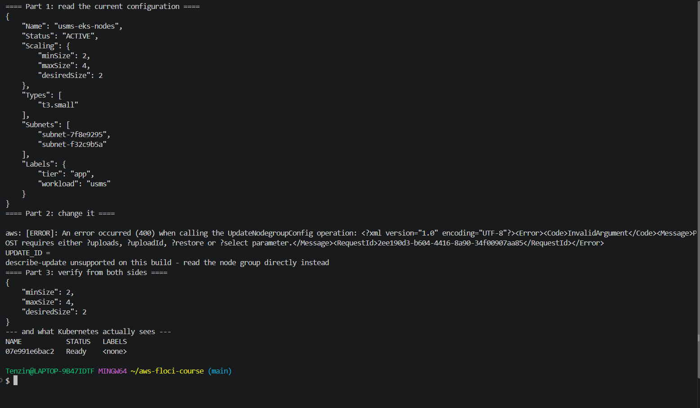

## Step 11: Cluster Autoscaler, Karpenter and a nodeSelector

- Cluster Autoscaler watches for Pending pods and raises the desired capacity of a node group's Auto Scaling group, so it only uses the node groups I declared and takes minutes. Karpenter watches the same Pending pods but launches EC2 instances directly and picks a size that fits, in under a minute.
- Neither is installed here. Both need IRSA to call AWS APIs, which stopped at step 2 of 6 in Lab 07, and Cluster Autoscaler also needs a tagged Auto Scaling group that Floci does not have. Their job is to connect Step 9 (Pending pods) to Step 10 (desiredSize).
- The node group labels workload=usms and tier=app had not reached the k3s node, so I added them by hand with kubectl label node. After a Docker restart Floci builds a new node without them, so I have to label the node again after every recovery.
- With nodeSelector workload=usms the enrolment pods rolled out onto 07e991e6bac2.
- With nodeSelector workload=nonexistent the new pod stayed Pending with "FailedScheduling: 0/1 nodes are available: 1 node(s) didn't match Pod's node affinity/selector", and the two old pods kept serving because maxUnavailable is 0. My first describe -l showed a healthy pod's events, so I ran it again on the Pending pod only.
- I put it back to workload=usms and added the nodeSelector to manifests/lab-07/20-enrolment.yaml. The doc's Python looks for spec: followed straight by containers:, but my file has topologySpreadConstraints from Lab 07 Exercise 4 in between, so I inserted it before topologySpreadConstraints instead. kubectl diff then showed no differences.

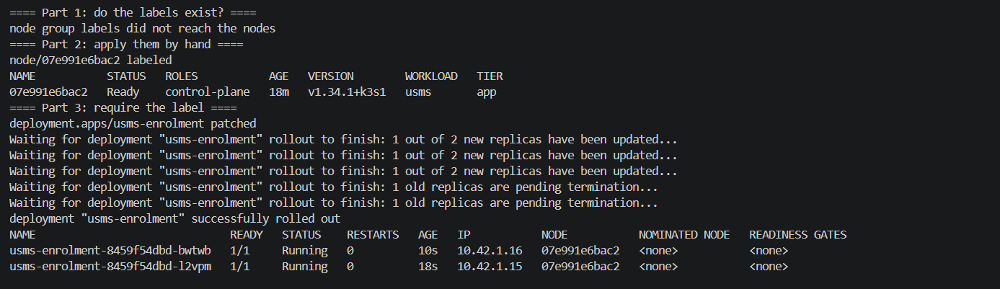
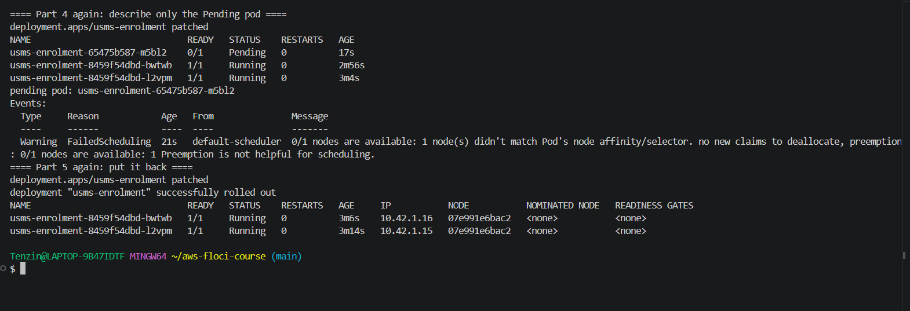

## Step 12: PodDisruptionBudgets

- manifests/lab-08/30-pdb-gateway.yaml created usms-gateway-pdb (minAvailable 1, ALLOWED DISRUPTIONS 0) and changed my Lab 07 usms-enrolment-pdb from minAvailable 1 to maxUnavailable 1 (ALLOWED DISRUPTIONS 1). maxUnavailable fits enrolment better because the HPA moves its replica count.
- To stop the two files fighting over one object, I changed the PDB inside manifests/lab-07/20-enrolment.yaml to maxUnavailable: 1 as well. kubectl diff then only showed a label difference (lab: 05b from the Lab 08 file against tier: app), with the same rule.
- With a single replica, minAvailable 1 blocks every voluntary eviction of the gateway, so it cannot be both highly available and drainable. Exercise 2 fixes that.
- An eviction through the API (kubectl create --raw on the pod's eviction subresource) was refused with "Error from server (TooManyRequests): Cannot evict pod as it would violate the pod's disruption budget." I needed MSYS_NO_PATHCONV=1 so Git Bash did not change the /api/v1/... path.
- kubectl delete pod usms-gateway-7d98649dc-qgn68 went straight through and a new pod hf75q replaced it. A PDB only governs the eviction API, so it is a rule for cooperative tools, not a lock.
- kubectl drain --dry-run=client listed the gateway, both results pods and timetable as evicted. The client side dry run never asks the server, so it does not check PDBs; a real drain would keep retrying the gateway, as I saw in Lab 07 Exercise 4.
- A PDB is ignored for involuntary loss: a node crash, out of memory, an instance terminated in the console, or hardware failure.

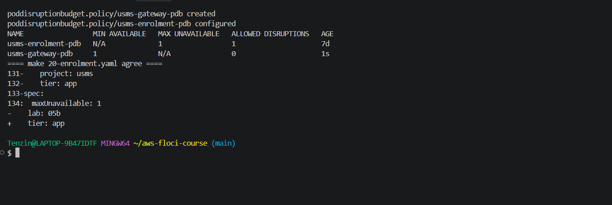
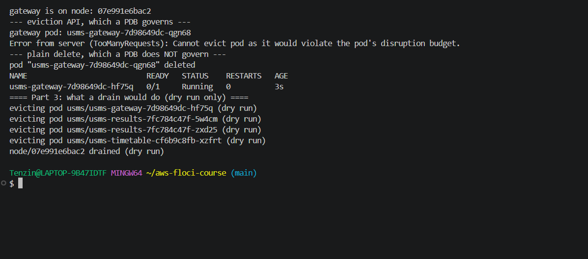

## Step 13: ClusterIP and port-forward

- All four Services are ClusterIP with no external address. From my laptop, curl to the gateway ClusterIP 10.43.204.146 failed ("as expected: a ClusterIP is not routable from your machine"), because my machine has no route to the cluster's virtual network.
- kubectl port-forward svc/usms-gateway 18080:80 opened a tunnel (Forwarding from 127.0.0.1:18080 -> 80). Through localhost:18080 I got the gateway JSON (pod usms-gateway-7d98649dc-hf75q), /enrolment/ (usms-enrolment-8459f54dbd-l2vpm) and /results/ (usms-results-7fc784c47f-5w4cm).
- port-forward goes through the API server to one pod, with no load balancing, and only while the command runs on my machine, so it is only for debugging.

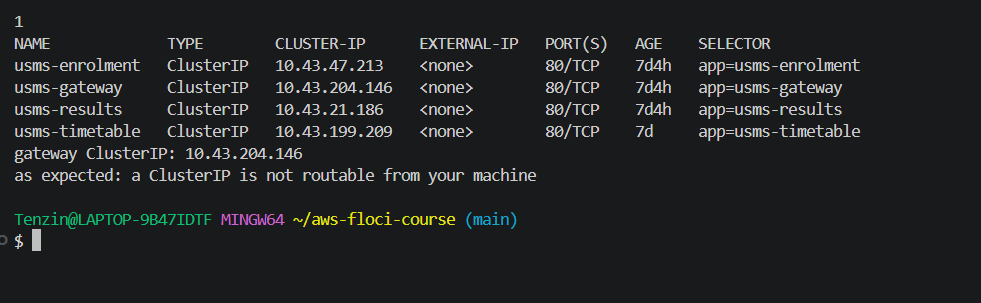
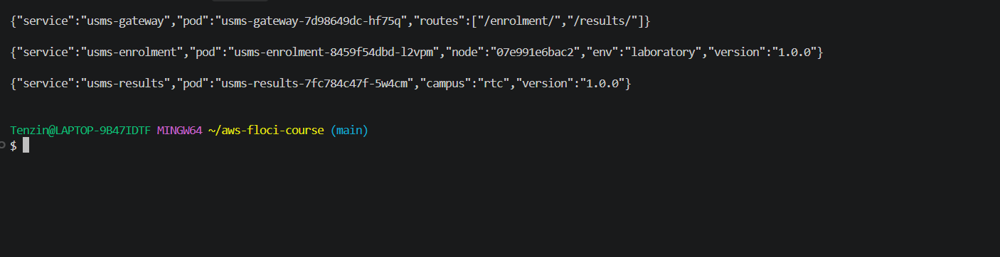

## Step 14: NodePort

- manifests/lab-08/40-service-nodeport.yaml made a second Service, usms-results-np, type NodePort, 80:30080/TCP, selecting the same pods as usms-results. It still has its own ClusterIP (10.43.189.241), so each rung keeps the one below.
- From a busybox pod, http://172.17.0.3:30080/ (the node's InternalIP) returned the results JSON, once from pod zxd25 and once from pod 5w4cm. I only have one node, so Part 3's loop had one line.
- Floci limitation: curl to localhost:30080 from my laptop got no answer, because the node is a container and 30080 was not published when it was made. On real AWS the nodes are EC2 instances in the VPC and a load balancer reaches them on the NodePort.
- Fallback from the doc: kubectl port-forward svc/usms-results-np 30080:80, then curl localhost:30080 returned the results JSON (pod 5w4cm). This proves the Service works, not that the NodePort is reachable from outside.

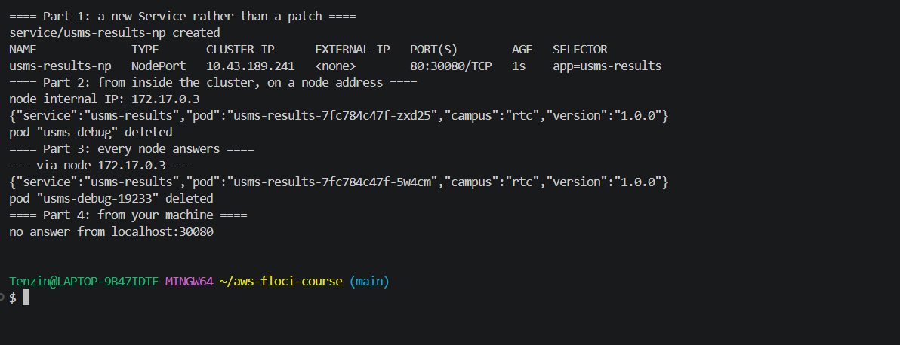
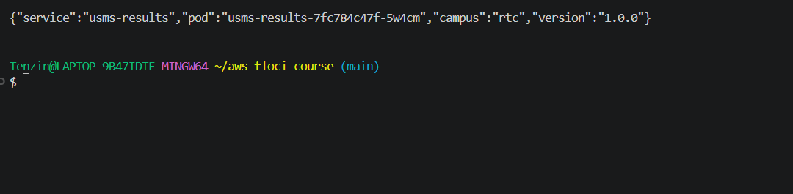

## Step 15: LoadBalancer

- manifests/lab-08/50-service-loadbalancer.yaml is a full Service manifest that changed usms-gateway from ClusterIP to LoadBalancer, with the three AWS annotations: aws-load-balancer-type external (use the AWS Load Balancer Controller), aws-load-balancer-nlb-target-type ip (pod IPs as targets, the same target type ip as Lab 05's target group, because pods have their own VPC addresses like Fargate tasks), and aws-load-balancer-scheme internet-facing (the public subnets from Lab 02). Locally they are ignored.
- The kubectl get straight after the apply failed once with "getting credentials: exec: executable aws failed with exit code 255". The next command worked and Floci and the cluster were fine, so it was a one off.
- k3s's built in service load balancer gave EXTERNAL-IP 172.17.0.3 (the node's IP) and a NodePort was added automatically. The verify line: type=LoadBalancer clusterIP=10.43.204.146 nodePort=31650 external=172.17.0.3. So LoadBalancer contains NodePort contains ClusterIP.
- From inside the cluster, http://172.17.0.3/ returned the gateway JSON.
- Floci limitation: curl to localhost:8081 and 8082 got nothing. docker port showed the k3s container only publishes 6443 to 6500, so the _lb_ports_ ports were not published when Floci rebuilt the container during my recovery.
- Fallback from the doc: kubectl port-forward svc/usms-gateway 8080:80, then localhost:8080 returned the gateway and /enrolment/ JSON. So I observed the ClusterIP, NodePort and LoadBalancer fields and the in cluster address, but not the host port 8081.

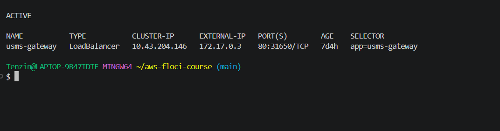
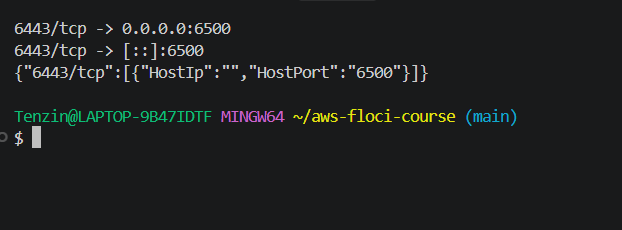
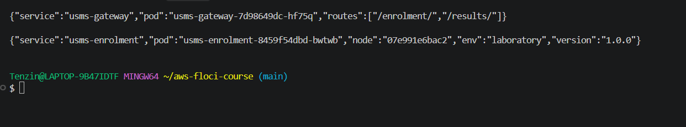

## Step 16: Ingress

- kubectl get ingressclass returned nothing and no traefik, ingress or nginx controller pod was running, so this Floci build runs k3s without Traefik.
- manifests/lab-08/60-ingress.yaml created usms-portal-ingress with /enrolment to usms-enrolment, /results to usms-results and / to usms-gateway. describe showed the backends resolved to the right pod IPs, but CLASS <none> and no ADDRESS, because no controller is acting on it. The Ingress is a valid stored object with nothing implementing it, so this rung is Conceptual on my build.
- localhost:8081 gave no answer for any path, and the in cluster test printed "No ingress address: no controller is implementing this object."
- On real EKS the longest matching path wins, so /enrolment/x goes to usms-enrolment even though / also matches. Lab 05's ALB used numeric rule priority instead. /enrolment through the Ingress also skips usms-gateway.
- No controller question: on real EKS the AWS Load Balancer Controller would have run the same calls I ran by hand in Lab 05, in this order. First aws elbv2 create-load-balancer, an internet facing ALB in usms-public-subnet-a and -b. Then aws elbv2 create-target-group with --target-type ip, one per backend Service (enrolment, results, gateway), with the health check on /healthz. Then aws elbv2 create-listener on HTTP 80. Then aws elbv2 create-rule for /enrolment and /results, with / as the listener's default action. After that it keeps the targets registered and deregistered by watching the Endpoints, which ECS did for me in Lab 05. Ten paths would still be one ALB, not ten.

- Each annotation in 60-ingress.yaml against the Lab 05 command it replaces:

| Annotation | Lab 05 command |
| --- | --- |
| alb.ingress.kubernetes.io/scheme: internet-facing | aws elbv2 create-load-balancer --scheme internet-facing |
| alb.ingress.kubernetes.io/target-type: ip | aws elbv2 create-target-group --target-type ip |
| alb.ingress.kubernetes.io/listen-ports: [{"HTTP": 80}] | aws elbv2 create-listener --protocol HTTP --port 80 |
| alb.ingress.kubernetes.io/healthcheck-path: /healthz | aws elbv2 create-target-group --health-check-path |
| alb.ingress.kubernetes.io/tags: Project=USMS,Tier=web,Lab=08 | the --tags on create-load-balancer and create-target-group |

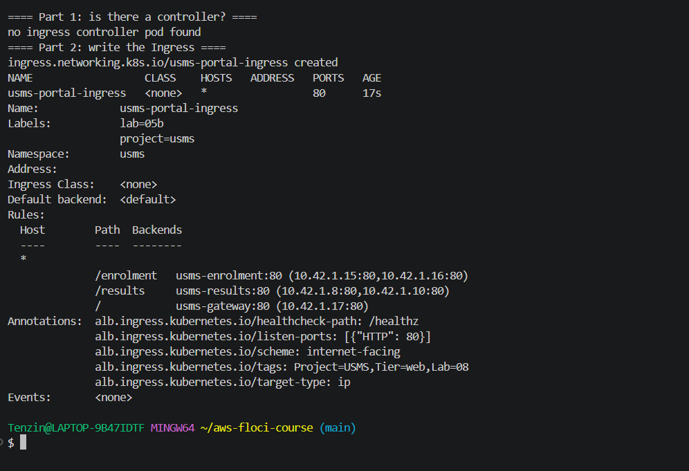
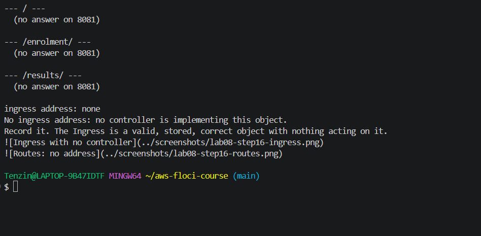

## Step 17 - Practical 2 and Practical 4, compared with both running

### Scaling

| Question | ECS + Application Auto Scaling | Kubernetes + HPA |
| --- | --- | --- |
| What integer is written? | desiredCount on usms-enrolment-svc | spec.replicas on the usms-enrolment Deployment |
| Who writes it? | Application Auto Scaling, through the scalable target and its policies | the HorizontalPodAutoscaler controller (usms-enrolment-hpa) |
| Where does that thing run? | in AWS, outside anything I own | inside the cluster, in the controller manager (on EKS, in the AWS run control plane) |
| Where does the metric come from? | CloudWatch (AWS/ECS CPUUtilization, ALB RequestCountPerTarget, my own USMS/Enrolment metric) | metrics-server through the metrics.k8s.io API, CPU and memory only |
| What does "50% CPU" mean - 50% of what? | 50% of the CPU reserved for the task in the task definition | 50% of the container's CPU request, so 25m of 50m per pod |
| How is scale in slowed down? | ScaleInCooldown 300 on the target tracking policy | behavior.scaleDown.stabilizationWindowSeconds 300 and at most 1 pod per 60 seconds |
| What happens if there is no capacity for the new instance/pod? | Fargate finds capacity, so it does not really run out | the pod stays Pending until a node is added (Step 11's job), as in Step 9's warning |
| What creates the alarms, if anything? | target tracking created two CloudWatch alarms for me (AlarmHigh and AlarmLow) | nothing, the controller polls the metric every 15 seconds |

### Exposure

| Question | ECS + ALB (Lab 05) | Kubernetes + Ingress (Step 16) |
| --- | --- | --- |
| How many AWS objects did I create by hand? | about six: usms-alb-sg, the load balancer, the target group, the listener, the /alb-health rule and the service's load balancer link | none by hand; on real EKS one Ingress object would make the controller create them |
| What is the target type, and why? | ip, because each Fargate task has its own VPC address | ip (target-type annotation), because each pod has its own VPC address through the VPC CNI |
| How are targets registered and deregistered? | the ECS service registers and deregisters its own tasks | the AWS Load Balancer Controller watches the Service endpoints |
| How are competing routing rules disambiguated? | numeric rule priority (priority 10 for /alb-health) | the longest matching path wins |
| What would I change to move this to another cloud? | everything: the ALB, target group, listener, rules and the ECS service are AWS only | the Ingress rules move as they are; only the alb.ingress.kubernetes.io annotations and the controller change |
| What is the cost of exposing ten services? | one ALB with ten rules, but every rule and target group made by hand | one ALB from one Ingress with ten paths, but ten LoadBalancer Services would be ten load balancers and ten bills |

### Two paragraphs, in prose

1. If the AWS control plane has a bad afternoon, Application Auto Scaling, CloudWatch and the ECS API all live in AWS, so the ECS service keeps running its current tasks but nothing scales and I can only debug through the same AWS APIs that are failing. On EKS the HPA runs in the cluster control plane, which AWS also runs, so if that control plane is down the HPA stops as well, but the pods keep running on the nodes and the Services keep routing. If only other AWS services are down, the HPA keeps working because metrics-server and the controller are inside the cluster, and I can still debug with kubectl get, describe and logs.

2. For USMS, with one small team, one region, and eight quiet months then two busy ones, I would choose ECS on Fargate with Application Auto Scaling. Labs 05 and 06 already gave it a load balancer, scaling and alarms, there are no nodes to patch, and Fargate does not run out of capacity in the busy weeks. The strongest argument against my choice is portability and speed: the Kubernetes manifests could move to another cloud almost unchanged, and the HPA reacts every 15 seconds without waiting for CloudWatch alarms, while everything I built on ECS is tied to AWS.

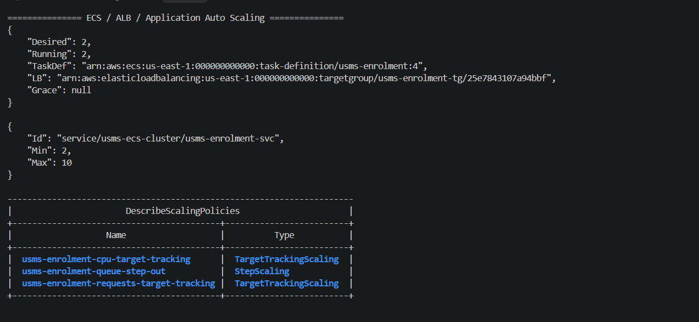
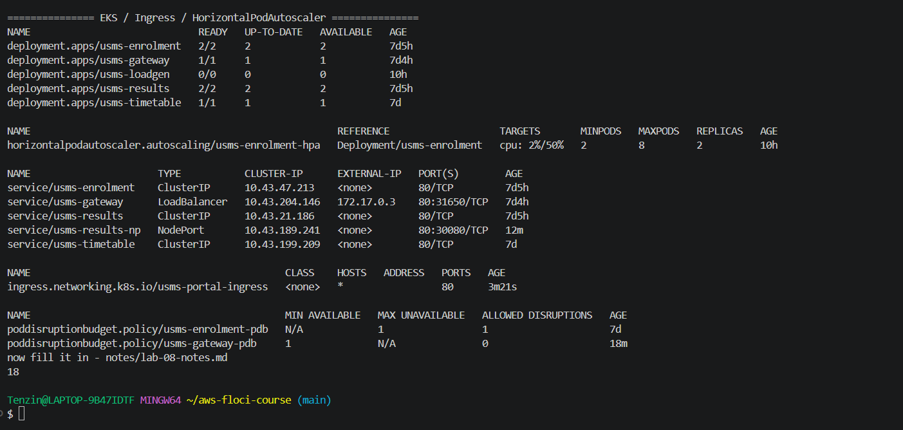

## Step 18: persistence across a Floci restart

- Before the restart I saved the HPA (2, 8, 50), both PDBs (enrolment maxUnavailable 1, gateway minAvailable 1), the five Services with their types and nodePorts, the Ingress paths and the node group (2, 4, 2) to outputs/lab-08-before-restart.txt.
- floci-down.sh and floci-up.sh made Floci build a new k3s node (791327db2f83). kubectl was refused at first and the cluster said CREATING, so the doc's update-kubeconfig fallback ran.
- My extra recovery: I waited for ACTIVE, deleted the old node 07e991e6bac2, and labelled the new node workload=usms tier=app again, because the label from Step 11 was on the old node and the enrolment pods now require it. Then I waited until every Deployment was ready again.
- The read back in outputs/lab-08-after-restart.txt was identical and diff printed PERSISTENCE PROVEN. usms-results-np kept its pinned NodePort 30080, and usms-gateway even kept its allocated nodePort 31650 and EXTERNAL-IP 172.17.0.3.
- So the HPA, PDBs, Services and Ingress are stored state and survived, while the running pods and the hand added node label did not and had to be rebuilt.

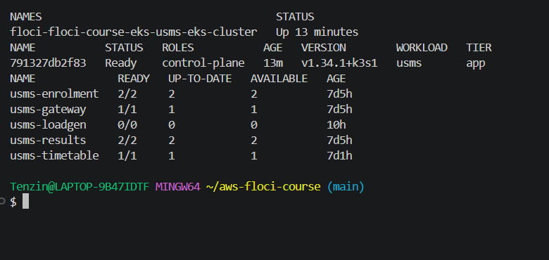
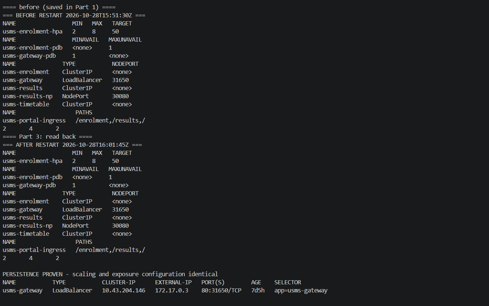

## Step 19: configs/lab-08.env

- 19 exports, every value looked up live. The only empty one is USMS_INGRESS_CLASS, which the doc lists as an expected exception because no ingress controller is running (Step 16).
- hpa: 2..8 at 50% cpu, scale in window 300s. nodeport 30080, gateway LoadBalancer with nodePort 31650.
- The node group values are 2 / 4 / 2, not the doc's 2 / 6 / 3, because the Step 10 update failed on my Floci build. The file records what is actually true.

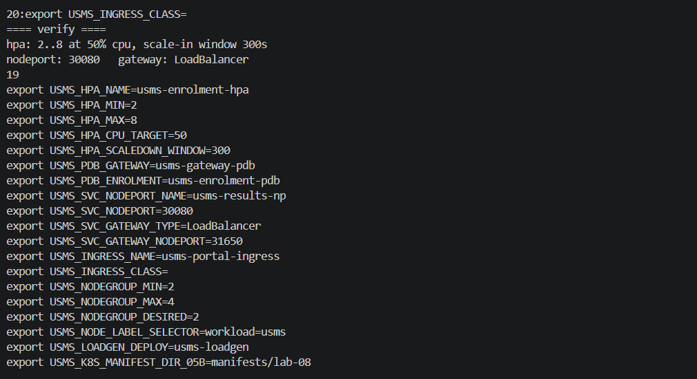

## Section 8: verify script, smoke test and cleanup script

- verify-lab-08.sh gave PASS=33 FAIL=1. The one failure is "node group maxSize was raised to 6", because update-nodegroup-config fails on my Floci build (Step 10, course Known Issues).
- Straight after writing the script I applied the same one line fix as in Labs 06 and 07, so the "no secret is tracked by git" check ignores only outputs/.gitkeep.

- The smoke test passed, and bash -n scripts/cleanup/lab-08-cleanup.sh found no syntax errors. I did not run the cleanup script, because Lab 09 builds on this cluster.

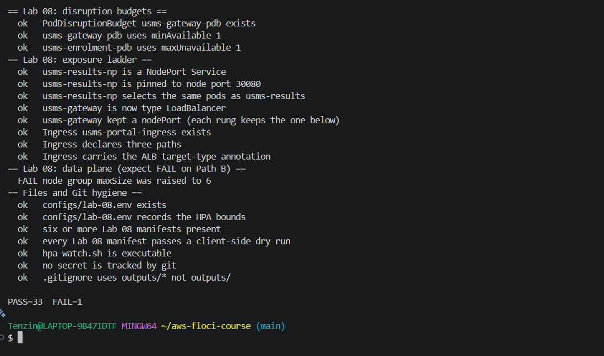
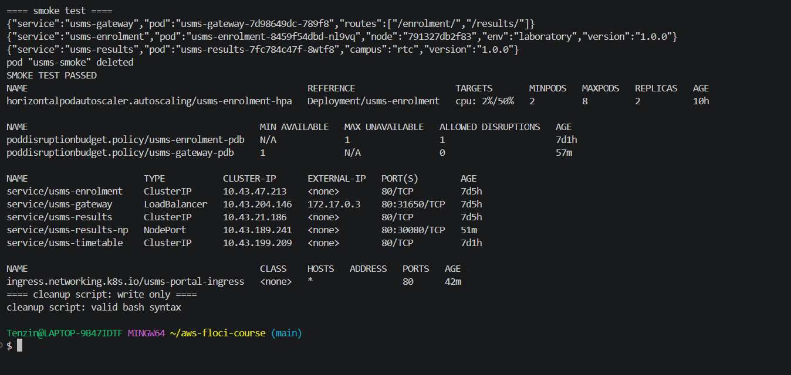

## ECS or Kubernetes for USMS

I recommend ECS on Fargate for USMS. The team is small, there is one region, and the load is quiet for eight months and very busy for two. In Lab 06 the enrolment service already scaled from 2 to 10 by itself when the usms-enrolment-queue-high alarm fired, and the activity's Cause named both the alarm and the policy, all without me running any nodes. Fargate never left a task waiting for a machine.

Kubernetes gave me more to look after for the same result. In this lab the HPA moved usms-enrolment from 2 to 3 and back, which is the same job Application Auto Scaling did, but first I had to check metrics-server, the CPU request and the node labels. Every Docker restart left my pods on a dead k3s node until I deleted it, and the workload=usms label I added in Step 11 disappeared with the old node, which would have left enrolment Pending. update-nodegroup-config failed outright on my build, so the node side of scaling, which Fargate hides, was the part I could not even test.

Exposure tells the same story. In Lab 05 I made the security group, load balancer, target group, listener and rule by hand, and a request went through it. In this lab the LoadBalancer Service got an address but localhost:8081 was never published, and the Ingress had no controller, so the rung that should replace Lab 05's ALB was only a stored object.

The strongest argument against my choice is portability and control. My Deployments, Services, HPA and Ingress would run on any conformant cluster almost unchanged, while every ECS object is AWS only. The HPA also checks every 15 seconds inside the cluster instead of waiting for CloudWatch alarms, and the PDB in Step 12 refused an eviction that would have taken the gateway down, a safety rule ECS has no direct equal for. If USMS grew into many services or had to leave AWS, that would outweigh the extra care.

## Section 14: Review questions

**1. "averageUtilization: 50 scales when the node hits 50% CPU."**

That is wrong. The HPA divides each pod's CPU use by the pod's CPU request, not by the node. With a 50m request, 50% means 25m per pod on average, which is why my 16 core node sat at 0% while the HPA read 55% and added a pod. If someone halves the request to 25m without changing the HPA, the same load reads as double the percentage, so the HPA adds pods sooner and more of them, and each pod also reserves less on the node. The workload ends up with more pods but each one is promised less CPU, and the scaling point has moved without anyone deciding it.

**2. Ten times the traffic by Monday.**

First dimension 1: raise maxReplicas on usms-enrolment-hpa and let it add pods, then check kubectl get pods for Pending and kubectl top for CPU under the target. If pods go Pending, dimension 3: raise the node group's desiredSize and maxSize, then check the new nodes are Ready and the Pending pods scheduled. Only if each pod is still too slow at its limit, dimension 2: raise the request and limit, accepting that every pod restarts, and check it still fits a node. Dimension 4, a bigger instance type, cannot change in place, so I would create a second node group with the larger type, cordon and drain the old one, then delete it.

**3. One integer, written from outside or inside.**

Application Auto Scaling runs in AWS outside my workload, so it keeps working if my service is broken, but if CloudWatch or the AWS API has problems it stops scaling and I can only debug through those same APIs. The HPA runs in the cluster's controller manager, so it depends on the cluster's own health: when my k3s container crashed, the HPA stopped too and showed FailedGetResourceMetric until metrics-server came back. The second consequence is the metric: Application Auto Scaling waits for CloudWatch alarms, while the HPA polls metrics-server every 15 seconds, so it reacts faster but only to CPU and memory without an adapter.

**4. Replicas 4 to 8, and four pods Pending for twenty minutes.**

The HPA and the node group are two separate control loops. The HPA did its job and wrote 8 into replicas, but nothing told the node group to add capacity, so the scheduler had nowhere to put the extra pods, the same FailedScheduling I saw in Lab 07 Step 19. On real EKS the Cluster Autoscaler or Karpenter watches for Pending pods and raises desiredSize or launches instances. Lowering the CPU request is a bad fix because it is also the HPA's denominator: the pods would fit, but each would be promised less CPU, the utilisation percentage would jump, and the HPA would ask for even more pods.

**5. Service versus Ingress.**

A Service gives one set of pods a stable address, and a LoadBalancer Service gives that one Service its own load balancer. An Ingress is a set of HTTP routing rules that sends different paths to different Services through one controller and one load balancer. A requirement like "expose /results and /timetable on one address, with enrolment not exposed" fails with LoadBalancer Services, because that needs two load balancers and two bills and exposes whole Services. It is met by one Ingress with two paths, as in Exercise 4.

**6. /enrolment straight to usms-enrolment, or through usms-gateway?**

I would keep the route through usms-gateway and delete the /enrolment and /results paths from usms-portal-ingress, leaving / to the gateway. The gateway is where the request is shaped: it strips the /enrolment/ prefix before passing the request on, sets the Host and X-Forwarded-For headers, and is the one place to add logging, rate limits or authentication later. The Ingress rule only matches a path prefix. Two routes to the same service also means two places to secure and two behaviours to test.

**7. Why minAvailable 1 did not stop kubectl delete pod.**

A PDB only governs the eviction API, which is how cooperative tools like kubectl drain and a cluster autoscaler ask to remove pods. kubectl delete pod does not use eviction, so it went straight through, while my eviction request was refused with TooManyRequests. Voluntary disruptions are requested through an API, like a drain for an upgrade. Involuntary ones, like a node crash or an instance terminated in the console, are never asked about, so a PDB cannot stop them. A realistic save: during a node group upgrade, EKS drains each old node, and usms-gateway-pdb with two replicas makes it move one gateway pod at a time, so the portal never goes down during the upgrade.

## Section 15: clean up

- I deleted usms-loadgen, and usms-reports with its HPA from Exercise 3 was already deleted. No node is cordoned.
- What stays for Lab 09 and later: usms-enrolment 2, usms-gateway 2, usms-results 2, usms-timetable 1, both HPAs at 2%, the PDBs, the NodePort and LoadBalancer Services and both Ingresses.

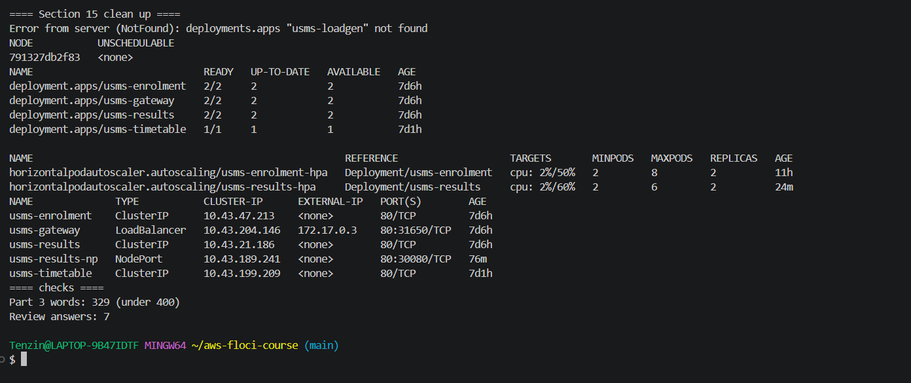

## Step 20: commit

- Before git add I checked git status --short. Nothing under outputs/ was listed, and configs/lab-08.env and manifests/lab-07/20-enrolment.yaml were.
- git check-ignore -v outputs/lab-08-baseline.txt named the rule .gitignore:1:outputs/* so everything in outputs/ stays local except .gitkeep.
- I staged the Lab 08 files by name and committed them as "Updating lab 8". git ls-files outputs/ shows only outputs/.gitkeep.
